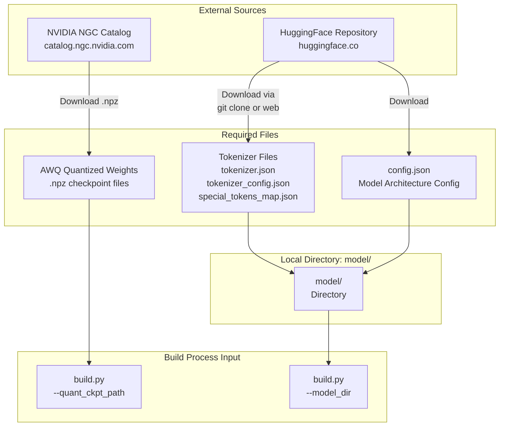
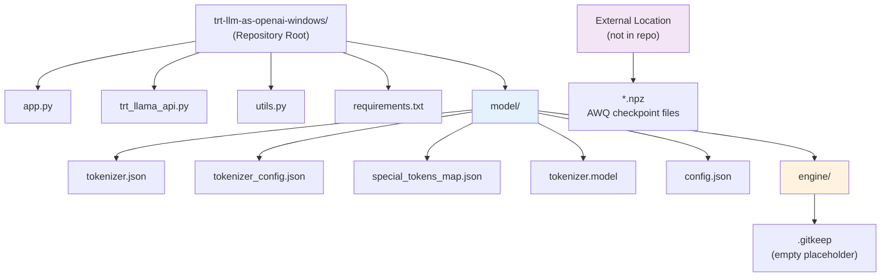
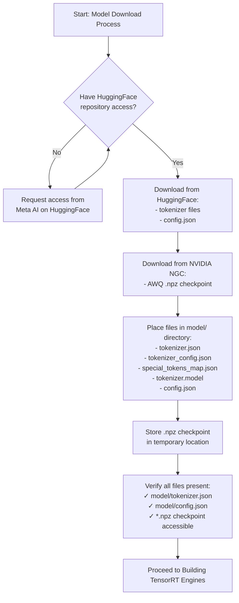

<!-- source: DeepWiki mcp.deepwiki.com · repo NVIDIA/trt-llm-as-openai-windows · extra page Downloading Models and Weights · fetched 2026-10-26 -->

# Downloading Models and Weights

<details>
<summary>Relevant source files</summary>

The following files were used as context for generating this wiki page:

- [README.md](README.md)

</details>


## Purpose and Scope

This document provides step-by-step instructions for acquiring the necessary model files and quantized weights required for the TensorRT-LLM OpenAI API system. This is the first step in the model preparation phase and must be completed before building TensorRT engines (see [Building TensorRT Engines](#2.2.2)).

The download process involves obtaining files from two separate sources: HuggingFace repositories for model architecture and tokenizer files, and NVIDIA NGC Catalog for AWQ 4-bit quantized weight checkpoints.

**Sources:** [README.md:10-31](), [README.md:54-56]()

---

## Download Sources Overview

The system requires files from two external repositories for each supported model (CodeLlama-13B and Llama-2-13B):



**Diagram: File Sources and Destinations for Model Preparation**

**Sources:** [README.md:15-17](), [README.md:25-31](), [README.md:54-56]()

---

## HuggingFace Model Downloads

### Access Requirements

Before downloading, ensure you have been granted access to the Llama model repositories on HuggingFace. These are gated repositories requiring approval from Meta AI.

**Sources:** [README.md:15-17]()

### CodeLlama-13B-Instruct

**Repository URL:** `https://huggingface.co/codellama/CodeLlama-13b-Instruct-hf`

**Required Files:**
- `tokenizer.json`
- `tokenizer_config.json`
- `special_tokens_map.json`
- `tokenizer.model`
- `config.json`

**Download Methods:**

1. **Git Clone (Recommended for all files):**
   ```bash
   git clone https://huggingface.co/codellama/CodeLlama-13b-Instruct-hf
   ```

2. **Manual Download (Alternative):**
   Navigate to the repository's Files tab and download individual files:
   `https://huggingface.co/codellama/CodeLlama-13b-Instruct-hf/tree/main`

**Destination:** Copy downloaded files to `model/` directory in this repository.

**Sources:** [README.md:16](), [README.md:27](), [README.md:55]()

### Llama-2-13B-Chat

**Repository URL:** `https://huggingface.co/meta-llama/Llama-2-13b-chat-hf`

**Required Files:**
- `tokenizer.json`
- `tokenizer_config.json`
- `special_tokens_map.json`
- `tokenizer.model`
- `config.json`

**Download Methods:**

1. **Git Clone (Recommended):**
   ```bash
   git clone https://huggingface.co/meta-llama/Llama-2-13b-chat-hf
   ```

2. **Manual Download (Alternative):**
   Navigate to: `https://huggingface.co/meta-llama/Llama-2-13b-chat-hf/tree/main`

**Destination:** Copy downloaded files to `model/` directory in this repository.

**Sources:** [README.md:17](), [README.md:30](), [README.md:56]()

---

## NVIDIA NGC Quantized Weight Downloads

The AWQ (Activation-aware Weight Quantization) 4-bit checkpoint files must be downloaded separately from NVIDIA's NGC Catalog. These `.npz` files contain the quantized neural network weights that significantly reduce memory usage while maintaining model quality.

### CodeLlama-13B AWQ int4 Checkpoints

**NGC Catalog URL:** `https://catalog.ngc.nvidia.com/orgs/nvidia/models/code_llama/files?version=1.1`

**File Format:** `.npz` (NumPy compressed array format)

**Download Steps:**
1. Navigate to the NGC Catalog URL
2. Locate version 1.1 of the `code_llama` model
3. Download the AWQ int4 checkpoint file(s)
4. Store in a temporary location (will be referenced during engine build via `--quant_ckpt_path`)

**Sources:** [README.md:28]()

### Llama-2-13B-Chat AWQ int4 Checkpoints

**NGC Catalog URL:** `https://catalog.ngc.nvidia.com/orgs/nvidia/models/llama2-13b/files?version=1.3`

**File Format:** `.npz`

**Download Steps:**
1. Navigate to the NGC Catalog URL
2. Locate version 1.3 of the `llama2-13b` model
3. Download the AWQ int4 checkpoint file(s)
4. Store in a temporary location (will be referenced during engine build via `--quant_ckpt_path`)

**Sources:** [README.md:31]()

---

## File Organization and Placement

### Directory Structure

After downloading all required files, the repository directory structure should appear as follows:



**Diagram: File Structure After Downloading Model Assets**

**Sources:** [README.md:54-57]()

### File Placement Details

| File Type | Source | Destination | Usage |
|-----------|--------|-------------|-------|
| `tokenizer.json` | HuggingFace | `model/tokenizer.json` | Loaded by `trt_llama_api.py` via `AutoTokenizer.from_pretrained()` |
| `tokenizer_config.json` | HuggingFace | `model/tokenizer_config.json` | Required by `AutoTokenizer` initialization |
| `special_tokens_map.json` | HuggingFace | `model/special_tokens_map.json` | Defines BOS, EOS, and special delimiter tokens |
| `tokenizer.model` | HuggingFace | `model/tokenizer.model` | SentencePiece tokenizer model file |
| `config.json` | HuggingFace | `model/config.json` | Model architecture configuration (hidden_size, num_layers, etc.) |
| `*.npz` checkpoint | NVIDIA NGC | Any location | Referenced by `build.py --quant_ckpt_path` during engine compilation |

**Sources:** [README.md:54-56](), [README.md:40](), [README.md:44]()

---

## Complete Download Workflow



**Diagram: Step-by-Step Download Process Workflow**

**Sources:** [README.md:15-31](), [README.md:54-56]()

---

## File Requirements by Model

### CodeLlama-13B-Instruct Requirements

| Component | Source | Location | Size (Approximate) |
|-----------|--------|----------|-------------------|
| Tokenizer files | HuggingFace | `model/` | < 10 MB |
| config.json | HuggingFace | `model/` | < 1 MB |
| AWQ int4 checkpoint | NGC v1.1 | Any path | ~7 GB |

**Special Configuration Note:** CodeLlama requires the `--no_system_prompt True` flag when launching `app.py`, as it uses a different prompt structure than Llama-2.

**Sources:** [README.md:26-28](), [README.md:69-71]()

### Llama-2-13B-Chat Requirements

| Component | Source | Location | Size (Approximate) |
|-----------|--------|----------|-------------------|
| Tokenizer files | HuggingFace | `model/` | < 10 MB |
| config.json | HuggingFace | `model/` | < 1 MB |
| AWQ int4 checkpoint | NGC v1.3 | Any path | ~7 GB |

**Sources:** [README.md:29-31]()

---

## Verification Steps

After completing all downloads, verify the following:

1. **Tokenizer Directory Contents:**
   ```
   model/
   ├── tokenizer.json
   ├── tokenizer_config.json
   ├── special_tokens_map.json
   ├── tokenizer.model
   └── config.json
   ```

2. **AWQ Checkpoint Accessibility:**
   - Verify the `.npz` file path is accessible
   - Note the full path for use with `build.py --quant_ckpt_path`

3. **File Integrity:**
   - Ensure `config.json` contains valid JSON
   - Verify `tokenizer.json` is not corrupted
   - Check that `.npz` checkpoint file size matches expected values (~7 GB)

**Sources:** [README.md:54-57]()

---

## Important Notes

### Storage Requirements

- HuggingFace model files: ~10 MB per model
- NGC AWQ checkpoints: ~7 GB per model
- Total for both models: ~14-15 GB before engine compilation

### GPU Architecture Dependency

The AWQ quantized checkpoints are architecture-agnostic at this stage. However, the TensorRT engines compiled from these checkpoints in the next step will be GPU-specific and cannot be transferred between different GPU architectures.

**Sources:** [README.md:19]()

### Version Specificity

The NGC Catalog URLs specify exact versions (v1.1 for CodeLlama, v1.3 for Llama-2). These versions have been tested with this codebase. Using different versions may require adjustments to the `build.py` parameters.

**Sources:** [README.md:28](), [README.md:31]()

---

## Next Steps

Once all model files and quantized weights have been downloaded and placed in the appropriate directories, proceed to [Building TensorRT Engines](#2.2.2) to compile optimized inference engines for your specific GPU.

**Sources:** [README.md:21-45]()

---

