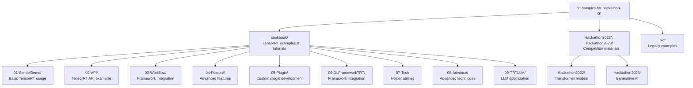
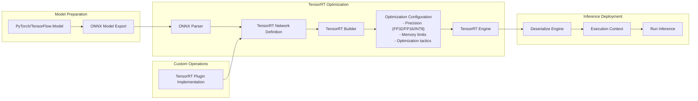
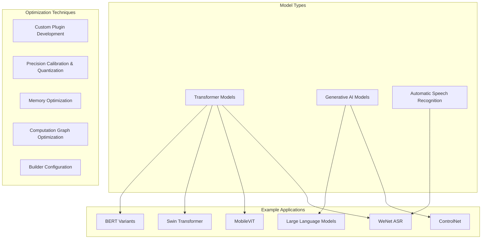
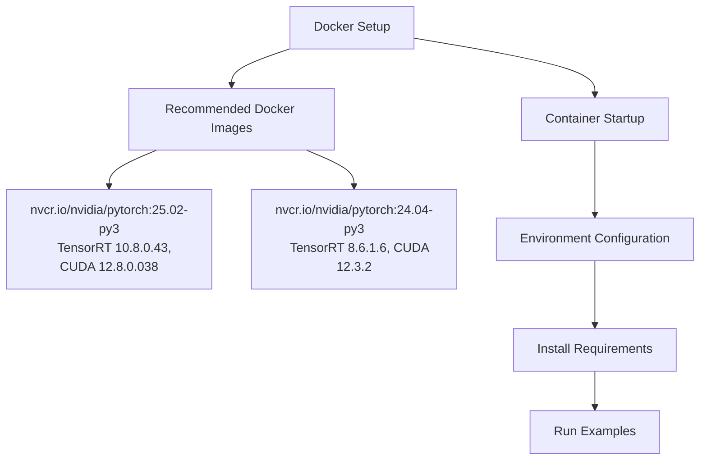

<!-- source: DeepWiki mcp.deepwiki.com · repo NVIDIA/trt-samples-for-hackathon-cn · page 1 Overview · fetched 2026-10-26 -->

# Overview

Relevant source files

The following files were used as context for generating this wiki page:

- [Hackathon2022/README.md](Hackathon2022/README.md)
- [README.md](README.md)
- [cookbook/.gitignore](cookbook/.gitignore)
- [cookbook/README.md](cookbook/README.md)

## Purpose and Scope

This documentation covers the NVIDIA TensorRT samples repository, a comprehensive collection of resources for learning and applying NVIDIA's TensorRT optimization technology. The repository provides educational materials, code examples, and resources from annual Hackathon competitions, all aimed at helping developers optimize deep learning models for inference using TensorRT.

The repository serves multiple purposes:
- Providing learning resources for TensorRT beginners
- Offering code examples demonstrating TensorRT features and best practices
- Documenting optimization techniques from previous Hackathon competitions
- Serving as a reference for common TensorRT development workflows

For detailed information about specific components, see [TensorRT Cookbook](#2), [TensorRT Hackathons](#3), or [Model Optimization Techniques](#4).

Sources: [README.md:1-5](), [README.md:9-13]()

## Repository Structure

The repository is organized into three main sections:

Sources: [README.md:7-13](), [cookbook/README.md:124-167]()

### Main Sections

1. **cookbook**: Collection of TensorRT code examples organized by topic, serving as a comprehensive cookbook for TensorRT techniques.
   
2. **Hackathon materials**: Annual TensorRT Hackathon competition resources, including problem descriptions, reference implementations, and winning solutions.
   
3. **old**: Legacy TensorRT examples that may be migrated to the cookbook in future updates.

Sources: [README.md:9-13]()

## TensorRT Development Workflow

The repository demonstrates the typical workflow for optimizing models with TensorRT, from model export to optimized inference:

Sources: [cookbook/README.md:13-20]()

## Key Focus Areas

The repository focuses on optimizing several types of deep learning models:

Sources: [Hackathon2022/README.md:1-41](), [cookbook/README.md:124-167]()

## Setup and Environment

The repository recommends using NVIDIA-optimized Docker containers for running the examples:

The repository provides detailed setup instructions for creating a suitable development environment with the necessary versions of TensorRT, CUDA, and Python packages.

Sources: [cookbook/README.md:24-70]()

## Available Resources

The repository includes a variety of additional resources:

| Resource Type | Description | Location |
|--------------|-------------|----------|
| Video Tutorials | TensorRT tutorial videos on Bilibili | Links in repository READMEs |
| Hackathon Slides | Presentation slides from competitions | Linked in Baidu Netdisk |
| Documentation Links | Links to official TensorRT documentation | In cookbook README |
| Example Datasets | Sample datasets for testing models | cookbook/00-Data |
| Reference Implementations | Optimized model implementations | Hackathon directories |

For more detailed information about specific repository components, consult the respective sections in the documentation: [TensorRT Cookbook](#2), [TensorRT Hackathons](#3), or [Model Optimization Techniques](#4).

Sources: [README.md:15-19](), [cookbook/README.md:5-11](), [cookbook/README.md:91-123]()

---

