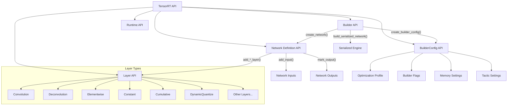
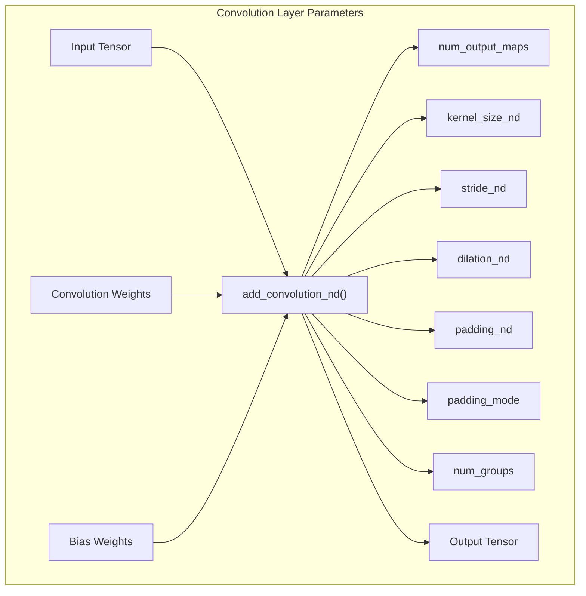
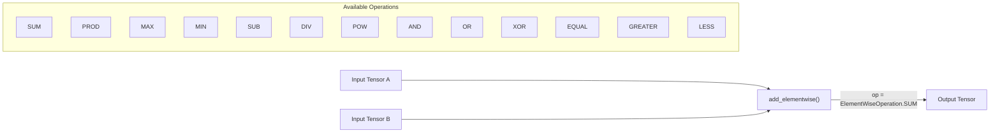
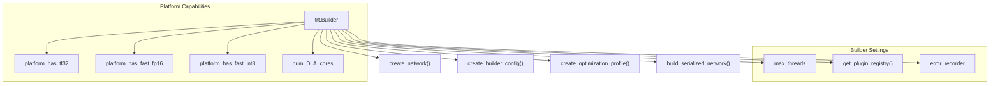
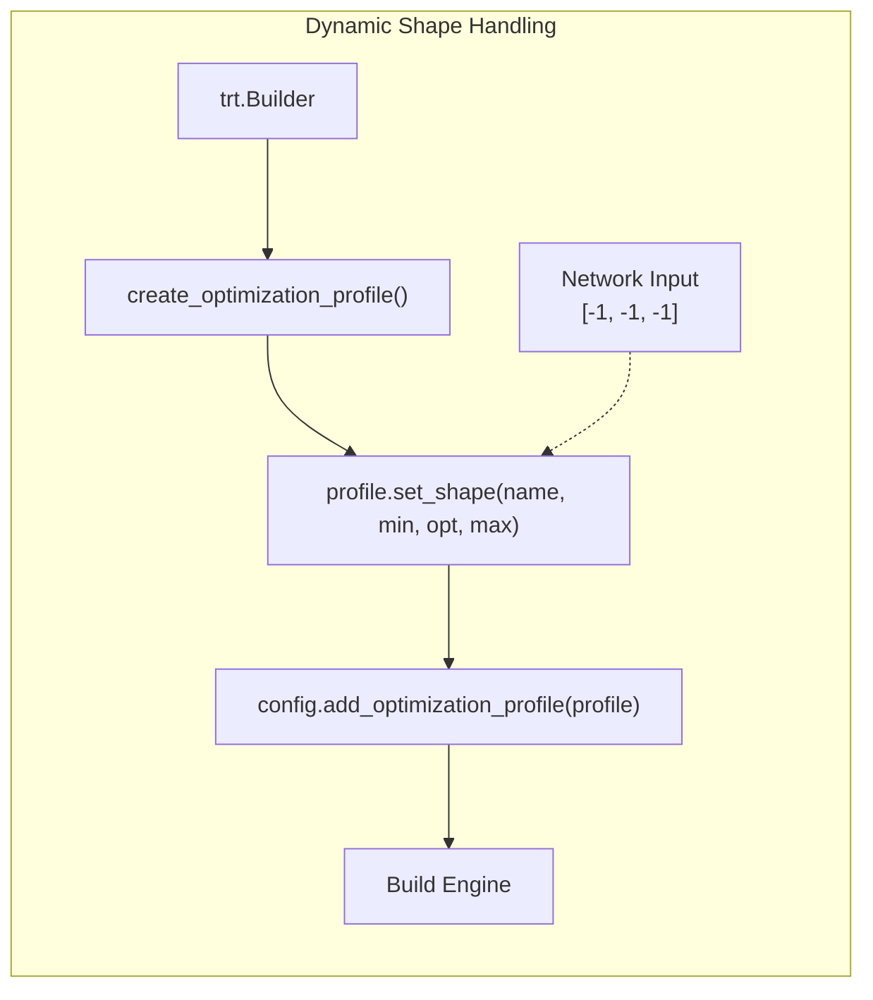

<!-- source: DeepWiki mcp.deepwiki.com · repo NVIDIA/trt-samples-for-hackathon-cn · page 2.1 API Usage Examples · fetched 2026-10-26 -->

# API Usage Examples

Relevant source files

The following files were used as context for generating this wiki page:

- [cookbook/.pre-commit-config.yaml](cookbook/.pre-commit-config.yaml)
- [cookbook/00-Data/README.md](cookbook/00-Data/README.md)
- [cookbook/00-Data/get_model_part2.py](cookbook/00-Data/get_model_part2.py)
- [cookbook/02-API/Builder/main.py](cookbook/02-API/Builder/main.py)
- [cookbook/02-API/BuilderConfig/main.py](cookbook/02-API/BuilderConfig/main.py)
- [cookbook/02-API/Layer/Constant/main.py](cookbook/02-API/Layer/Constant/main.py)
- [cookbook/02-API/Layer/Convolution/main.py](cookbook/02-API/Layer/Convolution/main.py)
- [cookbook/02-API/Layer/Cumulative/README.md](cookbook/02-API/Layer/Cumulative/README.md)
- [cookbook/02-API/Layer/Cumulative/main.py](cookbook/02-API/Layer/Cumulative/main.py)
- [cookbook/02-API/Layer/Cumulative/unit_test.sh](cookbook/02-API/Layer/Cumulative/unit_test.sh)
- [cookbook/02-API/Layer/Deconvolution/main.py](cookbook/02-API/Layer/Deconvolution/main.py)
- [cookbook/02-API/Layer/DynamicQuantize/README.md](cookbook/02-API/Layer/DynamicQuantize/README.md)
- [cookbook/02-API/Layer/DynamicQuantize/main.py](cookbook/02-API/Layer/DynamicQuantize/main.py)
- [cookbook/02-API/Layer/DynamicQuantize/unit_test.sh](cookbook/02-API/Layer/DynamicQuantize/unit_test.sh)
- [cookbook/02-API/Layer/Elementwise/main.py](cookbook/02-API/Layer/Elementwise/main.py)

This page provides a comprehensive guide to TensorRT API usage patterns demonstrated in the cookbook examples. It focuses on showing practical implementations of various TensorRT APIs, covering layer creation, network configuration, and engine building. For information about plugin development, see [Plugin Development](#2.2), and for details on utility tools, refer to [Tools and Utilities](#2.3).

## Purpose and Scope

The TensorRT API examples illustrate how to effectively use TensorRT's programming interfaces to build and optimize neural network inference engines. These examples demonstrate:

- Creating and configuring different layer types
- Building TensorRT networks programmatically
- Configuring engine parameters for optimal performance
- Working with different precision types and optimization settings

These examples serve as both learning resources and reusable code patterns for developers implementing TensorRT in their own applications.

## TensorRT API Component Overview

Sources: [cookbook/02-API/Builder/main.py](), [cookbook/02-API/BuilderConfig/main.py](), [cookbook/02-API/Layer/Convolution/main.py]()

## TensorRT Network Building Workflow

```mermaid
flowchart LR
    subgraph "Network Definition"
        CreateBuilder["Create Builder"] --> CreateNetwork["Create Network"]
        CreateNetwork --> AddInputs["Add Network Inputs"]
        AddInputs --> AddLayers["Add Layers"]
        AddLayers --> MarkOutputs["Mark Network Outputs"]
    end
    
    subgraph "Configuration"
        CreateBuilder --> CreateConfig["Create BuilderConfig"]
        CreateConfig --> SetFlags["Set Precision Flags"]
        SetFlags --> SetMemory["Set Memory Limits"]
        SetMemory --> AddProfiles["Add Optimization Profiles"]
    end
    
    subgraph "Engine Building"
        MarkOutputs --> BuildEngine["Build Engine"]
        AddProfiles --> BuildEngine
        BuildEngine --> Serialize["Serialize Engine"]
    end
    
    subgraph "Inference"
        Serialize --> Deserialize["Deserialize Engine"]
        Deserialize --> CreateContext["Create Execution Context"]
        CreateContext --> SetInputs["Set Input Buffers"]
        SetInputs --> Execute["Execute Inference"]
        Execute --> GetOutputs["Get Output Results"]
    end
```

Sources: [cookbook/02-API/Builder/main.py](), [cookbook/02-API/BuilderConfig/main.py]()

## Layer API Examples

The Layer API examples demonstrate how to create and configure various layer types in a TensorRT network. Each example follows a similar pattern:

1. Create a TensorRT wrapper (using the helper class `TRTWrapperV1`)
2. Define input tensors
3. Add the specific layer with appropriate parameters
4. Configure additional layer properties
5. Build and run the network

### Convolution Layer

The Convolution layer API provides functionalities to apply convolution operations on input tensors.

Key features demonstrated:
- Basic 2D convolution ([cookbook/02-API/Layer/Convolution/main.py:30-41]())
- Stride, dilation, and padding configurations ([cookbook/02-API/Layer/Convolution/main.py:44-61]())
- Group convolution ([cookbook/02-API/Layer/Convolution/main.py:64-78]())
- 3D convolution ([cookbook/02-API/Layer/Convolution/main.py:81-92]())
- Quantized INT8 convolution with QDQ nodes ([cookbook/02-API/Layer/Convolution/main.py:95-114]())

Sources: [cookbook/02-API/Layer/Convolution/main.py]()

### Deconvolution Layer

The Deconvolution layer API (transposed convolution) provides similar functionality to the Convolution layer but performs the inverse operation.

Key features demonstrated:
- Basic deconvolution configuration ([cookbook/02-API/Layer/Deconvolution/main.py:29-40]())
- Stride, dilation, and padding parameters ([cookbook/02-API/Layer/Deconvolution/main.py:43-60]())
- Group deconvolution ([cookbook/02-API/Layer/Deconvolution/main.py:63-77]())
- 3D deconvolution ([cookbook/02-API/Layer/Deconvolution/main.py:80-91]())
- INT8 quantized deconvolution ([cookbook/02-API/Layer/Deconvolution/main.py:93-113]())

Sources: [cookbook/02-API/Layer/Deconvolution/main.py]()

### Elementwise Layer

The Elementwise layer performs element-wise operations between two tensors.

Key features demonstrated:
- Basic elementwise addition ([cookbook/02-API/Layer/Elementwise/main.py:26-35]())
- Element broadcasting across dimensions ([cookbook/02-API/Layer/Elementwise/main.py:38-51]())

Sources: [cookbook/02-API/Layer/Elementwise/main.py]()

### Constant Layer

The Constant layer adds a tensor with constant values to the network.

Key features demonstrated:
- Adding constant data to a network ([cookbook/02-API/Layer/Constant/main.py:41-49]())
- Working with reduced precision types like INT4 ([cookbook/02-API/Layer/Constant/main.py:52-63]())

Sources: [cookbook/02-API/Layer/Constant/main.py]()

### Cumulative Layer

The Cumulative layer performs operations like sum or product along a specified axis.

Key features demonstrated:
- Cumulative sum operation along a dimension ([cookbook/02-API/Layer/Cumulative/main.py:24-35]())
- Configuration options for exclusive/inclusive and forward/reverse computation

Sources: [cookbook/02-API/Layer/Cumulative/main.py]()

### DynamicQuantize Layer

The DynamicQuantize layer performs dynamic quantization of tensors to reduced precision formats.

Key features demonstrated:
- Dynamic quantization to reduced precision (FP4) ([cookbook/02-API/Layer/DynamicQuantize/main.py:24-38]())
- Configuration of quantization axis and block size
- Setting scale data type

Sources: [cookbook/02-API/Layer/DynamicQuantize/main.py]()

## Builder API Examples

The Builder API is the entry point for creating TensorRT networks and engines.

Key features demonstrated:
- Creating a builder with appropriate logging level ([cookbook/02-API/Builder/main.py:18-21]())
- Creating a network with explicit batch dimensions ([cookbook/02-API/Builder/main.py:25-29]())
- Querying platform capabilities for different precision types ([cookbook/02-API/Builder/main.py:37-42]())
- Setting maximum threads for build optimization ([cookbook/02-API/Builder/main.py:45]())
- Checking if a network is supported ([cookbook/02-API/Builder/main.py:46]())
- Accessing the plugin registry ([cookbook/02-API/Builder/main.py:47]())
- Building and serializing a network ([cookbook/02-API/Builder/main.py:51]())

Sources: [cookbook/02-API/Builder/main.py]()

## BuilderConfig API Examples

The BuilderConfig API allows configuration of various engine building parameters to control performance and precision.

```mermaid
flowchart TD
    Config["trt.BuilderConfig"] --> Flags["flags"]
    Config --> QuantizationFlags["quantization_flags"]
    Config --> MemoryLimits["memory_pool_limit"]
    Config --> Profiles["add_optimization_profile()"]
    
    subgraph "Device Settings"
        Config --> EngineCapability["engine_capability"]
        Config --> DeviceType["set_device_type()"]
        Config --> DLACore["DLA_core"]
    end
    
    subgraph "Precision Flags"
        Flags --> FP16["FP16"]
        Flags --> INT8["INT8"]
        Flags --> TF32["TF32"]
        Flags --> REFIT["REFIT"]
        Flags --> DEBUG["DEBUG"]
        Flags --> SAFETY_SCOPE["SAFETY_SCOPE"]
        Flags --> OBEY_PRECISION_CONSTRAINTS["OBEY_PRECISION_CONSTRAINTS"]
    end
    
    subgraph "Optimization Settings"
        Config --> TacticSources["set_tactic_sources()"]
        Config --> TimingCache["set_timing_cache()"]
        Config --> ProfileVerbosity["profiling_verbosity"]
        Config --> BuilderLevel["builder_optimization_level"]
    end
```

Key features demonstrated:
- Setting engine capability mode ([cookbook/02-API/BuilderConfig/main.py:33-37]())
- Managing device types (GPU vs. DLA) ([cookbook/02-API/BuilderConfig/main.py:38-48]())
- Configuring precision flags (FP16, INT8, TF32) ([cookbook/02-API/BuilderConfig/main.py:63-67]())
- Setting quantization flags ([cookbook/02-API/BuilderConfig/main.py:69-72]())
- Enabling preview features ([cookbook/02-API/BuilderConfig/main.py:75-76]())
- Setting memory limits for workspace and tactics ([cookbook/02-API/BuilderConfig/main.py:79-84]())
- Configuring optimization parameters ([cookbook/02-API/BuilderConfig/main.py:89-92]())
- Setting tactic sources ([cookbook/02-API/BuilderConfig/main.py:106-114]())
- Configuring profiling verbosity ([cookbook/02-API/BuilderConfig/main.py:116-120]())

Sources: [cookbook/02-API/BuilderConfig/main.py]()

## Working with Optimization Profiles

Optimization profiles are essential for handling dynamic shapes in TensorRT networks. The examples demonstrate:

1. Creating an optimization profile ([cookbook/02-API/BuilderConfig/main.py:21-22]())
2. Setting input tensor shapes with min, optimal, and max dimensions ([cookbook/02-API/BuilderConfig/main.py:26]())
3. Adding the profile to the builder configuration ([cookbook/02-API/BuilderConfig/main.py:27]())

Sources: [cookbook/02-API/BuilderConfig/main.py]()

## Common Patterns and Best Practices

Based on the examples, several best practices emerge for working with TensorRT APIs:

| Best Practice | Description | Example Location |
|---------------|-------------|------------------|
| Appropriate logging | Set appropriate logging levels for different development stages | [cookbook/02-API/Builder/main.py:18]() |
| Explicit batch dimensions | Use explicit batch dimensions for more flexibility | [cookbook/02-API/Builder/main.py:25-29]() |
| Optimization profiles | Configure optimization profiles for dynamic shapes | [cookbook/02-API/BuilderConfig/main.py:21-27]() |
| Memory management | Set appropriate workspace memory limits | [cookbook/02-API/BuilderConfig/main.py:79-84]() |
| Precision selection | Select appropriate precision based on hardware capabilities | [cookbook/02-API/Builder/main.py:37-42](), [cookbook/02-API/BuilderConfig/main.py:63-67]() |
| Layer configuration | Configure layer parameters appropriately for the task | [cookbook/02-API/Layer/Convolution/main.py:51-57]() |
| QDQ patterns | Use proper QDQ (Quantize-Dequantize) patterns for INT8 precision | [cookbook/02-API/Layer/Convolution/main.py:95-114]() |

Sources: [cookbook/02-API/Builder/main.py](), [cookbook/02-API/BuilderConfig/main.py](), [cookbook/02-API/Layer/Convolution/main.py]()

## Conclusion

The TensorRT API examples in the cookbook provide practical demonstrations of key TensorRT functionalities. By studying these examples, developers can learn how to effectively use the TensorRT API to build and optimize deep learning inference engines for their applications.

For more advanced usage, including plugin development, see [Plugin Development](#2.2), and for tools to inspect and analyze TensorRT engines, see [Tools and Utilities](#2.3).

---

