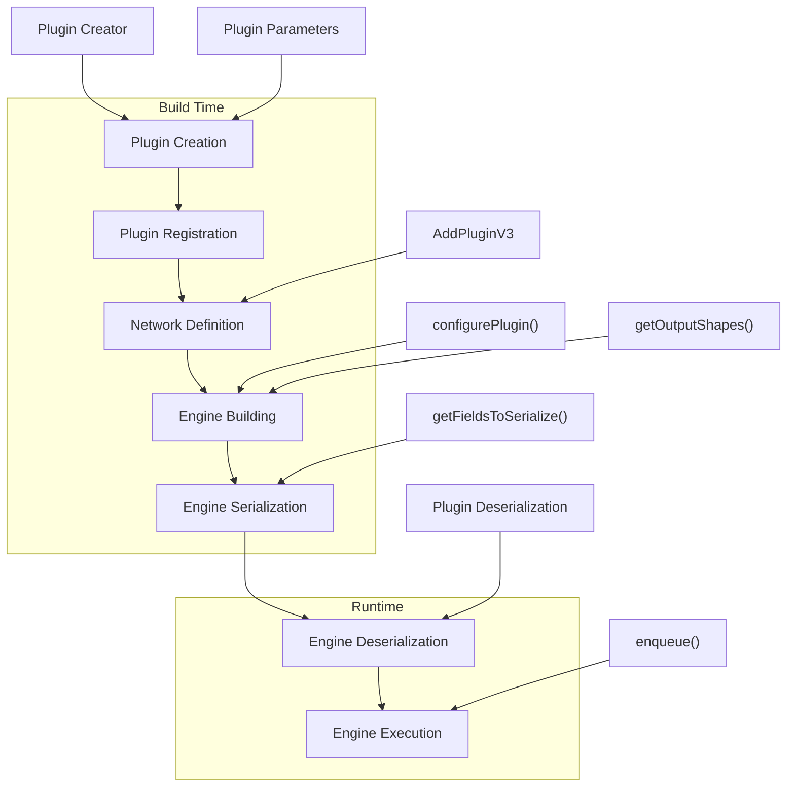
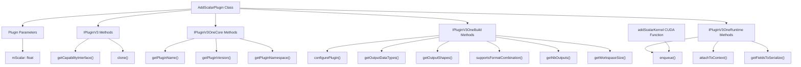
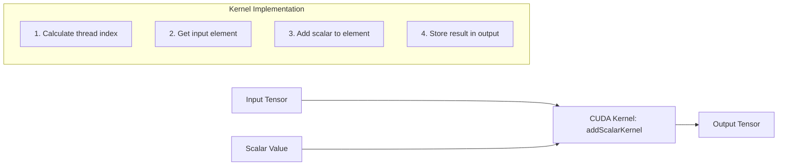
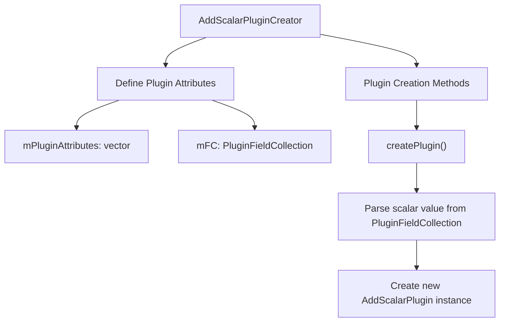
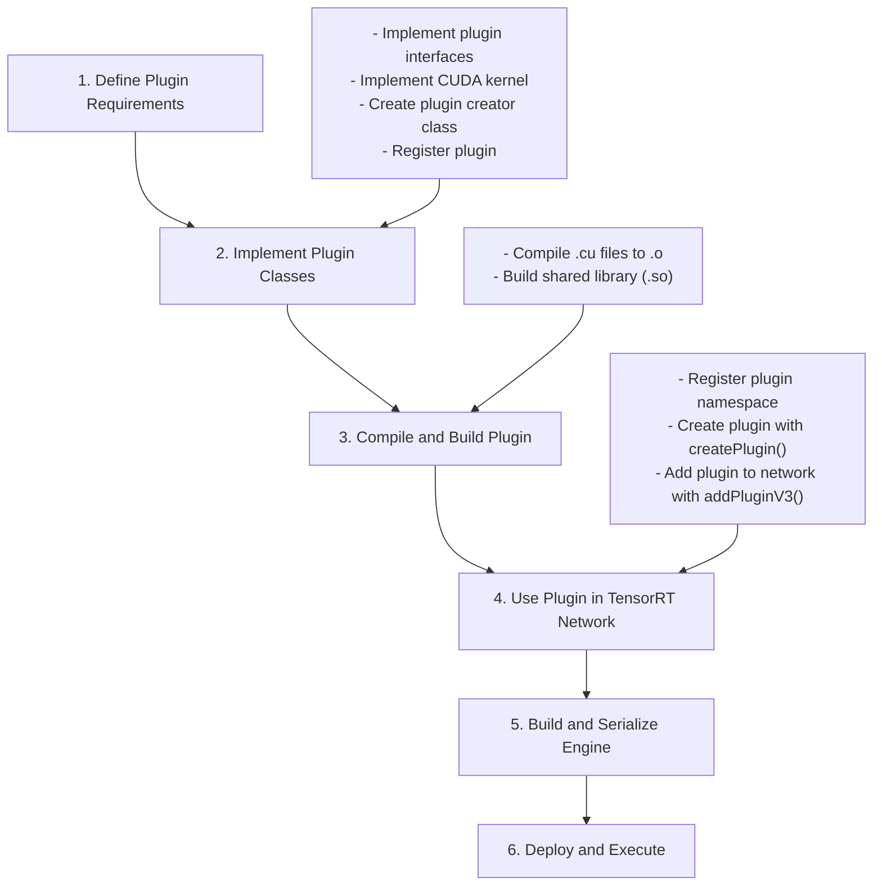

<!-- source: DeepWiki mcp.deepwiki.com · repo NVIDIA/trt-samples-for-hackathon-cn · page 2.2 Plugin Development · fetched 2026-10-26 -->

# Plugin Development

<details>
<summary>Relevant source files</summary>

The following files were used as context for generating this wiki page:

- [cookbook/.gitattributes](cookbook/.gitattributes)
- [cookbook/05-Plugin/BasicExample/AddScalarPlugin.cu](cookbook/05-Plugin/BasicExample/AddScalarPlugin.cu)
- [cookbook/05-Plugin/BasicExample/AddScalarPlugin.h](cookbook/05-Plugin/BasicExample/AddScalarPlugin.h)
- [cookbook/05-Plugin/BasicExample/Makefile](cookbook/05-Plugin/BasicExample/Makefile)
- [cookbook/05-Plugin/BasicExample/README.md](cookbook/05-Plugin/BasicExample/README.md)

</details>


## Purpose and Scope

This document provides a comprehensive guide to developing custom plugins for NVIDIA TensorRT. Custom plugins allow you to extend TensorRT's functionality by implementing operations that aren't natively supported in the TensorRT core. This page covers the plugin architecture, implementation details, development workflow, and examples from the TensorRT cookbook repository.

## Plugin Architecture in TensorRT

TensorRT plugins follow a specific architecture with well-defined interfaces and components that enable the integration of custom operations into the TensorRT engine.

### Plugin Interfaces Hierarchy

```mermaid
classDiagram
    class "IPluginV3" {
        +getCapabilityInterface()
        +clone()
    }
    
    class "IPluginV3OneCore" {
        +getPluginName()
        +getPluginVersion()
        +getPluginNamespace()
    }
    
    class "IPluginV3OneBuild" {
        +configurePlugin()
        +getOutputDataTypes()
        +getOutputShapes()
        +supportsFormatCombination()
        +getNbOutputs()
        +getWorkspaceSize()
    }
    
    class "IPluginV3OneRuntime" {
        +setTactic()
        +onShapeChange()
        +enqueue()
        +attachToContext()
        +getFieldsToSerialize()
    }
    
    class "Custom Plugin Class" {
        -Plugin parameters
        -Implementation methods
    }
    
    class "Plugin Creator" {
        +getPluginName()
        +getPluginVersion()
        +getFieldNames()
        +createPlugin()
        +getPluginNamespace()
    }
    
    "IPluginV3" <|-- "IPluginV3OneCore"
    "IPluginV3" <|-- "IPluginV3OneBuild"
    "IPluginV3" <|-- "IPluginV3OneRuntime"
    "IPluginV3OneCore" <|-- "Custom Plugin Class"
    "IPluginV3OneBuild" <|-- "Custom Plugin Class"
    "IPluginV3OneRuntime" <|-- "Custom Plugin Class"
    "Plugin Creator" --> "Custom Plugin Class" : creates
```

Sources: [cookbook/05-Plugin/BasicExample/AddScalarPlugin.h:29-69]()

### Plugin Lifecycle



Sources: [cookbook/05-Plugin/BasicExample/AddScalarPlugin.h:29-69](), [cookbook/05-Plugin/BasicExample/AddScalarPlugin.cu:34-204]()

## Key Components of TensorRT Plugins

### 1. Plugin Class

The plugin class implements multiple interfaces that define its behavior during different phases of the TensorRT workflow:

- **IPluginV3**: Base interface for all plugins
- **IPluginV3OneCore**: Core plugin functionality
- **IPluginV3OneBuild**: Build-time functionality
- **IPluginV3OneRuntime**: Runtime functionality

Each plugin must implement various methods defined in these interfaces, such as shape calculation, data type handling, and the actual computation kernel.

Sources: [cookbook/05-Plugin/BasicExample/AddScalarPlugin.h:29-69]()

### 2. Plugin Creator Class

The plugin creator is responsible for:
- Defining the plugin's attributes
- Providing methods to create new instances of the plugin
- Registering the plugin with TensorRT

```mermaid
classDiagram
    class "IPluginCreatorV3One" {
        +getPluginName()
        +getPluginVersion()
        +getFieldNames()
        +createPlugin()
        +getPluginNamespace()
    }
    
    class "AddScalarPluginCreator" {
        -mFC: PluginFieldCollection
        -mPluginAttributes: vector<PluginField>
        +AddScalarPluginCreator()
        +getPluginName()
        +getPluginVersion()
        +getFieldNames()
        +createPlugin()
        +getPluginNamespace()
    }
    
    "IPluginCreatorV3One" <|-- "AddScalarPluginCreator"
```

Sources: [cookbook/05-Plugin/BasicExample/AddScalarPlugin.h:71-84](), [cookbook/05-Plugin/BasicExample/AddScalarPlugin.cu:206-253]()

### 3. Plugin Registration

Plugins must be registered with TensorRT using the `REGISTER_TENSORRT_PLUGIN` macro to make them available for use.

Sources: [cookbook/05-Plugin/BasicExample/AddScalarPlugin.cu:254]()

## Case Study: AddScalarPlugin Implementation

Let's examine a basic plugin example from the cookbook that adds a scalar value to each element of an input tensor.

### Plugin Implementation Overview



Sources: [cookbook/05-Plugin/BasicExample/AddScalarPlugin.h:29-69](), [cookbook/05-Plugin/BasicExample/AddScalarPlugin.cu:20-30](), [cookbook/05-Plugin/BasicExample/AddScalarPlugin.cu:34-204]()

### Key Method Implementations

#### Shape and Data Type Handling

The plugin must determine the output shapes and data types based on the input:

- `getOutputShapes()`: Determines the output tensor dimensions (matches the input dimensions)
- `getOutputDataTypes()`: Defines the output data type (same as input in this case)
- `supportsFormatCombination()`: Specifies which tensor formats and data types are supported

Sources: [cookbook/05-Plugin/BasicExample/AddScalarPlugin.cu:86-102](), [cookbook/05-Plugin/BasicExample/AddScalarPlugin.cu:104-121]()

#### Computation Kernel

The actual computation is implemented as a CUDA kernel that runs on the GPU:



Sources: [cookbook/05-Plugin/BasicExample/AddScalarPlugin.cu:20-30](), [cookbook/05-Plugin/BasicExample/AddScalarPlugin.cu:177-188]()

#### Plugin Creator

The creator defines the plugin's attributes and creates instances of the plugin:



Sources: [cookbook/05-Plugin/BasicExample/AddScalarPlugin.cu:206-246]()

## Plugin Development Workflow

### 1. Define Plugin Requirements

- Identify the operation you need to implement
- Determine input/output tensor shapes and data types
- Define any parameters required for the operation

### 2. Implement Plugin Classes

1. Create your plugin class implementing the required interfaces
2. Create a plugin creator class
3. Implement the CUDA kernel for your operation



Sources: [cookbook/05-Plugin/BasicExample/Makefile:1-28]()

### 3. Build and Use the Plugin

The plugin must be compiled and built into a shared library that can be loaded by TensorRT:

1. Compile the plugin source files
2. Link into a shared library (.so file)
3. Load the plugin when building your TensorRT application

The example Makefile demonstrates this process:

Sources: [cookbook/05-Plugin/BasicExample/Makefile:7-16]()

## Plugin Examples in the Cookbook

The TensorRT cookbook repository includes several plugin examples that demonstrate different aspects of plugin development:

| Example | Description | Location |
|---------|-------------|----------|
| AddScalarPlugin | Basic plugin that adds a scalar value to a tensor | cookbook/05-Plugin/BasicExample |
| AddSubMulPlugin | Multi-input/output plugin that performs multiple operations | cookbook/05-Plugin/MultiIOExample |
| Custom DataType Plugin | Plugin that works with custom data types | cookbook/05-Plugin/DataTypeExample |

These examples demonstrate increasing levels of complexity in plugin development, from basic operations to advanced use cases.

Sources: [cookbook/05-Plugin/BasicExample/README.md:1-9]()

## Best Practices for Plugin Development

1. **Performance Optimization**:
   - Optimize your CUDA kernel for maximum performance
   - Minimize memory transfers between host and device
   - Use appropriate thread and block configurations

2. **Error Handling**:
   - Implement robust error checking in all interface methods
   - Handle edge cases for different input shapes and types

3. **Testing and Validation**:
   - Test your plugin with different input sizes and values
   - Validate against a reference implementation
   - Profile performance to identify bottlenecks

## Conclusion

TensorRT plugins provide a powerful mechanism to extend TensorRT's capabilities with custom operations. By following the plugin development process outlined in this document and studying the examples provided in the cookbook, you can implement custom operations that integrate seamlessly with TensorRT's optimization pipeline.

For more information about the TensorRT API usage that may be necessary when working with plugins, see [API Usage Examples](#2.1).

---

