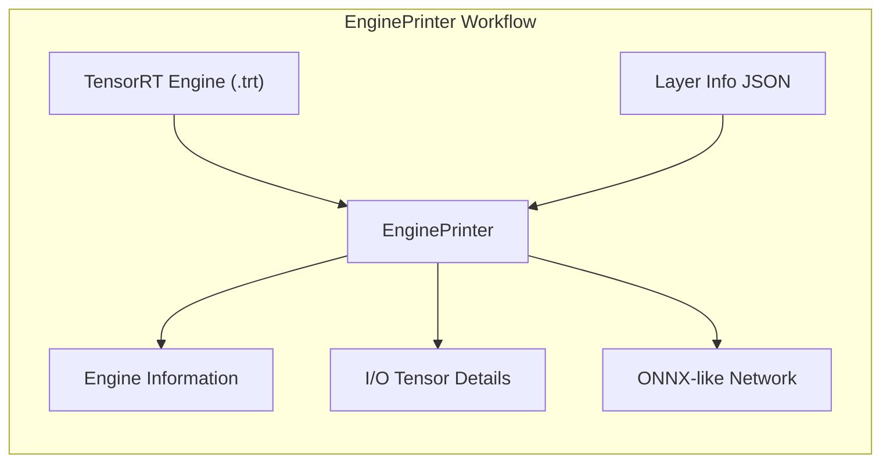
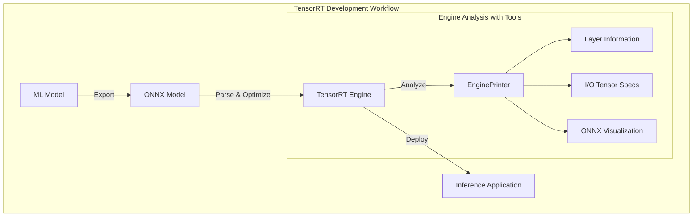
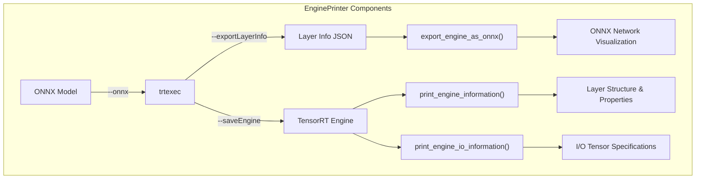

<!-- source: DeepWiki mcp.deepwiki.com · repo NVIDIA/trt-samples-for-hackathon-cn · page 2.3 Tools and Utilities · fetched 2026-10-26 -->

# Tools and Utilities

<details>
<summary>Relevant source files</summary>

The following files were used as context for generating this wiki page:

- [cookbook/02-API/Layer/Shuffle/main.py](cookbook/02-API/Layer/Shuffle/main.py)
- [cookbook/07-Tool/EnginePrinter/main.py](cookbook/07-Tool/EnginePrinter/main.py)
- [cookbook/07-Tool/EnginePrinter/main.sh](cookbook/07-Tool/EnginePrinter/main.sh)

</details>


This page provides an overview of the utility tools available in the TensorRT cookbook for inspecting, analyzing, and working with TensorRT engines. These tools help developers understand the internal structure of TensorRT engines, extract information about the optimized network, and provide insights into how TensorRT processes deep learning models.

For information about TensorRT API usage, see [API Usage Examples](#2.1). For plugin development, see [Plugin Development](#2.2).

## TensorRT Engine Analysis Tools

The cookbook includes tools for analyzing TensorRT engines, allowing developers to inspect their structure and properties after optimization. These tools are particularly useful during the development and debugging process.

### EnginePrinter

The EnginePrinter is a utility that provides detailed information about TensorRT engines. It allows developers to:
- Extract and print comprehensive information about a TensorRT engine
- View input/output tensor specifications
- Export engine information to ONNX-like format for visualization



Sources: [cookbook/07-Tool/EnginePrinter/main.py:16-58](). [cookbook/07-Tool/EnginePrinter/main.sh:20-35]()

### Key Functions

The EnginePrinter tool exposes three main functions through the TensorRT cookbook utility library:

```mermaid
classDiagram
    class "print_engine_information" {
        +Extract engine details
        +Display layer information
        +Show memory usage
    }
    
    class "print_engine_io_information" {
        +Display input tensor specs
        +Display output tensor specs
        +Show data types and dimensions
    }
    
    class "export_engine_as_onnx" {
        +Convert engine to ONNX format
        +Enable visualization
        +Preserve layer structure
    }

    "EnginePrinter Tool" --> "print_engine_information"
    "EnginePrinter Tool" --> "print_engine_io_information"
    "EnginePrinter Tool" --> "export_engine_as_onnx"
```

Sources: [cookbook/07-Tool/EnginePrinter/main.py:50-57]()

## Usage Examples

### Basic Engine Analysis

The following example demonstrates how to use EnginePrinter to analyze a TensorRT engine:

1. First, build a TensorRT engine from an ONNX model using `trtexec` with detailed profiling information
2. Use `print_engine_information` to extract and display engine details
3. Use `print_engine_io_information` to show input/output tensor specifications
4. Convert the engine to ONNX format using `export_engine_as_onnx` for visualization

```python
# Get engine meta data (engine itself is enough)
print_engine_information(trt_file=Path(model_name + ".trt"), plugin_file_list=[], device_index=0)

# Get engine input / output tensor data (engine itself is enough)
print_engine_io_information(trt_file=Path(model_name + ".trt"), plugin_file_list=[])

# Convert engine to a ONNX-like file (dumped json file is needed)
export_engine_as_onnx(engine_json=Path(model_name + ".json"), export_onnx_file=Path(model_name + "-network.onnx"))
```

Sources: [cookbook/07-Tool/EnginePrinter/main.py:50-57]()

### Command-Line Interface

The EnginePrinter tool can also be used from the command line through the `main.sh` script:

```bash
# Build a TensorRT engine and export layer information
trtexec \
    --onnx=$TRT_COOKBOOK_PATH/00-Data/model/model-trained.onnx \
    --profilingVerbosity=detailed \
    --exportLayerInfo=model-trained.json \
    --skipInference

# Run the EnginePrinter tool
python3 main.py
```

Sources: [cookbook/07-Tool/EnginePrinter/main.sh:23-35]()

## Integration with TensorRT Workflow

The EnginePrinter tools integrate into the typical TensorRT development workflow, providing valuable insights at the engine analysis stage.



Sources: [cookbook/07-Tool/EnginePrinter/main.py:20-58]()

## Supported Features and Use Cases

The EnginePrinter tools support various use cases in the TensorRT development process:

| Feature | Description | Use Case |
|---------|-------------|----------|
| Engine Information | Extract and display detailed information about each layer in the TensorRT engine | Debugging and optimization analysis |
| I/O Information | Display specifications of input and output tensors | Verifying correct tensor shapes and data types |
| Engine Export | Convert TensorRT engine to ONNX-like format | Visualizing the optimized network structure |
| Plugin Support | Handle custom plugins in TensorRT engines | Analyzing networks with custom operations |
| Dynamic Shapes | Support for engines with dynamic input shapes | Verifying profile configurations |

Sources: [cookbook/07-Tool/EnginePrinter/main.py:33-47](), [cookbook/07-Tool/EnginePrinter/main.sh:23-33]()

## Technical Details

The EnginePrinter tool works by parsing the serialized TensorRT engine file and extracting the internal structure. For a complete analysis, it requires:

1. A TensorRT engine file (`.trt`)
2. Optionally, a JSON file with layer information (generated using `trtexec --exportLayerInfo`)
3. Any plugin libraries needed to load custom plugins in the engine



Sources: [cookbook/07-Tool/EnginePrinter/main.py:20-58](), [cookbook/07-Tool/EnginePrinter/main.sh:23-33]()

## Example Output

When running the EnginePrinter, you can expect to see detailed information about:

1. **Engine Properties**: Version, precision settings, workspace size, etc.
2. **Layer Information**: Layer types, input/output connections, precision, etc.
3. **Tensor Specifications**: Names, shapes, data types of input and output tensors
4. **Memory Usage**: Memory requirements for activation tensors and weights
5. **Profiling Data**: Layer execution times (if available)

This information is invaluable for understanding how TensorRT has optimized your network and for diagnosing performance issues.

Sources: [cookbook/07-Tool/EnginePrinter/main.py:50-57]()

## Conclusion

The TensorRT cookbook provides powerful tools for analyzing and working with TensorRT engines. The EnginePrinter utility offers comprehensive features for inspecting engine properties, visualizing network structure, and understanding how TensorRT has optimized your deep learning model. These tools are essential for developers who need to debug, optimize, and understand their TensorRT implementations.

---

