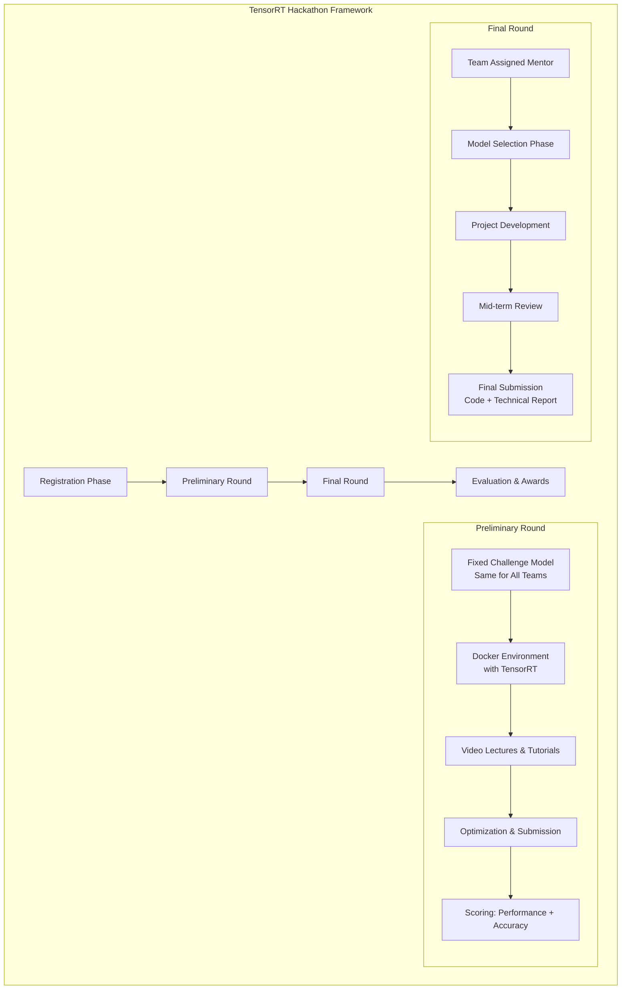
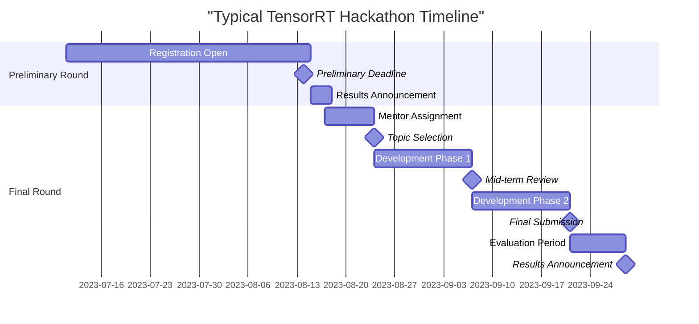
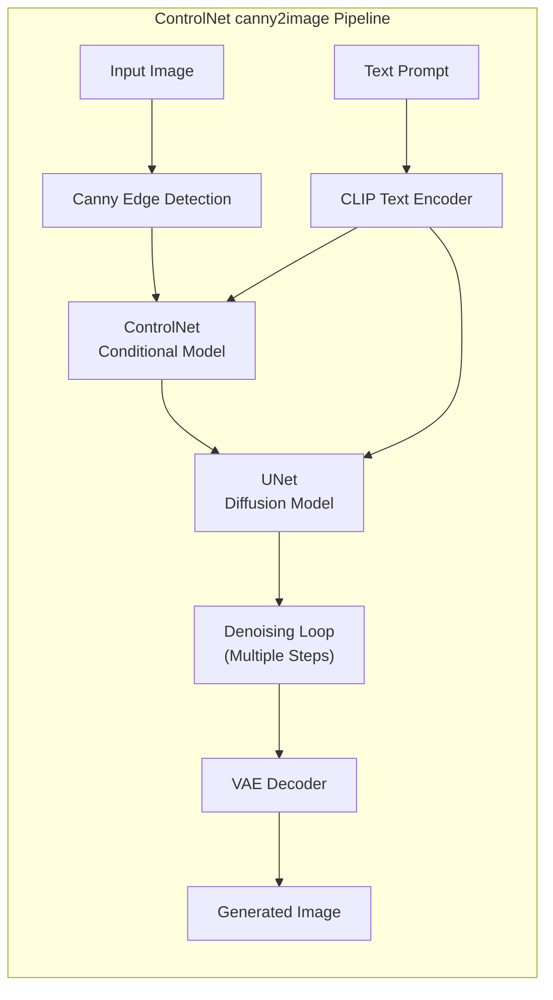
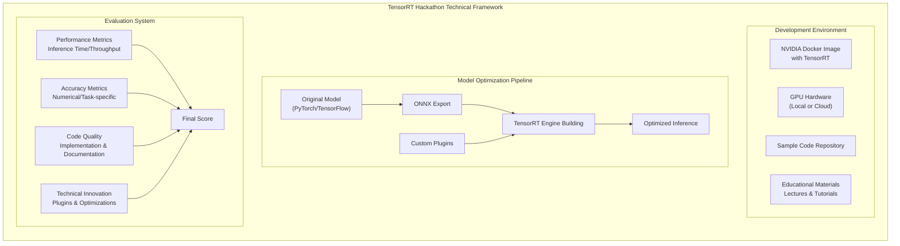
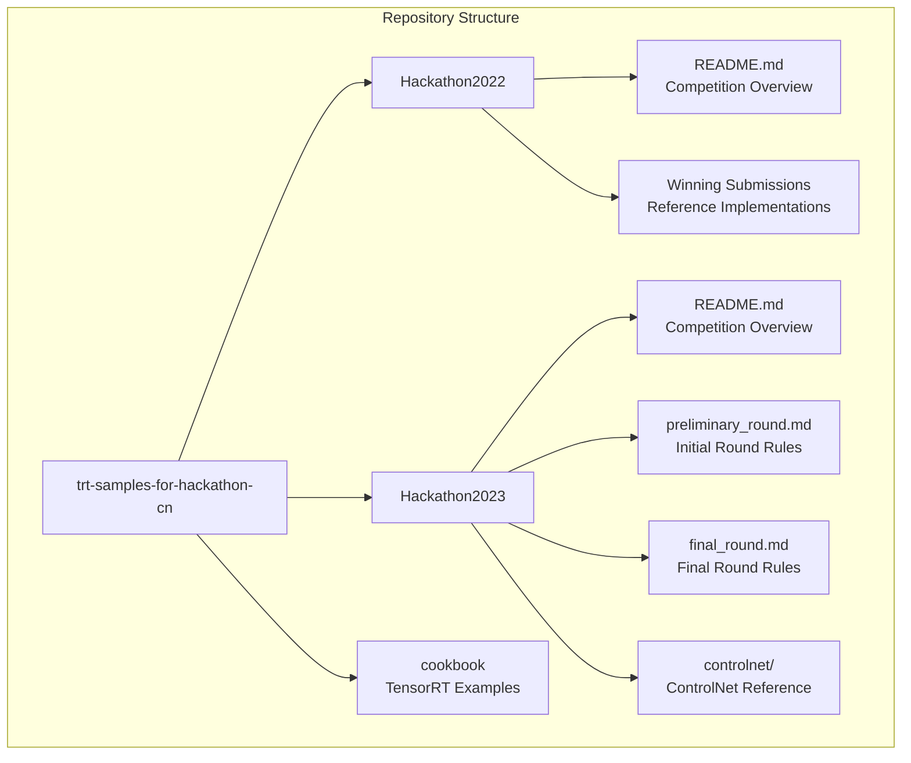

<!-- source: DeepWiki mcp.deepwiki.com · repo NVIDIA/trt-samples-for-hackathon-cn · page 3 TensorRT Hackathons · fetched 2026-10-26 -->

# TensorRT Hackathons

Relevant source files

The following files were used as context for generating this wiki page:

- [Hackathon2022/README.md](Hackathon2022/README.md)
- [Hackathon2023/README.md](Hackathon2023/README.md)
- [Hackathon2023/controlnet/README.md](Hackathon2023/controlnet/README.md)
- [Hackathon2023/final_round.md](Hackathon2023/final_round.md)
- [Hackathon2023/preliminary_round.md](Hackathon2023/preliminary_round.md)
- [README.md](README.md)

This document provides an overview of NVIDIA's TensorRT Hackathon competition series, including their purpose, structure, and technical focus areas. For detailed information about specific model optimization techniques used in these hackathons, see [Model Optimization Techniques](#4).

## Purpose and Overview

TensorRT Hackathons are annual competitions organized by NVIDIA to encourage developers to optimize deep learning models using the TensorRT inference optimization library. These hackathons serve multiple purposes:

1. To promote effective use of TensorRT for AI inference acceleration
2. To provide hands-on experience with TensorRT development workflows
3. To demonstrate optimization techniques for state-of-the-art AI models
4. To build a community of TensorRT developers and experts

The hackathons follow a consistent structure with preliminary and final rounds, focusing on different model architectures each year, reflecting evolving trends in AI research and application.

Sources: [README.md:3-5](). [Hackathon2022/README.md:12-17](). [Hackathon2023/README.md:5-9]().

## Hackathon Competition Structure

TensorRT Hackathons follow a structured two-phase competition format that combines learning and practical application:

### Preliminary Round

The preliminary round serves as both a qualification phase and a learning opportunity:

- All teams work on the **same model optimization challenge**
- A standardized Docker environment with TensorRT and related tools is provided
- Educational resources, including video lectures and technical tutorials, are available
- Teams submit optimized implementations that are evaluated for both performance and accuracy

### Final Round

Qualified teams enter the final round, which has a more open-ended structure:

- Each team is assigned a mentor from NVIDIA's engineering team
- Teams select their own AI model (within the year's theme) to optimize
- Multiple checkpoints ensure steady progress:
  - Initial topic selection and approval
  - Mid-term review of implementation progress
  - Final code submission with technical report
- Optimization work must be fully documented in a standardized report format

Sources: [Hackathon2022/README.md:21-51](). [Hackathon2023/README.md:11-31](). [Hackathon2023/final_round.md:11-29]().

## Competition Timeline

The hackathon typically spans two to three months, with roughly one month for the preliminary round and two months for the final round. Key milestones in the competition include:

1. **Registration & Preliminary Round**: 4-5 weeks for teams to complete the fixed challenge
2. **Mentor Assignment**: Qualified teams each receive a dedicated NVIDIA engineer as mentor
3. **Topic Selection**: Teams finalize their model choice and create project repositories
4. **Mid-term Review**: Checkpoint to ensure progress (typically requiring a working TensorRT implementation)
5. **Final Submission**: Complete code with comprehensive optimization report
6. **Results Announcement**: Winners in different categories are announced

Sources: [Hackathon2022/README.md:42-51](). [Hackathon2023/README.md:22-31]().

## Past Hackathons

### Hackathon 2022: Transformer Models

The 2022 hackathon focused on optimizing Transformer architecture models with TensorRT.

**Preliminary Round**: Participants optimized WeNet, an end-to-end Automatic Speech Recognition (ASR) model containing both encoder and decoder components based on Transformer architecture.

**Final Round**: Teams selected from various Transformer-based models, including:

| Category | Examples from Winning Teams |
|----------|----------------------------|
| Vision Transformers | MobileViT, Swin Transformer, LeViT |
| Detection Transformers | AnchorDETR, DAB-DETR |
| Segmentation Transformers | SegFormer, Mask2Former, Swin-Unet |
| Multi-modal Transformers | CLIP, ViLBERT, LayoutLMv3 |
| Image Processing | MST++, SwinIR, ELAN |
| Speech Processing | WeNet, espnet, 3M-ASR |

The top winning project implemented TensorRT optimization for MST++, an image restoration model based on Transformer architecture.

Sources: [Hackathon2022/README.md:21-40, 53-107]().

### Hackathon 2023: Generative AI Models

The 2023 hackathon focused on optimizing generative AI models, reflecting the rapid advancement in generative capabilities.

**Preliminary Round**: Participants optimized the ControlNet canny2image pipeline, a conditional Stable Diffusion implementation that uses edge detection to guide image generation.

**Final Round**: Teams had two primary options:

1. **TensorRT-LLM Track**: Implementing and optimizing models using NVIDIA's specialized library for large language model (LLM) inference
2. **Standard TensorRT Track**: Optimizing generative models with the core TensorRT library

Winning projects featured a diverse range of models:

| Rank | Team Name | Model | Technology |
|------|-----------|-------|------------|
| Special Contribution | "无声优化者（着）" | Qwen-7B | TensorRT-LLM |
| Second Prize | "蹦极不拴绳" | Qwen-7B | TensorRT-LLM |
| Second Prize | "NaN-emm" | minigpt4 | TensorRT |
| Third Prize | "xixixixixixi" | gpt2-medium | TensorRT-LLM |
| Third Prize | "iie" | Qwen-7B | TensorRT-LLM |
| Third Prize | "你的耳朵长不长？" | Qwen-7B | TensorRT-LLM |

The competition also introduced TensorRT-LLM, a specialized library for optimizing large language models, which became a central element of the final round.

Sources: [Hackathon2023/README.md:11-18, 33-73](). [Hackathon2023/preliminary_round.md:17-19](). [Hackathon2023/controlnet/README.md:1-3](). [Hackathon2023/final_round.md:1-8]().

## Technical Framework and Evaluation System

### Development Environment

For consistency and reproducibility, hackathons provide standardized Docker environments:

- TensorRT-optimized Docker images with necessary dependencies
- Specific version requirements (e.g., `registry.cn-hangzhou.aliyuncs.com/trt-hackathon/trt-hackathon:v2` for 2023)
- For the final round, cloud instances with NVIDIA GPUs (typically A10) are provided
- Environments include TensorRT libraries, CUDA tools, and other required components

### Evaluation Criteria

Submissions are evaluated on multiple dimensions:

1. **Performance Improvement**:
   - Inference speed compared to baseline implementation
   - Throughput for batch processing scenarios
   - Memory efficiency and resource utilization

2. **Accuracy Preservation**:
   - For preliminary rounds: numerical accuracy or task-specific metrics (e.g., Perceptual Distance)
   - For final rounds: task-appropriate metrics (e.g., ROUGE scores for language models)

3. **Technical Quality**:
   - Code quality and organization
   - Documentation completeness
   - Innovation in optimization approach

4. **Additional Factors** (Final Round):
   - Development of custom TensorRT plugins
   - Use of profiling tools (e.g., Nsight Systems)
   - Bug reports and contributions to TensorRT ecosystem

Sources: [Hackathon2023/preliminary_round.md:35-109](). [Hackathon2023/final_round.md:11-72]().

## Repository Organization for Hackathon Materials

The hackathon materials in the repository are organized by year, with each hackathon directory containing:

1. **Competition Documentation**:
   - README files explaining the hackathon structure and rules
   - Detailed instructions for preliminary and final rounds
   - Evaluation criteria and submission guidelines

2. **Reference Implementations**:
   - Example optimized models from the hackathon
   - Code for processing and evaluating models

3. **Links to External Resources**:
   - Video lectures and tutorials
   - Winning team repositories

The hackathon materials complement the `cookbook` directory, which contains general TensorRT optimization examples that can be useful for hackathon participants.

Sources: [README.md:7-13](). [Hackathon2023/controlnet/README.md:1-15]().

## Participating in Future Hackathons

For developers interested in participating in future TensorRT Hackathons:

1. **Prerequisites**:
   - Experience with deep learning frameworks (PyTorch, TensorFlow)
   - Basic understanding of CUDA programming
   - Familiarity with model optimization concepts

2. **Preparation Resources**:
   - TensorRT cookbook examples in this repository
   - Documentation and video tutorials from previous hackathons
   - NVIDIA Developer resources on TensorRT

3. **Typical Technical Challenges**:
   - Converting complex model architectures to TensorRT
   - Implementing custom layers as TensorRT plugins
   - Optimizing for both throughput and accuracy
   - Debugging numerical precision issues

4. **Success Strategies**:
   - Start with smaller components before optimizing the entire model
   - Use profiling tools to identify bottlenecks
   - Experiment with different precision modes (FP32, FP16, INT8)
   - Document optimization approaches thoroughly

Sources: [Hackathon2023/preliminary_round.md:15-26](). [Hackathon2023/final_round.md:75-159]().

---

