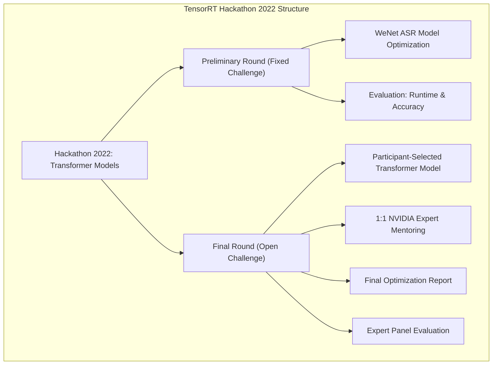
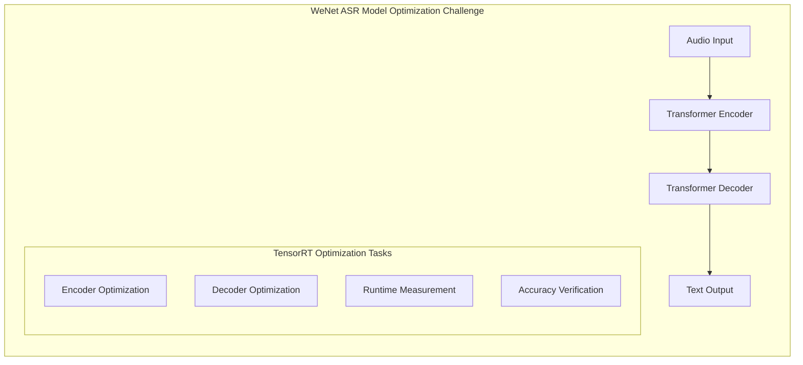
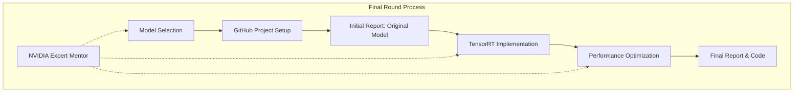
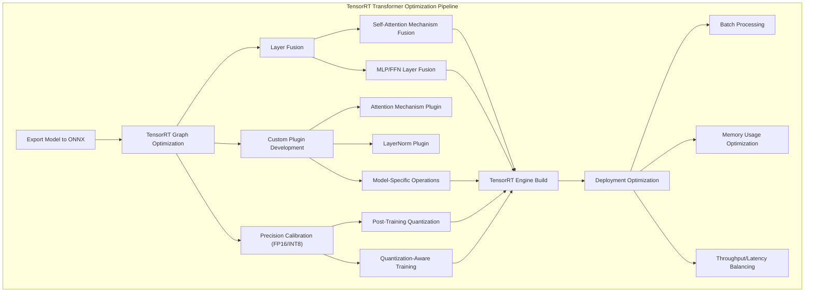

<!-- source: DeepWiki mcp.deepwiki.com · repo NVIDIA/trt-samples-for-hackathon-cn · page 3.1 Hackathon 2022: Transformer Models · fetched 2026-10-26 -->

# Hackathon 2022: Transformer Models

Relevant source files

The following files were used as context for generating this wiki page:

- [Hackathon2022/README.md](Hackathon2022/README.md)
- [README.md](README.md)

## Purpose and Scope

This document details the 2022 NVIDIA TensorRT Hackathon competition that focused on optimizing Transformer-based models for inference. The hackathon provided a structured environment for developers to learn and apply TensorRT techniques specifically for accelerating transformer architectures. For information about the 2023 Hackathon focusing on Generative AI models, see [Hackathon 2023: Generative AI](#3.2).

## Overview

The 2022 TensorRT Hackathon was a technical competition hosted by NVIDIA in collaboration with Alibaba Tianchi. The competition challenged participants to optimize transformer-based deep learning models using NVIDIA TensorRT, with a focus on achieving maximum inference performance while maintaining accuracy.

Sources: [Hackathon2022/README.md:11-21](), [Hackathon2022/README.md:25-40]()

## Competition Structure and Timeline

The competition was divided into two phases with a structured timeline to guide participants through the optimization process:

| Phase | Duration | Description | Deliverables |
|-------|----------|-------------|------------|
| Preliminary Round | April 2 - May 20, 2022 | Optimization of WeNet ASR model | Optimized model with runtime metrics |
| Mentor Assignment | May 23, 2022 | Start of final round | Team-mentor matching |
| Topic Selection | By May 27, 2022 | Selection of transformer model | Project setup and initial report |
| Mid-term Review | By June 13, 2022 | Initial TensorRT implementation | Running model on TensorRT |
| Final Submission | By June 27, 2022 | Completed optimization | Code and comprehensive report |
| Results Announcement | July 6, 2022 | Winners declared | - |

Sources: [Hackathon2022/README.md:42-51]()

## Preliminary Round: WeNet ASR Optimization

The preliminary round challenged participants to optimize the WeNet Automatic Speech Recognition model, which features a typical encoder-decoder transformer architecture.

Key aspects of the preliminary round included:
- Optimization of both encoder and decoder components
- Evaluation based on inference speed and accuracy preservation
- Technical discussions in a dedicated group chat
- Supporting lectures and resources provided by NVIDIA experts

Sources: [Hackathon2022/README.md:25-36]()

## Final Round: Open Transformer Models

The final round offered greater flexibility, allowing teams to select any publicly available transformer-based model to optimize with TensorRT.

The final round emphasized:
- One-on-one mentoring from NVIDIA experts
- Documenting the optimization process through detailed reports
- Progressive evaluation through multiple checkpoints
- Sharing knowledge through open-source implementations

Sources: [Hackathon2022/README.md:38-40](), [Hackathon2022/README.md:47-50]()

## Technical Resources

To support participants' learning, the organizers provided:
- Series of technical lectures on TensorRT optimization
- Video tutorials available on Bilibili
- TensorRT cookbook with code examples
- Initial model implementation for the preliminary round

Participants had access to the [cookbook](https://github.com/NVIDIA/trt-samples-for-hackathon-cn/tree/master/cookbook) directory in the repository, which contains numerous examples and techniques for TensorRT implementation.

Sources: [Hackathon2022/README.md:29-36](), [README.md:9-13]()

## Winning Teams and Projects

The competition showcased a wide variety of transformer model optimizations, with teams tackling different architectures and achieving significant performance improvements.

### First Prize Winner

| Team | Project | Original Model |
|------|---------|---------------|
| 美迪康AI Lab | [MST++ TensorRT](https://github.com/TRT2022/MST-plus-plus-TensorRT) | [MST++](https://github.com/caiyuanhao1998/MST-plus-plus) |

### Second Prize Winners

| Team | Project | Original Model |
|------|---------|---------------|
| ching | [WeNet TensorRT](https://github.com/dingyuqing05/trt2022_wenet) | [WeNet](https://github.com/wenet-e2e/wenet) |
| Quark | [MobileViT TensorRT](https://github.com/chenlamei/MobileVit_TensorRT) | [MobileViT](https://github.com/wilile26811249/MobileViT) |

### Third Prize Winners

| Team | Project | Original Model |
|------|---------|---------------|
| 错误代码114 | [AnchorDETR TensorRT](https://github.com/YukSing12/trt-hackathon-2022) | [AnchorDETR](https://github.com/megvii-research/AnchorDETR) |
| 试到秃头 | [WeNet TRT8](https://github.com/huismiling/wenet_trt8) | [WeNet](https://github.com/wenet-e2e/wenet) |
| 小小蜜蜂 | [LayoutLMv3 TensorRT](https://github.com/tuoeg/bee) | [LayoutLMv3](https://github.com/microsoft/unilm/tree/master/layoutlmv3) |

Additional notable projects from honorable mention teams included optimizations for:
- SwinIR, LeViT, and CLIP vision transformers
- Mask2Former and SegFormer for segmentation
- DAB-DETR and other detection transformers
- Swin Transformer V2 and other advanced architectures

Sources: [Hackathon2022/README.md:53-107]()

## Transformer Model Optimization Techniques

The major optimization techniques used by participants in the competition included:

1. **Model Conversion and Graph Optimization**
   - Converting models to ONNX format for TensorRT parsing
   - Optimizing network structures for TensorRT execution
   - Removing unnecessary operations

2. **Custom Plugin Development**
   - Implementing specialized operators for transformer components
   - Creating optimized versions of attention mechanisms
   - Building efficient layer normalization implementations

3. **Precision Optimization**
   - FP16 and INT8 precision calibration
   - Mixed precision execution for optimal performance
   - Quantization-aware fine-tuning

4. **Memory and Runtime Optimization**
   - Optimizing memory usage patterns
   - Tuning batch sizes for throughput/latency trade-offs
   - Efficient implementation of inference pipelines

Sources: Combined information from the repository structure and winning team implementations

## Learning Resources and References

The Hackathon provided numerous learning resources for participants:

- Video lectures on Bilibili covering TensorRT fundamentals and optimization techniques
- Technical reviews of the preliminary round to share optimization insights
- Example implementations in the TensorRT cookbook
- One-on-one mentoring from NVIDIA experts

The knowledge and techniques demonstrated during this competition have been incorporated into the broader TensorRT samples repository as reference material for developers working with similar transformer models.

Sources: [Hackathon2022/README.md:31-36](), [README.md:9-13]()

## Conclusion

The 2022 TensorRT Hackathon successfully demonstrated the effectiveness of TensorRT in optimizing a wide range of transformer models. The competition not only resulted in significant performance improvements for the targeted models but also generated valuable reference implementations and optimization techniques that developers can learn from. The strong focus on transformer architectures prepared the ground for the subsequent Hackathon in 2023, which expanded to generative AI models.

---

