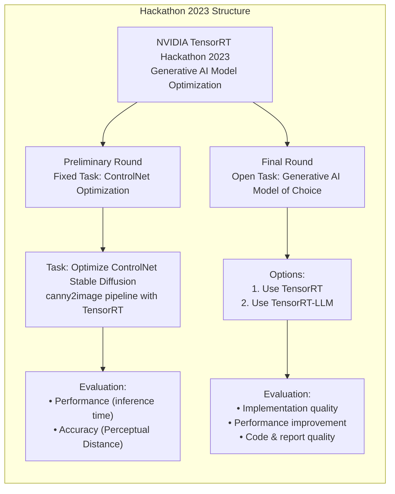
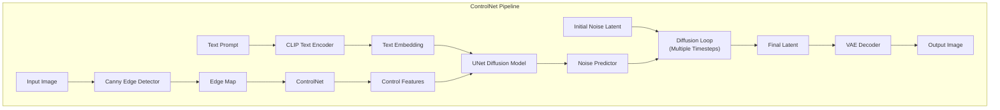
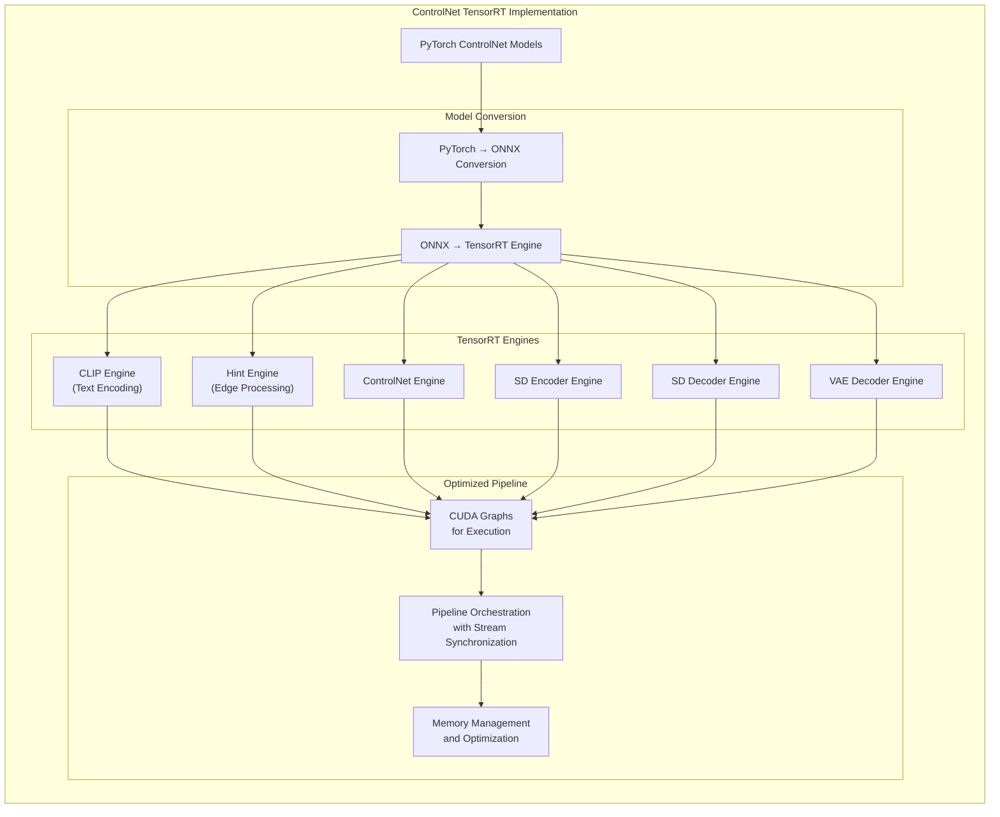
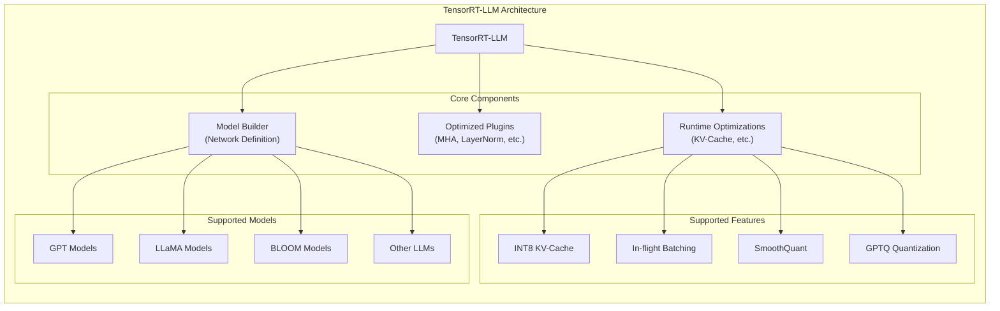
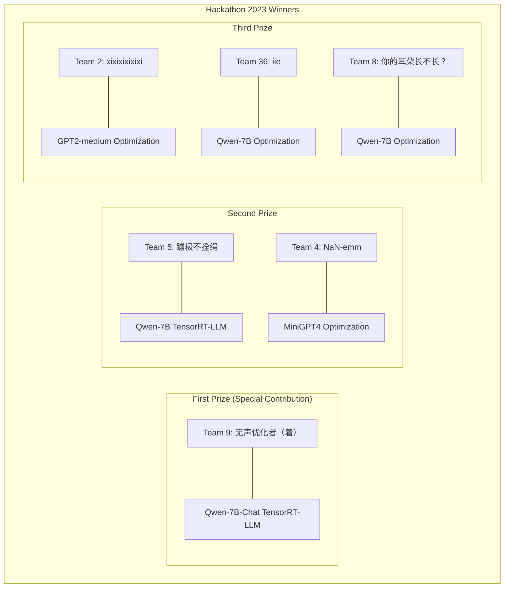

<!-- source: DeepWiki mcp.deepwiki.com · repo NVIDIA/trt-samples-for-hackathon-cn · page 3.2 Hackathon 2023: Generative AI · fetched 2026-10-26 -->

# Hackathon 2023: Generative AI

<details>
<summary>Relevant source files</summary>

The following files were used as context for generating this wiki page:

- [Hackathon2023/README.md](Hackathon2023/README.md)
- [Hackathon2023/controlnet/README.md](Hackathon2023/controlnet/README.md)
- [Hackathon2023/controlnet/canny2image_TRT.py](Hackathon2023/controlnet/canny2image_TRT.py)
- [Hackathon2023/controlnet/cldm/cldm.py](Hackathon2023/controlnet/cldm/cldm.py)
- [Hackathon2023/controlnet/models/cldm_v15.yaml](Hackathon2023/controlnet/models/cldm_v15.yaml)
- [Hackathon2023/final_round.md](Hackathon2023/final_round.md)
- [Hackathon2023/preliminary_round.md](Hackathon2023/preliminary_round.md)

</details>


## Purpose and Scope

This document provides a comprehensive overview of the NVIDIA TensorRT Hackathon 2023, which focused on optimizing generative AI models. The competition challenged participants to accelerate inference for state-of-the-art generative models using NVIDIA's TensorRT optimization tools. This page covers the competition structure, technical implementation details of the optimization tasks, and results of the hackathon. For information about TensorRT Cookbook examples, see [TensorRT Cookbook](#2), and for details about previous hackathons, see [Hackathon 2022: Transformer Models](#3.1).

## Competition Overview

The 2023 Hackathon focused on generative AI models, which have seen explosive growth in both capabilities and computational requirements. The competition was designed to help developers learn how to optimize these models for inference using TensorRT, ultimately improving performance while maintaining accuracy.



Sources: [Hackathon2023/README.md:1-9](), [Hackathon2023/preliminary_round.md:1-32](), [Hackathon2023/final_round.md:1-37]()

## Preliminary Round: ControlNet Optimization

The preliminary round focused on optimizing a Stable Diffusion model with ControlNet for the canny2image task using TensorRT. Participants were required to convert PyTorch models to TensorRT engines and accelerate the entire inference pipeline.

### ControlNet Architecture and Pipeline

ControlNet is an extension to Stable Diffusion that allows for controlled image generation by incorporating additional input conditions (such as edge maps). The main components include:



Sources: [Hackathon2023/controlnet/cldm/cldm.py:22-384](), [Hackathon2023/controlnet/canny2image_TRT.py:20-239](), [Hackathon2023/controlnet/models/cldm_v15.yaml:1-80]()

### TensorRT Implementation

The TensorRT optimization workflow involves identifying key model components, converting them to TensorRT engines, and implementing an optimized inference pipeline. The main components that needed optimization were:



Sources: [Hackathon2023/controlnet/canny2image_TRT.py:22-148](), [Hackathon2023/controlnet/README.md:1-15]()

### Code Implementation Details

The TensorRT implementation leverages several key techniques for optimizing the ControlNet pipeline:

1. **Engine Management**: The `hackathon` class manages multiple TensorRT engines for different model components.

2. **CUDA Graphs**: The implementation uses CUDA graphs to capture and replay the execution of TensorRT engines, reducing CPU overhead.

3. **Stream Synchronization**: Multiple CUDA streams are used with events for synchronization between dependent operations.

4. **DDIM Scheduler**: The implementation includes a custom DDIM scheduler for the diffusion process.

The main inference loop in `ddim_sampling` shows how these components are orchestrated:

```python
@torch.no_grad()
def ddim_sampling(self, batch_size):
    img = torch.randn((batch_size, 4, 32, 48), device="cuda").to(torch.float16)
    self.img.copy_(img)
    for i, step in enumerate(self.time_range):
        index = self.total_steps - i - 1
        self.index[:] = index
        self.step[:] = step

        # Run encoder and control networks in parallel streams
        self.sd_encoder_cudagraph.infer()
        cudart.cudaEventRecord(self.event, self.stream_1)
        self.sd_control_cudagraph.infer()

        # Synchronize streams before running decoder
        cudart.cudaStreamWaitEvent(self.stream_0, self.event, cudart.cudaEventWaitDefault)
        self.sd_decoder_cudagraph.infer()
        cudart.cudaStreamSynchronize(self.stream_0)

        # Update latent with scheduler step
        x = DDIM_scheduler.step(self.img, self.latent, index,
                              self.scheduler.ddim_alphas,
                              self.scheduler.ddim_alphas_prev,
                              self.scheduler.ddim_sqrt_one_minus_alphas)
        self.img.copy_(x)
    return self.img
```

Sources: [Hackathon2023/controlnet/canny2image_TRT.py:152-180]()

### Performance Evaluation

Participants' submissions were evaluated on two main criteria:

1. **Accuracy**: Measured using Perceptual Distance (PD) score, which calculates the difference between TensorRT-generated images and PyTorch FP32 reference images. Lower PD scores indicate better accuracy.

2. **Performance**: Measured by the end-to-end inference time for generating images.

The final score considered both factors, with a threshold of PD score ≤ 12 required to pass the accuracy check.

Sources: [Hackathon2023/preliminary_round.md:105-110]()

## Final Round: Open Model Optimization

The final round gave participants more freedom to choose their own generative AI model to optimize. They had two main options:

1. **Use TensorRT**: Optimize a model of their choice using standard TensorRT techniques
2. **Use TensorRT-LLM**: Implement or optimize a model using NVIDIA's specialized library for large language model inference

### TensorRT-LLM Overview

TensorRT-LLM is a specialized library built on top of TensorRT, designed specifically for optimizing large language models. It provides:



Sources: [Hackathon2023/final_round.md:1-10](), [Hackathon2023/final_round.md:23-29]()

### Evaluation Criteria

The final round submissions were evaluated based on multiple criteria:

1. **Model Implementation**: For new models, completeness and correctness of implementation
2. **Performance Optimization**: Speed improvement while maintaining accuracy
3. **Feature Implementation**: Adding or enabling advanced features like quantization techniques
4. **Code Quality**: Clarity, organization, and documentation
5. **Report Quality**: Completeness and usefulness of the technical report

Participants using TensorRT-LLM received additional points due to the higher complexity and novelty of the framework.

Sources: [Hackathon2023/final_round.md:37-72]()

## Competition Results

The hackathon resulted in a range of impressive projects across different model types and optimization techniques.

### Winning Teams and Projects



Sources: [Hackathon2023/README.md:33-55]()

### Model Diversity

The competition featured a wide range of generative AI models, showcasing the versatility of TensorRT and TensorRT-LLM:

1. **Large Language Models**:
   - Qwen-7B (most popular choice)
   - LLaMA/LLaMA-2
   - GPT2-medium
   - Galactica
   - Whisper
   - CPM-Bee

2. **Multimodal Models**:
   - MiniGPT4
   - SAM (Segment Anything Model)

3. **Generation Models**:
   - UniDiffuser
   - CoDeF

Sources: [Hackathon2023/README.md:38-78]()

## Technical Challenges and Solutions

Several common technical challenges were encountered during the hackathon:

1. **Memory Optimization**: Managing GPU memory efficiently for large models
2. **Pipeline Optimization**: Optimizing the end-to-end pipeline, not just individual components
3. **Precision Balancing**: Maintaining accuracy while using lower precision operations
4. **Model-Specific Optimizations**: Handling unique aspects of different model architectures

### ControlNet-Specific Optimizations

For the ControlNet preliminary round, key optimization techniques included:

1. **Parallel Execution**: Running ControlNet and UNet components in parallel
2. **CUDA Graphs**: Using CUDA graphs to reduce CPU overhead
3. **Memory Management**: Efficient allocation and reuse of GPU memory
4. **Plugin Development**: Custom plugins for specific operations
5. **Pipeline Orchestration**: Optimizing the interaction between components

Sources: [Hackathon2023/controlnet/canny2image_TRT.py:163-174]()

## Conclusion

The NVIDIA TensorRT Hackathon 2023 demonstrated the significant performance improvements that can be achieved for generative AI models through optimization with TensorRT and TensorRT-LLM. The competition showcased a diverse range of models and optimization techniques, highlighting both the challenges and opportunities in accelerating state-of-the-art generative AI inference.

Sources: [Hackathon2023/README.md:1-11]()

---

