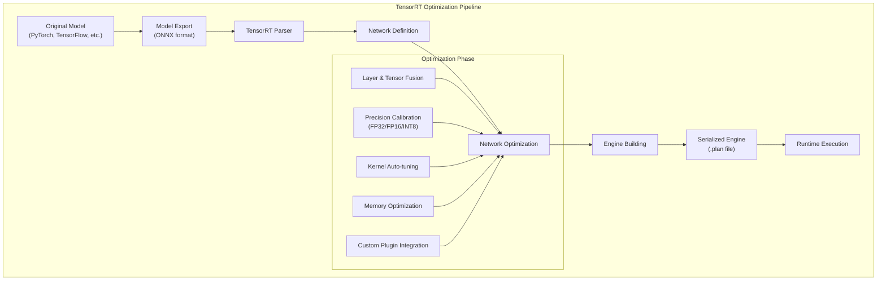
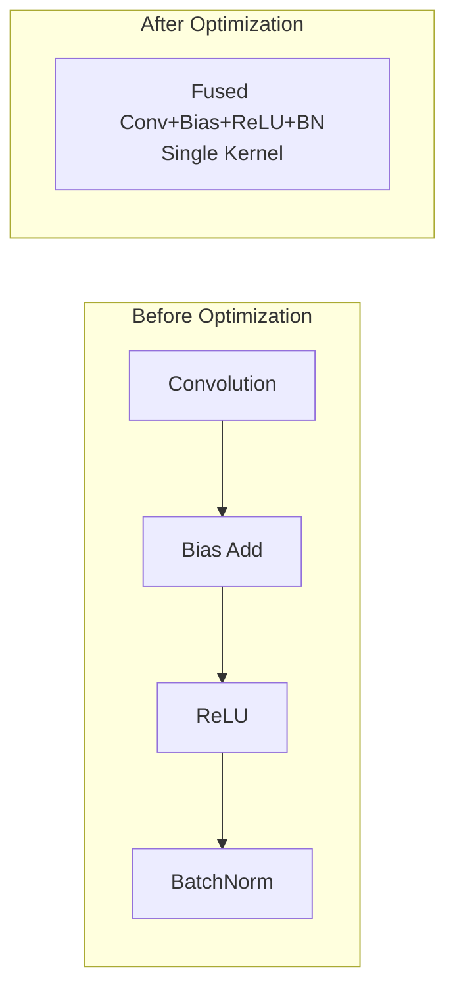
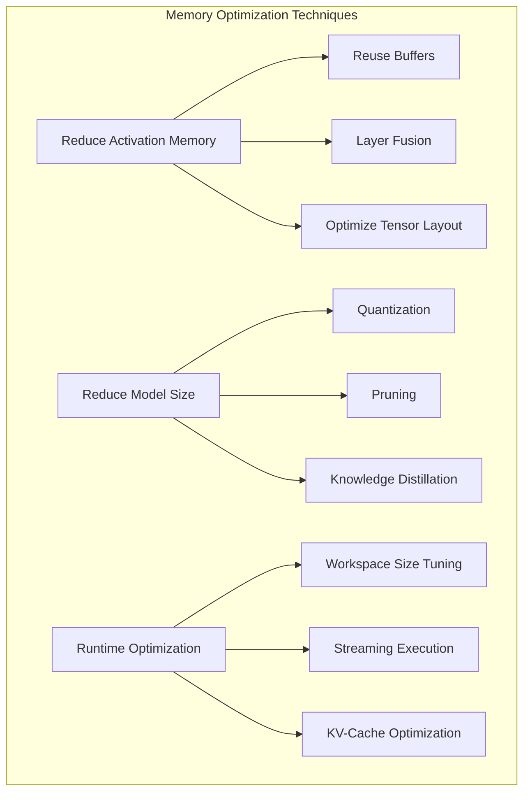
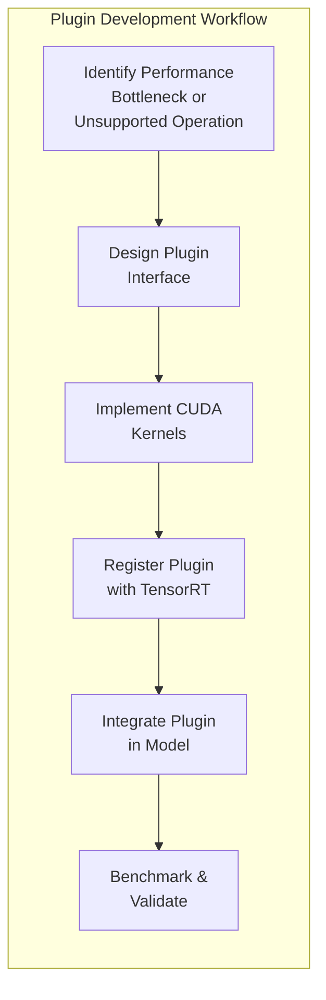
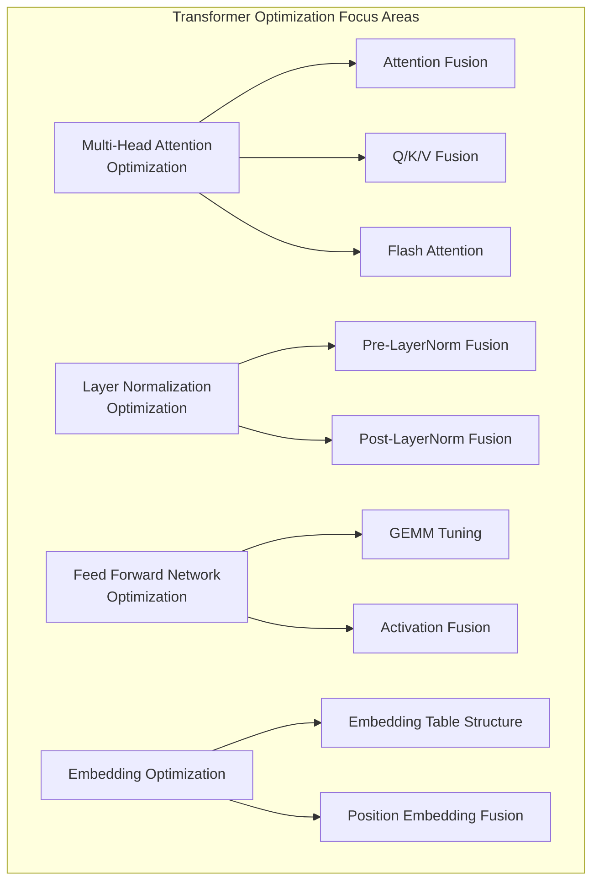
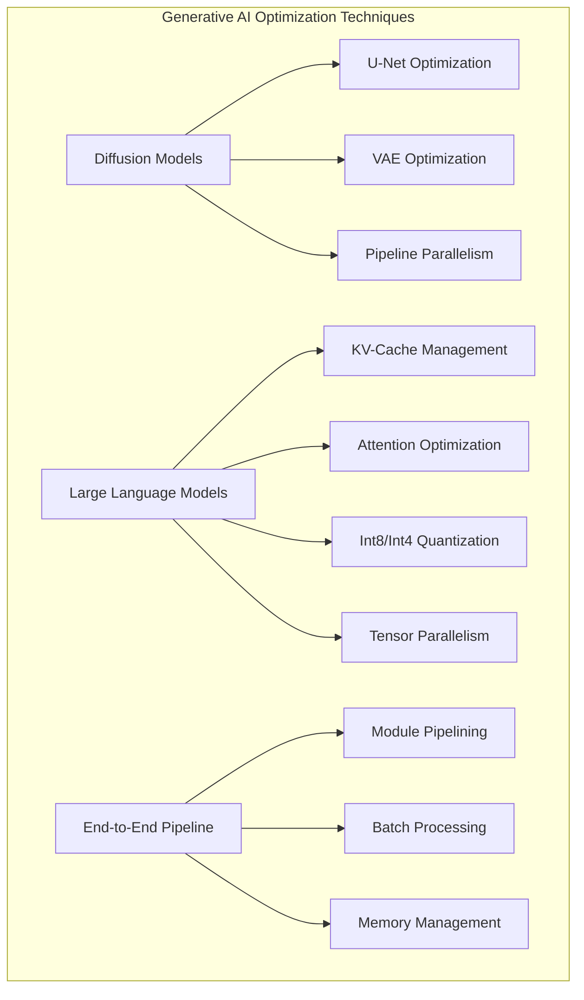
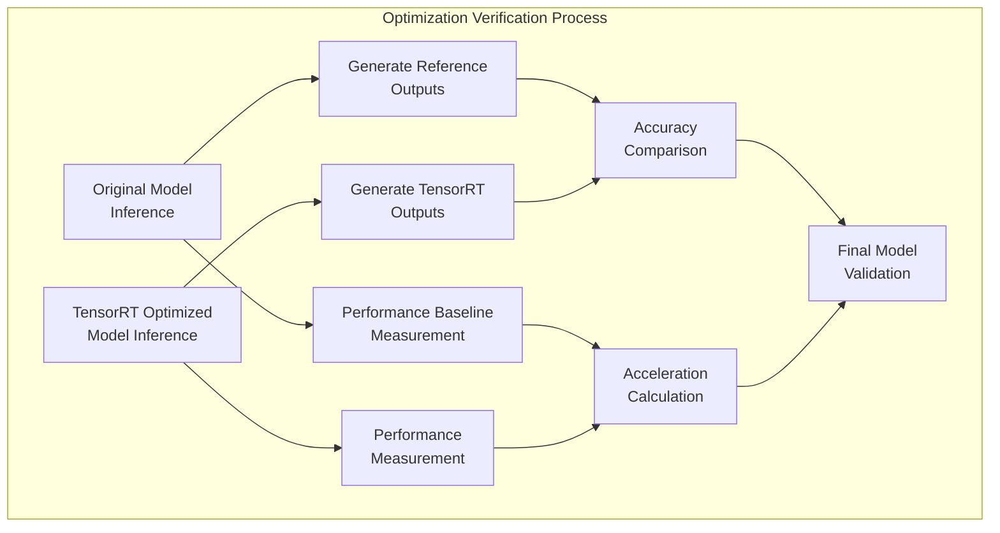
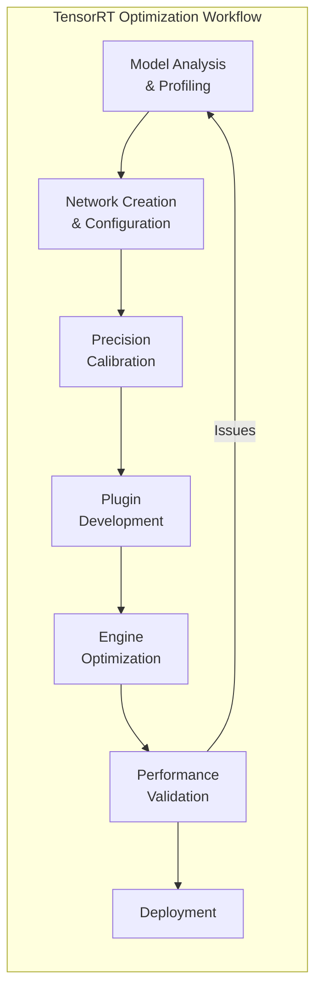

<!-- source: DeepWiki mcp.deepwiki.com · repo NVIDIA/trt-samples-for-hackathon-cn · page 4 Model Optimization Techniques · fetched 2026-10-26 -->

# Model Optimization Techniques

Relevant source files

The following files were used as context for generating this wiki page:

- [Hackathon2022/README.md](Hackathon2022/README.md)
- [Hackathon2023/README.md](Hackathon2023/README.md)
- [Hackathon2023/controlnet/README.md](Hackathon2023/controlnet/README.md)
- [Hackathon2023/final_round.md](Hackathon2023/final_round.md)
- [Hackathon2023/preliminary_round.md](Hackathon2023/preliminary_round.md)
- [README.md](README.md)

## Purpose and Scope

This page provides an overview of optimization techniques for accelerating deep learning model inference using NVIDIA TensorRT. It covers common optimization strategies, best practices, and specific approaches for different model architectures. This document focuses on the general optimization methodology, while specific implementation details for transformer models and generative AI models are covered in [Transformer Model Optimization](#4.1) and [Generative AI Model Optimization](#4.2) respectively.

## TensorRT Optimization Overview

TensorRT offers various optimization techniques to accelerate deep learning model inference on NVIDIA GPUs. These optimizations happen at different levels, from precision calibration to kernel selection and execution planning.

Sources: `README.md`, `Hackathon2022/README.md`, `Hackathon2023/README.md`

## Key Optimization Techniques

### Precision Optimization

TensorRT supports different precision modes to balance accuracy and performance. Reduced precision provides faster computation at the cost of potential accuracy loss.

| Precision | Description | Use Cases | Relative Performance |
|-----------|-------------|-----------|----------------------|
| FP32      | Full precision floating point | High precision requirements, baseline implementation | 1x (baseline) |
| FP16      | Half precision floating point | Most deep learning models, good balance of speed and accuracy | 1.5-3x |
| INT8      | 8-bit integer quantization | Production deployment, throughput-sensitive applications | 2-4x |
| INT4/INT8 (mixed) | Mixed low-precision quantization | LLM inference, memory-constrained environments | 3-5x |

Implementing precision calibration for TensorRT typically involves:

1. Gather calibration data representative of the expected inference data
2. Configure the builder for the target precision mode
3. Provide calibration data during engine building
4. Validate final model accuracy against the full-precision model

Sources: `Hackathon2023/final_round.md`, `Hackathon2022/README.md`

### Layer Fusion and Graph Optimization

TensorRT automatically fuses layers and operations to reduce memory operations and increase throughput. Common fusion patterns include:

Optimizations to consider for better layer fusion:
- Avoid unnecessary reshapes and transposes
- Prefer supported layer combinations
- Use layer and tensor formats that facilitate fusion
- Eliminate unnecessary operations during model export

Sources: `Hackathon2023/preliminary_round.md`, `Hackathon2023/final_round.md`

### Memory Optimization

Effective memory usage is critical for optimal TensorRT performance, especially for large models like LLMs and diffusion models.

Key memory optimization techniques implemented in the Hackathon projects:
- For LLMs: KV-cache optimization to reduce memory usage during autoregressive generation
- For Diffusion models: Reusing memory buffers across diffusion steps
- For all models: Appropriate workspace size allocation and precision selection

Sources: `Hackathon2023/final_round.md`, `Hackathon2023/README.md`

### Custom Plugin Development

For operations not natively supported by TensorRT or to implement specialized optimizations, custom plugins are essential.

Common scenarios for plugin development:
1. Custom operations not supported in ONNX or TensorRT
2. Fusing multiple operations for better performance
3. Implementing model-specific optimizations
4. Supporting specialized algorithms or attention mechanisms

Sources: `Hackathon2023/final_round.md`, `Hackathon2022/README.md`

## Model-Specific Optimization Strategies

The optimization approach varies significantly based on model architecture. Here is a high-level overview of optimization strategies for different model types.

### Transformer Model Optimization

Transformer models (like WeNet, BERT, ViT) benefit from these specific optimizations:

Key optimization techniques deployed in successful Hackathon 2022 projects:
- Q/K/V computation fusion in multi-head attention
- Optimizing layer normalization implementation
- Efficient handling of residual connections
- Specialized kernels for specific transformer blocks

Sources: `Hackathon2022/README.md`

### Generative AI Model Optimization

Generative models like ControlNet, Stable Diffusion, and LLMs require specialized optimization approaches:

Specific techniques from Hackathon 2023 for generative AI:
- Optimizing UNet and ControlNet modules in diffusion models
- Implementing efficient KV-cache for LLMs
- Pipeline-level optimizations for end-to-end generation
- Memory optimizations for long sequence generation

Sources: `Hackathon2023/README.md`, `Hackathon2023/controlnet/README.md`, `Hackathon2023/final_round.md`

## Performance Measurement and Validation

Proper performance measurement and accuracy validation are critical when optimizing models with TensorRT.

Key metrics to measure:
- Latency: End-to-end processing time
- Throughput: Samples processed per second
- Accuracy: Comparison with reference model outputs
- Memory usage: Peak and average memory consumption

For different model types, specific accuracy metrics apply:
- Generative AI: Perceptual Distance (PD) score for image quality
- LLMs: ROUGE score for summarization tasks
- ASR models: Word Error Rate (WER)

Sources: `Hackathon2023/preliminary_round.md`, `Hackathon2023/final_round.md`

## TensorRT Workflow Integration

Successful TensorRT optimization involves integrating these techniques into a cohesive workflow:

Best practices for effective TensorRT integration:
1. Start by profiling the original model to identify bottlenecks
2. Target high-impact areas first (usually compute-intensive operations)
3. Validate accuracy after each major optimization
4. Measure performance consistently with representative inputs
5. Iterate optimization-validation cycle until goals are met

Sources: `Hackathon2022/README.md`, `Hackathon2023/README.md`

## Common Optimization Tools

The TensorRT ecosystem includes several essential tools for optimization:

| Tool | Purpose | Use Cases |
|------|---------|-----------|
| Polygraphy | ONNX graph manipulation, comparison | Troubleshooting model conversion issues |
| trtexec | Engine building and benchmarking | Quick performance measurement |
| Nsight Systems | System-level performance analysis | Identifying bottlenecks in end-to-end pipeline |
| Nsight Compute | Kernel-level performance analysis | Optimizing custom CUDA kernels |
| TensorRT-LLM | LLM-specific optimization toolkit | Building and optimizing large language models |

Sources: `Hackathon2023/final_round.md`

## Conclusion

Effective model optimization with TensorRT involves applying a combination of techniques tailored to the specific model architecture and deployment requirements. The Hackathon examples demonstrate that significant acceleration can be achieved while maintaining accuracy through careful application of precision tuning, custom plugins, and model-specific optimizations.

For more detailed information on optimizing specific model types, refer to the specialized guides for [Transformer Model Optimization](#4.1) and [Generative AI Model Optimization](#4.2).

---

