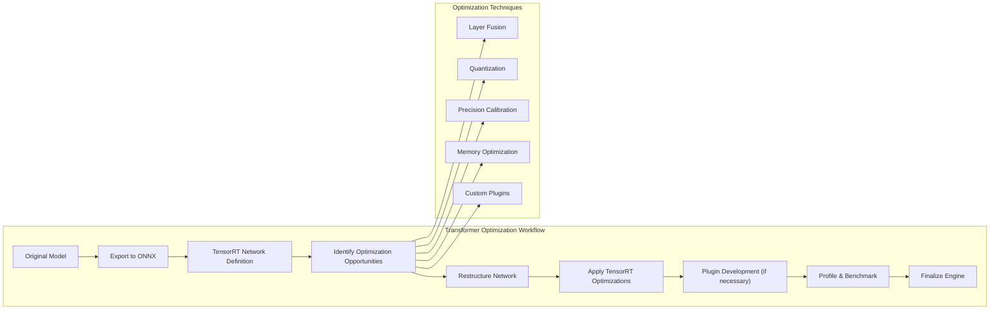
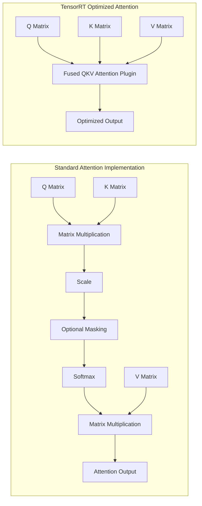
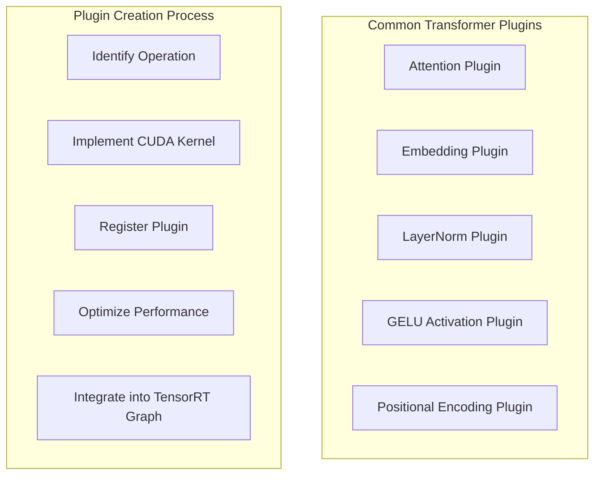
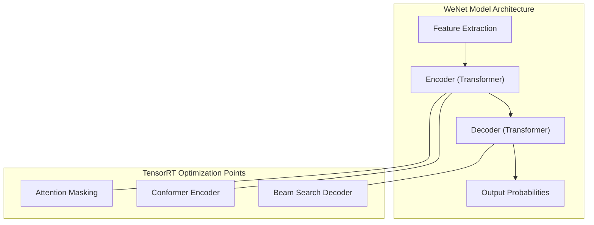

<!-- source: DeepWiki mcp.deepwiki.com · repo NVIDIA/trt-samples-for-hackathon-cn · page 4.1 Transformer Model Optimization · fetched 2026-10-26 -->

# Transformer Model Optimization

Relevant source files

The following files were used as context for generating this wiki page:

- [Hackathon2022/README.md](Hackathon2022/README.md)
- [README.md](README.md)

## Purpose and Scope

This document explains specific techniques and approaches for optimizing Transformer-based models with NVIDIA TensorRT. It covers common architectural patterns in Transformer models, optimization strategies, and practical implementation techniques to achieve maximum inference performance. For information about optimizing Generative AI models (which often use Transformer architectures), see [Generative AI Model Optimization](#4.2).

## Overview of Transformer Models in TensorRT

Transformer models present unique optimization challenges due to their complex attention mechanisms, layer structures, and computational patterns. TensorRT provides several approaches to accelerate these models, from automatic optimizations to custom plugin implementations.

```mermaid
flowchart TD
    subgraph "Transformer Architecture"
        IM["Input Embedding"] --> ME["Multi-Head Attention"]
        ME --> AN["Add & Norm"]
        AN --> FF["Feed Forward"]
        FF --> AN2["Add & Norm"]
        AN2 --> OUT["Output"]
    end

    subgraph "TensorRT Optimization Points"
        QKV["QKV Projection"] --> ATTN["Attention Mechanism"]
        ATTN --> ATTN_OUT["Attention Output Projection"]
        ATTN_OUT --> LN["Layer Normalization"]
        LN --> FFN["Feed-Forward Network"]
        FFN --> LN2["Layer Normalization"]
    end

    style QKV stroke-dasharray: 5 5
    style ATTN stroke-dasharray: 5 5
    style ATTN_OUT stroke-dasharray: 5 5
    style LN stroke-dasharray: 5 5
    style FFN stroke-dasharray: 5 5
    style LN2 stroke-dasharray: 5 5
```

Sources: Hackathon2022/README.md

## Key Optimization Challenges for Transformers

Transformer models present several specific optimization challenges:

1. **Attention Mechanism**: Computationally intensive with complex data dependencies
2. **Layer Structure**: Repeated blocks with potential for fusion optimization
3. **Dynamic Sequence Lengths**: Variable input handling requirements
4. **Large Model Size**: Memory constraints and optimization needs
5. **Mixed Precision Requirements**: Balance between accuracy and performance

### Common Transformer Variants

TensorRT optimization techniques apply to various Transformer architectures:

| Variant Type | Examples | Key Characteristics |
|--------------|----------|---------------------|
| NLP Transformers | BERT, GPT | Self-attention across text tokens |
| Vision Transformers | ViT, SwinTransformer, MobileViT | Image patches as tokens, specialized attention patterns |
| Multimodal Transformers | CLIP, ViLBERT | Cross-modal attention mechanisms |
| Speech Transformers | WeNet, Conformer | Time-sequence processing with attention |

Sources: Hackathon2022/README.md

## TensorRT Optimization Workflow for Transformers

Sources: Hackathon2022/README.md

## Key Optimization Techniques

### 1. Attention Mechanism Optimization

The attention mechanism is often the most computationally intensive part of Transformer models:

Optimization strategies:
- Fused attention implementation
- INT8 quantization for attention computation
- Custom plugin implementations for specific attention patterns
- Kernel selection optimization based on sequence length

Sources: Hackathon2022/README.md

### 2. Layer Normalization and Residual Connection Optimization

Layer normalization is common in Transformer models and can be accelerated through:

- Fusion of normalization with preceding or following operations
- Custom plugin implementation for specific normalization patterns
- Precision optimization (FP16 or INT8 where applicable)

### 3. Quantization Strategies

Quantization significantly improves Transformer performance:

| Precision | Benefits | Considerations |
|-----------|----------|----------------|
| FP16 | 2-3x speedup, minimal accuracy impact | Default for most transformers |
| INT8 | 4x+ speedup potential | Requires careful calibration |
| Mixed Precision | Optimal performance/accuracy | Identify precision-sensitive layers |

### 4. Plugin Development for Transformer Components

TensorRT plugins are essential for optimizing unique Transformer operations:

## Case Studies from Hackathon

### WeNet ASR Optimization

WeNet is an automatic speech recognition model with encoder and decoder components based on Transformer architecture:

Key optimization techniques:
- Attention mask optimization
- Layer fusion in encoder blocks
- Optimized memory management for long sequences
- INT8 quantization for less sensitive components

Sources: Hackathon2022/README.md

### Vision Transformer Optimizations

Vision Transformers like MobileViT and Swin Transformer presented in the Hackathon highlight specific optimization approaches:

| Model | Key Optimization Techniques | Performance Gains |
|-------|----------------------------|------------------|
| MobileViT | Optimized patch embedding, attention fusion | Significant latency reduction |
| Swin Transformer | Window attention optimization, shifted window merging | Memory reduction, faster inference |
| SegFormer | Efficient encoder-decoder implementation | Real-time performance |

Sources: Hackathon2022/README.md

## Model-Specific Optimization Guidelines

### BERT and BERT Variants

For BERT-like models:
- Optimize embedding layers with custom implementations
- Fuse multi-head attention operations
- Apply layer normalization fusion
- Consider INT8 quantization with careful calibration

### Vision Transformers

For Vision Transformer variants:
- Optimize patch embedding pre-processing
- Implement efficient attention for spatial tokens
- Leverage custom CUDA kernels for specialized attention patterns (like window attention)
- Balance precision requirements across different components

### Encoder-Decoder Transformers

For Seq2Seq models:
- Optimize encoder attention mechanisms
- Implement efficient cross-attention between encoder and decoder
- Consider beam search optimization for decoder
- Manage memory carefully for long sequences

## Performance Measurement and Benchmarking

When optimizing Transformer models, establish clear performance metrics:

1. Latency (average and percentile measurements)
2. Throughput (batched inference)
3. Memory utilization
4. Accuracy compared to original model

Profile the model to identify bottlenecks:
- Attention computation time
- Memory transfer overhead
- Layer-by-layer execution profile

## Practical Optimization Tips

1. Start with FP16 precision before attempting INT8 quantization
2. Identify and focus on the most time-consuming operations first
3. Consider model architecture modifications that are TensorRT-friendly
4. Develop custom plugins only when necessary for significant performance gains
5. Optimize for specific batch sizes and sequence lengths based on deployment requirements
6. Consider using TensorRT-LLM for large language models (see [TensorRT-LLM](#2.2))

## Summary

Transformer model optimization with TensorRT requires understanding both the model architecture and TensorRT's capabilities. The most successful approaches combine automatic TensorRT optimizations with targeted manual interventions, particularly around attention mechanisms and layer fusion opportunities. By balancing precision requirements and leveraging appropriate plugins, significant performance improvements can be achieved without sacrificing model accuracy.

Sources: Hackathon2022/README.md, README.md

---

