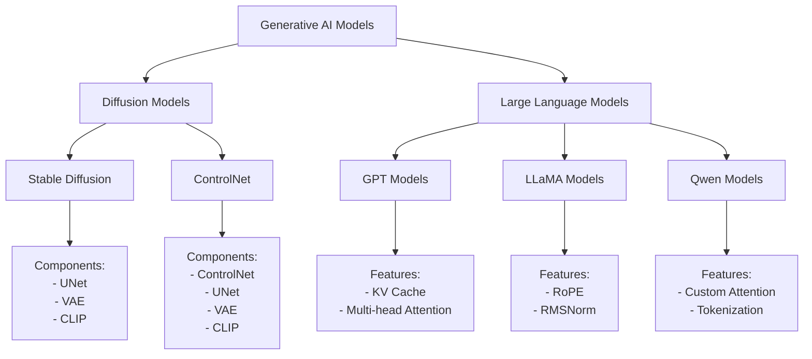
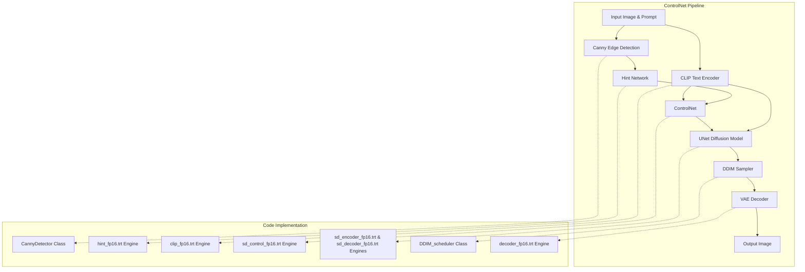
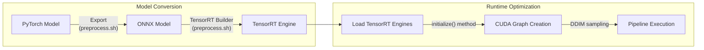
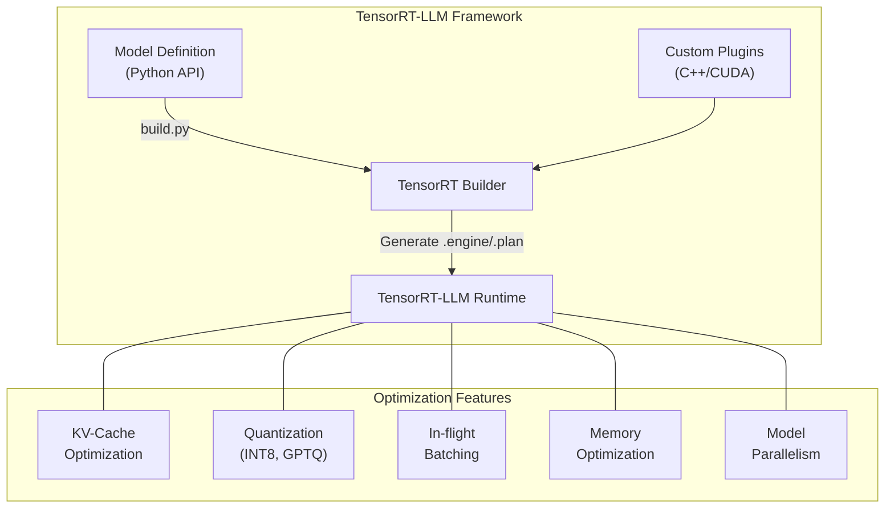

<!-- source: DeepWiki mcp.deepwiki.com · repo NVIDIA/trt-samples-for-hackathon-cn · page 4.2 Generative AI Model Optimization · fetched 2026-10-26 -->

# Generative AI Model Optimization

<details>
<summary>Relevant source files</summary>

The following files were used as context for generating this wiki page:

- [Hackathon2023/README.md](Hackathon2023/README.md)
- [Hackathon2023/controlnet/README.md](Hackathon2023/controlnet/README.md)
- [Hackathon2023/controlnet/canny2image_TRT.py](Hackathon2023/controlnet/canny2image_TRT.py)
- [Hackathon2023/controlnet/cldm/cldm.py](Hackathon2023/controlnet/cldm/cldm.py)
- [Hackathon2023/controlnet/models/cldm_v15.yaml](Hackathon2023/controlnet/models/cldm_v15.yaml)
- [Hackathon2023/final_round.md](Hackathon2023/final_round.md)
- [Hackathon2023/preliminary_round.md](Hackathon2023/preliminary_round.md)

</details>


This page documents techniques and approaches for optimizing generative AI models using NVIDIA TensorRT. It focuses on accelerating inference for diffusion models, large language models (LLMs), and other generative architectures. For transformer model optimization, see [Transformer Model Optimization](#4.1).

## Introduction to Generative AI Optimization

Generative AI models produce new content based on learned patterns from training data. These models present unique optimization challenges due to their:

1. Iterative generation processes (e.g., diffusion steps, autoregressive generation)
2. Complex architectures with custom operations
3. Large memory requirements
4. Quality sensitivity to optimization changes

TensorRT offers a comprehensive toolkit for accelerating these models while maintaining generation quality.

### Generative AI Models in the Repository

This repository includes optimization techniques for several types of generative AI models:



Sources: 
- [Hackathon2023/README.md]()
- [Hackathon2023/final_round.md]()

## ControlNet Optimization

ControlNet extends Stable Diffusion by incorporating conditioning inputs for controlled image generation. The NVIDIA TensorRT Hackathon 2023 preliminary round focused on optimizing the ControlNet canny2image pipeline.

### ControlNet Architecture

ControlNet consists of several key components that are optimized in the implementation:



Sources: 
- [Hackathon2023/controlnet/canny2image_TRT.py]()
- [Hackathon2023/controlnet/cldm/cldm.py:69-335]()

The ControlNet implementation includes:

- `ControlNet` class - Extends UNet with conditioning capability
- `ControlLDM` class - LatentDiffusion with control signals 
- `ControlledUnetModel` class - Modified UNet for handling control inputs

### Optimization Workflow

The process of optimizing generative AI models like ControlNet follows this workflow:



Sources:
- [Hackathon2023/controlnet/canny2image_TRT.py:22-149]()
- [Hackathon2023/preliminary_round.md]()

Key optimization steps:

1. **Model Conversion**: Converting PyTorch models to ONNX and then to TensorRT engines
2. **Engine Loading**: Loading serialized engines for each component
3. **CUDA Graph Creation**: Creating CUDA graphs for efficient execution
4. **Pipeline Optimization**: Implementing efficient DDIM sampling

### Implementation Details

The implementation in `canny2image_TRT.py` optimizes multiple components:

1. **Initialization and Engine Loading**:
   - Loading TensorRT engines for each component
   - Setting up CUDA streams and events for parallel execution

   ```python
   def load_all_engines(self, trt_engine_file_list):
       engine_table = {}
       for engine_file_name in trt_engine_file_list:
           with open(engine_file_name, "rb") as f:
               engine_str = f.read()
           engine = trt.Runtime(self.trt_logger).deserialize_cuda_engine(engine_str)
           context = engine.create_execution_context()
           engine_name = engine_file_name.split('.')[0]
           engine_table[engine_name] = (engine, context)
       return engine_table
   ```

2. **DDIM Sampling**:
   - Implementation of optimized DDIM sampling
   - Using both control and encoder outputs for generation
   - Concurrent execution using multiple CUDA streams

3. **Pipeline Execution**:
   - Processing canny edges through the hint network
   - CLIP text encoding
   - VAE decoding for final image generation

The optimization achieves significant speedup while maintaining image quality, measured using Perceptual Distance (PD) score.

Sources:
- [Hackathon2023/controlnet/canny2image_TRT.py]()
- [Hackathon2023/preliminary_round.md:82-85]()

## Large Language Model Optimization with TensorRT-LLM

The final round of the Hackathon 2023 focused on optimizing generative AI models, with special emphasis on LLMs using TensorRT-LLM.

### TensorRT-LLM Architecture

TensorRT-LLM provides a framework for optimizing large language models:



Sources:
- [Hackathon2023/final_round.md:4-8]()
- [Hackathon2023/final_round.md:42-66]()

### Optimization Techniques

TensorRT-LLM provides several optimization techniques for generative language models:

| Optimization Technique | Description | Use Case |
|------------------------|-------------|----------|
| INT8 KV-Cache | Stores attention key/value tensors in INT8 | Long context generation |
| SmoothQuant | Smooths activation distribution before quantization | Stable INT8 inference |
| GPTQ | Post-training weight-only quantization | Reducing model size |
| Inflight Batching | Dynamic batching for multiple requests | Serving scenarios |
| Model Parallelism | Splitting model across multiple GPUs | Large models |

Sources:
- [Hackathon2023/final_round.md:42-66]()

### Custom Plugin Development

For optimal performance in generative AI models, custom plugins may be developed:

1. Specialized attention mechanisms for different model architectures
2. Custom kernels for model-specific operations
3. Fused operations to reduce memory bandwidth requirements
4. Integration with external libraries like OpenAI Triton

TensorRT-LLM supports custom plugin development through C++ and CUDA interfaces, allowing optimization of model-specific operations that are not efficiently handled by default TensorRT operators.

## Hackathon 2023 Results

The Hackathon 2023 showcased various approaches to generative AI optimization, with teams achieving significant speedups while maintaining generation quality:

| Model Type | Teams | Optimization Techniques | Performance Improvement |
|------------|-------|-------------------------|-------------------------|
| Qwen-7B | 9 teams | TensorRT-LLM, custom plugins | Significant throughput gains |
| MinGPT4 | 1 team | Vision-language model optimization | Reduced latency |
| Whisper | 2 teams | Audio transcription acceleration | Faster processing time |
| UniDiffuser | 1 team | Diffusion model optimization | Enhanced generation speed |

Most winning teams focused on LLM optimization (particularly Qwen-7B) using TensorRT-LLM with techniques like INT8 quantization, custom plugins, and pipeline optimizations.

Sources:
- [Hackathon2023/README.md:33-80]()

## Performance Considerations

When optimizing generative AI models, several factors affect performance:

1. **Model Architecture**:
   - Diffusion models: Number of diffusion steps, U-Net complexity
   - LLMs: Model size, attention mechanism, context length

2. **Optimization Techniques**:
   - Precision (FP16, INT8) vs accuracy trade-offs
   - Memory management for large models
   - Pipeline optimization for multi-component systems

3. **Hardware Considerations**:
   - GPU memory bandwidth
   - Tensor core utilization
   - Multi-GPU scaling for large models

4. **Quality Metrics**:
   - For diffusion models: Perceptual Distance (PD) score
   - For LLMs: ROUGE score, perplexity, or application-specific metrics

## Conclusion

Optimizing generative AI models with TensorRT enables significant performance improvements while maintaining generation quality. The techniques demonstrated in this repository, especially those from the Hackathon 2023, provide a foundation for accelerating a wide range of generative models, from diffusion-based image generation to large language models.

Key takeaways:
1. TensorRT provides effective tools for optimizing complex generative models
2. TensorRT-LLM offers specialized optimizations for large language models
3. Balancing performance and quality is essential in generative AI optimization
4. Multi-component pipelines benefit from system-level optimizations like CUDA Graphs and stream parallelism

Sources:
- [Hackathon2023/README.md]()
- [Hackathon2023/final_round.md]()
- [Hackathon2023/preliminary_round.md]()

---

