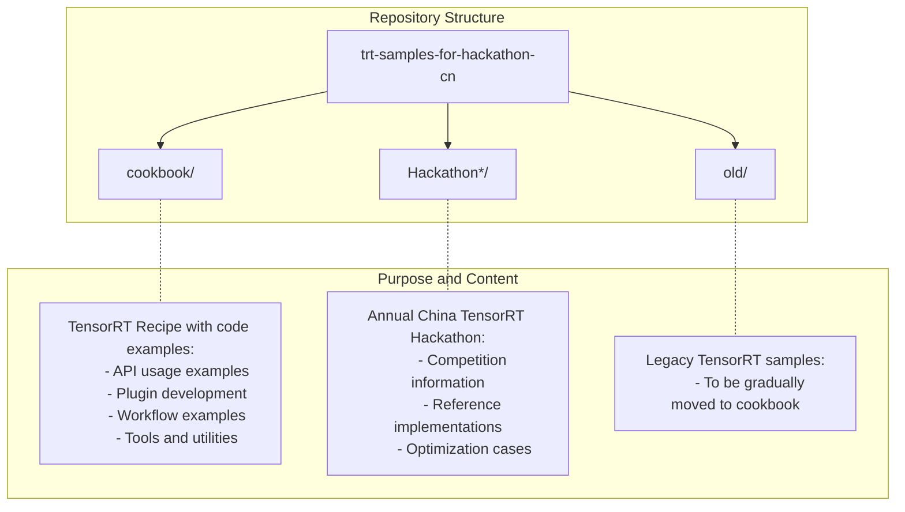
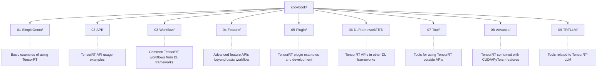
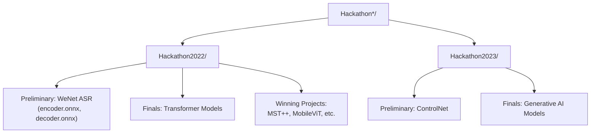
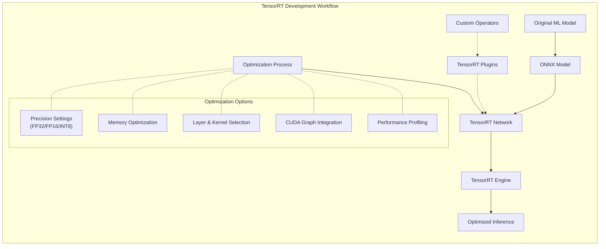

<!-- source: DeepWiki mcp.deepwiki.com · repo NVIDIA/trt-samples-for-hackathon-cn · page 5 Repository Structure and Resources · fetched 2026-10-26 -->

# Repository Structure and Resources

<details>
<summary>Relevant source files</summary>

The following files were used as context for generating this wiki page:

- [.gitattributes](.gitattributes)
- [.gitignore](.gitignore)
- [Hackathon2022/README.md](Hackathon2022/README.md)
- [README.md](README.md)
- [cookbook/.gitignore](cookbook/.gitignore)
- [cookbook/README.md](cookbook/README.md)

</details>


This document provides a detailed overview of the TensorRT Samples Repository's organization, file structure, and available resources. It serves as a guide for navigating the codebase, understanding its components, and accessing the various learning materials and examples provided.

For information about specific model optimization techniques, see [Model Optimization Techniques](#4). For details about Hackathon competitions, see [TensorRT Hackathons](#3).

## Repository Overview

The TensorRT Samples Repository is organized into three main directories, each serving a specific purpose in helping developers learn and apply TensorRT optimization technology.



Sources: [README.md:7-13]()

## Main Directory Structure

The repository is structured to provide a clear separation between educational materials, competition resources, and legacy code:

| Directory | Description | Contents |
|-----------|-------------|----------|
| `cookbook/` | TensorRT recipes and examples | Code examples for API usage, plugins, workflows, and tools |
| `Hackathon*/` | Hackathon competition materials | Competition information, topic resources, reference implementations |
| `old/` | Legacy sample code | Additional TensorRT samples to be migrated to cookbook |

Each of these main directories serves a specific purpose in the repository's goal of providing comprehensive TensorRT learning and reference materials for both beginners and experienced developers.

Sources: [README.md:7-13](), [cookbook/README.md:1-6]()

## TensorRT Cookbook Structure

The cookbook directory is the primary location for TensorRT code examples and learning resources. It's organized into categorical subdirectories, each focusing on specific aspects of TensorRT development.



Sources: [cookbook/README.md:128-163]()

### Cookbook Subdirectories and Contents

Each subdirectory in the cookbook contains specific examples and resources targeted at different aspects of TensorRT development:

1. **01-SimpleDemo**: Contains standalone examples demonstrating basic TensorRT network building and inference.
2. **02-API**: Shows examples of TensorRT API usage, implemented in Python with one-to-one correspondence to C++.
3. **03-Workflow**: Presents common workflows for using TensorRT with deep learning frameworks.
4. **04-Feature**: Contains examples of advanced feature APIs not necessary in basic workflows.
5. **05-Plugin**: Provides examples and guidance for developing and using TensorRT plugins.
6. **06-DLFrameworkTRT**: Demonstrates TensorRT integration with other deep learning frameworks.
7. **07-Tool**: Contains utility tools for using TensorRT beyond direct API usage.
8. **08-Advance**: Provides advanced techniques combining TensorRT with CUDA or PyTorch features.
9. **09-TRTLLM**: Contains tools specifically related to TensorRT-LLM for large language model optimization.

Sources: [cookbook/README.md:128-163]()

### Recommended Learning Path

For newcomers to TensorRT, the repository authors recommend the following learning path through the cookbook:

1. Start with **01-SimpleDemo/TensorRT10.0** for basic concepts
2. Move to **04-BuildEngineByONNXParser/pyTorch-ONNX-TensorRT** to understand model conversion
3. Explore **07-Tool/Netron** and **07-Tool/trtexec** for model visualization and benchmarking
4. Learn basic plugin development with **05-Plugin/BasicExample**
5. Advance to **05-Plugin/UseONNXParserAndPlugin-pyTorch** for integrating plugins with PyTorch models

Sources: [cookbook/README.md:13-20]()

## Hackathon Materials

The repository contains materials from annual TensorRT Hackathon competitions, serving as valuable reference implementations and optimization examples:



Sources: [README.md:9-10](), [Hackathon2022/README.md:3-6](), [Hackathon2022/README.md:25-37](), [.gitattributes:1-3]()

### Hackathon 2022: Transformer Models

The 2022 Hackathon focused on optimizing Transformer-based models with TensorRT. The competition had two phases:

1. **Preliminary round**: Optimization of WeNet ASR model (with encoder and decoder components)
2. **Final round**: Open competition where participants chose public Transformer models to optimize

The repository contains reference implementations, winning projects, and supporting materials like lectures and tutorials.

Sources: [Hackathon2022/README.md:21-41](), [Hackathon2022/README.md:53-100]()

### Hackathon 2023: Generative AI

The 2023 Hackathon focused on Generative AI models, particularly:

1. **Preliminary round**: ControlNet optimization
2. **Final round**: Various Generative AI models with two tracks:
   - TensorRT-LLM track for large language models
   - Standard TensorRT track for other generative models

Sources: [cookbook/README.md:10-11]()

## External Resources

The repository provides access to various external resources for learning and development:

### Lecture Materials and Tutorials

External resources are available through Baidu Netdisk and Bilibili:

- **Baidu Netdisk Link**: [https://pan.baidu.com/s/14HNCFbySLXndumicFPD-Ww](https://pan.baidu.com/s/14HNCFbySLXndumicFPD-Ww) (Extraction code: gpq2)
  - TensorRT video tutorial slides
  - Hackathon competition files and information

- **Bilibili Video Tutorials**:
  - TensorRT-8.6.1: [https://www.bilibili.com/video/BV1jj411Z7wG/](https://www.bilibili.com/video/BV1jj411Z7wG/)
  - TensorRT-8.2.3: [https://www.bilibili.com/video/BV15Y4y1W73E](https://www.bilibili.com/video/BV15Y4y1W73E)
  - Hackathon2022: [https://www.bilibili.com/video/BV1i3411G7vN](https://www.bilibili.com/video/BV1i3411G7vN)
  - Hackathon2023: [https://www.bilibili.com/video/BV1dw411r7X8/](https://www.bilibili.com/video/BV1dw411r7X8/)

Sources: [README.md:15-19](), [cookbook/README.md:5-11]()

### Official TensorRT Documentation

The repository provides links to official TensorRT documentation and resources:

- Developer Guide
- API Documentation (C++ and Python)
- Support Matrix
- Operator Documentation
- Installation Guides
- ONNX GraphSurgeon API
- Polygraphy tools
- Quantization toolkits

Sources: [cookbook/README.md:92-112]()

### Additional Resources

The repository also links to related tools and frameworks:

- CUDA
- ONNX (Open Neural Network Exchange)
- ONNX Operators
- ONNX Model Zoo
- ONNX Runtime
- TREX (TensorRT Engine Explorer)
- TF-TRT (TensorFlow-TensorRT integration)
- Torch-TensorRT

Sources: [cookbook/README.md:113-123]()

## Environment Setup

The repository recommends using NVIDIA-optimized Docker containers to run the examples, providing setup instructions and recommended Docker images.

### Recommended Docker Images

| Docker Image | Python | CUDA | TensorRT | Comment |
|--------------|--------|------|----------|---------|
| nvcr.io/nvidia/tensorrt:19.12-py3 | 3.6 | 10.2.89 | 6.0.1 | Last version with TensorRT 6 |
| nvcr.io/nvidia/tensorrt:21.06-py3 | 3.8 | 11.3.1 | 7.2.3.4 | Last version with TensorRT 7 |
| nvcr.io/nvidia/pytorch:23.02-py3 | 3.8 | 12.0.1 | 8.5.3 | Last version with PyTorch 1 |
| nvcr.io/nvidia/pytorch:24.04-py3 | 3.10 | 12.3.2 | 8.6.1.6 | Last version with TensorRT 8.6 |
| nvcr.io/nvidia/pytorch:25.02-py3 | 3.10 | 12.8.0.038 | 10.8.0.43 | **Preferred version** |

Sources: [cookbook/README.md:26-39]()

### Container Setup and Installation

The repository provides detailed instructions for setting up the Docker container and installing required dependencies:

```bash
docker run \
    -it -e NVIDIA_VISIBLE_DEVICES=0 --gpus "device=0" \
    --shm-size 16G --ulimit memlock=-1 --ulimit stack=67108864 \
    --name trt-cookbook \
    -v <PathToRepo>:/trtcookbook \
    nvcr.io/nvidia/pytorch:25.02-py3 \
    /bin/bash
```

After starting the container, you need to:

```bash
cd <Path to the cookbook repo>
export TRT_COOKBOOK_PATH=$(pwd)  # NECESSARY!
pip install -r requirements.txt
pip install -e .  # For developer usage
```

Sources: [cookbook/README.md:42-66]()

## TensorRT Development Workflow

The repository supports the following general workflow for optimizing models with TensorRT:



Sources: [cookbook/README.md:128-130](), [cookbook/README.md:134-143]()

## Ignoring Generated Files

The repository uses `.gitignore` files to exclude certain file types from version control:

### Common Ignored Files

- Generated files: `*.exe`, `*.o`, `*.so`
- TensorRT-specific files: `*.trt`, `*.Int8Cache`, `*.TimingCache`, `*.Tacitc`  
- ML framework files: `*.onnx`, `*.pth`, `*.ts`, `*.pkl`
- Profiling data: `*.nsys-rep`, `*.qdrep`
- Build directories: `build/`, `dist/`
- Python artifacts: `__pycache__/`, `*.egg-info/`

These exclusions help keep the repository clean while allowing users to generate and work with these files locally.

Sources: [.gitignore:1-11](), [cookbook/.gitignore:1-42]()

## Updates and Versioning

The repository is regularly updated to support new TensorRT versions:

- **November 2024**: Updated to TensorRT 10.6, packaged as `tensorrt_cookbook.whl`
- **September 2024**: Updated to TensorRT 10.5
- **May 2024**: Updated to TensorRT 10.0 GA
- **February 2024**: Updated to TensorRT 9.X GA
- **June 2023**: Updated to TensorRT 8.6 GA
- **March 2023**: Freeze code of branch TensorRT-8.5
- **October 2022**: Updated to TensorRT 8.5 GA

Older versions are maintained in separate branches, allowing users to access examples compatible with specific TensorRT versions.

Sources: [cookbook/README.md:72-90]()