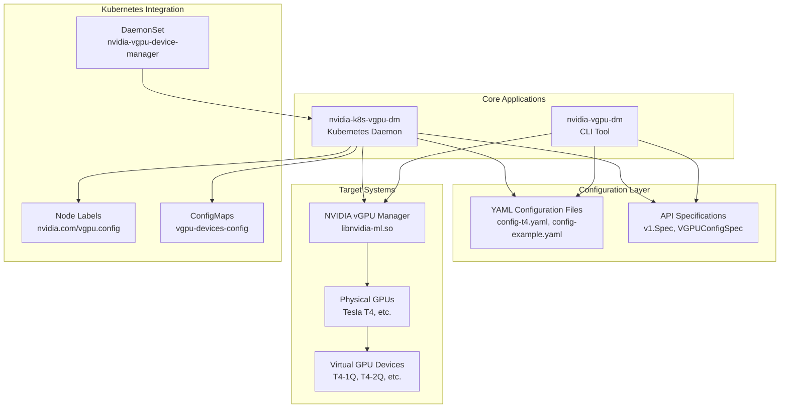
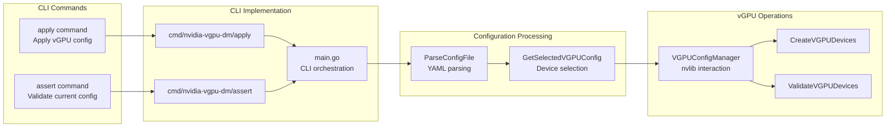
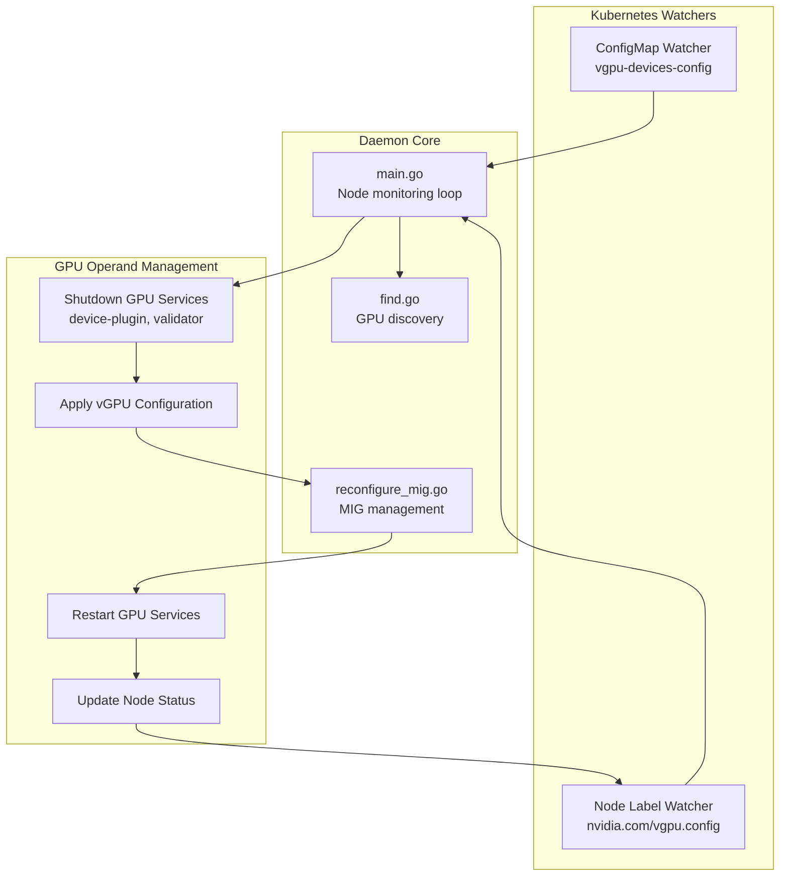
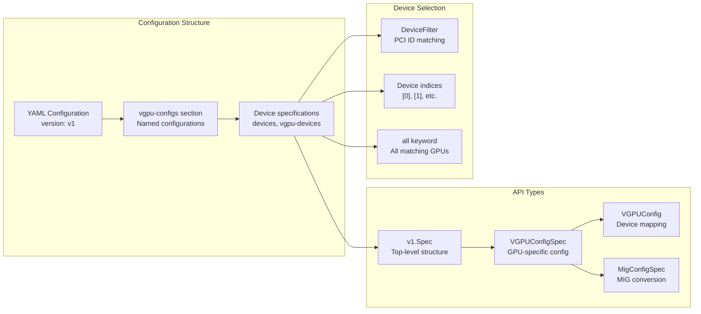
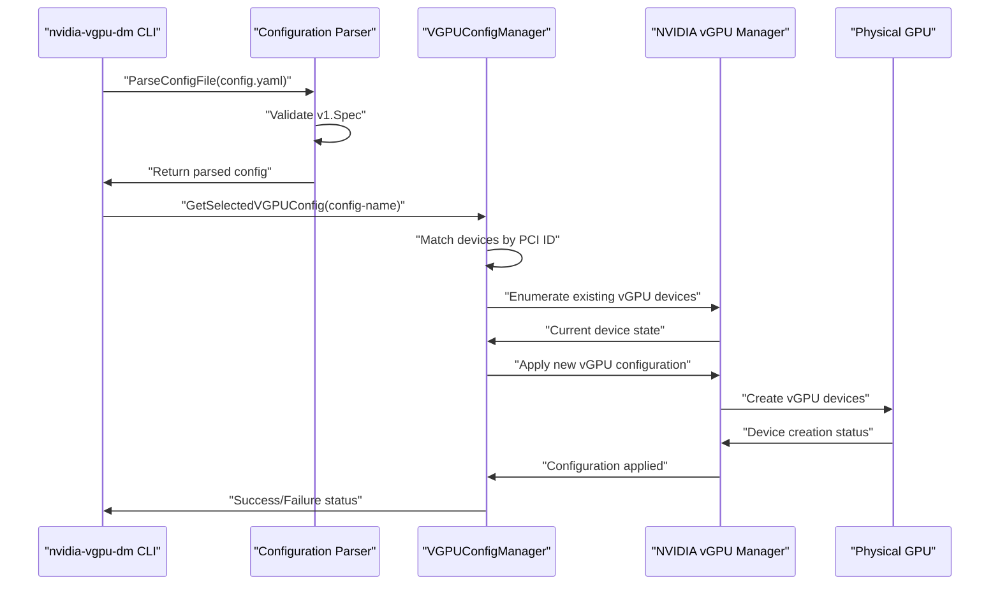
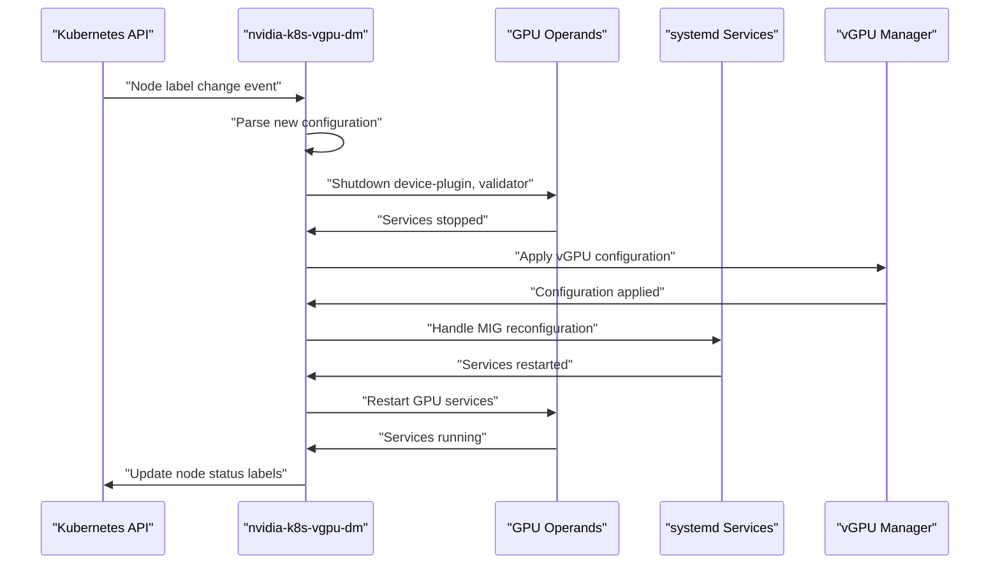

<!-- source: DeepWiki mcp.deepwiki.com · repo NVIDIA/vgpu-device-manager · page 1 Overview · fetched 2026-10-26 -->

# Overview

Relevant source files

The following files were used as context for generating this wiki page:

- [LICENSE](LICENSE)
- [README.md](README.md)

## Purpose and Scope

The NVIDIA vGPU Device Manager is a comprehensive system designed to manage virtual GPU (vGPU) configurations in Kubernetes environments and standalone deployments. This system enables administrators to declaratively define and apply vGPU device configurations across GPU-enabled nodes, providing fine-grained control over how physical GPUs are partitioned into virtual devices for different workloads.

This document provides a high-level overview of the system architecture, core components, and operational workflows. For detailed information about specific components, see [CLI Tools](#2.1), [Kubernetes Daemon](#2.2), and [Configuration System](#2.3). For build and deployment procedures, refer to [Build System & Development](#4) and [Deployment & Operations](#7).

*Sources: [README.md:1-190]()*

## System Architecture Overview

The NVIDIA vGPU Device Manager consists of two primary applications that work together to manage vGPU configurations:

*Sources: [README.md:8-16](), diagrams provided by user*

## Core Applications

The system provides two main entry points for vGPU management:

### Standalone CLI Tool (`nvidia-vgpu-dm`)

The CLI tool enables direct interaction with vGPU configurations on individual nodes:

*Sources: [README.md:77-102](), [README.md:114-163]()*

### Kubernetes Daemon (`nvidia-k8s-vgpu-dm`)

The Kubernetes daemon manages vGPU configurations automatically based on node labels and ConfigMaps:

*Sources: [README.md:164-190](), diagrams provided by user*

## Configuration System

The system uses a YAML-based configuration format that defines vGPU device arrangements:

Example configuration structure from the repository:

| Configuration Name | Devices | vGPU Type | Count | Description |
|-------------------|---------|-----------|--------|-------------|
| `T4-1Q` | `all` | `T4-1Q` | 16 | Creates 16 T4-1Q devices on all GPUs |
| `T4-8Q` | `all` | `T4-8Q` | 2 | Creates 2 T4-8Q devices on all GPUs |
| `T4-small` | `[0], [1]` | `T4-1Q, T4-2Q` | 16, 8 | Custom mixed configuration |

*Sources: [README.md:18-75](), diagrams provided by user*

## Key Operational Workflows

### Configuration Application Workflow

### Kubernetes Node Management Workflow

*Sources: diagrams provided by user, [README.md:189-190]()*

## Technology Stack and Dependencies

The system is built using the following key technologies and dependencies:

| Component | Technology | Purpose |
|-----------|------------|---------|
| **Core Language** | Go | Primary implementation language |
| **Configuration** | YAML | Declarative vGPU configuration format |
| **Container Runtime** | Docker/Podman | Containerized deployment |
| **Orchestration** | Kubernetes | Cluster-wide vGPU management |
| **GPU Interface** | NVIDIA vGPU Manager | Low-level vGPU device management |
| **GPU Library** | libnvidia-ml.so | NVIDIA Management Library |
| **Build System** | Make | Build automation and tooling |

### External Dependencies

```mermaid
graph TB
    subgraph "NVIDIA Dependencies"
        VGPU_MGR["NVIDIA vGPU Manager<br/>Hypervisor component"]
        NVML["NVIDIA ML Library<br/>libnvidia-ml.so"]
        GPU_DRIVER["NVIDIA GPU Driver<br/>Host driver stack"]
    end
    
    subgraph "Kubernetes Dependencies"
        K8S_API["Kubernetes API<br/>Node labels, ConfigMaps"]
        DEVICE_PLUGIN["NVIDIA Device Plugin<br/>GPU resource management"]
        GPU_OPERATOR["NVIDIA GPU Operator<br/>Lifecycle management"]
    end
    
    subgraph "System Dependencies"
        SYSTEMD["systemd<br/>Service management"]
        CONTAINER_RUNTIME["Container Runtime<br/>Docker/containerd"]
    end
    
    VGPU_MGR --> NVML
    NVML --> GPU_DRIVER
    K8S_API --> DEVICE_PLUGIN
    DEVICE_PLUGIN --> GPU_OPERATOR
    SYSTEMD --> CONTAINER_RUNTIME
```

*Sources: [README.md:118](), [LICENSE:1-203](), diagrams provided by user*

---

