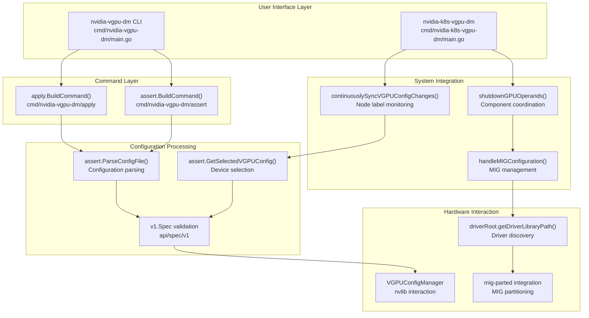
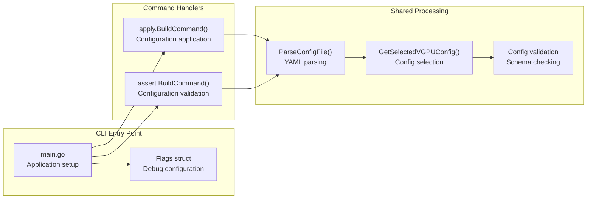
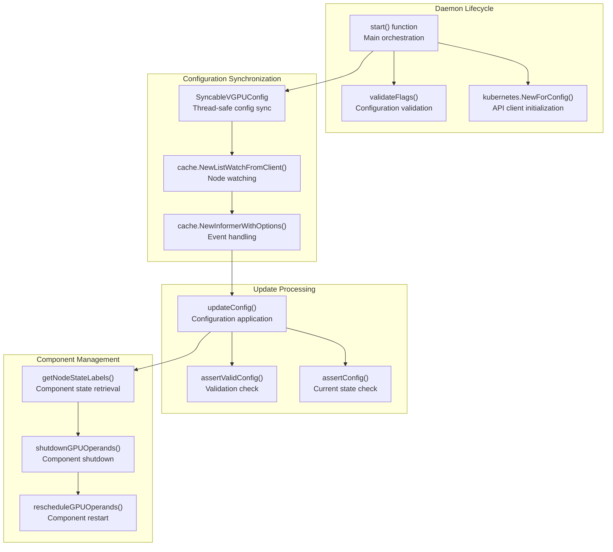
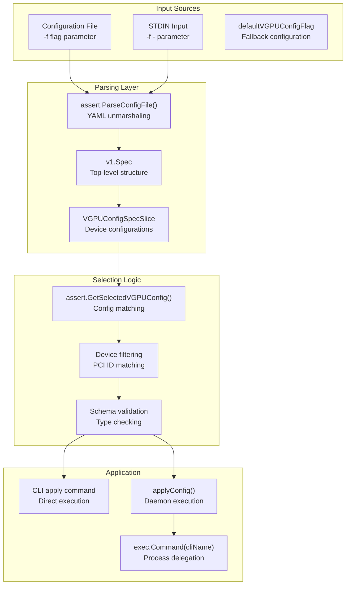
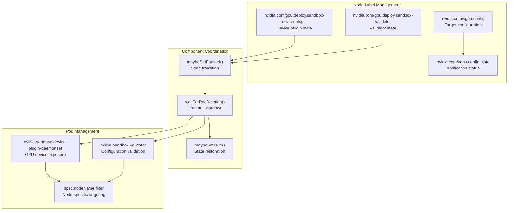
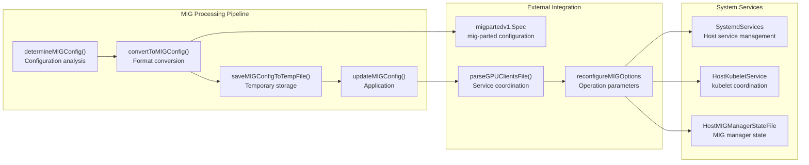

<!-- source: DeepWiki mcp.deepwiki.com · repo NVIDIA/vgpu-device-manager · page 2 Architecture & Core Components · fetched 2026-10-26 -->

# Architecture & Core Components

Relevant source files

The following files were used as context for generating this wiki page:

- [README.md](README.md)
- [cmd/nvidia-k8s-vgpu-dm/main.go](cmd/nvidia-k8s-vgpu-dm/main.go)
- [cmd/nvidia-vgpu-dm/main.go](cmd/nvidia-vgpu-dm/main.go)

This document provides a detailed overview of the NVIDIA vGPU Device Manager's system architecture, core applications, and how the major components interact to manage virtual GPU devices in Kubernetes environments. For specific configuration formats and examples, see [Configuration Format & Examples](#3). For deployment and operational considerations, see [Deployment & Operations](#7).

## System Overview

The NVIDIA vGPU Device Manager consists of two primary applications that work together to provide declarative vGPU device management:

- **CLI Tool (`nvidia-vgpu-dm`)**: Standalone command-line interface for direct vGPU configuration management
- **Kubernetes Daemon (`nvidia-k8s-vgpu-dm`)**: Node-level daemon that integrates with Kubernetes to automatically manage vGPU configurations based on node labels

Both applications share a common configuration system and interact with the underlying NVIDIA driver stack to create and manage virtual GPU instances.

## Core System Architecture

**Sources:** [cmd/nvidia-vgpu-dm/main.go:53-56](), [cmd/nvidia-k8s-vgpu-dm/main.go:316-345](), [cmd/nvidia-k8s-vgpu-dm/main.go:460-499](), [cmd/nvidia-k8s-vgpu-dm/main.go:591-610]()

## Application Components

### CLI Tool Architecture

The `nvidia-vgpu-dm` CLI provides direct vGPU management capabilities through two primary commands:

The CLI supports both file-based and stdin configuration input, with debug logging controlled through the `Flags.Debug` field at [cmd/nvidia-vgpu-dm/main.go:31-33]().

**Sources:** [cmd/nvidia-vgpu-dm/main.go:35-74]()

### Kubernetes Daemon Architecture

The `nvidia-k8s-vgpu-dm` daemon provides automated vGPU management in Kubernetes environments:

The daemon uses the `SyncableVGPUConfig` type at [cmd/nvidia-k8s-vgpu-dm/main.go:86-125]() to coordinate configuration changes between the node label watcher and the main processing loop.

**Sources:** [cmd/nvidia-k8s-vgpu-dm/main.go:258-314](), [cmd/nvidia-k8s-vgpu-dm/main.go:316-345](), [cmd/nvidia-k8s-vgpu-dm/main.go:347-395]()

## Configuration System Integration

Both applications share a common configuration processing pipeline:

The configuration system supports device selection through multiple methods: `"all"` for all devices, numeric indices for specific devices, or PCI ID patterns for device matching.

**Sources:** [cmd/nvidia-k8s-vgpu-dm/main.go:397-408](), [cmd/nvidia-k8s-vgpu-dm/main.go:410-420](), [cmd/nvidia-k8s-vgpu-dm/main.go:422-433]()

## Kubernetes Integration Layer

The daemon manages integration with Kubernetes components through a sophisticated orchestration system:

The daemon coordinates component shutdowns by temporarily setting state labels to `"paused-for-vgpu-change"` and waiting for pod deletion with a 120-second timeout, as implemented in [cmd/nvidia-k8s-vgpu-dm/main.go:501-525]().

**Sources:** [cmd/nvidia-k8s-vgpu-dm/main.go:48-60](), [cmd/nvidia-k8s-vgpu-dm/main.go:460-499](), [cmd/nvidia-k8s-vgpu-dm/main.go:527-544](), [cmd/nvidia-k8s-vgpu-dm/main.go:546-558]()

## MIG Configuration Handling

The system includes specialized handling for Multi-Instance GPU (MIG) configurations:

The MIG handling converts vGPU configurations to `migpartedv1.Spec` format and coordinates with host systemd services. The `GPUClients` struct at [cmd/nvidia-k8s-vgpu-dm/main.go:81-84]() defines which systemd services need coordination during MIG reconfiguration.

**Sources:** [cmd/nvidia-k8s-vgpu-dm/main.go:591-610](), [cmd/nvidia-k8s-vgpu-dm/main.go:612-632](), [cmd/nvidia-k8s-vgpu-dm/main.go:634-646](), [cmd/nvidia-k8s-vgpu-dm/main.go:667-693](), [cmd/nvidia-k8s-vgpu-dm/main.go:695-715]()

---

