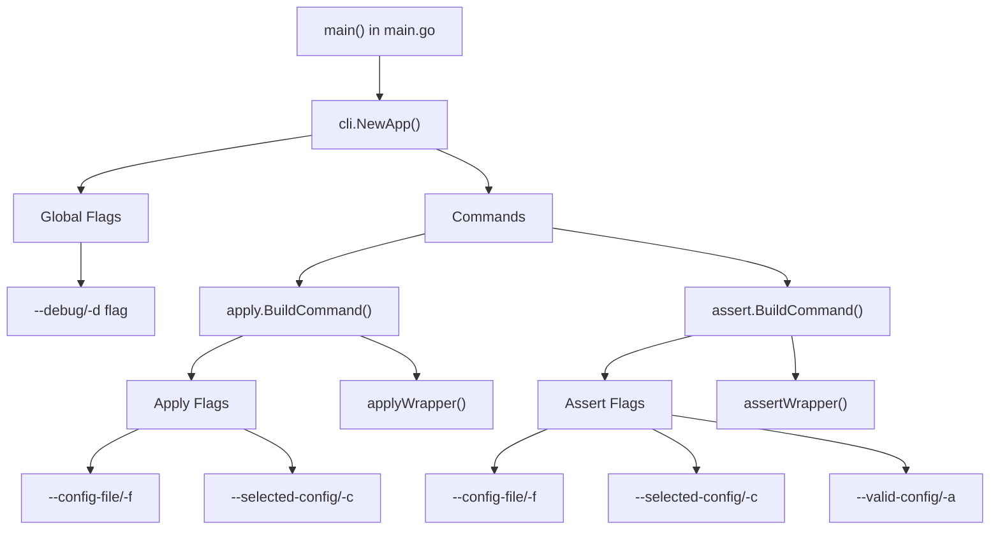
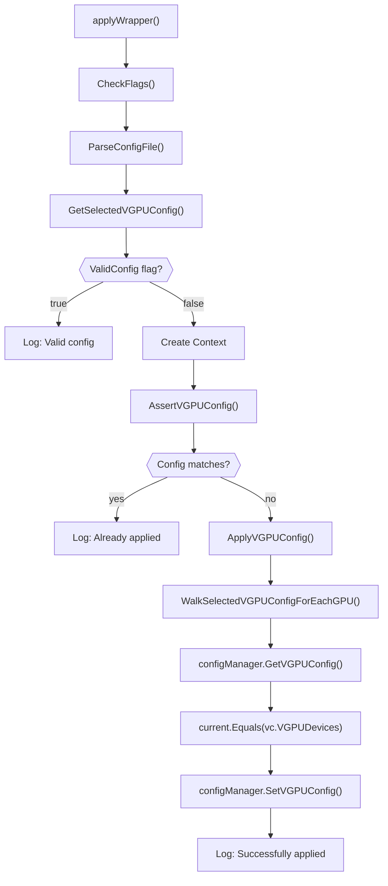
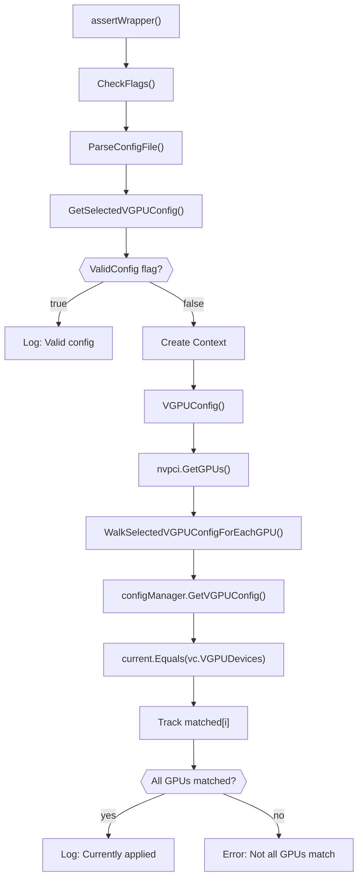
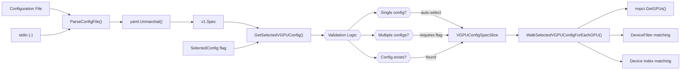
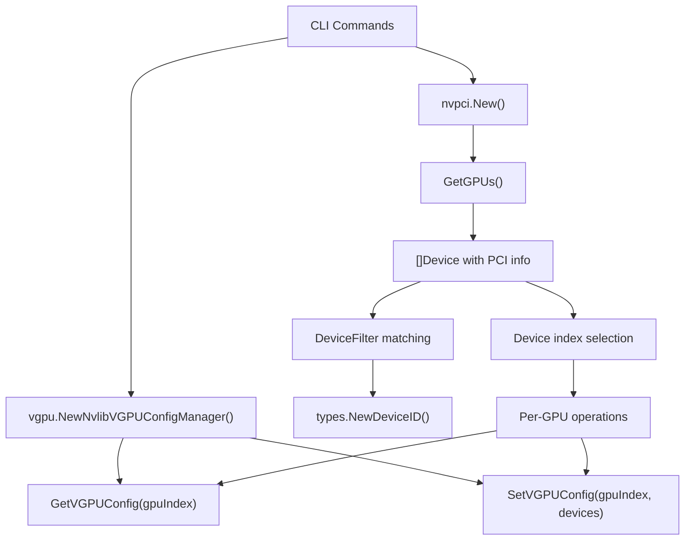

<!-- source: DeepWiki mcp.deepwiki.com · repo NVIDIA/vgpu-device-manager · page 2.1 CLI Tools (nvidia-vgpu-dm) · fetched 2026-10-26 -->

# CLI Tools (nvidia-vgpu-dm)

<details>
<summary>Relevant source files</summary>

The following files were used as context for generating this wiki page:

- [cmd/nvidia-vgpu-dm/apply/apply.go](cmd/nvidia-vgpu-dm/apply/apply.go)
- [cmd/nvidia-vgpu-dm/apply/config.go](cmd/nvidia-vgpu-dm/apply/config.go)
- [cmd/nvidia-vgpu-dm/assert/assert.go](cmd/nvidia-vgpu-dm/assert/assert.go)
- [cmd/nvidia-vgpu-dm/assert/config.go](cmd/nvidia-vgpu-dm/assert/config.go)
- [cmd/nvidia-vgpu-dm/main.go](cmd/nvidia-vgpu-dm/main.go)

</details>


The `nvidia-vgpu-dm` CLI tool provides command-line interface for managing NVIDIA virtual GPU (vGPU) device configurations on individual nodes. This tool allows administrators to apply and validate vGPU configurations using declarative YAML configuration files.

This page covers the CLI tool specifically. For information about the Kubernetes daemon that automates vGPU management across clusters, see [Kubernetes Daemon (nvidia-k8s-vgpu-dm)](#2.2). For details about the configuration file format and schema, see [Configuration System](#2.3).

## Overview

The `nvidia-vgpu-dm` CLI tool is built using the `urfave/cli/v2` framework and provides two primary commands for vGPU device management:

- **`apply`** - Applies a vGPU configuration to the current node, making necessary changes
- **`assert`** - Validates that a specific vGPU configuration is currently applied to the node

Both commands operate on YAML configuration files that define vGPU device mappings and support device filtering based on PCI device IDs.

## CLI Application Structure

The main CLI application structure is organized around a command-driven architecture:



**Sources:** [cmd/nvidia-vgpu-dm/main.go:35-74](), [cmd/nvidia-vgpu-dm/apply/apply.go:47-75](), [cmd/nvidia-vgpu-dm/assert/assert.go:56-91]()

## Command Line Interface

### Global Options

| Flag | Aliases | Environment Variable | Description |
|------|---------|---------------------|-------------|
| `--debug` | `-d` | `VGPU_DM_DEBUG` | Enable debug-level logging |

### Apply Command

The `apply` command applies vGPU configurations to the current node:

```bash
nvidia-vgpu-dm apply --config-file /path/to/config.yaml --selected-config config-name
```

| Flag | Aliases | Environment Variable | Description |
|------|---------|---------------------|-------------|
| `--config-file` | `-f` | `VGPU_DM_CONFIG_FILE` | Path to the configuration file |
| `--selected-config` | `-c` | `VGPU_DM_SELECTED_CONFIG` | Label of the vgpu-config to apply |

### Assert Command

The `assert` command validates that a specific vGPU configuration is currently applied:

```bash
nvidia-vgpu-dm assert --config-file /path/to/config.yaml --selected-config config-name
```

| Flag | Aliases | Environment Variable | Description |
|------|---------|---------------------|-------------|
| `--config-file` | `-f` | `VGPU_DM_CONFIG_FILE` | Path to the configuration file |
| `--selected-config` | `-c` | `VGPU_DM_SELECTED_CONFIG` | Name of the vgpu-config to assert |
| `--valid-config` | `-a` | `VGPU_DM_VALID_CONFIG` | Only validate config file and selected config presence |

**Sources:** [cmd/nvidia-vgpu-dm/apply/apply.go:57-72](), [cmd/nvidia-vgpu-dm/assert/assert.go:66-88]()

## Apply Command Workflow

The apply command follows a structured workflow to safely apply vGPU configurations:



**Sources:** [cmd/nvidia-vgpu-dm/apply/apply.go:94-139](), [cmd/nvidia-vgpu-dm/apply/config.go:29-50]()

## Assert Command Workflow

The assert command validates current vGPU configurations against the desired state:



**Sources:** [cmd/nvidia-vgpu-dm/assert/assert.go:93-132](), [cmd/nvidia-vgpu-dm/assert/config.go:29-67]()

## Configuration Processing Pipeline

Both commands share a common configuration processing pipeline that handles YAML parsing and device selection:



**Sources:** [cmd/nvidia-vgpu-dm/assert/assert.go:146-190](), [cmd/nvidia-vgpu-dm/assert/assert.go:192-229]()

## Core Data Structures

The CLI tool operates on several key data structures:

### Flags Structure
```go
type Flags struct {
    ConfigFile     string  // Path to configuration file
    SelectedConfig string  // Name of config to select
    ValidConfig    bool    // Assert command only
}
```

### Context Structure
```go
type Context struct {
    *cli.Context          // CLI context
    Flags      *Flags     // Command flags  
    VGPUConfig v1.VGPUConfigSpecSlice  // Selected config
}
```

### Configuration Flow Functions

| Function | Purpose | Location |
|----------|---------|----------|
| `ParseConfigFile()` | Parse YAML config from file or stdin | [cmd/nvidia-vgpu-dm/assert/assert.go:146-171]() |
| `GetSelectedVGPUConfig()` | Select specific config from parsed spec | [cmd/nvidia-vgpu-dm/assert/assert.go:173-190]() |
| `WalkSelectedVGPUConfigForEachGPU()` | Iterate over matching GPUs | [cmd/nvidia-vgpu-dm/assert/assert.go:192-229]() |
| `CheckFlags()` | Validate required flags are present | [cmd/nvidia-vgpu-dm/assert/assert.go:134-144]() |

**Sources:** [cmd/nvidia-vgpu-dm/apply/apply.go:36-44](), [cmd/nvidia-vgpu-dm/assert/assert.go:42-53]()

## Device Management Integration

The CLI tool integrates with the underlying vGPU device management system through specific interfaces:



**Sources:** [cmd/nvidia-vgpu-dm/apply/config.go:31-46](), [cmd/nvidia-vgpu-dm/assert/config.go:39-53](), [cmd/nvidia-vgpu-dm/assert/assert.go:194-226]()

The CLI tool serves as the direct interface for vGPU configuration management, providing both interactive validation (`assert`) and configuration application (`apply`) capabilities that integrate with the broader vGPU device management system.

---

