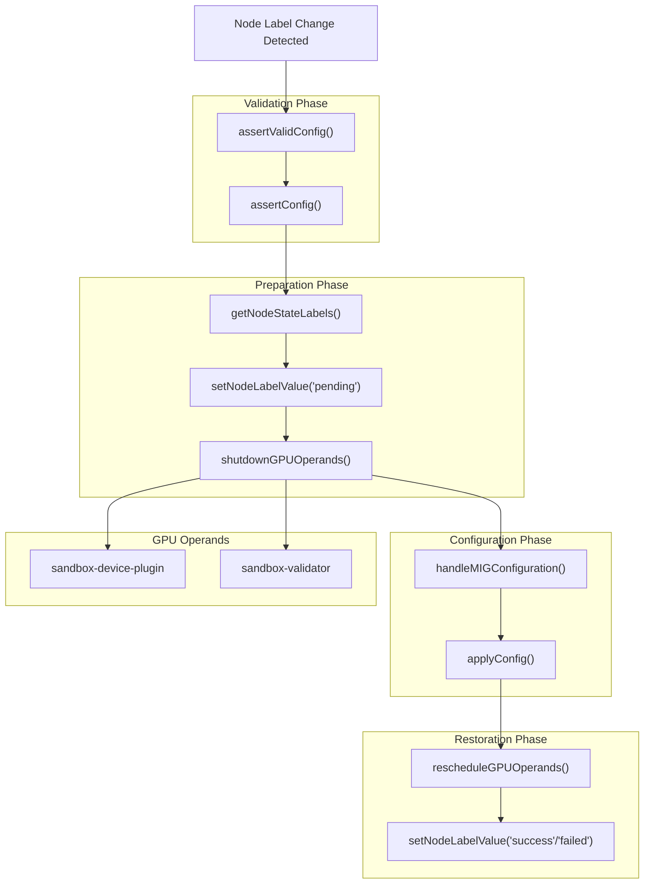
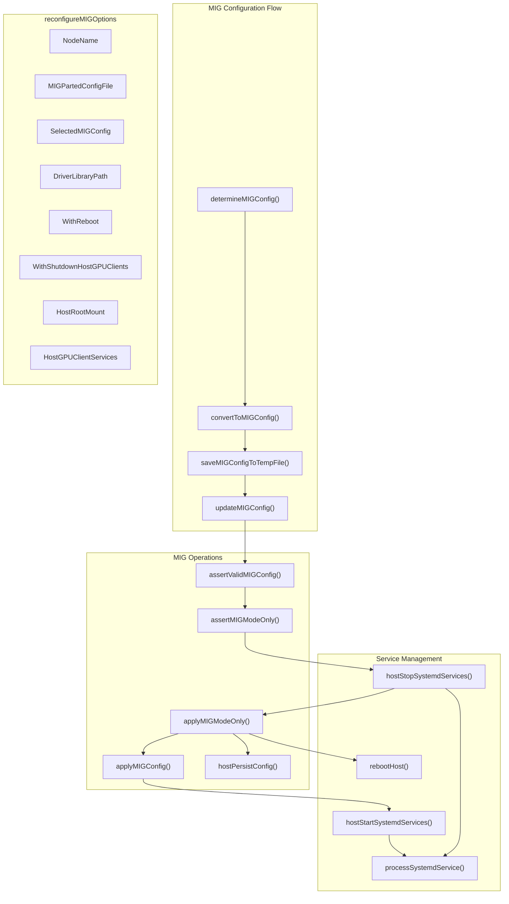
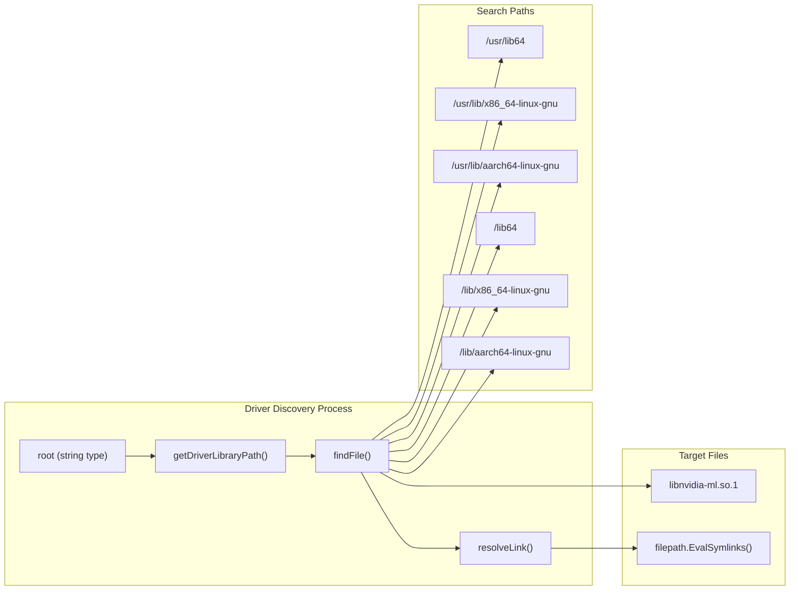

<!-- source: DeepWiki mcp.deepwiki.com · repo NVIDIA/vgpu-device-manager · page 2.2 Kubernetes Daemon (nvidia-k8s-vgpu-dm) · fetched 2026-10-26 -->

# Kubernetes Daemon (nvidia-k8s-vgpu-dm)

<details>
<summary>Relevant source files</summary>

The following files were used as context for generating this wiki page:

- [cmd/nvidia-k8s-vgpu-dm/find.go](cmd/nvidia-k8s-vgpu-dm/find.go)
- [cmd/nvidia-k8s-vgpu-dm/main.go](cmd/nvidia-k8s-vgpu-dm/main.go)
- [cmd/nvidia-k8s-vgpu-dm/reconfigure_mig.go](cmd/nvidia-k8s-vgpu-dm/reconfigure_mig.go)

</details>


The `nvidia-k8s-vgpu-dm` daemon is responsible for monitoring and managing vGPU configurations on Kubernetes nodes. It watches for configuration changes via node labels, applies vGPU device configurations, manages MIG (Multi-Instance GPU) settings, and coordinates the lifecycle of GPU operands such as device plugins and validators.

This daemon operates as a long-running process on each GPU-enabled node, continuously monitoring for configuration changes and ensuring the node's GPU configuration matches the desired state. For information about the CLI tool that this daemon uses internally, see [CLI Tools (nvidia-vgpu-dm)](#2.1). For details about the configuration format, see [Configuration System](#2.3).

## System Architecture

The daemon implements a reactive architecture that responds to Kubernetes node label changes and manages the complete GPU configuration lifecycle.

```mermaid
graph TB
    subgraph "main.go Core Components"
        main_start["start()"]
        main_validate["validateFlags()"]
        sync_config["SyncableVGPUConfig"]
        continuous_sync["continuouslySyncVGPUConfigChanges()"]
        update_config["updateConfig()"]
    end
    
    subgraph "Configuration Management"
        assert_valid["assertValidConfig()"]
        assert_config["assertConfig()"]
        apply_config["applyConfig()"]
        handle_mig["handleMIGConfiguration()"]
    end
    
    subgraph "Driver Discovery (find.go)"
        driver_root["root"]
        get_driver_path["getDriverLibraryPath()"]
        find_file["findFile()"]
        resolve_link["resolveLink()"]
    end
    
    subgraph "MIG Management (reconfigure_mig.go)"
        reconfig_mig["reconfigureMIG()"]
        reconfig_opts["reconfigureMIGOptions"]
        assert_mig["assertMIGConfig()"]
        apply_mig["applyMIGConfig()"]
        host_persist["hostPersistConfig()"]
    end
    
    subgraph "GPU Operands Management"
        shutdown_ops["shutdownGPUOperands()"]
        reschedule_ops["rescheduleGPUOperands()"]
        wait_deletion["waitForPodDeletion()"]
    end
    
    subgraph "Node Label Management"
        get_label["getNodeLabelValue()"]
        set_label["setNodeLabelValue()"]
        get_state["getNodeStateLabels()"]
    end
    
    main_start --> main_validate
    main_start --> sync_config
    main_start --> continuous_sync
    main_start --> update_config
    
    update_config --> assert_valid
    update_config --> assert_config
    update_config --> shutdown_ops
    update_config --> handle_mig
    update_config --> apply_config
    update_config --> reschedule_ops
    
    handle_mig --> get_driver_path
    handle_mig --> reconfig_mig
    
    get_driver_path --> find_file
    find_file --> resolve_link
    
    reconfig_mig --> reconfig_opts
    reconfig_mig --> assert_mig
    reconfig_mig --> apply_mig
    reconfig_mig --> host_persist
    
    shutdown_ops --> wait_deletion
    continuous_sync --> sync_config
    
    update_config --> get_state
    update_config --> set_label
```



Sources: [cmd/nvidia-k8s-vgpu-dm/main.go:127-314](), [cmd/nvidia-k8s-vgpu-dm/find.go:24-71](), [cmd/nvidia-k8s-vgpu-dm/reconfigure_mig.go:47-194]()

## Node Label Monitoring

The daemon uses a `SyncableVGPUConfig` struct to coordinate configuration changes based on Kubernetes node label modifications. It monitors the `nvidia.com/vgpu.config` label and triggers configuration updates when changes are detected.

```mermaid
graph TB
    subgraph "Node Label Monitoring"
        list_watch["cache.NewListWatchFromClient()"]
        informer["cache.NewInformerWithOptions()"]
        syncable["SyncableVGPUConfig"]
        
        subgraph "Event Handlers"
            add_func["AddFunc()"]
            update_func["UpdateFunc()"]
        end
        
        subgraph "Label Constants"
            vgpu_label['"nvidia.com/vgpu.config"']
            state_label['"nvidia.com/vgpu.config.state"']
            plugin_label['"nvidia.com/gpu.deploy.sandbox-device-plugin"']
            validator_label['"nvidia.com/gpu.deploy.sandbox-validator"']
        end
    end
    
    subgraph "Configuration Synchronization"
        sync_set["syncableVGPUConfig.Set()"]
        sync_get["syncableVGPUConfig.Get()"]
        sync_cond["sync.Cond"]
        sync_mutex["sync.Mutex"]
    end
    
    list_watch --> informer
    informer --> add_func
    informer --> update_func
    
    add_func --> vgpu_label
    update_func --> vgpu_label
    
    add_func --> sync_set
    update_func --> sync_set
    
    sync_set --> sync_cond
    sync_get --> sync_cond
    sync_cond --> sync_mutex
    
    syncable --> sync_set
    syncable --> sync_get
```

Sources: [cmd/nvidia-k8s-vgpu-dm/main.go:86-125](), [cmd/nvidia-k8s-vgpu-dm/main.go:316-345](), [cmd/nvidia-k8s-vgpu-dm/main.go:48-59]()

The `SyncableVGPUConfig` implements a thread-safe mechanism where `Get()` calls block until a corresponding `Set()` call is made, ensuring that configuration changes are processed sequentially.

## Configuration Management Workflow

The daemon orchestrates a multi-step process to safely apply vGPU configurations, including validation, GPU operand management, and MIG configuration.



Sources: [cmd/nvidia-k8s-vgpu-dm/main.go:347-394](), [cmd/nvidia-k8s-vgpu-dm/main.go:459-499](), [cmd/nvidia-k8s-vgpu-dm/main.go:527-544]()

| Function | Purpose | CLI Command Used |
|----------|---------|------------------|
| `assertValidConfig()` | Validates configuration exists | `nvidia-vgpu-dm assert --valid-config` |
| `assertConfig()` | Checks if configuration is applied | `nvidia-vgpu-dm assert` |
| `applyConfig()` | Applies vGPU configuration | `nvidia-vgpu-dm apply` |

## MIG Configuration Management

The daemon integrates with `nvidia-mig-parted` to handle Multi-Instance GPU configurations, including mode changes, service lifecycle management, and optional node reboots.



Sources: [cmd/nvidia-k8s-vgpu-dm/main.go:591-693](), [cmd/nvidia-k8s-vgpu-dm/reconfigure_mig.go:90-194](), [cmd/nvidia-k8s-vgpu-dm/reconfigure_mig.go:270-304]()

The `reconfigureMIGOptions` struct contains comprehensive validation rules using the `validator` package, ensuring proper systemd service names and file paths before executing MIG operations.

## Driver Discovery

The daemon locates NVIDIA driver libraries required for GPU operations through a systematic search across standard system paths.



Sources: [cmd/nvidia-k8s-vgpu-dm/find.go:26-71]()

The `root` type provides methods for locating driver files within a specified root directory, supporting both direct file access and symlink resolution across multiple architecture-specific paths.

## GPU Operands Lifecycle Management

The daemon manages the lifecycle of GPU-related Kubernetes components by manipulating node labels and waiting for pod termination.

```mermaid
graph TB
    subgraph "Shutdown Workflow"
        get_node_labels["getNodeStateLabels()"]
        maybe_set_paused["maybeSetPaused()"]
        update_node["clientset.Update()"]
        wait_plugin["waitForPodDeletion(sandbox-device-plugin)"]
        wait_validator["waitForPodDeletion(sandbox-validator)"]
    end
    
    subgraph "Label Management"
        plugin_state['"nvidia.com/gpu.deploy.sandbox-device-plugin"']
        validator_state['"nvidia.com/gpu.deploy.sandbox-validator"']
        paused_value['"paused-for-vgpu-change"']
    end
    
    subgraph "Reschedule Workflow"
        maybe_set_true["maybeSetTrue()"]
        restore_labels["Update node labels"]
    end
    
    subgraph "Pod Selection"
        field_selector['"spec.nodeName=<node>"']
        plugin_selector['"app=nvidia-sandbox-device-plugin-daemonset"']
        validator_selector['"app=nvidia-sandbox-validator"']
    end
    
    get_node_labels --> maybe_set_paused
    maybe_set_paused --> plugin_state
    maybe_set_paused --> validator_state
    maybe_set_paused --> paused_value
    maybe_set_paused --> update_node
    
    update_node --> wait_plugin
    update_node --> wait_validator
    
    wait_plugin --> field_selector
    wait_plugin --> plugin_selector
    wait_validator --> field_selector
    wait_validator --> validator_selector
    
    wait_validator --> maybe_set_true
    maybe_set_true --> restore_labels
```

Sources: [cmd/nvidia-k8s-vgpu-dm/main.go:459-558](), [cmd/nvidia-k8s-vgpu-dm/main.go:501-525]()

The daemon uses a 120-second timeout for pod deletion operations and implements polling with 1-second intervals to monitor pod termination status.

## Integration Points

The daemon integrates with multiple external systems and CLI tools to provide comprehensive vGPU management.

| Component | Integration Method | Purpose |
|-----------|-------------------|---------|
| `nvidia-vgpu-dm` CLI | `exec.Command()` calls | Configuration validation and application |
| `nvidia-mig-parted` CLI | `exec.Command()` with `LD_PRELOAD` | MIG configuration management |
| Kubernetes API | `client-go` library | Node monitoring and label management |
| systemd | `chroot` + `systemctl` commands | Host service lifecycle management |
| Host filesystem | Mount paths and file operations | Driver discovery and configuration persistence |

Sources: [cmd/nvidia-k8s-vgpu-dm/main.go:397-433](), [cmd/nvidia-k8s-vgpu-dm/reconfigure_mig.go:397-401](), [cmd/nvidia-k8s-vgpu-dm/reconfigure_mig.go:255-268]()

The daemon operates with elevated privileges to manage host system services and requires specific mount points (`/host` for host root, `/driver-root` for driver files) to function correctly in containerized environments.

---

