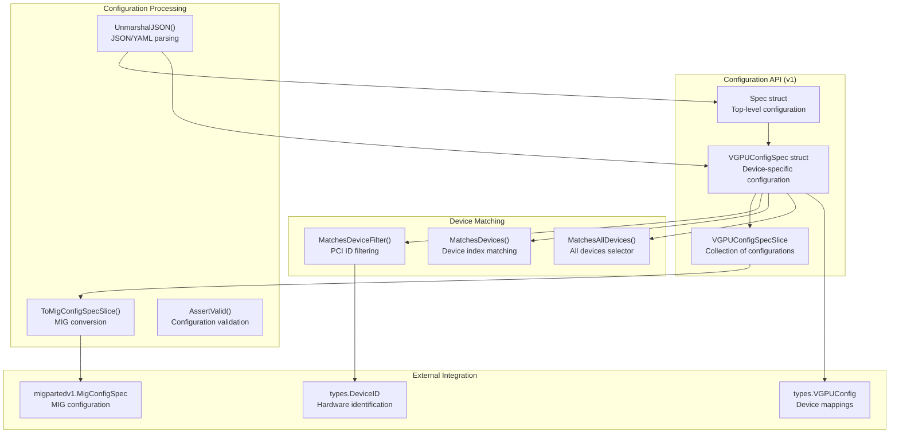
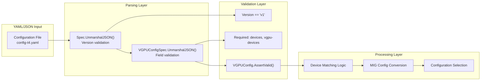
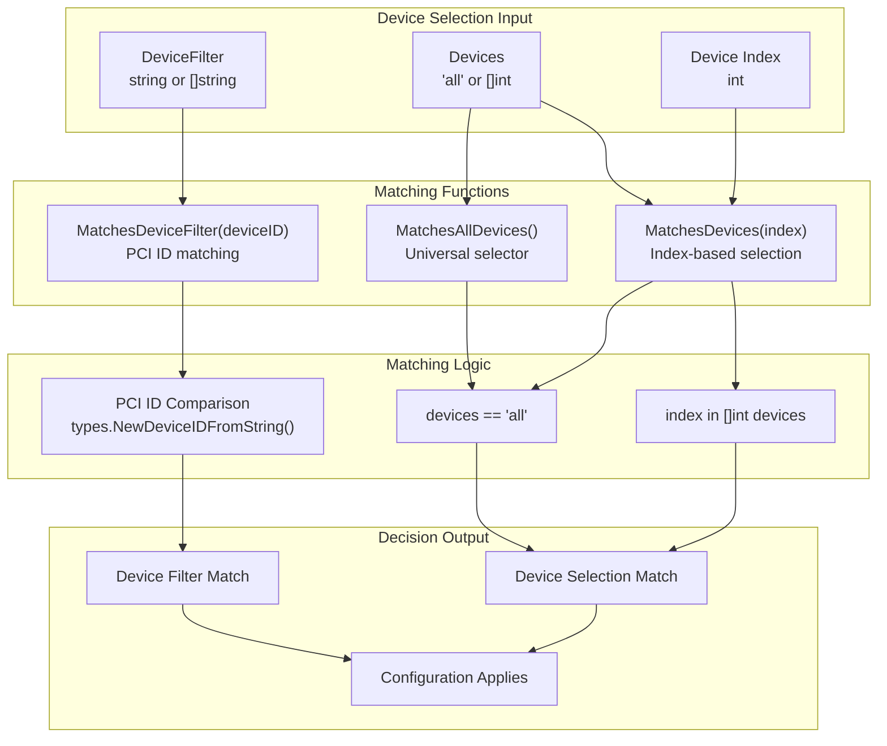
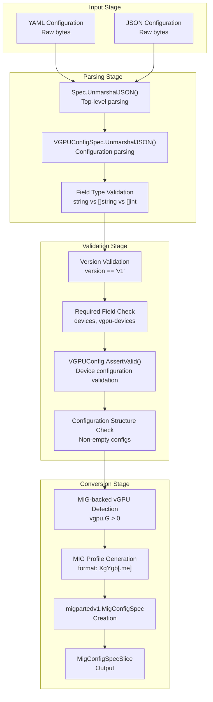

<!-- source: DeepWiki mcp.deepwiki.com · repo NVIDIA/vgpu-device-manager · page 2.3 Configuration System · fetched 2026-10-26 -->

# Configuration System

Relevant source files

The following files were used as context for generating this wiki page:

- [api/spec/v1/helpers.go](api/spec/v1/helpers.go)
- [api/spec/v1/spec.go](api/spec/v1/spec.go)
- [api/spec/v1/spec_test.go](api/spec/v1/spec_test.go)

## Purpose and Scope

The Configuration System provides the core infrastructure for parsing, validating, and processing vGPU device configurations across the NVIDIA vGPU Device Manager. This system handles YAML/JSON configuration files that define how virtual GPU devices should be allocated and managed on physical GPU hardware.

The configuration system serves both the CLI tool (`nvidia-vgpu-dm`) and the Kubernetes daemon (`nvidia-k8s-vgpu-dm`) by providing a unified specification format and device matching logic. For information about how these applications use the configuration system, see [CLI Tools](#2.1) and [Kubernetes Daemon](#2.2). For details about the actual configuration file format and examples, see [Configuration Format & Examples](#3).

## Configuration Architecture

The configuration system is built around a versioned API specification that defines how vGPU configurations are structured and processed.

### Core Configuration Components

**Sources:** [api/spec/v1/spec.go:33-46](), [api/spec/v1/helpers.go:23-68]()

## Configuration Data Model

The configuration system uses a hierarchical structure to define vGPU device allocations:

### Primary Configuration Structures

| Component | Purpose | Key Fields |
|-----------|---------|------------|
| `Spec` | Top-level configuration container | `Version`, `VGPUConfigs` |
| `VGPUConfigSpec` | Individual GPU configuration | `DeviceFilter`, `Devices`, `VGPUDevices` |
| `VGPUConfigSpecSlice` | Collection of configurations | Array of `VGPUConfigSpec` |

### Configuration Schema Flow

**Sources:** [api/spec/v1/spec.go:48-95](), [api/spec/v1/spec.go:97-164]()

## Device Matching System

The configuration system implements flexible device selection through multiple matching strategies:

### Device Selection Methods

**Sources:** [api/spec/v1/helpers.go:24-47](), [api/spec/v1/helpers.go:50-68]()

### Device Filter Processing

The `MatchesDeviceFilter` function handles both single device filters and arrays of device filters:

- **Single Device Filter**: `DeviceFilter` as `string` - matches one specific PCI device ID
- **Multiple Device Filters**: `DeviceFilter` as `[]string` - matches any device ID in the array  
- **No Filter**: Empty `DeviceFilter` - matches all devices by default

The `Devices` field supports two modes:
- **Universal Selection**: `"all"` - applies configuration to all matching devices
- **Index-based Selection**: `[]int` - applies configuration only to devices at specified indices

**Sources:** [api/spec/v1/helpers.go:24-47](), [api/spec/v1/helpers.go:57-68]()

## Configuration Processing Flow

The system processes configurations through a multi-stage pipeline that handles parsing, validation, and conversion:

### Processing Pipeline

**Sources:** [api/spec/v1/spec.go:48-95](), [api/spec/v1/spec.go:97-164](), [api/spec/v1/spec.go:166-202]()

## MIG Configuration Integration

The configuration system provides seamless integration with NVIDIA Multi-Instance GPU (MIG) technology through automatic conversion of vGPU specifications to MIG configurations:

### MIG Conversion Process

The `ToMigConfigSpecSlice` method analyzes vGPU types to determine if they require MIG partitioning:

| vGPU Type Pattern | MIG Profile | MIG Enabled |
|------------------|-------------|-------------|
| `A100-1-5C` | `1g.5gb` | Yes |
| `A100-2-10C` | `2g.10gb` | Yes |
| `A100-1-5CME` | `1g.5gb.me` | Yes |
| `A100-40C` | N/A | No |

The conversion logic in `ToMigConfigSpecSlice()` parses vGPU types using `types.ParseVGPUType()` and generates corresponding MIG profiles. Media Extensions (`ME`) attribute adds `.me` suffix to MIG profiles.

**Sources:** [api/spec/v1/spec.go:166-202](), [api/spec/v1/spec_test.go:239-424]()

## Error Handling and Validation

The configuration system implements comprehensive error handling across multiple validation layers:

### Validation Categories

- **Version Validation**: Ensures configuration uses supported API version (`v1`)
- **Structure Validation**: Validates required fields and proper JSON/YAML structure  
- **Type Validation**: Handles polymorphic fields (`DeviceFilter`, `Devices`) with multiple type options
- **Content Validation**: Validates vGPU device configurations and device filter formats
- **Conversion Validation**: Ensures valid vGPU types during MIG configuration conversion

The system uses detailed error messages with context about which field caused validation failures, enabling efficient debugging of configuration issues.

**Sources:** [api/spec/v1/spec.go:56-94](), [api/spec/v1/spec.go:105-163](), [api/spec/v1/spec_test.go:31-151]()

---

