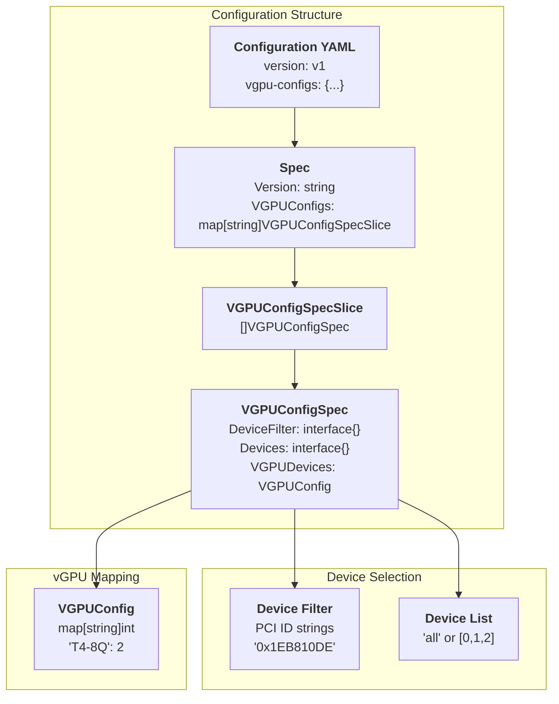
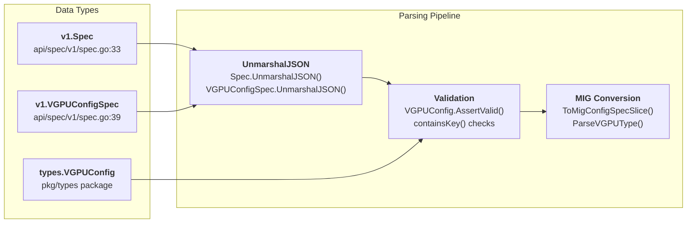
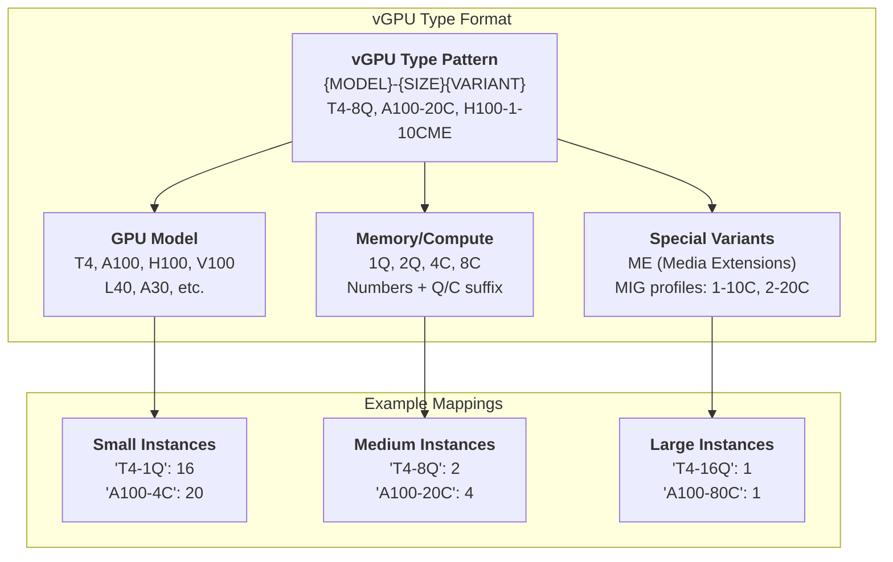
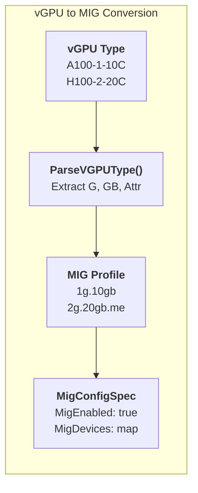
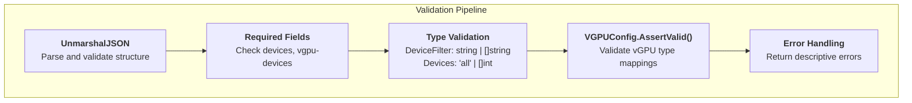

<!-- source: DeepWiki mcp.deepwiki.com · repo NVIDIA/vgpu-device-manager · page 3 Configuration Format & Examples · fetched 2026-10-26 -->

# Configuration Format & Examples

<details>
<summary>Relevant source files</summary>

The following files were used as context for generating this wiki page:

- [api/spec/v1/spec.go](api/spec/v1/spec.go)
- [examples/config-example.yaml](examples/config-example.yaml)
- [examples/config-t4.yaml](examples/config-t4.yaml)

</details>


This document describes the YAML configuration format used by the NVIDIA vGPU Device Manager to specify virtual GPU configurations. The configuration system defines how physical GPUs should be partitioned into virtual GPU devices and which devices should receive specific configurations.

For information about how configurations are applied and validated, see [CLI Tools](#2.1). For details on the configuration parsing and device matching logic, see [Configuration System](#2.3).

## Configuration Schema Overview

The vGPU Device Manager uses a versioned YAML configuration format that maps configuration names to device specifications. Each configuration defines which physical devices to target and how to partition them into virtual GPU instances.



**Sources:** [api/spec/v1/spec.go:29-46](), [examples/config-t4.yaml:1-53]()

## Core Data Structures

The configuration system is built around several key Go types that handle parsing, validation, and device matching:



**Sources:** [api/spec/v1/spec.go:48-95](), [api/spec/v1/spec.go:97-164](), [api/spec/v1/spec.go:166-202]()

## Device Selection Mechanisms

The configuration system provides flexible device targeting through two complementary mechanisms:

### Device Filter Options

| Filter Type | Format | Example | Description |
|-------------|--------|---------|-------------|
| Single PCI ID | String | `"0x1EB810DE"` | Matches specific GPU model |
| Multiple PCI IDs | String Array | `["0x1EB810DE", "0x223610DE"]` | Matches multiple GPU models |
| No Filter | Omitted | N/A | Applies to all detected GPUs |

### Device Selection Options

| Selection Type | Format | Example | Description |
|----------------|--------|---------|-------------|
| All Devices | String | `"all"` | Targets all matching devices |
| Specific Indices | Integer Array | `[0, 1, 2]` | Targets devices by index |

**Sources:** [api/spec/v1/spec.go:115-145](), [examples/config-t4.yaml:31-52]()

## vGPU Type Specifications

Each vGPU configuration maps vGPU type identifiers to the number of instances to create:



**Sources:** [examples/config-example.yaml:3-2888](), [examples/config-t4.yaml:4-27]()

## Basic Configuration Examples

### Simple T4 Configuration

```yaml
version: v1
vgpu-configs:
  T4-8Q:
    - devices: all
      vgpu-devices:
        "T4-8Q": 2
```

### Multi-Device Configuration

```yaml
version: v1
vgpu-configs:
  T4-mixed:
    - devices: [0]
      vgpu-devices:
        "T4-4Q": 4
    - devices: [1]
      vgpu-devices:
        "T4-8Q": 2
```

### Device Filter Configuration

```yaml
version: v1
vgpu-configs:
  default:
    - device-filter: "0x1EB810DE"
      devices: all
      vgpu-devices:
        "T4-8Q": 2
    - device-filter: "0x20B510DE"
      devices: all
      vgpu-devices:
        "A100D-40C": 2
```

**Sources:** [examples/config-t4.yaml:4-53](), [examples/config-example.yaml:2643-2888]()

## Advanced Configuration Patterns

### MIG-Enabled Configurations

The system automatically converts vGPU types with MIG profiles to appropriate MIG configurations:



### Multi-GPU Configurations

```yaml
version: v1
vgpu-configs:
  datacenter-mixed:
    - device-filter: ["0x20B510DE", "0x20B710DE"]
      devices: all
      vgpu-devices:
        "A100D-40C": 2
        "A30-12C": 2
```

**Sources:** [api/spec/v1/spec.go:166-202](), [examples/config-example.yaml:119-158]()

## Configuration Validation

The configuration system performs comprehensive validation during parsing:

### Required Fields Validation

| Field | Requirement | Validation |
|-------|-------------|------------|
| `version` | Required | Must be "v1" |
| `vgpu-configs` | Required | Must contain at least one entry |
| `devices` | Required | Must be "all" or integer array |
| `vgpu-devices` | Required | Must pass `AssertValid()` |

### Type-Specific Validation



**Sources:** [api/spec/v1/spec.go:105-110](), [api/spec/v1/spec.go:152-156]()

## Integration with MIG Partitioning

The configuration system seamlessly integrates with NVIDIA MIG (Multi-Instance GPU) through automatic conversion:

### MIG Profile Generation

```yaml
# vGPU Configuration Input
vgpu-devices:
  "A100-1-10C": 7
  "A100-2-20C": 3

# Converted MIG Configuration
mig-devices:
  "1g.10gb": 7
  "2g.20gb": 3
```

### Media Extensions Support

```yaml
# vGPU with Media Extensions
vgpu-devices:
  "A100-1-10CME": 1

# MIG Profile with ME
mig-devices:
  "1g.10gb.me": 1
```

**Sources:** [api/spec/v1/spec.go:176-194](), [api/spec/v1/spec.go:186-192]()

---

