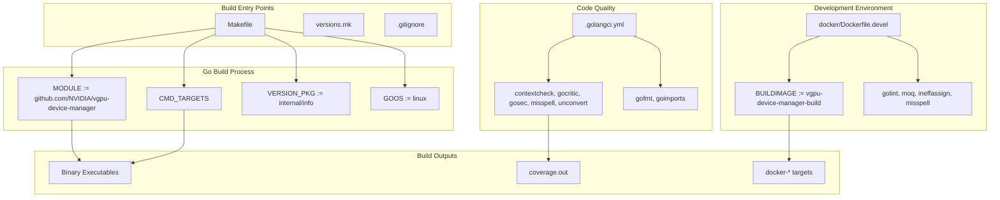
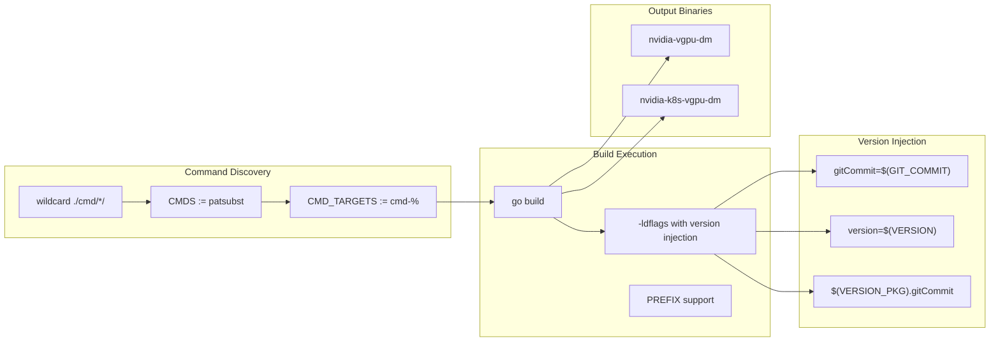
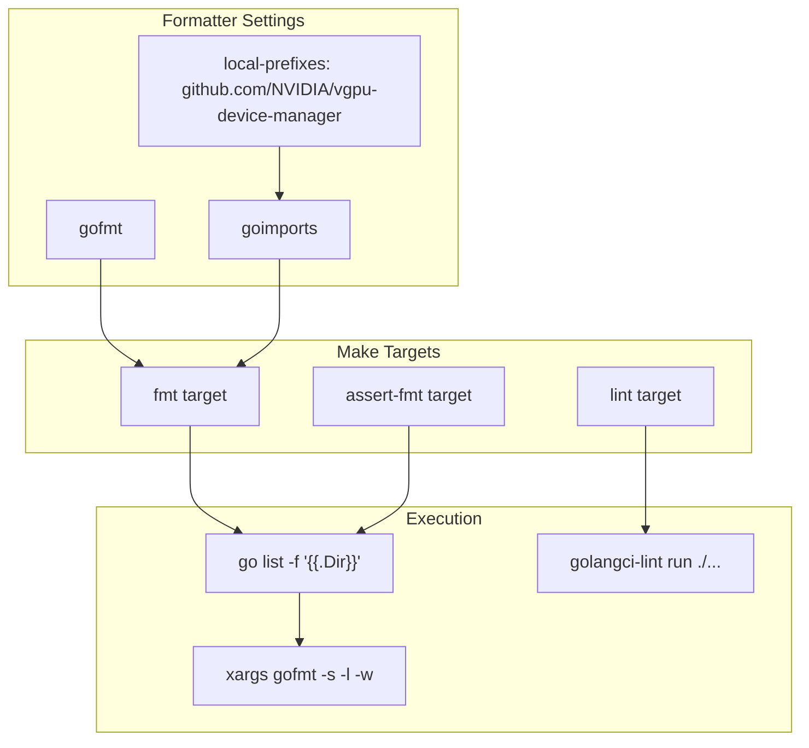
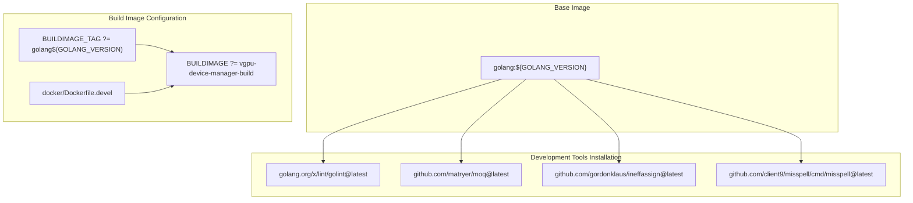
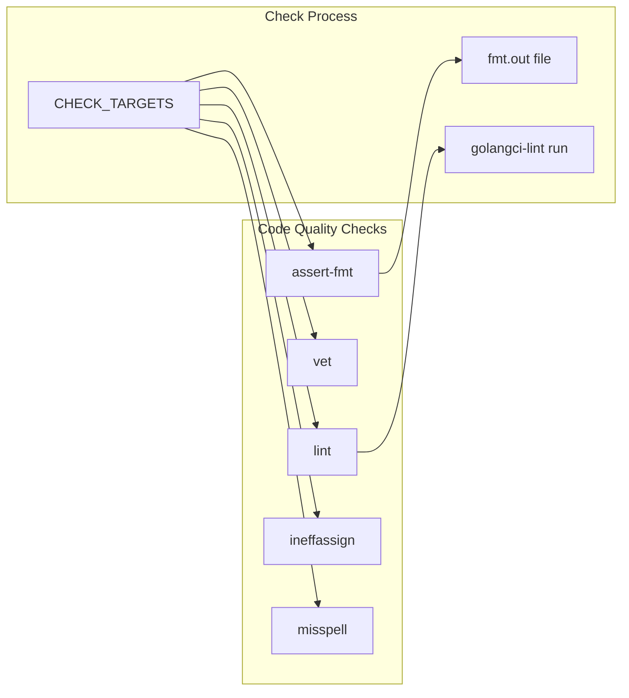
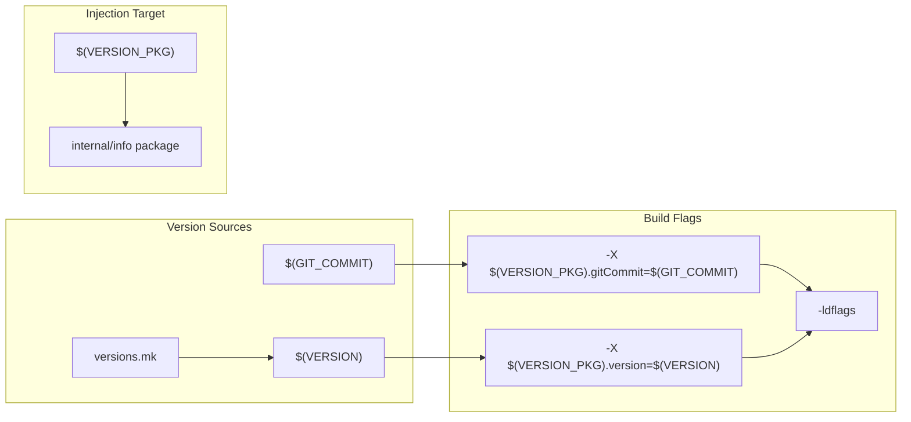

<!-- source: DeepWiki mcp.deepwiki.com · repo NVIDIA/vgpu-device-manager · page 4 Build System & Development · fetched 2026-10-26 -->

# Build System & Development

<details>
<summary>Relevant source files</summary>

The following files were used as context for generating this wiki page:

- [.gitignore](.gitignore)
- [.golangci.yml](.golangci.yml)
- [Makefile](Makefile)
- [docker/Dockerfile.devel](docker/Dockerfile.devel)

</details>


This document covers the build system, development environment setup, and development workflows for the NVIDIA vGPU Device Manager project. It explains the Make-based build system, Go compilation process, code quality tools, and development container setup.

For information about container image builds and deployment, see [Container Images](#4.1). For CI/CD pipeline details, see [CI/CD Pipelines](#5).

## Overview

The NVIDIA vGPU Device Manager uses a comprehensive build system built around Go's native tooling, Make, and Docker. The system supports cross-compilation, code quality enforcement, testing, and development environment containerization.

### Build System Architecture



**Sources:** [Makefile:1-106](), [.golangci.yml:1-43](), [docker/Dockerfile.devel:1-21]()

## Go Build Configuration

The project is configured as a Go module with specific build settings for cross-compilation and version injection.

### Module and Build Settings

| Setting | Value | Purpose |
|---------|-------|---------|
| `MODULE` | `github.com/NVIDIA/vgpu-device-manager` | Go module identifier |
| `GOOS` | `linux` | Target operating system |
| `VERSION_PKG` | `internal/info` | Package for version injection |
| `BUILDIMAGE_TAG` | `golang$(GOLANG_VERSION)` | Development container tag |

**Sources:** [Makefile:15](), [Makefile:35](), [Makefile:36]()

### Command Build Process



**Sources:** [Makefile:24-25](), [Makefile:42-44]()

## Code Quality and Linting

The project enforces code quality through golangci-lint with specific linter configurations and formatting rules.

### Linter Configuration

The `.golangci.yml` file configures multiple linters with specific exclusions:

| Linter | Purpose |
|--------|---------|
| `contextcheck` | Context usage validation |
| `gocritic` | Go code criticism |
| `gosec` | Security vulnerability detection |
| `misspell` | Spelling error detection |
| `unconvert` | Unnecessary type conversions |

**Exclusions:**
- Test files (`.*_test.go`) for specific gosec rules
- Third-party code (`third_party$`, `builtin$`, `examples$`)
- Generated code with lax enforcement

**Sources:** [.golangci.yml:3-8](), [.golangci.yml:17-24](), [.golangci.yml:26-28]()

### Formatting Configuration



**Sources:** [.golangci.yml:29-36](), [Makefile:49-52](), [Makefile:66-68]()

## Development Environment

### Docker Development Container

The development environment is containerized using a custom Docker image that extends the official Go image with additional development tools.



**Sources:** [docker/Dockerfile.devel:14-21](), [Makefile:21-22]()

### Docker Build Targets

The Makefile provides Docker-wrapped versions of all build targets for consistent development environments:

**Docker Target Execution Pattern:**
```bash
docker run --rm -e GOCACHE=/tmp/.cache -v $(PWD):$(PWD) -w $(PWD) --user $(id -u):$(id -g) $(BUILDIMAGE) make $(TARGET)
```

**Sources:** [Makefile:96-105]()

## Build Targets

### Primary Build Targets

| Target | Purpose | Dependencies |
|--------|---------|--------------|
| `cmds` | Build all command binaries | `$(CMD_TARGETS)` |
| `build` | Compile all packages | None |
| `test` | Run tests with coverage | `build` |
| `lint` | Run linting checks | None |
| `fmt` | Format code | None |
| `coverage` | Generate coverage report | `test` |

**Sources:** [Makefile:27-28](), [Makefile:42-76]()

### Check Targets



**Sources:** [Makefile:27](), [Makefile:54-64]()

## Testing and Coverage

### Test Execution

The testing system uses Go's built-in testing framework with coverage reporting:

**Test Command:**
```bash
go test -v -coverprofile=$(COVERAGE_FILE) $(MODULE)/...
```

**Coverage Processing:**
- Excludes mock files (`_mock.go`) from coverage calculations
- Generates both raw and filtered coverage reports
- Uses `go tool cover` for coverage analysis

**Sources:** [Makefile:70-76]()

### Coverage Configuration

| Variable | Value | Purpose |
|----------|-------|---------|
| `COVERAGE_FILE` | `coverage.out` | Primary coverage output |
| `$(COVERAGE_FILE).no-mocks` | `coverage.out.no-mocks` | Filtered coverage without mocks |

**Sources:** [Makefile:70](), [Makefile:75]()

## Version Management

The build system supports version injection through ldflags during compilation:



**Sources:** [Makefile:19](), [Makefile:36](), [Makefile:44]()

---

