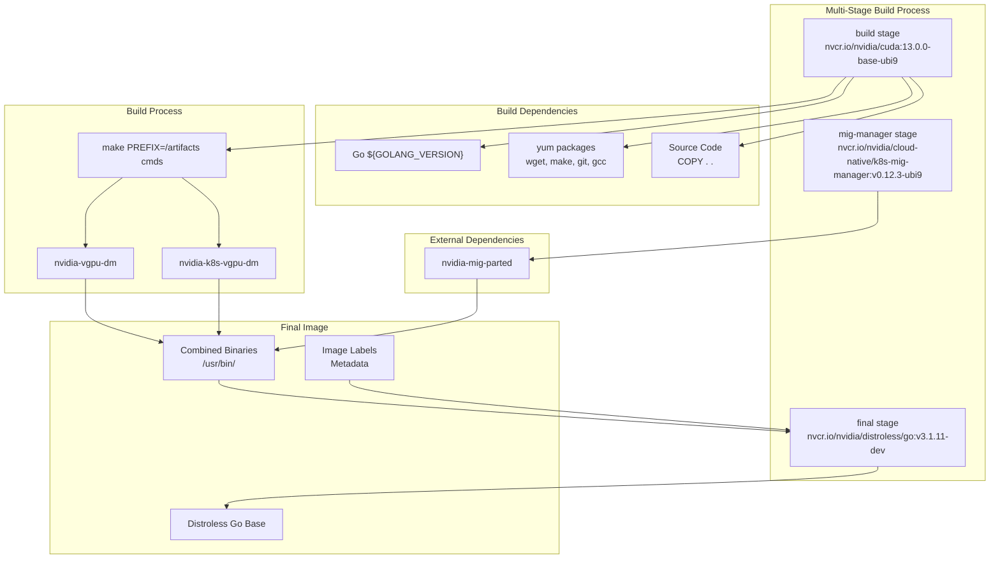
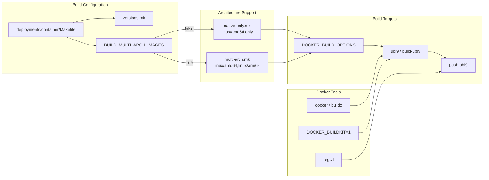

<!-- source: DeepWiki mcp.deepwiki.com · repo NVIDIA/vgpu-device-manager · page 4.1 Container Images · fetched 2026-10-26 -->

# Container Images

<details>
<summary>Relevant source files</summary>

The following files were used as context for generating this wiki page:

- [deployments/container/Dockerfile.ubi9](deployments/container/Dockerfile.ubi9)
- [deployments/container/Makefile](deployments/container/Makefile)
- [deployments/container/multi-arch.mk](deployments/container/multi-arch.mk)
- [deployments/container/native-only.mk](deployments/container/native-only.mk)

</details>


This document covers the container image build system for the NVIDIA vGPU Device Manager. It explains the multi-stage build process, multi-architecture support, and how the container images are constructed and deployed. For information about the overall build system including Go compilation, see [Build System & Development](#4). For CI/CD pipeline details that automate image builds, see [CI/CD Pipelines](#5).

## Build Architecture Overview

The container build system uses a multi-stage Docker build process to create lightweight, secure container images containing the vGPU device manager binaries.



Sources: [deployments/container/Dockerfile.ubi9:15-61]()

## Build System Configuration

The build system supports both native and multi-architecture builds through configurable Makefiles.



Sources: [deployments/container/Makefile:15-74](), [deployments/container/native-only.mk:15-20](), [deployments/container/multi-arch.mk:15-30]()

## Multi-Stage Build Process

### Build Stage

The first stage uses a CUDA base image to compile the Go binaries with all necessary development dependencies.

| Component | Description | Location |
|-----------|-------------|----------|
| Base Image | `nvcr.io/nvidia/cuda:13.0.0-base-ubi9` | [Dockerfile.ubi9:15]() |
| Go Installation | Architecture-aware Go installation | [Dockerfile.ubi9:19-30]() |
| Build Tools | `wget`, `make`, `git`, `gcc` | [Dockerfile.ubi9:17]() |
| Build Command | `make PREFIX=/artifacts cmds` | [Dockerfile.ubi9:39]() |

The build stage includes architecture detection logic to download the correct Go binary:

```
arch="$(uname -m)"; \
case "${arch##*-}" in \
    x86_64 | amd64) ARCH='amd64' ;; \
    ppc64el | ppc64le) ARCH='ppc64le' ;; \
    aarch64) ARCH='arm64' ;; \
    *) echo "unsupported architecture" ; exit 1 ;; \
esac;
```

Sources: [deployments/container/Dockerfile.ubi9:22-27]()

### MIG Manager Stage

The second stage extracts the `nvidia-mig-parted` binary from the NVIDIA MIG Manager image.

| Component | Value |
|-----------|-------|
| Source Image | `nvcr.io/nvidia/cloud-native/k8s-mig-manager:v0.12.3-ubi9` |
| Extracted Binary | `/usr/bin/nvidia-mig-parted` |

Sources: [deployments/container/Dockerfile.ubi9:41-49]()

### Final Stage

The final stage creates a minimal distroless image containing all required binaries.

```mermaid
graph TB
    subgraph "Final Image Composition"
        DISTROLESS["nvcr.io/nvidia/distroless/go:v3.1.11-dev"]
        NVIDIA_VISIBLE_DEVICES["ENV NVIDIA_VISIBLE_DEVICES=void"]
        USER_CONFIG["USER 0:0"]
        ENTRYPOINT_CONFIG["ENTRYPOINT nvidia-k8s-vgpu-dm"]
    end
    
    subgraph "Copied Binaries"
        VGPU_DM_COPY["COPY --from=build<br/>/artifacts/nvidia-vgpu-dm<br/>/usr/bin/nvidia-vgpu-dm"]
        K8S_VGPU_DM_COPY["COPY --from=build<br/>/artifacts/nvidia-k8s-vgpu-dm<br/>/usr/bin/nvidia-k8s-vgpu-dm"]
        MIG_PARTED_COPY["COPY --from=mig-manager<br/>/usr/bin/nvidia-mig-parted<br/>/usr/bin/nvidia-mig-parted"]
    end
    
    subgraph "Image Labels"
        VERSION_LABEL["version=${VERSION}"]
        VENDOR_LABEL["vendor=NVIDIA"]
        DISPLAY_NAME["io.k8s.display-name=<br/>NVIDIA vGPU Device Manager for Kubernetes"]
        SUMMARY_LABEL["summary=<br/>NVIDIA vGPU Device Manager for Kubernetes"]
    end
    
    DISTROLESS --> VGPU_DM_COPY
    DISTROLESS --> K8S_VGPU_DM_COPY
    DISTROLESS --> MIG_PARTED_COPY
    DISTROLESS --> VERSION_LABEL
    DISTROLESS --> VENDOR_LABEL
    DISTROLESS --> DISPLAY_NAME
    DISTROLESS --> SUMMARY_LABEL
    DISTROLESS --> NVIDIA_VISIBLE_DEVICES
    DISTROLESS --> USER_CONFIG
    DISTROLESS --> ENTRYPOINT_CONFIG
```



Sources: [deployments/container/Dockerfile.ubi9:43-61]()

## Build Targets and Options

### Supported Distributions

Currently, only UBI9-based images are supported:

| Target | Distribution | Dockerfile |
|--------|-------------|------------|
| `ubi9` | Red Hat UBI 9 | `Dockerfile.ubi9` |
| `build-ubi9` | Red Hat UBI 9 | `Dockerfile.ubi9` |
| `push-ubi9` | Push target | N/A |

Sources: [deployments/container/Makefile:38-44]()

### Build Arguments

The following build arguments can be customized:

| Argument | Purpose | Default |
|----------|---------|---------|
| `GOLANG_VERSION` | Go version to install | From `versions.mk` |
| `VERSION` | Image version label | From build system |
| `GIT_COMMIT` | Git commit for traceability | From build system |
| `CVE_UPDATES` | CVE update information | From build system |

Sources: [deployments/container/Makefile:68-71]()

### Multi-Architecture Support

The build system supports two modes:

#### Native-Only Mode (`BUILD_MULTI_ARCH_IMAGES=false`)
- Builds for `linux/amd64` only
- Uses standard Docker commands
- Pushes using `docker tag` and `docker push`

#### Multi-Architecture Mode (`BUILD_MULTI_ARCH_IMAGES=true`)  
- Intended for `linux/amd64,linux/arm64` support
- Uses Docker Buildx
- Uses `regctl` for image copying
- Currently restricted to `linux/amd64` for compatibility

Sources: [deployments/container/multi-arch.mk:16-29](), [deployments/container/native-only.mk:15-19]()

## Image Registry Configuration

### Registry Settings

| Variable | Default | Purpose |
|----------|---------|---------|
| `REGISTRY` | `nvidia` | Container registry prefix |
| `IMAGE_NAME` | `$(REGISTRY)/vgpu-device-manager` | Full image name |
| `IMAGE_VERSION` | `$(VERSION)` | Image tag version |

### Output Configuration

| Variable | Default | Purpose |
|----------|---------|---------|
| `OUT_IMAGE_NAME` | `$(IMAGE_NAME)` | Output image name |
| `OUT_IMAGE_VERSION` | `$(IMAGE_VERSION)` | Output image version |

Sources: [deployments/container/Makefile:25-35]()

## Build Commands

### Building Images

```bash
# Build UBI9 image (native architecture)
make ubi9

# Build with multi-architecture support
BUILD_MULTI_ARCH_IMAGES=true make ubi9

# Build and push in one step (multi-arch mode)
BUILD_MULTI_ARCH_IMAGES=true PUSH_ON_BUILD=true make ubi9
```

### Pushing Images

```bash
# Push to configured registry
make push-ubi9

# Push to custom registry
OUT_IMAGE_NAME=custom-registry/vgpu-device-manager make push-ubi9
```

Sources: [deployments/container/Makefile:62-73](), [deployments/container/multi-arch.mk:21-24]()

---

