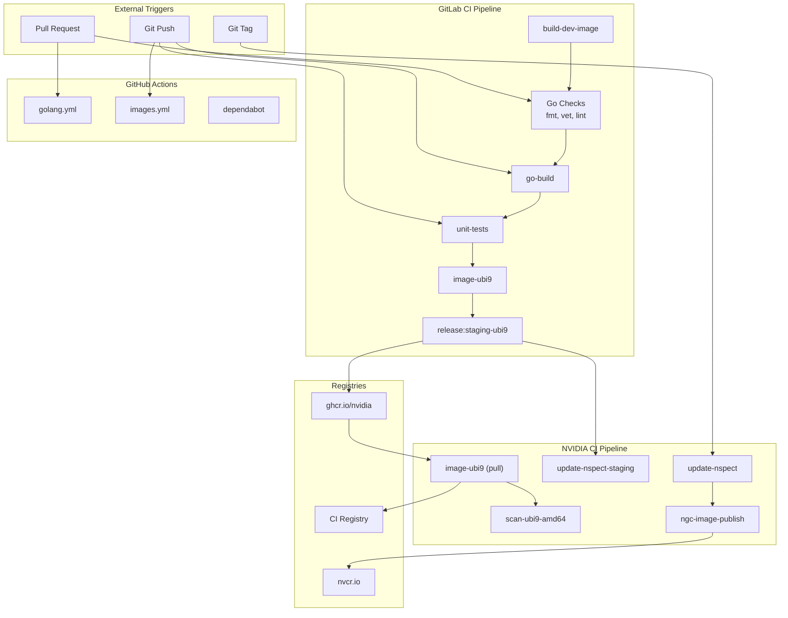
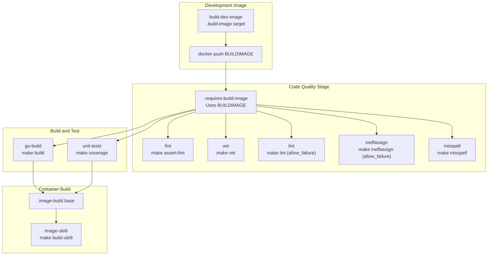
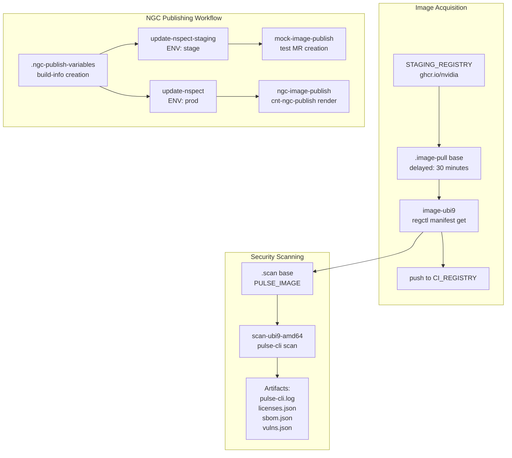
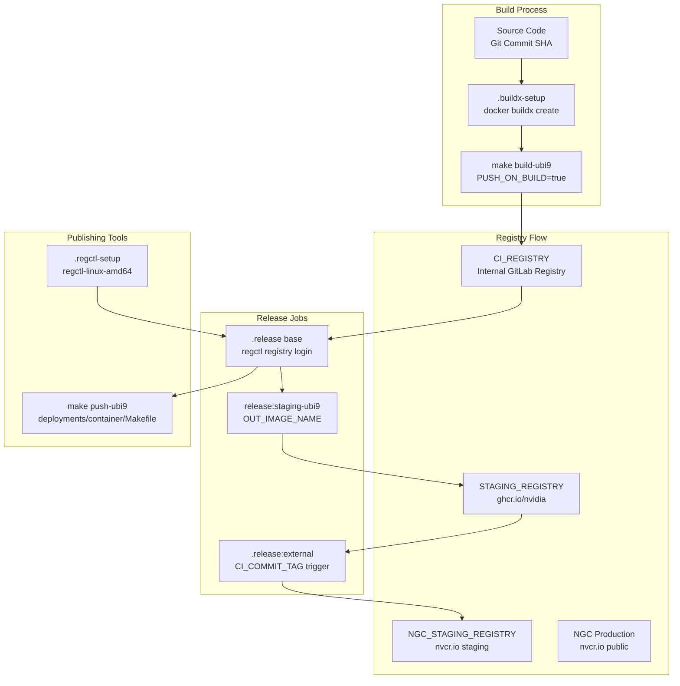

<!-- source: DeepWiki mcp.deepwiki.com · repo NVIDIA/vgpu-device-manager · page 5 CI/CD Pipelines · fetched 2026-10-26 -->

# CI/CD Pipelines

Relevant source files

The following files were used as context for generating this wiki page:

- [.common-ci.yml](.common-ci.yml)
- [.gitlab-ci.yml](.gitlab-ci.yml)
- [.nvidia-ci.yml](.nvidia-ci.yml)

This document provides an overview of the comprehensive CI/CD system that manages builds, testing, and releases for the NVIDIA vGPU Device Manager. The system spans multiple platforms including GitLab CI, GitHub Actions, and NVIDIA-specific internal pipelines, each with distinct responsibilities in the development and release workflow.

For detailed information about GitHub Actions workflows, see [GitHub Actions](#5.1). For code quality standards and security scanning processes, see [Code Quality & Security](#5.2).

## Multi-System CI/CD Architecture

The CI/CD infrastructure consists of three interconnected pipeline systems that work together to provide comprehensive coverage from development to production release.

Sources: [.gitlab-ci.yml:1-99](), [.nvidia-ci.yml:1-211](), [.common-ci.yml:1-153]()

## Common Configuration System

The CI/CD system uses a shared configuration approach with `.common-ci.yml` serving as the foundation for both GitLab and NVIDIA pipelines. This ensures consistency across different execution environments.

### Pipeline Stages and Variables

| Stage | Purpose | Key Jobs |
|-------|---------|----------|
| `image` | Build development images | `build-dev-image` |
| `lint` | Code quality checks | `fmt`, `vet`, `lint` |
| `go-checks` | Go-specific validation | `ineffassign`, `misspell` |
| `go-build` | Compile applications | `go-build` |
| `unit-tests` | Run test suites | `unit-tests` |
| `image-build` | Build container images | `image-ubi9` |
| `test` | Integration testing | `.integration` |
| `scan` | Security scanning | `scan-ubi9-amd64` |
| `release` | Registry deployment | `release:staging-ubi9` |
| `ngc-publish` | NGC publishing | `ngc-image-publish` |

Key configuration variables include:
- `BUILD_MULTI_ARCH_IMAGES: "true"` - Enables multi-architecture builds
- `BUILDIMAGE: "${CI_REGISTRY_IMAGE}/build:${CI_COMMIT_SHORT_SHA}"` - Development image reference
- Platform targets: `PLATFORM: linux/amd64`, `PLATFORM: linux/arm64`
- Distribution targets: `DIST: ubi9`

Sources: [.common-ci.yml:21-50](), [.common-ci.yml:25-35]()

## GitLab CI Pipeline

The GitLab pipeline serves as the primary CI/CD system, handling the complete workflow from code validation to initial image publishing.

### Key Job Configurations

The GitLab pipeline uses several important base configurations:

- `.requires-build-image`: Extends jobs to use the development container built in the `image` stage
- `.go-check`: Base for all Go code quality checks, extends `.requires-build-image`
- `.image-build`: Configures Docker buildx setup for multi-architecture builds

Sources: [.gitlab-ci.yml:18-99](), [.gitlab-ci.yml:26-28](), [.gitlab-ci.yml:29-33]()

## NVIDIA CI Pipeline

The NVIDIA internal pipeline focuses on security scanning, compliance, and final publishing to NGC registry. It operates on images built by the GitLab pipeline.

### NVIDIA Pipeline Specializations

The NVIDIA pipeline includes several unique features:

- **Delayed Image Pull**: Uses `when: delayed` and `start_in: 30 minutes` to allow upstream pipelines to complete
- **Container Tags**: Runs on specialized runners with tags `cnt`, `container-dev`, `docker/multi-arch`
- **Pulse Security Scanning**: Uses `pulse-cli` for comprehensive security analysis
- **NGC Publishing Automation**: Uses `cnt-ngc-publish` tool for registry management

Sources: [.nvidia-ci.yml:39-72](), [.nvidia-ci.yml:81-112](), [.nvidia-ci.yml:177-211]()

## Image Build and Release Flow

The system manages a complex flow of container images across multiple registries with different purposes and access controls.

### Registry Strategy

The multi-registry approach serves different purposes:

| Registry | Purpose | Access | Image Tags |
|----------|---------|--------|------------|
| `CI_REGISTRY` | Internal GitLab registry | Private | `${CI_COMMIT_SHORT_SHA}` |
| `ghcr.io/nvidia` | Public staging | Public | `${CI_COMMIT_SHORT_SHA}` |
| `NGC_STAGING_REGISTRY` | NVIDIA staging | Internal | Release testing |
| NGC Production | Public release | Public | `${CI_COMMIT_TAG}` |

The system uses `regctl` for advanced registry operations and supports multi-architecture manifests for `linux/amd64` and `linux/arm64` platforms.

Sources: [.common-ci.yml:81-153](), [.nvidia-ci.yml:39-72](), [.common-ci.yml:52-63]()

---

