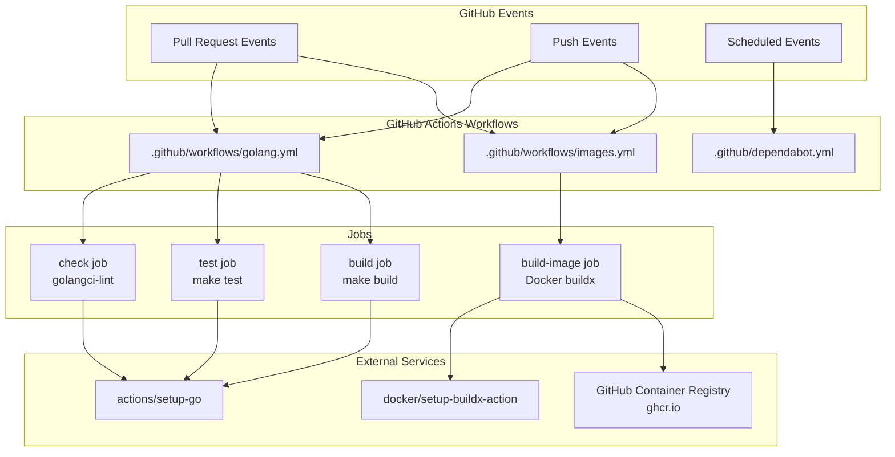
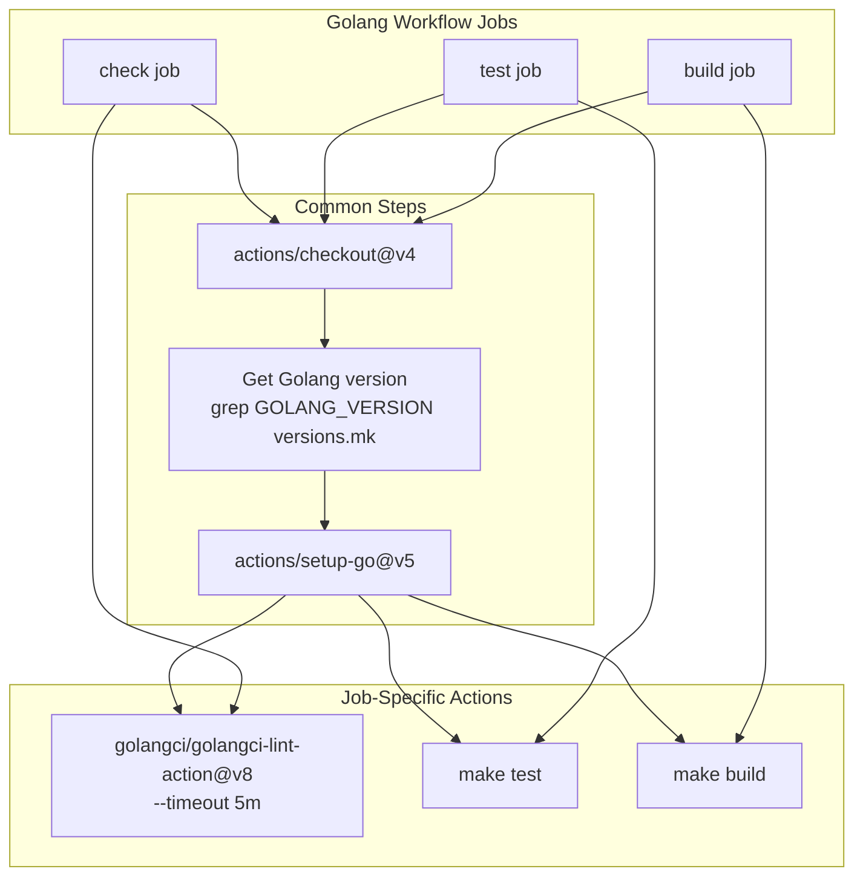
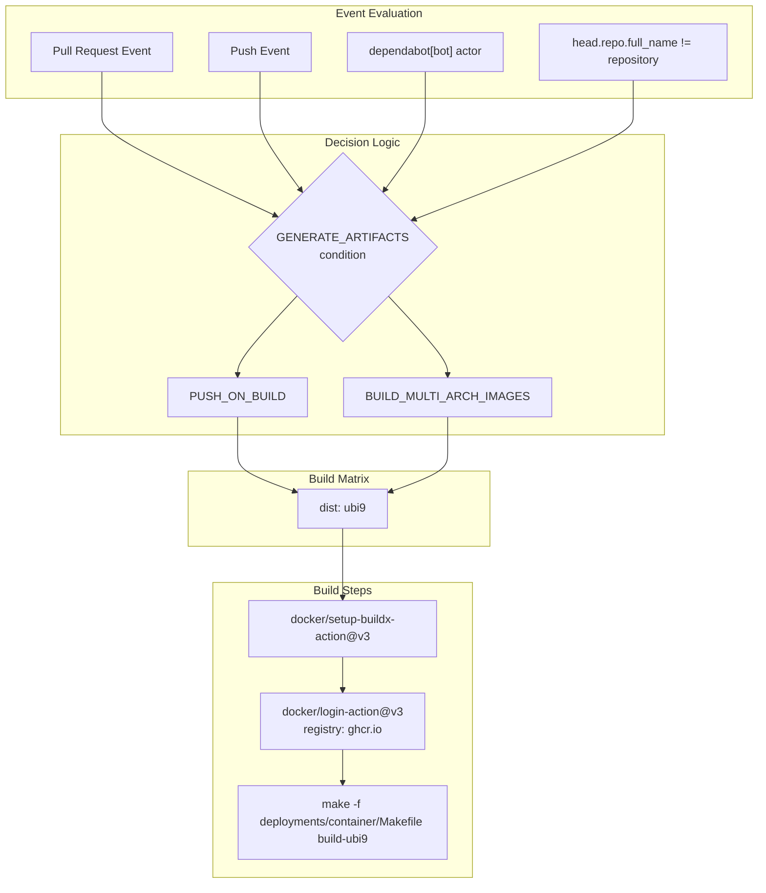
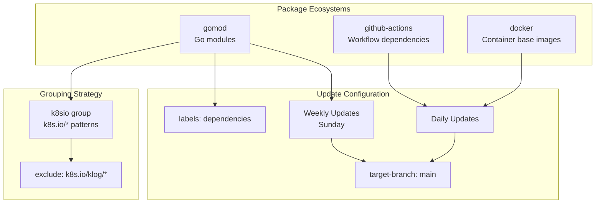

<!-- source: DeepWiki mcp.deepwiki.com · repo NVIDIA/vgpu-device-manager · page 5.1 GitHub Actions · fetched 2026-10-26 -->

# GitHub Actions

<details>
<summary>Relevant source files</summary>

The following files were used as context for generating this wiki page:

- [.github/dependabot.yml](.github/dependabot.yml)
- [.github/workflows/golang.yml](.github/workflows/golang.yml)
- [.github/workflows/images.yml](.github/workflows/images.yml)

</details>


## Purpose and Scope

This document covers the GitHub Actions CI/CD workflows implemented for the NVIDIA vGPU Device Manager repository. These workflows handle Go application builds, testing, linting, and container image builds that are triggered on pull requests and pushes to main and release branches. For information about other CI/CD systems used in this project, see [CI/CD Pipelines](#5) which covers the broader multi-platform CI/CD architecture including GitLab CI and NVIDIA-specific pipelines.

## Workflow Overview

The GitHub Actions system consists of three main components that work together to provide continuous integration and automated dependency management:



Sources: [.github/workflows/golang.yml:17-26](), [.github/workflows/images.yml:17-30](), [.github/dependabot.yml:21-29]()

## Golang Workflow

The `golang.yml` workflow provides comprehensive Go application testing and building across three parallel jobs:

### Workflow Configuration

| Property | Value |
|----------|-------|
| **Trigger Events** | Pull requests and pushes to `main` and `release-*` branches |
| **Runner OS** | `ubuntu-latest` |
| **Go Version Source** | Extracted from `versions.mk` file |

### Job Execution Flow



Sources: [.github/workflows/golang.yml:28-78]()

### Go Version Management

The workflow dynamically extracts the Go version from the `versions.mk` file using shell parameter expansion:

```bash
GOLANG_VERSION=$( grep "GOLANG_VERSION ?=" versions.mk )
echo "GOLANG_VERSION=${GOLANG_VERSION##GOLANG_VERSION ?= }" >> $GITHUB_ENV
```

This approach ensures consistency between local development and CI environments by using a single source of truth for the Go version.

Sources: [.github/workflows/golang.yml:35-37](), [.github/workflows/golang.yml:56-58](), [.github/workflows/golang.yml:71-73]()

## Images Workflow

The `images.yml` workflow builds and pushes multi-architecture container images to GitHub Container Registry with conditional execution logic:

### Build Conditions and Logic

The workflow implements sophisticated conditional logic to determine when to build and push images:



Sources: [.github/workflows/images.yml:34-36](), [.github/workflows/images.yml:53-62]()

### Image Naming and Versioning

The workflow constructs image names and versions using GitHub context variables:

| Variable | Source | Purpose |
|----------|--------|---------|
| `COMMIT_SHORT_SHA` | `${GITHUB_SHA:0:8}` | Short commit hash for versioning |
| `LOWERCASE_REPO_OWNER` | `$(echo "${GITHUB_REPOSITORY_OWNER}" \| awk '{print tolower($0)}')` | Lowercase repository owner for image registry |
| `IMAGE_NAME` | `ghcr.io/${LOWERCASE_REPO_OWNER}/vgpu-device-manager` | Full image name for GHCR |
| `LABEL_IMAGE_SOURCE` | `https://github.com/${REPO_FULL_NAME}` | Source code URL label |

Sources: [.github/workflows/images.yml:47-51](), [.github/workflows/images.yml:76-77]()

### Container Build Integration

The workflow delegates the actual container building to the project's container-specific Makefile:

```bash
make -f deployments/container/Makefile build-${{ matrix.dist }}
```

This approach maintains separation of concerns between GitHub Actions orchestration and build logic implementation.

Sources: [.github/workflows/images.yml:80]()

## Dependabot Configuration

The Dependabot configuration automates dependency updates across three package ecosystems:

### Update Schedules and Targeting



Sources: [.github/dependabot.yml:5-29]()

### Kubernetes Dependency Grouping

Dependabot groups Kubernetes-related dependencies to reduce PR noise:

- **Include Pattern**: `k8s.io/*` - Groups all Kubernetes ecosystem packages
- **Exclude Pattern**: `k8s.io/klog/*` - Excludes logging packages from grouping
- **Group Name**: `k8sio` - Identifier for the dependency group

This configuration ensures that related Kubernetes dependency updates are batched together in single pull requests.

Sources: [.github/dependabot.yml:14-20]()

## Integration with Build System

The GitHub Actions workflows integrate with the project's build system through standardized Make targets:

| Workflow | Make Target | Purpose |
|----------|-------------|---------|
| `golang.yml` (test job) | `make test` | Execute unit tests |
| `golang.yml` (build job) | `make build` | Build Go binaries |
| `images.yml` | `make -f deployments/container/Makefile build-${dist}` | Build container images |

This integration ensures consistency between local development builds and CI builds while maintaining the flexibility to modify build logic without changing workflow files.

Sources: [.github/workflows/golang.yml:63](), [.github/workflows/golang.yml:78](), [.github/workflows/images.yml:80]()

---

