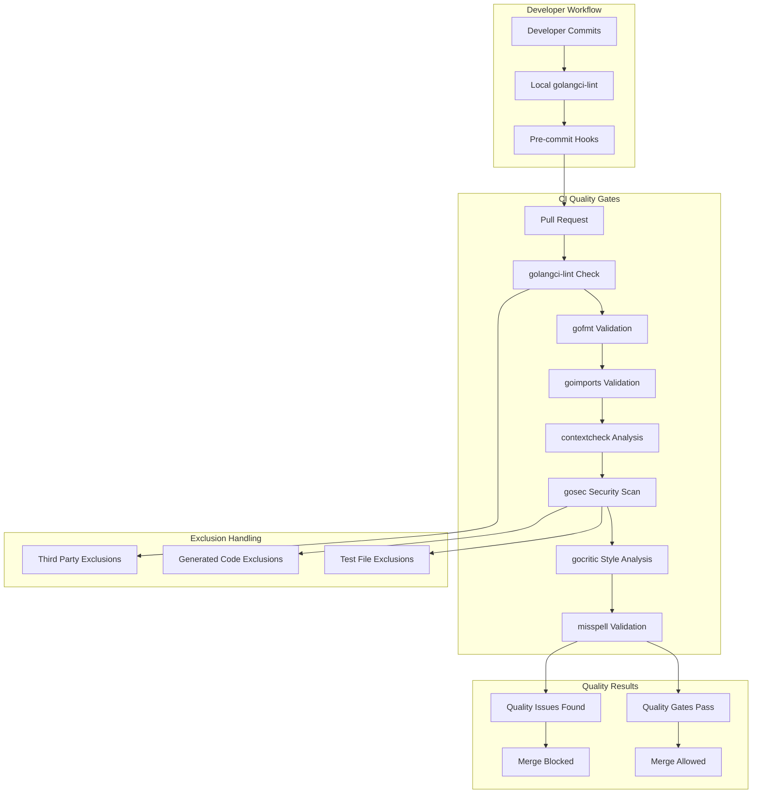
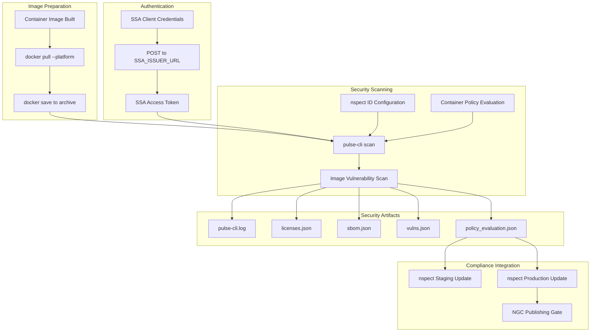
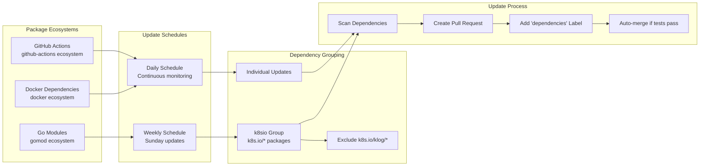
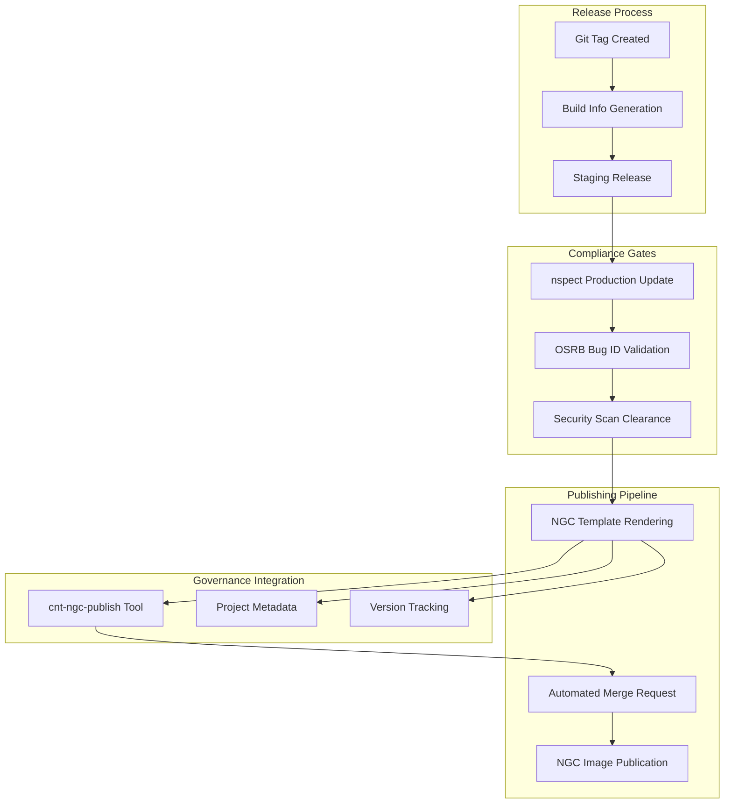

<!-- source: DeepWiki mcp.deepwiki.com · repo NVIDIA/vgpu-device-manager · page 5.2 Code Quality & Security · fetched 2026-10-26 -->

# Code Quality & Security

Relevant source files

The following files were used as context for generating this wiki page:

- [.github/dependabot.yml](.github/dependabot.yml)
- [.golangci.yml](.golangci.yml)
- [.nvidia-ci.yml](.nvidia-ci.yml)

This document covers the code quality standards, security scanning processes, and compliance measures implemented in the NVIDIA vGPU Device Manager. It details the automated tools, configurations, and workflows that ensure code reliability, security, and maintainability across the project.

For information about the broader CI/CD pipeline structure, see [CI/CD Pipelines](#5). For specific GitHub Actions workflows, see [GitHub Actions](#5.1).

## Code Quality Framework

The project implements a comprehensive code quality framework built around Go-specific tooling and industry best practices. The primary tool for maintaining code quality is `golangci-lint`, configured through [`.golangci.yml:1-43`]().

### Enabled Linters

The code quality configuration enables several specialized linters to catch different categories of issues:

| Linter | Purpose | Focus Area |
|--------|---------|------------|
| `contextcheck` | Context usage validation | Proper context.Context handling |
| `gocritic` | Style and performance | Code style and optimization opportunities |
| `gosec` | Security analysis | Security vulnerabilities and anti-patterns |
| `misspell` | Spelling validation | Documentation and comment accuracy |
| `unconvert` | Type conversion analysis | Unnecessary type conversions |

The configuration also includes preset exclusion rules for common false positives, legacy code patterns, and standard error handling idioms [`.golangci.yml:12-15`]().

### Code Formatting

Automatic code formatting is enforced through two complementary tools:
- **gofmt**: Standard Go formatting
- **goimports**: Import statement organization with local prefix handling

The local prefix is configured to prioritize internal project imports: `github.com/NVIDIA/vgpu-device-manager` [`.golangci.yml:35-36`]().

### Quality Exclusions

The system maintains practical exclusions for specific contexts:
- **Generated code**: Relaxed linting rules [`.golangci.yml:10-11`]()
- **Test files**: Specific `gosec` rule exclusions for G601 (memory aliasing) and G306 (file permissions) [`.golangci.yml:17-24`]()
- **Third-party code**: Complete exclusion from quality checks [`.golangci.yml:26-28`]()

Sources: `.golangci.yml`

## Code Quality Workflow

The following diagram illustrates how code quality checks are integrated into the development workflow:

### Code Quality Pipeline

Sources: `.golangci.yml`, `.github/dependabot.yml`

## Security Scanning Pipeline

The project implements a multi-layered security scanning approach that operates at both the code level and container image level. Security scans are performed using NVIDIA's internal security infrastructure.

### Container Security Scanning

The primary security scanning mechanism uses the `pulse-cli` tool integrated with NVIDIA's Security Service Authorization (SSA) system [`.nvidia-ci.yml:83-112`]().

### Security Scan Configuration

### Security Scan Execution

The scan process generates comprehensive security artifacts:
- **Software Bill of Materials (SBOM)**: Complete inventory of software components
- **Vulnerability Report**: Known security vulnerabilities and their severity
- **License Compliance**: Open source license analysis
- **Policy Evaluation**: Adherence to NVIDIA security policies

Security scans can be skipped using commit message flags: `[skip scans]` or by setting `SKIP_SCANS=yes` [`.nvidia-ci.yml:90-92`]().

Sources: `.nvidia-ci.yml`

## Dependency Management

The project uses GitHub's Dependabot service to maintain dependency security and freshness across multiple package ecosystems.

### Automated Dependency Updates

### Dependency Configuration Details

The Dependabot configuration manages three distinct ecosystems:

**Go Modules** [`.github/dependabot.yml:6-20`]():
- Weekly updates on Sundays
- Groups Kubernetes dependencies under `k8sio` pattern
- Excludes `k8s.io/klog/*` from grouping for independent updates

**GitHub Actions** [`.github/dependabot.yml:21-24`]():
- Daily monitoring for action updates
- Ensures CI/CD pipeline components stay current

**Docker Dependencies** [`.github/dependabot.yml:26-29`]():
- Daily scans of container dependencies
- Focuses on `deployments/container` directory

All dependency updates are automatically labeled with `dependencies` for easy filtering and management.

Sources: `.github/dependabot.yml`

## Compliance and Governance

The project integrates with NVIDIA's compliance and governance systems through the nspect platform and NGC publishing workflow.

### Compliance Workflow

The compliance process operates through two environments:
- **Staging Environment**: Testing compliance logic with `update-nspect-staging` [`.nvidia-ci.yml:153-162`]()
- **Production Environment**: Live compliance updates with `update-nspect` [`.nvidia-ci.yml:165-175`]()

### NGC Publishing Gate

The governance system requires several key components:
- **OSRB Bug ID**: Required for production releases [`.nvidia-ci.yml:171`]()
- **Project Registration**: Maintains project metadata in NGC systems
- **Version Tracking**: Links git commits to published artifacts [`.nvidia-ci.yml:130-134`]()

Sources: `.nvidia-ci.yml`

## Security Exception Handling

The codebase implements practical security exception handling for specific contexts where security rules may generate false positives or be inappropriate.

### Test-Specific Exclusions

Security linting exclusions for test files address common testing patterns:
- **G601 (Implicit memory aliasing)**: Acceptable in test scenarios where loop variable capture is intentional
- **G306 (File permissions)**: Test files may require broader permissions for temporary file operations

These exclusions are scoped specifically to `*_test.go` files [`.golangci.yml:17-24`]().

### Path-Based Exclusions

The system excludes entire directories from quality and security scanning:
- `third_party$`: External dependencies with their own quality standards
- `builtin$`: System-level code with different requirements  
- `examples$`: Sample code prioritizing readability over production standards

Sources: `.golangci.yml`

---

