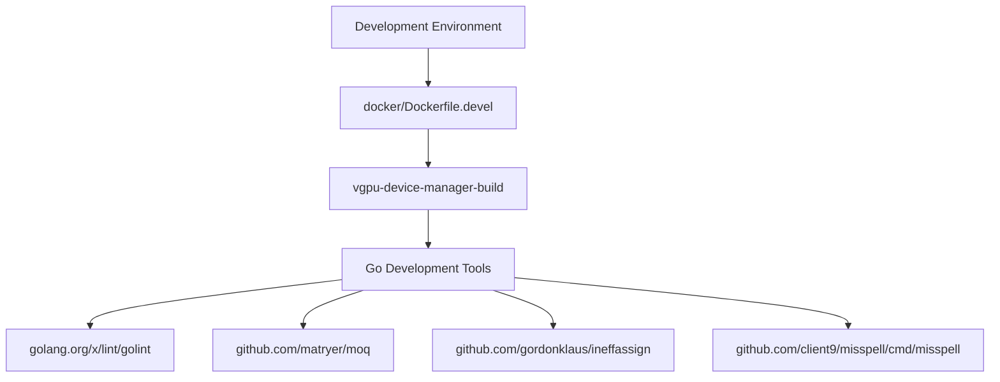
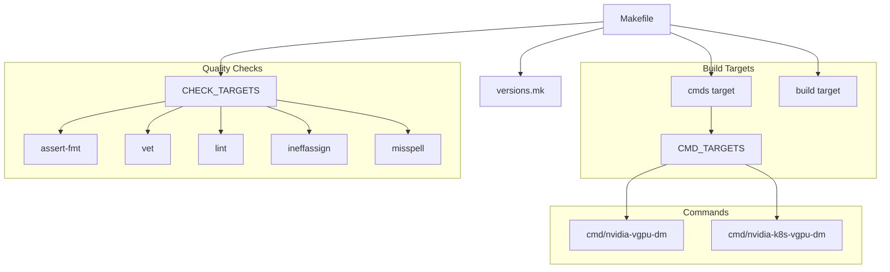
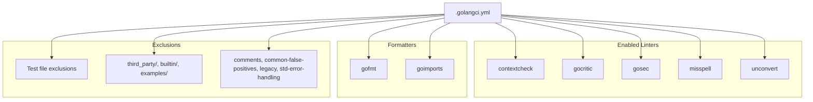
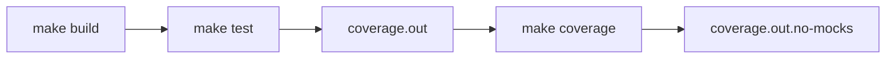
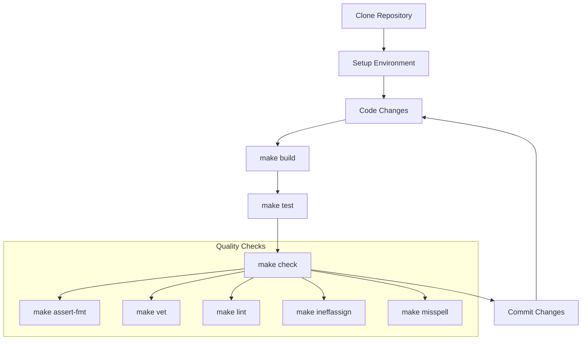
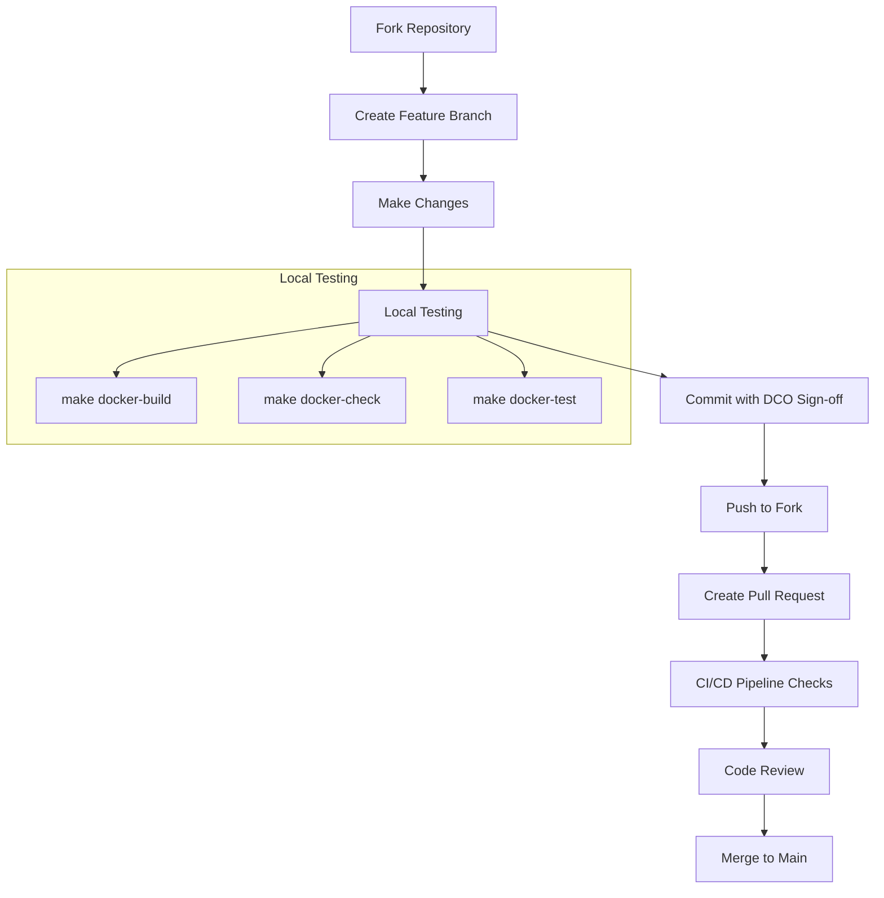

<!-- source: DeepWiki mcp.deepwiki.com · repo NVIDIA/vgpu-device-manager · page 6 Contributing & Development Guide · fetched 2026-10-26 -->

# Contributing & Development Guide

<details>
<summary>Relevant source files</summary>

The following files were used as context for generating this wiki page:

- [.golangci.yml](.golangci.yml)
- [CONTRIBUTING.md](CONTRIBUTING.md)
- [Makefile](Makefile)
- [docker/Dockerfile.devel](docker/Dockerfile.devel)

</details>


This guide provides comprehensive information for developers who want to contribute to the NVIDIA vGPU Device Manager project. It covers development environment setup, build processes, code quality standards, and the contribution workflow.

For information about deploying and operating the system in production environments, see [Deployment & Operations](#7). For details about the CI/CD pipeline infrastructure, see [CI/CD Pipelines](#5).

## Development Environment Setup

The NVIDIA vGPU Device Manager is written in Go and provides multiple development approaches: local development and Docker-based development for consistent build environments.

### Prerequisites

The project requires Go and various development tools. The supported Go version is defined in the build configuration and can be determined from [versions.mk]().

### Docker-Based Development Environment

The project provides a containerized development environment for consistent builds across different systems.



The development container is built with specific Go development tools installed: [docker/Dockerfile.devel:17-20]().

### Local Development Setup

For local development, install the required tools manually:
- `golint` for Go linting
- `moq` for mock generation  
- `ineffassign` for detecting ineffective assignments
- `misspell` for spell checking
- `golangci-lint` for comprehensive linting

Sources: [docker/Dockerfile.devel:17-20](), [Makefile:68]()

## Building the Project

The build system uses GNU Make with comprehensive targets for different development tasks.

### Build System Architecture



### Build Commands

| Command | Purpose | Implementation |
|---------|---------|---------------|
| `make cmds` | Build all command binaries | Builds targets in [Makefile:24]() |
| `make build` | Build all Go packages | Compiles `$(MODULE)/...` [Makefile:47]() |
| `make test` | Run tests with coverage | Executes with `-coverprofile` [Makefile:72]() |
| `make coverage` | Generate coverage report | Processes coverage excluding mocks [Makefile:74-76]() |

The build process uses version injection via ldflags: [Makefile:44]()

### Docker-Based Build

All make targets can be executed in the development container using the `docker-*` prefix:

```bash
make docker-build    # Build in container
make docker-test     # Test in container  
make docker-lint     # Lint in container
```

Sources: [Makefile:24-44](), [Makefile:96-105]()

## Code Quality & Standards

The project enforces strict code quality standards through automated tooling and configuration.

### Linting Configuration

The project uses `golangci-lint` with a comprehensive configuration:



### Import Organization

The `goimports` formatter is configured with local prefixes to organize imports properly: [.golangci.yml:34-36]()

### Code Quality Checks

The quality check pipeline includes multiple validation steps:

| Check | Purpose | Configuration |
|-------|---------|-------------|
| `assert-fmt` | Verify Go formatting | [Makefile:54-64]() |
| `vet` | Go static analysis | Part of `CHECK_TARGETS` [Makefile:27]() |
| `lint` | Comprehensive linting | Uses golangci-lint [Makefile:66-68]() |
| `ineffassign` | Find ineffective assignments | [docker/Dockerfile.devel:19]() |
| `misspell` | Spell checking | [docker/Dockerfile.devel:20]() |

Sources: [.golangci.yml:2-11](), [Makefile:27](), [Makefile:54-68]()

## Testing & Validation

The project includes comprehensive testing infrastructure with coverage reporting.

### Test Execution



Tests are executed with coverage profiling: [Makefile:71-72](). Coverage reports exclude mock files: [Makefile:75-76]().

### Mock Generation

The development environment includes `moq` for generating mocks: [docker/Dockerfile.devel:18]()

Sources: [Makefile:71-76](), [docker/Dockerfile.devel:18]()

## Development Workflow

The recommended development workflow follows these steps:

### Local Development Cycle



### Using Docker for Consistent Environment

For consistent results across different development systems, use the Docker-based workflow:

```bash
make docker-build      # Build in consistent environment
make docker-test       # Test in consistent environment  
make docker-check      # Run all quality checks
```

Sources: [Makefile:27-28](), [Makefile:96-105]()

## Contributing Changes

### Developer Certificate of Origin

All contributions must be signed off to certify compliance with the Developer Certificate of Origin (DCO). This is documented in [CONTRIBUTING.md:6-59]().

### Commit Signing

Add a sign-off line to every commit:
```
Signed-off-by: Your Name <your.email@example.com>
```

Use `git commit -s` to automatically add the sign-off if your Git configuration includes `user.name` and `user.email`: [CONTRIBUTING.md:58-59]()

### Code Submission Process



### Pre-Submission Checklist

Before submitting a pull request, ensure:

1. **Code Quality**: All quality checks pass (`make docker-check`)
2. **Tests**: All tests pass with adequate coverage (`make docker-test`) 
3. **Build**: Binaries build successfully (`make docker-cmds`)
4. **Formatting**: Code follows project formatting standards
5. **Sign-off**: All commits include DCO sign-off
6. **Documentation**: Relevant documentation is updated

Sources: [CONTRIBUTING.md:1-59](), [Makefile:27-28]()

---

