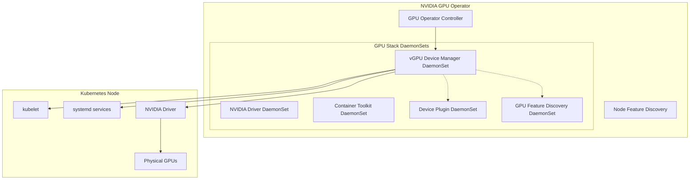
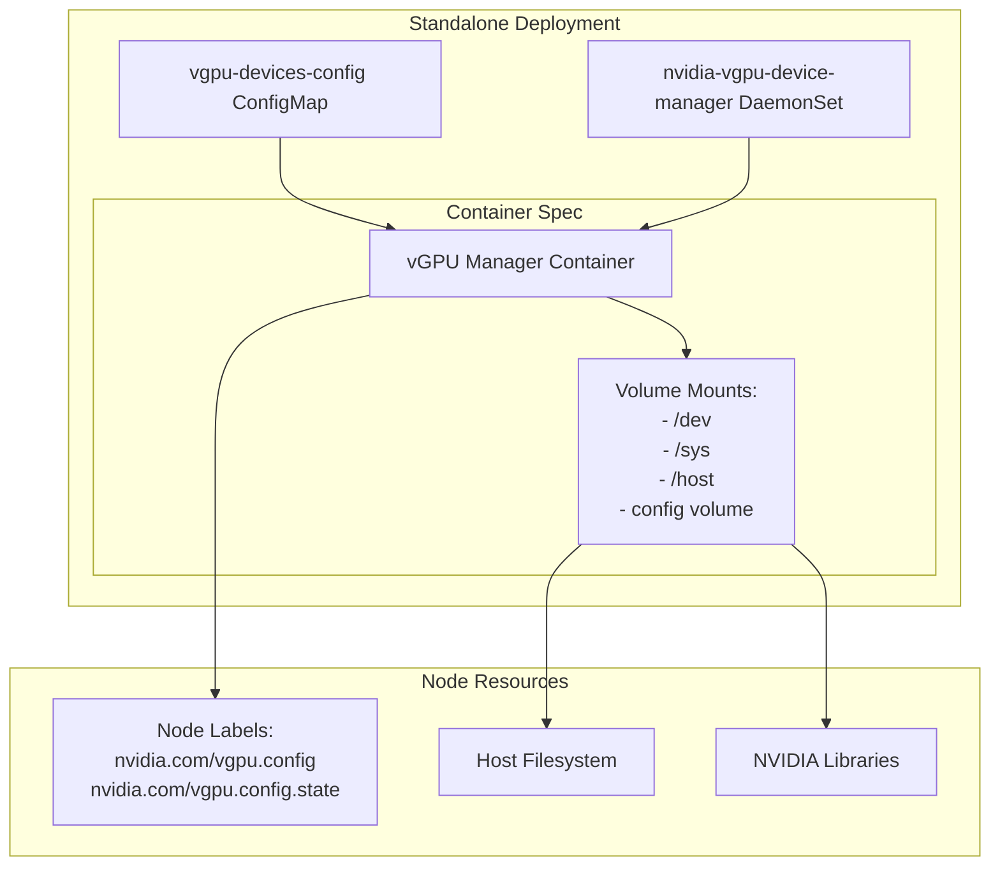
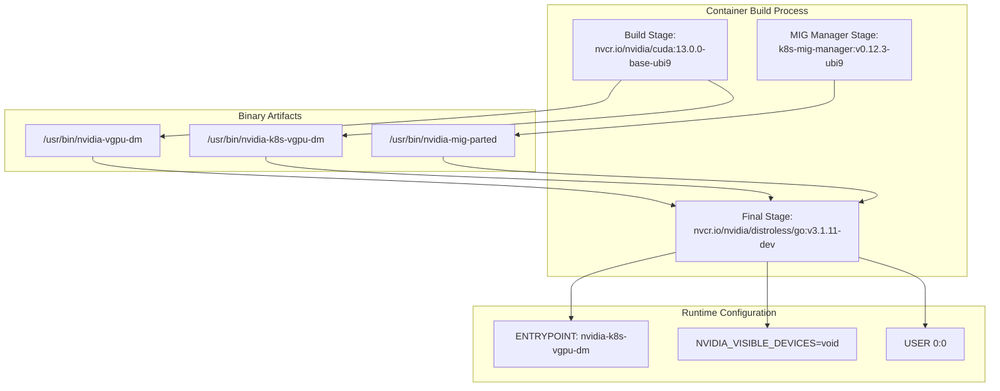
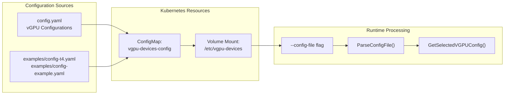
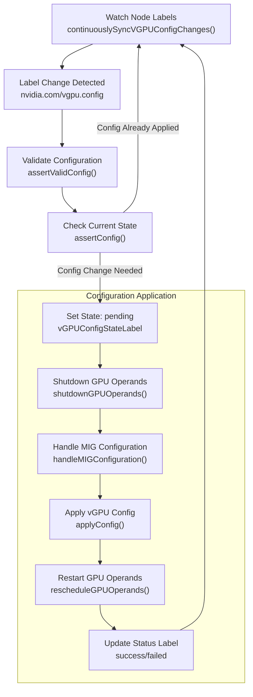
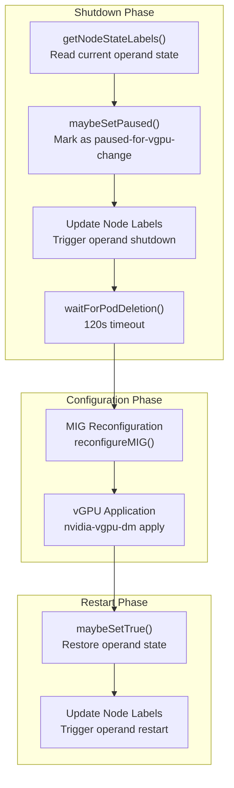
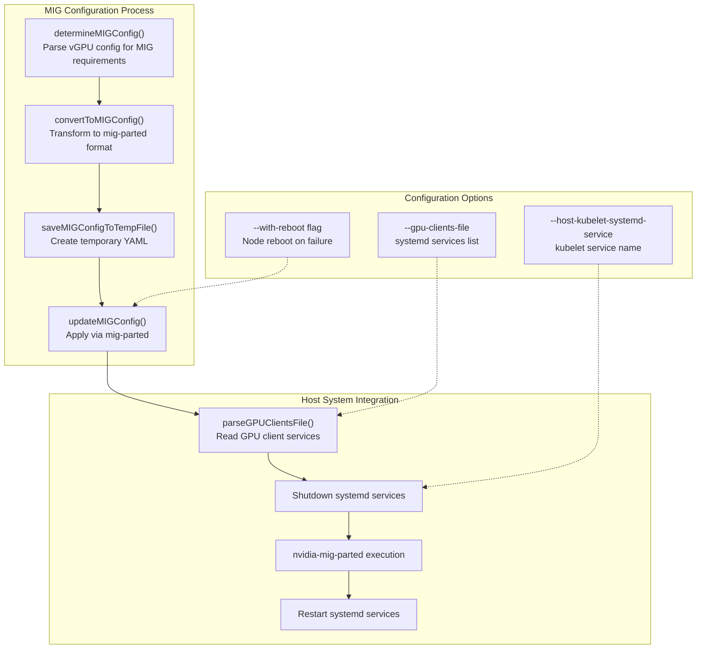

<!-- source: DeepWiki mcp.deepwiki.com · repo NVIDIA/vgpu-device-manager · page 7 Deployment & Operations · fetched 2026-10-26 -->

# Deployment & Operations

<details>
<summary>Relevant source files</summary>

The following files were used as context for generating this wiki page:

- [README.md](README.md)
- [cmd/nvidia-k8s-vgpu-dm/main.go](cmd/nvidia-k8s-vgpu-dm/main.go)
- [deployments/container/Dockerfile.ubi9](deployments/container/Dockerfile.ubi9)

</details>


This document covers deployment strategies, operational procedures, and production considerations for running the NVIDIA vGPU Device Manager in Kubernetes environments. It focuses on container-based deployments, configuration management, and day-to-day operational workflows.

For information about the configuration file format and vGPU device specifications, see [Configuration Format & Examples](#3). For details about the CLI tools and core components, see [Architecture & Core Components](#2).

## Deployment Methods

The NVIDIA vGPU Device Manager supports two primary deployment models: integration with the NVIDIA GPU Operator for production use, and standalone DaemonSet deployment for development and testing.

### GPU Operator Integration

The primary production deployment method is through the NVIDIA GPU Operator, where the vGPU Device Manager runs as a managed component within the GPU stack.



**GPU Operator Managed Deployment**

Sources: [README.md:166-168]()

### Standalone DaemonSet Deployment

For development and testing purposes, the vGPU Device Manager can be deployed as a standalone DaemonSet outside of the GPU Operator.



**Standalone Development Deployment**

The deployment process involves creating a ConfigMap with vGPU configuration and deploying the DaemonSet:

```bash
# Create configuration ConfigMap
kubectl create configmap vgpu-devices-config --from-file=config.yaml

# Deploy vGPU Device Manager DaemonSet  
kubectl apply -f https://raw.githubusercontent.com/NVIDIA/vgpu-device-manager/main/examples/nvidia-vgpu-device-manager-example.yaml
```

Sources: [README.md:171-189]()

## Container Image Architecture

The vGPU Device Manager container includes both CLI and daemon binaries along with required dependencies.



**Multi-stage Container Build**

Sources: [deployments/container/Dockerfile.ubi9:15-61]()

## Configuration Management

The vGPU Device Manager uses Kubernetes ConfigMaps to manage vGPU device configurations and supports dynamic configuration updates through node labeling.

### ConfigMap-Based Configuration



**Configuration Flow from YAML to Runtime**

Sources: [cmd/nvidia-k8s-vgpu-dm/main.go:158-165](), [README.md:171-181]()

### Node Label Management

The daemon manages configuration state through specific Kubernetes node labels:

| Label | Purpose | Values |
|-------|---------|--------|
| `nvidia.com/vgpu.config` | Specifies desired vGPU configuration | Configuration name from ConfigMap |
| `nvidia.com/vgpu.config.state` | Indicates configuration application status | `success`, `failed`, `pending` |
| `nvidia.com/gpu.deploy.sandbox-device-plugin` | Controls device plugin deployment | `true`, `false`, `paused-for-vgpu-change` |
| `nvidia.com/gpu.deploy.sandbox-validator` | Controls validator deployment | `true`, `false`, `paused-for-vgpu-change` |

Sources: [cmd/nvidia-k8s-vgpu-dm/main.go:51-54]()

## Operational Workflow

The vGPU Device Manager follows a specific operational sequence when applying configuration changes.



**vGPU Configuration Application Workflow**

Sources: [cmd/nvidia-k8s-vgpu-dm/main.go:347-395]()

### GPU Operand Lifecycle Management

The daemon coordinates with other GPU stack components during configuration changes:



**GPU Stack Component Coordination**

Sources: [cmd/nvidia-k8s-vgpu-dm/main.go:460-544]()

## Command-Line Interface Integration

The Kubernetes daemon internally uses the CLI tools for configuration operations:

| Operation | CLI Command | Purpose |
|-----------|-------------|---------|
| Configuration Validation | `nvidia-vgpu-dm assert --valid-config -f config.yaml -c T4-1Q` | Verify config exists in file |
| State Assertion | `nvidia-vgpu-dm assert -f config.yaml -c T4-1Q` | Check if config is currently applied |
| Configuration Application | `nvidia-vgpu-dm -d apply -f config.yaml -c T4-1Q` | Apply vGPU configuration to GPUs |

Sources: [cmd/nvidia-k8s-vgpu-dm/main.go:397-433]()

## MIG Configuration Handling

For GPUs supporting Multi-Instance GPU (MIG), the daemon performs additional configuration steps:



**MIG Configuration and Host Service Management**

Sources: [cmd/nvidia-k8s-vgpu-dm/main.go:591-715]()

## Monitoring and Troubleshooting

### Node Label Status Monitoring

Monitor vGPU configuration status through node labels:

```bash
# Check current vGPU configuration
kubectl get nodes -l nvidia.com/vgpu.config -o custom-columns=NAME:.metadata.name,VGPU_CONFIG:.metadata.labels.nvidia\.com/vgpu\.config,STATE:.metadata.labels.nvidia\.com/vgpu\.config\.state

# Monitor configuration changes
kubectl get nodes <node-name> -w -o jsonpath='{.metadata.labels.nvidia\.com/vgpu\.config\.state}'
```

### Common Operational States

| State | Description | Action Required |
|-------|-------------|-----------------|
| `success` | Configuration successfully applied | None |
| `failed` | Configuration application failed | Check daemon logs and vGPU configuration |
| `pending` | Configuration change in progress | Wait for completion |
| `paused-for-vgpu-change` | GPU operands temporarily paused | Normal during configuration updates |

### Daemon Configuration Flags

Key operational flags for the `nvidia-k8s-vgpu-dm` daemon:

| Flag | Environment Variable | Default | Purpose |
|------|---------------------|---------|---------|
| `--node-name` | `NODE_NAME` | Required | Target node for configuration |
| `--namespace` | `NAMESPACE` | Required | GPU operand namespace |
| `--config-file` | `CONFIG_FILE` | Required | vGPU configuration file path |
| `--default-vgpu-config` | `DEFAULT_VGPU_CONFIG` | Required | Fallback configuration name |
| `--with-reboot` | `WITH_REBOOT` | `false` | Reboot on MIG failure |
| `--host-root-mount` | `HOST_ROOT_MOUNT` | `/host` | Host filesystem mount point |

Sources: [cmd/nvidia-k8s-vgpu-dm/main.go:134-230]()

## Prerequisites and Dependencies

### Runtime Requirements

- NVIDIA vGPU Manager installed on host system
- Container runtime with GPU support (containerd/docker)
- Kubernetes cluster with node labeling capabilities
- Sufficient privileges for systemd service management (when using MIG)

### Container Dependencies

- Base CUDA runtime environment
- `nvidia-mig-parted` binary for MIG operations
- Go runtime for daemon execution
- Host filesystem access for driver interaction

Sources: [README.md:116-119](), [deployments/container/Dockerfile.ubi9:41-49]()

This deployment and operations guide provides the foundation for running the NVIDIA vGPU Device Manager in production Kubernetes environments, with proper monitoring and troubleshooting capabilities for reliable vGPU configuration management.