# Page: Overview

# Overview

<details>
<summary>Relevant source files</summary>

The following files were used as context for generating this wiki page:

- [LICENSE](LICENSE)
- [README.md](README.md)

</details>


## Purpose and Scope

The NVIDIA vGPU Device Manager is a comprehensive system designed to manage virtual GPU (vGPU) configurations in Kubernetes environments and standalone deployments. This system enables administrators to declaratively define and apply vGPU device configurations across GPU-enabled nodes, providing fine-grained control over how physical GPUs are partitioned into virtual devices for different workloads.

This document provides a high-level overview of the system architecture, core components, and operational workflows. For detailed information about specific components, see [CLI Tools](#2.1), [Kubernetes Daemon](#2.2), and [Configuration System](#2.3). For build and deployment procedures, refer to [Build System & Development](#4) and [Deployment & Operations](#7).

*Sources: [README.md:1-190]()*

## System Architecture Overview

The NVIDIA vGPU Device Manager consists of two primary applications that work together to manage vGPU configurations:

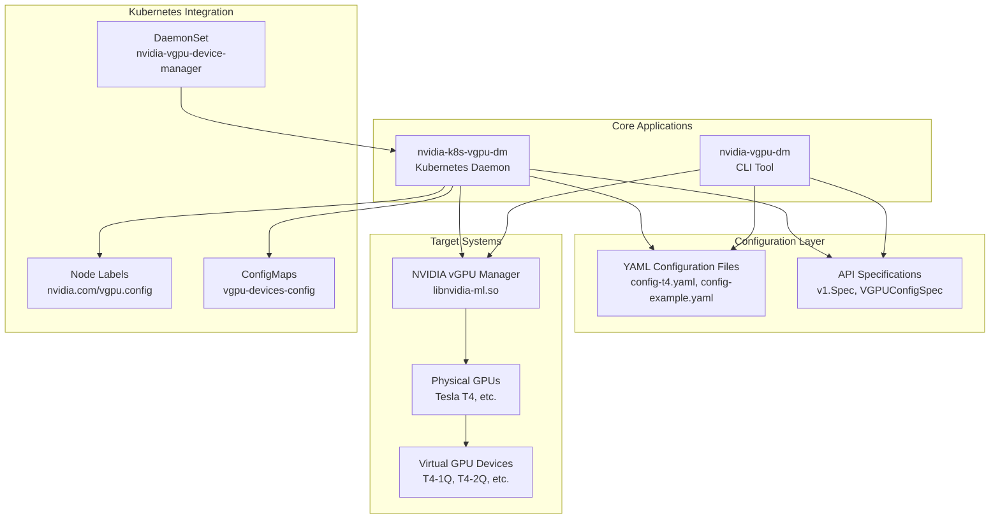

*Sources: [README.md:8-16](), diagrams provided by user*

## Core Applications

The system provides two main entry points for vGPU management:

### Standalone CLI Tool (`nvidia-vgpu-dm`)

The CLI tool enables direct interaction with vGPU configurations on individual nodes:

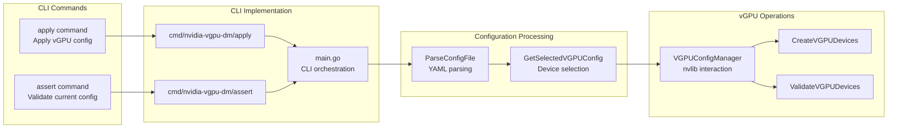

*Sources: [README.md:77-102](), [README.md:114-163]()*

### Kubernetes Daemon (`nvidia-k8s-vgpu-dm`)

The Kubernetes daemon manages vGPU configurations automatically based on node labels and ConfigMaps:

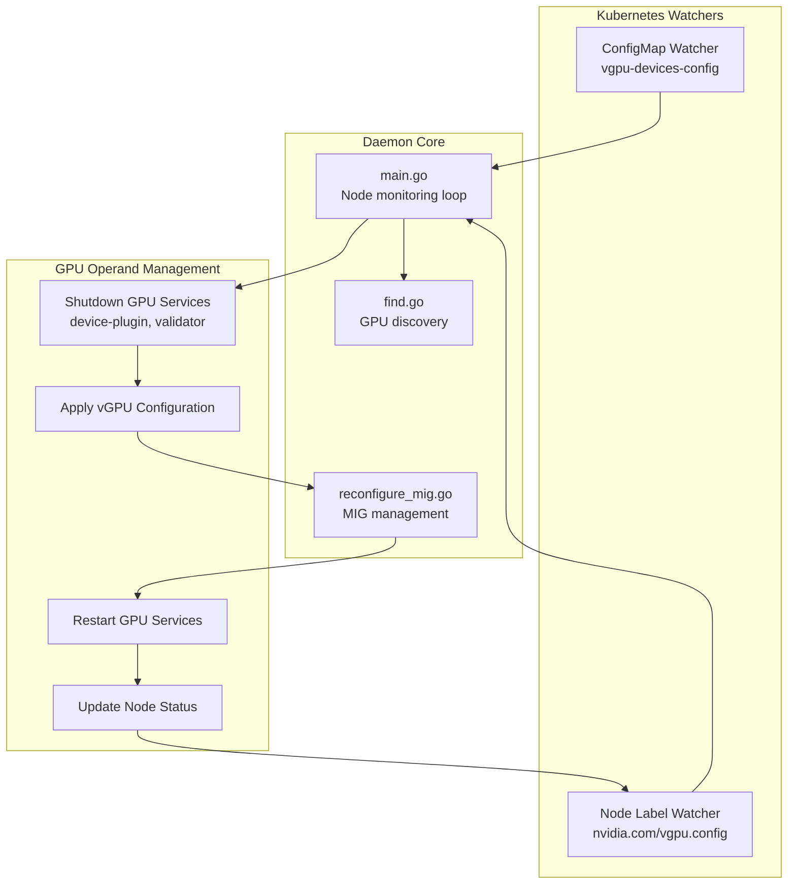

*Sources: [README.md:164-190](), diagrams provided by user*

## Configuration System

The system uses a YAML-based configuration format that defines vGPU device arrangements:

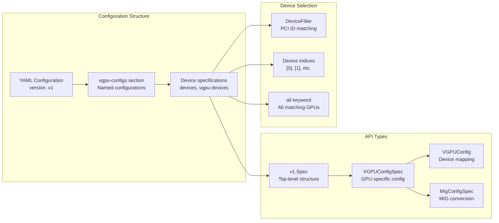

Example configuration structure from the repository:

| Configuration Name | Devices | vGPU Type | Count | Description |
|-------------------|---------|-----------|--------|-------------|
| `T4-1Q` | `all` | `T4-1Q` | 16 | Creates 16 T4-1Q devices on all GPUs |
| `T4-8Q` | `all` | `T4-8Q` | 2 | Creates 2 T4-8Q devices on all GPUs |
| `T4-small` | `[0], [1]` | `T4-1Q, T4-2Q` | 16, 8 | Custom mixed configuration |

*Sources: [README.md:18-75](), diagrams provided by user*

## Key Operational Workflows

### Configuration Application Workflow

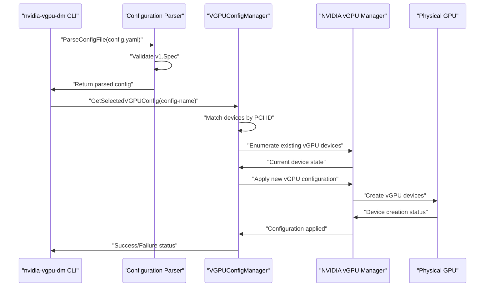

### Kubernetes Node Management Workflow

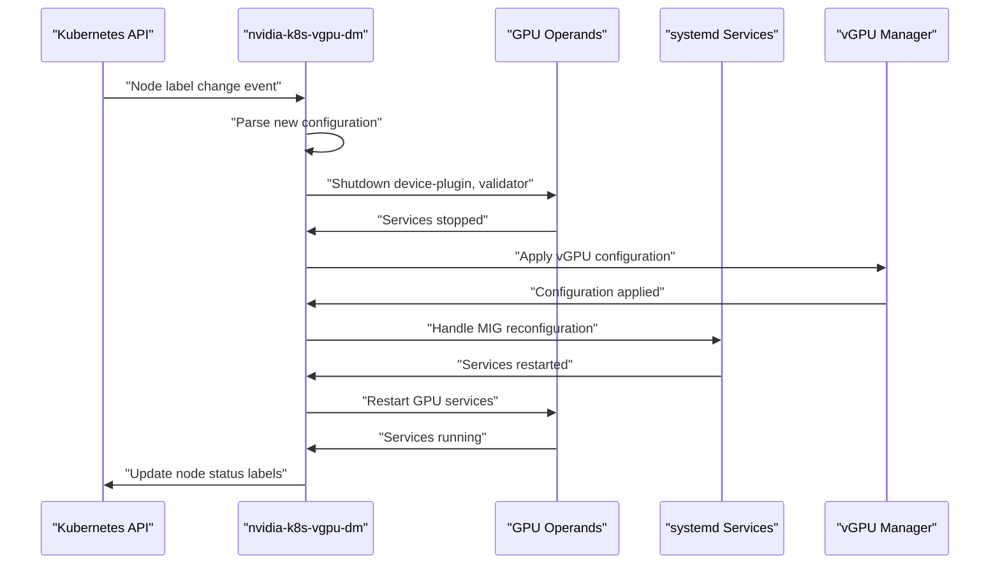

*Sources: diagrams provided by user, [README.md:189-190]()*

## Technology Stack and Dependencies

The system is built using the following key technologies and dependencies:

| Component | Technology | Purpose |
|-----------|------------|---------|
| **Core Language** | Go | Primary implementation language |
| **Configuration** | YAML | Declarative vGPU configuration format |
| **Container Runtime** | Docker/Podman | Containerized deployment |
| **Orchestration** | Kubernetes | Cluster-wide vGPU management |
| **GPU Interface** | NVIDIA vGPU Manager | Low-level vGPU device management |
| **GPU Library** | libnvidia-ml.so | NVIDIA Management Library |
| **Build System** | Make | Build automation and tooling |

### External Dependencies

```mermaid
graph TB
    subgraph "NVIDIA Dependencies"
        VGPU_MGR["NVIDIA vGPU Manager<br/>Hypervisor component"]
        NVML["NVIDIA ML Library<br/>libnvidia-ml.so"]
        GPU_DRIVER["NVIDIA GPU Driver<br/>Host driver stack"]
    end
    
    subgraph "Kubernetes Dependencies"
        K8S_API["Kubernetes API<br/>Node labels, ConfigMaps"]
        DEVICE_PLUGIN["NVIDIA Device Plugin<br/>GPU resource management"]
        GPU_OPERATOR["NVIDIA GPU Operator<br/>Lifecycle management"]
    end
    
    subgraph "System Dependencies"
        SYSTEMD["systemd<br/>Service management"]
        CONTAINER_RUNTIME["Container Runtime<br/>Docker/containerd"]
    end
    
    VGPU_MGR --> NVML
    NVML --> GPU_DRIVER
    K8S_API --> DEVICE_PLUGIN
    DEVICE_PLUGIN --> GPU_OPERATOR
    SYSTEMD --> CONTAINER_RUNTIME
```

*Sources: [README.md:118](), [LICENSE:1-203](), diagrams provided by user*

---

# Page: Architecture & Core Components

# Architecture & Core Components

<details>
<summary>Relevant source files</summary>

The following files were used as context for generating this wiki page:

- [README.md](README.md)
- [cmd/nvidia-k8s-vgpu-dm/main.go](cmd/nvidia-k8s-vgpu-dm/main.go)
- [cmd/nvidia-vgpu-dm/main.go](cmd/nvidia-vgpu-dm/main.go)

</details>


This document provides a detailed overview of the NVIDIA vGPU Device Manager's system architecture, core applications, and how the major components interact to manage virtual GPU devices in Kubernetes environments. For specific configuration formats and examples, see [Configuration Format & Examples](#3). For deployment and operational considerations, see [Deployment & Operations](#7).

## System Overview

The NVIDIA vGPU Device Manager consists of two primary applications that work together to provide declarative vGPU device management:

- **CLI Tool (`nvidia-vgpu-dm`)**: Standalone command-line interface for direct vGPU configuration management
- **Kubernetes Daemon (`nvidia-k8s-vgpu-dm`)**: Node-level daemon that integrates with Kubernetes to automatically manage vGPU configurations based on node labels

Both applications share a common configuration system and interact with the underlying NVIDIA driver stack to create and manage virtual GPU instances.

## Core System Architecture

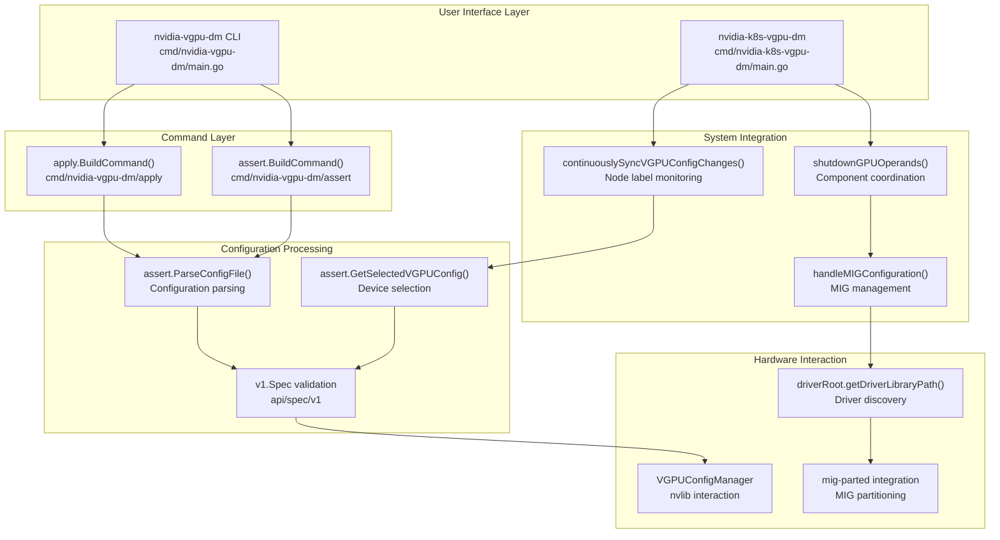

**Sources:** [cmd/nvidia-vgpu-dm/main.go:53-56](), [cmd/nvidia-k8s-vgpu-dm/main.go:316-345](), [cmd/nvidia-k8s-vgpu-dm/main.go:460-499](), [cmd/nvidia-k8s-vgpu-dm/main.go:591-610]()

## Application Components

### CLI Tool Architecture

The `nvidia-vgpu-dm` CLI provides direct vGPU management capabilities through two primary commands:

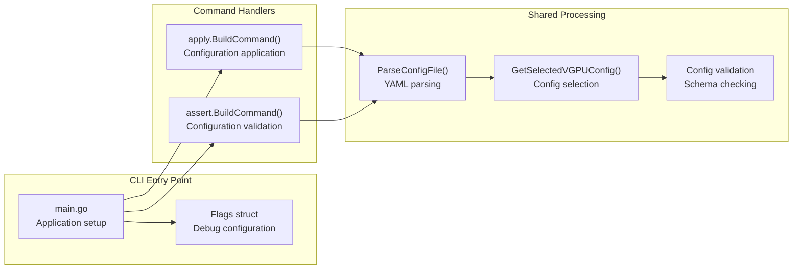

The CLI supports both file-based and stdin configuration input, with debug logging controlled through the `Flags.Debug` field at [cmd/nvidia-vgpu-dm/main.go:31-33]().

**Sources:** [cmd/nvidia-vgpu-dm/main.go:35-74]()

### Kubernetes Daemon Architecture

The `nvidia-k8s-vgpu-dm` daemon provides automated vGPU management in Kubernetes environments:

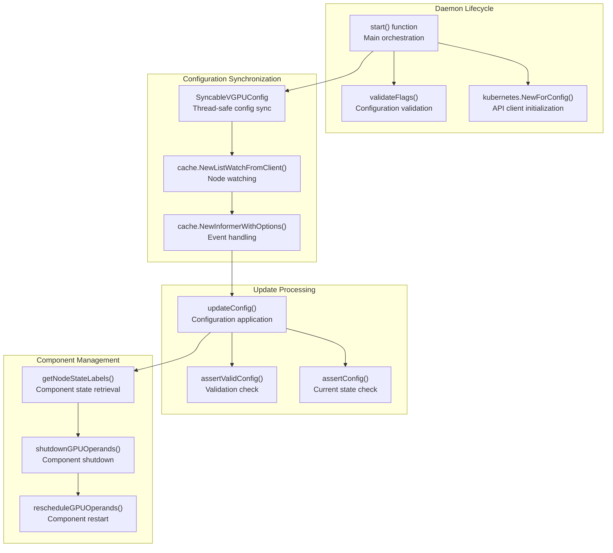

The daemon uses the `SyncableVGPUConfig` type at [cmd/nvidia-k8s-vgpu-dm/main.go:86-125]() to coordinate configuration changes between the node label watcher and the main processing loop.

**Sources:** [cmd/nvidia-k8s-vgpu-dm/main.go:258-314](), [cmd/nvidia-k8s-vgpu-dm/main.go:316-345](), [cmd/nvidia-k8s-vgpu-dm/main.go:347-395]()

## Configuration System Integration

Both applications share a common configuration processing pipeline:

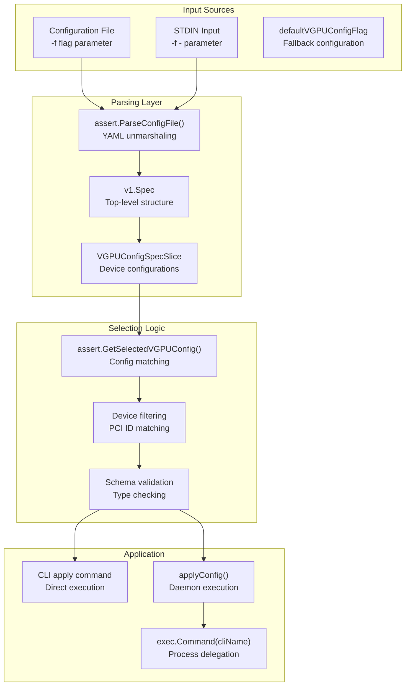

The configuration system supports device selection through multiple methods: `"all"` for all devices, numeric indices for specific devices, or PCI ID patterns for device matching.

**Sources:** [cmd/nvidia-k8s-vgpu-dm/main.go:397-408](), [cmd/nvidia-k8s-vgpu-dm/main.go:410-420](), [cmd/nvidia-k8s-vgpu-dm/main.go:422-433]()

## Kubernetes Integration Layer

The daemon manages integration with Kubernetes components through a sophisticated orchestration system:

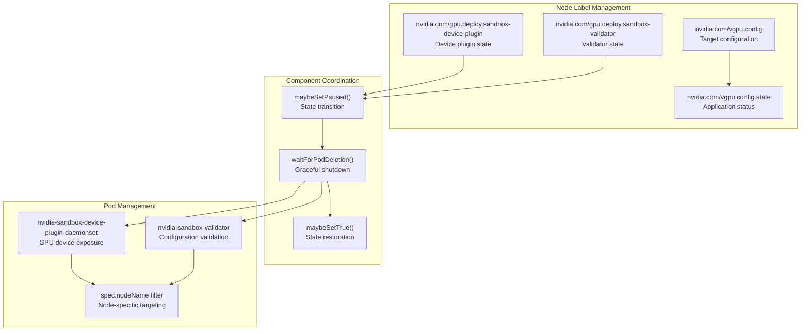

The daemon coordinates component shutdowns by temporarily setting state labels to `"paused-for-vgpu-change"` and waiting for pod deletion with a 120-second timeout, as implemented in [cmd/nvidia-k8s-vgpu-dm/main.go:501-525]().

**Sources:** [cmd/nvidia-k8s-vgpu-dm/main.go:48-60](), [cmd/nvidia-k8s-vgpu-dm/main.go:460-499](), [cmd/nvidia-k8s-vgpu-dm/main.go:527-544](), [cmd/nvidia-k8s-vgpu-dm/main.go:546-558]()

## MIG Configuration Handling

The system includes specialized handling for Multi-Instance GPU (MIG) configurations:

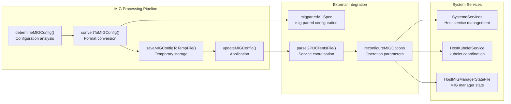

The MIG handling converts vGPU configurations to `migpartedv1.Spec` format and coordinates with host systemd services. The `GPUClients` struct at [cmd/nvidia-k8s-vgpu-dm/main.go:81-84]() defines which systemd services need coordination during MIG reconfiguration.

**Sources:** [cmd/nvidia-k8s-vgpu-dm/main.go:591-610](), [cmd/nvidia-k8s-vgpu-dm/main.go:612-632](), [cmd/nvidia-k8s-vgpu-dm/main.go:634-646](), [cmd/nvidia-k8s-vgpu-dm/main.go:667-693](), [cmd/nvidia-k8s-vgpu-dm/main.go:695-715]()

---

# Page: CLI Tools (nvidia-vgpu-dm)

# CLI Tools (nvidia-vgpu-dm)

<details>
<summary>Relevant source files</summary>

The following files were used as context for generating this wiki page:

- [cmd/nvidia-vgpu-dm/apply/apply.go](cmd/nvidia-vgpu-dm/apply/apply.go)
- [cmd/nvidia-vgpu-dm/apply/config.go](cmd/nvidia-vgpu-dm/apply/config.go)
- [cmd/nvidia-vgpu-dm/assert/assert.go](cmd/nvidia-vgpu-dm/assert/assert.go)
- [cmd/nvidia-vgpu-dm/assert/config.go](cmd/nvidia-vgpu-dm/assert/config.go)
- [cmd/nvidia-vgpu-dm/main.go](cmd/nvidia-vgpu-dm/main.go)

</details>


The `nvidia-vgpu-dm` CLI tool provides command-line interface for managing NVIDIA virtual GPU (vGPU) device configurations on individual nodes. This tool allows administrators to apply and validate vGPU configurations using declarative YAML configuration files.

This page covers the CLI tool specifically. For information about the Kubernetes daemon that automates vGPU management across clusters, see [Kubernetes Daemon (nvidia-k8s-vgpu-dm)](#2.2). For details about the configuration file format and schema, see [Configuration System](#2.3).

## Overview

The `nvidia-vgpu-dm` CLI tool is built using the `urfave/cli/v2` framework and provides two primary commands for vGPU device management:

- **`apply`** - Applies a vGPU configuration to the current node, making necessary changes
- **`assert`** - Validates that a specific vGPU configuration is currently applied to the node

Both commands operate on YAML configuration files that define vGPU device mappings and support device filtering based on PCI device IDs.

## CLI Application Structure

The main CLI application structure is organized around a command-driven architecture:

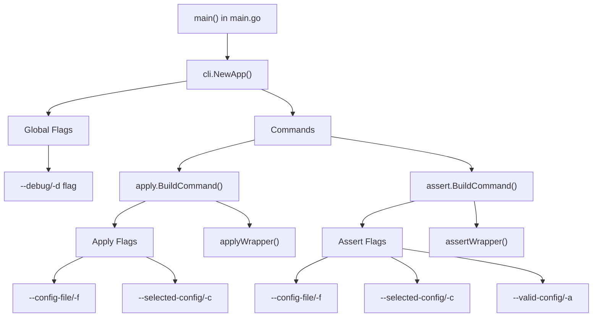

**Sources:** [cmd/nvidia-vgpu-dm/main.go:35-74](), [cmd/nvidia-vgpu-dm/apply/apply.go:47-75](), [cmd/nvidia-vgpu-dm/assert/assert.go:56-91]()

## Command Line Interface

### Global Options

| Flag | Aliases | Environment Variable | Description |
|------|---------|---------------------|-------------|
| `--debug` | `-d` | `VGPU_DM_DEBUG` | Enable debug-level logging |

### Apply Command

The `apply` command applies vGPU configurations to the current node:

```bash
nvidia-vgpu-dm apply --config-file /path/to/config.yaml --selected-config config-name
```

| Flag | Aliases | Environment Variable | Description |
|------|---------|---------------------|-------------|
| `--config-file` | `-f` | `VGPU_DM_CONFIG_FILE` | Path to the configuration file |
| `--selected-config` | `-c` | `VGPU_DM_SELECTED_CONFIG` | Label of the vgpu-config to apply |

### Assert Command

The `assert` command validates that a specific vGPU configuration is currently applied:

```bash
nvidia-vgpu-dm assert --config-file /path/to/config.yaml --selected-config config-name
```

| Flag | Aliases | Environment Variable | Description |
|------|---------|---------------------|-------------|
| `--config-file` | `-f` | `VGPU_DM_CONFIG_FILE` | Path to the configuration file |
| `--selected-config` | `-c` | `VGPU_DM_SELECTED_CONFIG` | Name of the vgpu-config to assert |
| `--valid-config` | `-a` | `VGPU_DM_VALID_CONFIG` | Only validate config file and selected config presence |

**Sources:** [cmd/nvidia-vgpu-dm/apply/apply.go:57-72](), [cmd/nvidia-vgpu-dm/assert/assert.go:66-88]()

## Apply Command Workflow

The apply command follows a structured workflow to safely apply vGPU configurations:

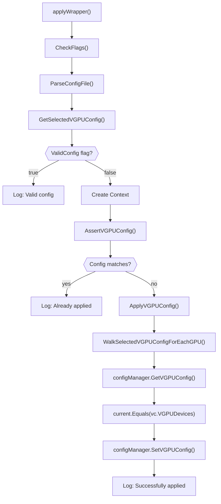

**Sources:** [cmd/nvidia-vgpu-dm/apply/apply.go:94-139](), [cmd/nvidia-vgpu-dm/apply/config.go:29-50]()

## Assert Command Workflow

The assert command validates current vGPU configurations against the desired state:

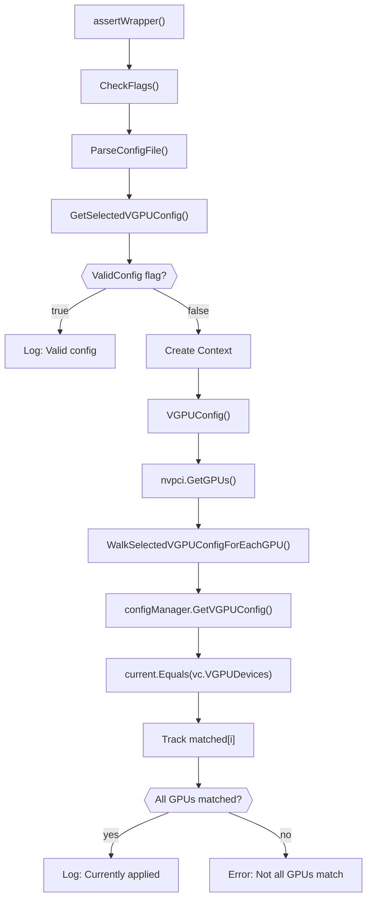

**Sources:** [cmd/nvidia-vgpu-dm/assert/assert.go:93-132](), [cmd/nvidia-vgpu-dm/assert/config.go:29-67]()

## Configuration Processing Pipeline

Both commands share a common configuration processing pipeline that handles YAML parsing and device selection:

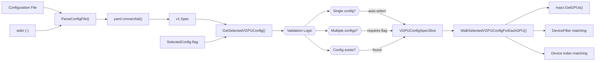

**Sources:** [cmd/nvidia-vgpu-dm/assert/assert.go:146-190](), [cmd/nvidia-vgpu-dm/assert/assert.go:192-229]()

## Core Data Structures

The CLI tool operates on several key data structures:

### Flags Structure
```go
type Flags struct {
    ConfigFile     string  // Path to configuration file
    SelectedConfig string  // Name of config to select
    ValidConfig    bool    // Assert command only
}
```

### Context Structure
```go
type Context struct {
    *cli.Context          // CLI context
    Flags      *Flags     // Command flags  
    VGPUConfig v1.VGPUConfigSpecSlice  // Selected config
}
```

### Configuration Flow Functions

| Function | Purpose | Location |
|----------|---------|----------|
| `ParseConfigFile()` | Parse YAML config from file or stdin | [cmd/nvidia-vgpu-dm/assert/assert.go:146-171]() |
| `GetSelectedVGPUConfig()` | Select specific config from parsed spec | [cmd/nvidia-vgpu-dm/assert/assert.go:173-190]() |
| `WalkSelectedVGPUConfigForEachGPU()` | Iterate over matching GPUs | [cmd/nvidia-vgpu-dm/assert/assert.go:192-229]() |
| `CheckFlags()` | Validate required flags are present | [cmd/nvidia-vgpu-dm/assert/assert.go:134-144]() |

**Sources:** [cmd/nvidia-vgpu-dm/apply/apply.go:36-44](), [cmd/nvidia-vgpu-dm/assert/assert.go:42-53]()

## Device Management Integration

The CLI tool integrates with the underlying vGPU device management system through specific interfaces:

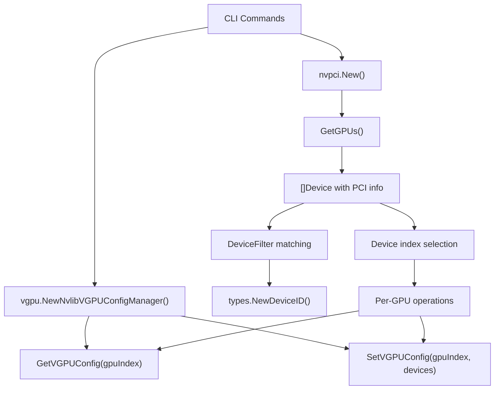

**Sources:** [cmd/nvidia-vgpu-dm/apply/config.go:31-46](), [cmd/nvidia-vgpu-dm/assert/config.go:39-53](), [cmd/nvidia-vgpu-dm/assert/assert.go:194-226]()

The CLI tool serves as the direct interface for vGPU configuration management, providing both interactive validation (`assert`) and configuration application (`apply`) capabilities that integrate with the broader vGPU device management system.

---

# Page: Kubernetes Daemon (nvidia-k8s-vgpu-dm)

# Kubernetes Daemon (nvidia-k8s-vgpu-dm)

<details>
<summary>Relevant source files</summary>

The following files were used as context for generating this wiki page:

- [cmd/nvidia-k8s-vgpu-dm/find.go](cmd/nvidia-k8s-vgpu-dm/find.go)
- [cmd/nvidia-k8s-vgpu-dm/main.go](cmd/nvidia-k8s-vgpu-dm/main.go)
- [cmd/nvidia-k8s-vgpu-dm/reconfigure_mig.go](cmd/nvidia-k8s-vgpu-dm/reconfigure_mig.go)

</details>


The `nvidia-k8s-vgpu-dm` daemon is responsible for monitoring and managing vGPU configurations on Kubernetes nodes. It watches for configuration changes via node labels, applies vGPU device configurations, manages MIG (Multi-Instance GPU) settings, and coordinates the lifecycle of GPU operands such as device plugins and validators.

This daemon operates as a long-running process on each GPU-enabled node, continuously monitoring for configuration changes and ensuring the node's GPU configuration matches the desired state. For information about the CLI tool that this daemon uses internally, see [CLI Tools (nvidia-vgpu-dm)](#2.1). For details about the configuration format, see [Configuration System](#2.3).

## System Architecture

The daemon implements a reactive architecture that responds to Kubernetes node label changes and manages the complete GPU configuration lifecycle.

```mermaid
graph TB
    subgraph "main.go Core Components"
        main_start["start()"]
        main_validate["validateFlags()"]
        sync_config["SyncableVGPUConfig"]
        continuous_sync["continuouslySyncVGPUConfigChanges()"]
        update_config["updateConfig()"]
    end
    
    subgraph "Configuration Management"
        assert_valid["assertValidConfig()"]
        assert_config["assertConfig()"]
        apply_config["applyConfig()"]
        handle_mig["handleMIGConfiguration()"]
    end
    
    subgraph "Driver Discovery (find.go)"
        driver_root["root"]
        get_driver_path["getDriverLibraryPath()"]
        find_file["findFile()"]
        resolve_link["resolveLink()"]
    end
    
    subgraph "MIG Management (reconfigure_mig.go)"
        reconfig_mig["reconfigureMIG()"]
        reconfig_opts["reconfigureMIGOptions"]
        assert_mig["assertMIGConfig()"]
        apply_mig["applyMIGConfig()"]
        host_persist["hostPersistConfig()"]
    end
    
    subgraph "GPU Operands Management"
        shutdown_ops["shutdownGPUOperands()"]
        reschedule_ops["rescheduleGPUOperands()"]
        wait_deletion["waitForPodDeletion()"]
    end
    
    subgraph "Node Label Management"
        get_label["getNodeLabelValue()"]
        set_label["setNodeLabelValue()"]
        get_state["getNodeStateLabels()"]
    end
    
    main_start --> main_validate
    main_start --> sync_config
    main_start --> continuous_sync
    main_start --> update_config
    
    update_config --> assert_valid
    update_config --> assert_config
    update_config --> shutdown_ops
    update_config --> handle_mig
    update_config --> apply_config
    update_config --> reschedule_ops
    
    handle_mig --> get_driver_path
    handle_mig --> reconfig_mig
    
    get_driver_path --> find_file
    find_file --> resolve_link
    
    reconfig_mig --> reconfig_opts
    reconfig_mig --> assert_mig
    reconfig_mig --> apply_mig
    reconfig_mig --> host_persist
    
    shutdown_ops --> wait_deletion
    continuous_sync --> sync_config
    
    update_config --> get_state
    update_config --> set_label
```

Sources: [cmd/nvidia-k8s-vgpu-dm/main.go:127-314](), [cmd/nvidia-k8s-vgpu-dm/find.go:24-71](), [cmd/nvidia-k8s-vgpu-dm/reconfigure_mig.go:47-194]()

## Node Label Monitoring

The daemon uses a `SyncableVGPUConfig` struct to coordinate configuration changes based on Kubernetes node label modifications. It monitors the `nvidia.com/vgpu.config` label and triggers configuration updates when changes are detected.

```mermaid
graph TB
    subgraph "Node Label Monitoring"
        list_watch["cache.NewListWatchFromClient()"]
        informer["cache.NewInformerWithOptions()"]
        syncable["SyncableVGPUConfig"]
        
        subgraph "Event Handlers"
            add_func["AddFunc()"]
            update_func["UpdateFunc()"]
        end
        
        subgraph "Label Constants"
            vgpu_label['"nvidia.com/vgpu.config"']
            state_label['"nvidia.com/vgpu.config.state"']
            plugin_label['"nvidia.com/gpu.deploy.sandbox-device-plugin"']
            validator_label['"nvidia.com/gpu.deploy.sandbox-validator"']
        end
    end
    
    subgraph "Configuration Synchronization"
        sync_set["syncableVGPUConfig.Set()"]
        sync_get["syncableVGPUConfig.Get()"]
        sync_cond["sync.Cond"]
        sync_mutex["sync.Mutex"]
    end
    
    list_watch --> informer
    informer --> add_func
    informer --> update_func
    
    add_func --> vgpu_label
    update_func --> vgpu_label
    
    add_func --> sync_set
    update_func --> sync_set
    
    sync_set --> sync_cond
    sync_get --> sync_cond
    sync_cond --> sync_mutex
    
    syncable --> sync_set
    syncable --> sync_get
```

Sources: [cmd/nvidia-k8s-vgpu-dm/main.go:86-125](), [cmd/nvidia-k8s-vgpu-dm/main.go:316-345](), [cmd/nvidia-k8s-vgpu-dm/main.go:48-59]()

The `SyncableVGPUConfig` implements a thread-safe mechanism where `Get()` calls block until a corresponding `Set()` call is made, ensuring that configuration changes are processed sequentially.

## Configuration Management Workflow

The daemon orchestrates a multi-step process to safely apply vGPU configurations, including validation, GPU operand management, and MIG configuration.

```mermaid
graph TD
    config_change["Node Label Change Detected"]
    
    subgraph "Validation Phase"
        assert_valid_config["assertValidConfig()"]
        assert_current["assertConfig()"]
    end
    
    subgraph "Preparation Phase"
        get_state_labels["getNodeStateLabels()"]
        set_pending["setNodeLabelValue('pending')"]
        shutdown_operands["shutdownGPUOperands()"]
    end
    
    subgraph "Configuration Phase"
        handle_mig_config["handleMIGConfiguration()"]
        apply_vgpu_config["applyConfig()"]
    end
    
    subgraph "Restoration Phase"
        reschedule_operands["rescheduleGPUOperands()"]
        update_state["setNodeLabelValue('success'/'failed')"]
    end
    
    subgraph "GPU Operands"
        plugin_pods["sandbox-device-plugin"]
        validator_pods["sandbox-validator"]
    end
    
    config_change --> assert_valid_config
    assert_valid_config --> assert_current
    assert_current --> get_state_labels
    get_state_labels --> set_pending
    set_pending --> shutdown_operands
    
    shutdown_operands --> plugin_pods
    shutdown_operands --> validator_pods
    
    shutdown_operands --> handle_mig_config
    handle_mig_config --> apply_vgpu_config
    apply_vgpu_config --> reschedule_operands
    reschedule_operands --> update_state
```

Sources: [cmd/nvidia-k8s-vgpu-dm/main.go:347-394](), [cmd/nvidia-k8s-vgpu-dm/main.go:459-499](), [cmd/nvidia-k8s-vgpu-dm/main.go:527-544]()

| Function | Purpose | CLI Command Used |
|----------|---------|------------------|
| `assertValidConfig()` | Validates configuration exists | `nvidia-vgpu-dm assert --valid-config` |
| `assertConfig()` | Checks if configuration is applied | `nvidia-vgpu-dm assert` |
| `applyConfig()` | Applies vGPU configuration | `nvidia-vgpu-dm apply` |

## MIG Configuration Management

The daemon integrates with `nvidia-mig-parted` to handle Multi-Instance GPU configurations, including mode changes, service lifecycle management, and optional node reboots.

```mermaid
graph TB
    subgraph "MIG Configuration Flow"
        determine_mig["determineMIGConfig()"]
        convert_mig["convertToMIGConfig()"]
        save_temp["saveMIGConfigToTempFile()"]
        update_mig["updateMIGConfig()"]
    end
    
    subgraph "reconfigureMIGOptions"
        node_name["NodeName"]
        mig_file["MIGPartedConfigFile"]
        selected_config["SelectedMIGConfig"]
        driver_path["DriverLibraryPath"]
        with_reboot["WithReboot"]
        with_shutdown["WithShutdownHostGPUClients"]
        host_root["HostRootMount"]
        gpu_clients["HostGPUClientServices"]
    end
    
    subgraph "MIG Operations"
        assert_valid_mig["assertValidMIGConfig()"]
        assert_mig_mode["assertMIGModeOnly()"]
        apply_mig_mode["applyMIGModeOnly()"]
        apply_mig_config["applyMIGConfig()"]
        host_persist_config["hostPersistConfig()"]
    end
    
    subgraph "Service Management"
        stop_services["hostStopSystemdServices()"]
        start_services["hostStartSystemdServices()"]
        process_service["processSystemdService()"]
        reboot_host["rebootHost()"]
    end
    
    determine_mig --> convert_mig
    convert_mig --> save_temp
    save_temp --> update_mig
    
    update_mig --> assert_valid_mig
    assert_valid_mig --> assert_mig_mode
    assert_mig_mode --> stop_services
    stop_services --> apply_mig_mode
    apply_mig_mode --> apply_mig_config
    apply_mig_config --> start_services
    
    stop_services --> process_service
    start_services --> process_service
    
    apply_mig_mode --> reboot_host
    apply_mig_mode --> host_persist_config
```

Sources: [cmd/nvidia-k8s-vgpu-dm/main.go:591-693](), [cmd/nvidia-k8s-vgpu-dm/reconfigure_mig.go:90-194](), [cmd/nvidia-k8s-vgpu-dm/reconfigure_mig.go:270-304]()

The `reconfigureMIGOptions` struct contains comprehensive validation rules using the `validator` package, ensuring proper systemd service names and file paths before executing MIG operations.

## Driver Discovery

The daemon locates NVIDIA driver libraries required for GPU operations through a systematic search across standard system paths.

```mermaid
graph LR
    subgraph "Driver Discovery Process"
        root_type["root (string type)"]
        get_driver_path["getDriverLibraryPath()"]
        find_file["findFile()"]
        resolve_link["resolveLink()"]
    end
    
    subgraph "Search Paths"
        usr_lib64["/usr/lib64"]
        usr_lib_x86["/usr/lib/x86_64-linux-gnu"]
        usr_lib_aarch["/usr/lib/aarch64-linux-gnu"]
        lib64["/lib64"]
        lib_x86["/lib/x86_64-linux-gnu"]
        lib_aarch["/lib/aarch64-linux-gnu"]
    end
    
    subgraph "Target Files"
        nvidia_ml["libnvidia-ml.so.1"]
        symlink_resolution["filepath.EvalSymlinks()"]
    end
    
    root_type --> get_driver_path
    get_driver_path --> find_file
    find_file --> usr_lib64
    find_file --> usr_lib_x86
    find_file --> usr_lib_aarch
    find_file --> lib64
    find_file --> lib_x86
    find_file --> lib_aarch
    
    find_file --> nvidia_ml
    find_file --> resolve_link
    resolve_link --> symlink_resolution
```

Sources: [cmd/nvidia-k8s-vgpu-dm/find.go:26-71]()

The `root` type provides methods for locating driver files within a specified root directory, supporting both direct file access and symlink resolution across multiple architecture-specific paths.

## GPU Operands Lifecycle Management

The daemon manages the lifecycle of GPU-related Kubernetes components by manipulating node labels and waiting for pod termination.

```mermaid
graph TB
    subgraph "Shutdown Workflow"
        get_node_labels["getNodeStateLabels()"]
        maybe_set_paused["maybeSetPaused()"]
        update_node["clientset.Update()"]
        wait_plugin["waitForPodDeletion(sandbox-device-plugin)"]
        wait_validator["waitForPodDeletion(sandbox-validator)"]
    end
    
    subgraph "Label Management"
        plugin_state['"nvidia.com/gpu.deploy.sandbox-device-plugin"']
        validator_state['"nvidia.com/gpu.deploy.sandbox-validator"']
        paused_value['"paused-for-vgpu-change"']
    end
    
    subgraph "Reschedule Workflow"
        maybe_set_true["maybeSetTrue()"]
        restore_labels["Update node labels"]
    end
    
    subgraph "Pod Selection"
        field_selector['"spec.nodeName=<node>"']
        plugin_selector['"app=nvidia-sandbox-device-plugin-daemonset"']
        validator_selector['"app=nvidia-sandbox-validator"']
    end
    
    get_node_labels --> maybe_set_paused
    maybe_set_paused --> plugin_state
    maybe_set_paused --> validator_state
    maybe_set_paused --> paused_value
    maybe_set_paused --> update_node
    
    update_node --> wait_plugin
    update_node --> wait_validator
    
    wait_plugin --> field_selector
    wait_plugin --> plugin_selector
    wait_validator --> field_selector
    wait_validator --> validator_selector
    
    wait_validator --> maybe_set_true
    maybe_set_true --> restore_labels
```

Sources: [cmd/nvidia-k8s-vgpu-dm/main.go:459-558](), [cmd/nvidia-k8s-vgpu-dm/main.go:501-525]()

The daemon uses a 120-second timeout for pod deletion operations and implements polling with 1-second intervals to monitor pod termination status.

## Integration Points

The daemon integrates with multiple external systems and CLI tools to provide comprehensive vGPU management.

| Component | Integration Method | Purpose |
|-----------|-------------------|---------|
| `nvidia-vgpu-dm` CLI | `exec.Command()` calls | Configuration validation and application |
| `nvidia-mig-parted` CLI | `exec.Command()` with `LD_PRELOAD` | MIG configuration management |
| Kubernetes API | `client-go` library | Node monitoring and label management |
| systemd | `chroot` + `systemctl` commands | Host service lifecycle management |
| Host filesystem | Mount paths and file operations | Driver discovery and configuration persistence |

Sources: [cmd/nvidia-k8s-vgpu-dm/main.go:397-433](), [cmd/nvidia-k8s-vgpu-dm/reconfigure_mig.go:397-401](), [cmd/nvidia-k8s-vgpu-dm/reconfigure_mig.go:255-268]()

The daemon operates with elevated privileges to manage host system services and requires specific mount points (`/host` for host root, `/driver-root` for driver files) to function correctly in containerized environments.

---

# Page: Configuration System

# Configuration System

<details>
<summary>Relevant source files</summary>

The following files were used as context for generating this wiki page:

- [api/spec/v1/helpers.go](api/spec/v1/helpers.go)
- [api/spec/v1/spec.go](api/spec/v1/spec.go)
- [api/spec/v1/spec_test.go](api/spec/v1/spec_test.go)

</details>


## Purpose and Scope

The Configuration System provides the core infrastructure for parsing, validating, and processing vGPU device configurations across the NVIDIA vGPU Device Manager. This system handles YAML/JSON configuration files that define how virtual GPU devices should be allocated and managed on physical GPU hardware.

The configuration system serves both the CLI tool (`nvidia-vgpu-dm`) and the Kubernetes daemon (`nvidia-k8s-vgpu-dm`) by providing a unified specification format and device matching logic. For information about how these applications use the configuration system, see [CLI Tools](#2.1) and [Kubernetes Daemon](#2.2). For details about the actual configuration file format and examples, see [Configuration Format & Examples](#3).

## Configuration Architecture

The configuration system is built around a versioned API specification that defines how vGPU configurations are structured and processed.

### Core Configuration Components

```mermaid
graph TB
    subgraph "Configuration API (v1)"
        Spec["Spec struct<br/>Top-level configuration"]
        VGPUConfigSpec["VGPUConfigSpec struct<br/>Device-specific configuration"]
        VGPUConfigSpecSlice["VGPUConfigSpecSlice<br/>Collection of configurations"]
    end
    
    subgraph "Device Matching"
        MatchesDeviceFilter["MatchesDeviceFilter()<br/>PCI ID filtering"]
        MatchesDevices["MatchesDevices()<br/>Device index matching"]
        MatchesAllDevices["MatchesAllDevices()<br/>All devices selector"]
    end
    
    subgraph "Configuration Processing"
        UnmarshalJSON["UnmarshalJSON()<br/>JSON/YAML parsing"]
        ToMigConfigSpecSlice["ToMigConfigSpecSlice()<br/>MIG conversion"]
        AssertValid["AssertValid()<br/>Configuration validation"]
    end
    
    subgraph "External Integration"
        VGPUConfig["types.VGPUConfig<br/>Device mappings"]
        MigConfig["migpartedv1.MigConfigSpec<br/>MIG configuration"]
        DeviceID["types.DeviceID<br/>Hardware identification"]
    end
    
    Spec --> VGPUConfigSpec
    VGPUConfigSpec --> VGPUConfigSpecSlice
    VGPUConfigSpec --> MatchesDeviceFilter
    VGPUConfigSpec --> MatchesDevices
    VGPUConfigSpec --> MatchesAllDevices
    
    UnmarshalJSON --> Spec
    UnmarshalJSON --> VGPUConfigSpec
    VGPUConfigSpecSlice --> ToMigConfigSpecSlice
    
    VGPUConfigSpec --> VGPUConfig
    ToMigConfigSpecSlice --> MigConfig
    MatchesDeviceFilter --> DeviceID
```

**Sources:** [api/spec/v1/spec.go:33-46](), [api/spec/v1/helpers.go:23-68]()

## Configuration Data Model

The configuration system uses a hierarchical structure to define vGPU device allocations:

### Primary Configuration Structures

| Component | Purpose | Key Fields |
|-----------|---------|------------|
| `Spec` | Top-level configuration container | `Version`, `VGPUConfigs` |
| `VGPUConfigSpec` | Individual GPU configuration | `DeviceFilter`, `Devices`, `VGPUDevices` |
| `VGPUConfigSpecSlice` | Collection of configurations | Array of `VGPUConfigSpec` |

### Configuration Schema Flow

```mermaid
graph LR
    subgraph "YAML/JSON Input"
        ConfigFile["Configuration File<br/>config-t4.yaml"]
    end
    
    subgraph "Parsing Layer"
        UnmarshalSpec["Spec.UnmarshalJSON()<br/>Version validation"]
        UnmarshalVGPU["VGPUConfigSpec.UnmarshalJSON()<br/>Field validation"]
    end
    
    subgraph "Validation Layer"
        VersionCheck["Version == 'v1'"]
        RequiredFields["Required: devices, vgpu-devices"]
        VGPUValidation["VGPUConfig.AssertValid()"]
    end
    
    subgraph "Processing Layer"
        DeviceMatching["Device Matching Logic"]
        MIGConversion["MIG Config Conversion"]
        ConfigSelection["Configuration Selection"]
    end
    
    ConfigFile --> UnmarshalSpec
    UnmarshalSpec --> VersionCheck
    UnmarshalSpec --> UnmarshalVGPU
    UnmarshalVGPU --> RequiredFields
    UnmarshalVGPU --> VGPUValidation
    
    VGPUValidation --> DeviceMatching
    DeviceMatching --> MIGConversion
    MIGConversion --> ConfigSelection
```

**Sources:** [api/spec/v1/spec.go:48-95](), [api/spec/v1/spec.go:97-164]()

## Device Matching System

The configuration system implements flexible device selection through multiple matching strategies:

### Device Selection Methods

```mermaid
graph TB
    subgraph "Device Selection Input"
        DeviceFilter["DeviceFilter<br/>string or []string"]
        Devices["Devices<br/>'all' or []int"]
        DeviceIndex["Device Index<br/>int"]
    end
    
    subgraph "Matching Functions"
        MatchesDeviceFilter["MatchesDeviceFilter(deviceID)<br/>PCI ID matching"]
        MatchesAllDevices["MatchesAllDevices()<br/>Universal selector"]
        MatchesDevices["MatchesDevices(index)<br/>Index-based selection"]
    end
    
    subgraph "Matching Logic"
        PCIMatching["PCI ID Comparison<br/>types.NewDeviceIDFromString()"]
        AllDevicesCheck["devices == 'all'"]
        IndexArrayCheck["index in []int devices"]
    end
    
    subgraph "Decision Output"
        FilterMatch["Device Filter Match"]
        DeviceMatch["Device Selection Match"]
        FinalSelection["Configuration Applies"]
    end
    
    DeviceFilter --> MatchesDeviceFilter
    Devices --> MatchesAllDevices
    Devices --> MatchesDevices
    DeviceIndex --> MatchesDevices
    
    MatchesDeviceFilter --> PCIMatching
    MatchesAllDevices --> AllDevicesCheck
    MatchesDevices --> IndexArrayCheck
    MatchesDevices --> AllDevicesCheck
    
    PCIMatching --> FilterMatch
    AllDevicesCheck --> DeviceMatch
    IndexArrayCheck --> DeviceMatch
    
    FilterMatch --> FinalSelection
    DeviceMatch --> FinalSelection
```

**Sources:** [api/spec/v1/helpers.go:24-47](), [api/spec/v1/helpers.go:50-68]()

### Device Filter Processing

The `MatchesDeviceFilter` function handles both single device filters and arrays of device filters:

- **Single Device Filter**: `DeviceFilter` as `string` - matches one specific PCI device ID
- **Multiple Device Filters**: `DeviceFilter` as `[]string` - matches any device ID in the array  
- **No Filter**: Empty `DeviceFilter` - matches all devices by default

The `Devices` field supports two modes:
- **Universal Selection**: `"all"` - applies configuration to all matching devices
- **Index-based Selection**: `[]int` - applies configuration only to devices at specified indices

**Sources:** [api/spec/v1/helpers.go:24-47](), [api/spec/v1/helpers.go:57-68]()

## Configuration Processing Flow

The system processes configurations through a multi-stage pipeline that handles parsing, validation, and conversion:

### Processing Pipeline

```mermaid
graph TD
    subgraph "Input Stage"
        YAMLInput["YAML Configuration<br/>Raw bytes"]
        JSONInput["JSON Configuration<br/>Raw bytes"]
    end
    
    subgraph "Parsing Stage"
        SpecUnmarshal["Spec.UnmarshalJSON()<br/>Top-level parsing"]
        ConfigUnmarshal["VGPUConfigSpec.UnmarshalJSON()<br/>Configuration parsing"]
        FieldValidation["Field Type Validation<br/>string vs []string vs []int"]
    end
    
    subgraph "Validation Stage"
        VersionValidation["Version Validation<br/>version == 'v1'"]
        RequiredValidation["Required Field Check<br/>devices, vgpu-devices"]
        VGPUValidation["VGPUConfig.AssertValid()<br/>Device configuration validation"]
        ConfigStructure["Configuration Structure Check<br/>Non-empty configs"]
    end
    
    subgraph "Conversion Stage"
        MIGDetection["MIG-backed vGPU Detection<br/>vgpu.G > 0"]
        MIGProfileGeneration["MIG Profile Generation<br/>format: XgYgb[.me]"]
        MIGConfigCreation["migpartedv1.MigConfigSpec<br/>Creation"]
        MIGSpecSlice["MigConfigSpecSlice<br/>Output"]
    end
    
    YAMLInput --> SpecUnmarshal
    JSONInput --> SpecUnmarshal
    SpecUnmarshal --> ConfigUnmarshal
    ConfigUnmarshal --> FieldValidation
    
    FieldValidation --> VersionValidation
    VersionValidation --> RequiredValidation
    RequiredValidation --> VGPUValidation
    VGPUValidation --> ConfigStructure
    
    ConfigStructure --> MIGDetection
    MIGDetection --> MIGProfileGeneration
    MIGProfileGeneration --> MIGConfigCreation
    MIGConfigCreation --> MIGSpecSlice
```

**Sources:** [api/spec/v1/spec.go:48-95](), [api/spec/v1/spec.go:97-164](), [api/spec/v1/spec.go:166-202]()

## MIG Configuration Integration

The configuration system provides seamless integration with NVIDIA Multi-Instance GPU (MIG) technology through automatic conversion of vGPU specifications to MIG configurations:

### MIG Conversion Process

The `ToMigConfigSpecSlice` method analyzes vGPU types to determine if they require MIG partitioning:

| vGPU Type Pattern | MIG Profile | MIG Enabled |
|------------------|-------------|-------------|
| `A100-1-5C` | `1g.5gb` | Yes |
| `A100-2-10C` | `2g.10gb` | Yes |
| `A100-1-5CME` | `1g.5gb.me` | Yes |
| `A100-40C` | N/A | No |

The conversion logic in `ToMigConfigSpecSlice()` parses vGPU types using `types.ParseVGPUType()` and generates corresponding MIG profiles. Media Extensions (`ME`) attribute adds `.me` suffix to MIG profiles.

**Sources:** [api/spec/v1/spec.go:166-202](), [api/spec/v1/spec_test.go:239-424]()

## Error Handling and Validation

The configuration system implements comprehensive error handling across multiple validation layers:

### Validation Categories

- **Version Validation**: Ensures configuration uses supported API version (`v1`)
- **Structure Validation**: Validates required fields and proper JSON/YAML structure  
- **Type Validation**: Handles polymorphic fields (`DeviceFilter`, `Devices`) with multiple type options
- **Content Validation**: Validates vGPU device configurations and device filter formats
- **Conversion Validation**: Ensures valid vGPU types during MIG configuration conversion

The system uses detailed error messages with context about which field caused validation failures, enabling efficient debugging of configuration issues.

**Sources:** [api/spec/v1/spec.go:56-94](), [api/spec/v1/spec.go:105-163](), [api/spec/v1/spec_test.go:31-151]()

---

# Page: Configuration Format & Examples

# Configuration Format & Examples

<details>
<summary>Relevant source files</summary>

The following files were used as context for generating this wiki page:

- [api/spec/v1/spec.go](api/spec/v1/spec.go)
- [examples/config-example.yaml](examples/config-example.yaml)
- [examples/config-t4.yaml](examples/config-t4.yaml)

</details>


This document describes the YAML configuration format used by the NVIDIA vGPU Device Manager to specify virtual GPU configurations. The configuration system defines how physical GPUs should be partitioned into virtual GPU devices and which devices should receive specific configurations.

For information about how configurations are applied and validated, see [CLI Tools](#2.1). For details on the configuration parsing and device matching logic, see [Configuration System](#2.3).

## Configuration Schema Overview

The vGPU Device Manager uses a versioned YAML configuration format that maps configuration names to device specifications. Each configuration defines which physical devices to target and how to partition them into virtual GPU instances.

```mermaid
graph TB
    subgraph "Configuration Structure"
        YAML["`**Configuration YAML**
        version: v1
        vgpu-configs: {...}`"]
        
        SPEC["`**Spec**
        Version: string
        VGPUConfigs: map[string]VGPUConfigSpecSlice`"]
        
        CONFIG_SLICE["`**VGPUConfigSpecSlice**
        []VGPUConfigSpec`"]
        
        CONFIG_SPEC["`**VGPUConfigSpec**
        DeviceFilter: interface{}
        Devices: interface{}
        VGPUDevices: VGPUConfig`"]
    end
    
    subgraph "Device Selection"
        FILTER["`**Device Filter**
        PCI ID strings
        '0x1EB810DE'`"]
        
        DEVICES["`**Device List**
        'all' or [0,1,2]`"]
    end
    
    subgraph "vGPU Mapping"
        VGPU_CONFIG["`**VGPUConfig**
        map[string]int
        'T4-8Q': 2`"]
    end
    
    YAML --> SPEC
    SPEC --> CONFIG_SLICE
    CONFIG_SLICE --> CONFIG_SPEC
    CONFIG_SPEC --> FILTER
    CONFIG_SPEC --> DEVICES
    CONFIG_SPEC --> VGPU_CONFIG
```

**Sources:** [api/spec/v1/spec.go:29-46](), [examples/config-t4.yaml:1-53]()

## Core Data Structures

The configuration system is built around several key Go types that handle parsing, validation, and device matching:

```mermaid
graph LR
    subgraph "Parsing Pipeline"
        JSON_UNMARSHAL["`**UnmarshalJSON**
        Spec.UnmarshalJSON()
        VGPUConfigSpec.UnmarshalJSON()`"]
        
        VALIDATION["`**Validation**
        VGPUConfig.AssertValid()
        containsKey() checks`"]
        
        MIG_CONVERT["`**MIG Conversion**
        ToMigConfigSpecSlice()
        ParseVGPUType()`"]
    end
    
    subgraph "Data Types"
        SPEC_TYPE["`**v1.Spec**
        api/spec/v1/spec.go:33`"]
        
        VGPU_SPEC_TYPE["`**v1.VGPUConfigSpec**
        api/spec/v1/spec.go:39`"]
        
        VGPU_CONFIG_TYPE["`**types.VGPUConfig**
        pkg/types package`"]
    end
    
    JSON_UNMARSHAL --> VALIDATION
    VALIDATION --> MIG_CONVERT
    SPEC_TYPE --> JSON_UNMARSHAL
    VGPU_SPEC_TYPE --> JSON_UNMARSHAL
    VGPU_CONFIG_TYPE --> VALIDATION
```

**Sources:** [api/spec/v1/spec.go:48-95](), [api/spec/v1/spec.go:97-164](), [api/spec/v1/spec.go:166-202]()

## Device Selection Mechanisms

The configuration system provides flexible device targeting through two complementary mechanisms:

### Device Filter Options

| Filter Type | Format | Example | Description |
|-------------|--------|---------|-------------|
| Single PCI ID | String | `"0x1EB810DE"` | Matches specific GPU model |
| Multiple PCI IDs | String Array | `["0x1EB810DE", "0x223610DE"]` | Matches multiple GPU models |
| No Filter | Omitted | N/A | Applies to all detected GPUs |

### Device Selection Options

| Selection Type | Format | Example | Description |
|----------------|--------|---------|-------------|
| All Devices | String | `"all"` | Targets all matching devices |
| Specific Indices | Integer Array | `[0, 1, 2]` | Targets devices by index |

**Sources:** [api/spec/v1/spec.go:115-145](), [examples/config-t4.yaml:31-52]()

## vGPU Type Specifications

Each vGPU configuration maps vGPU type identifiers to the number of instances to create:

```mermaid
graph TB
    subgraph "vGPU Type Format"
        TYPE_FORMAT["`**vGPU Type Pattern**
        {MODEL}-{SIZE}{VARIANT}
        T4-8Q, A100-20C, H100-1-10CME`"]
        
        MODEL["`**GPU Model**
        T4, A100, H100, V100
        L40, A30, etc.`"]
        
        SIZE["`**Memory/Compute**
        1Q, 2Q, 4C, 8C
        Numbers + Q/C suffix`"]
        
        VARIANT["`**Special Variants**
        ME (Media Extensions)
        MIG profiles: 1-10C, 2-20C`"]
    end
    
    subgraph "Example Mappings"
        SMALL["`**Small Instances**
        'T4-1Q': 16
        'A100-4C': 20`"]
        
        MEDIUM["`**Medium Instances**
        'T4-8Q': 2
        'A100-20C': 4`"]
        
        LARGE["`**Large Instances**
        'T4-16Q': 1
        'A100-80C': 1`"]
    end
    
    TYPE_FORMAT --> MODEL
    TYPE_FORMAT --> SIZE
    TYPE_FORMAT --> VARIANT
    
    MODEL --> SMALL
    SIZE --> MEDIUM
    VARIANT --> LARGE
```

**Sources:** [examples/config-example.yaml:3-2888](), [examples/config-t4.yaml:4-27]()

## Basic Configuration Examples

### Simple T4 Configuration

```yaml
version: v1
vgpu-configs:
  T4-8Q:
    - devices: all
      vgpu-devices:
        "T4-8Q": 2
```

### Multi-Device Configuration

```yaml
version: v1
vgpu-configs:
  T4-mixed:
    - devices: [0]
      vgpu-devices:
        "T4-4Q": 4
    - devices: [1]
      vgpu-devices:
        "T4-8Q": 2
```

### Device Filter Configuration

```yaml
version: v1
vgpu-configs:
  default:
    - device-filter: "0x1EB810DE"
      devices: all
      vgpu-devices:
        "T4-8Q": 2
    - device-filter: "0x20B510DE"
      devices: all
      vgpu-devices:
        "A100D-40C": 2
```

**Sources:** [examples/config-t4.yaml:4-53](), [examples/config-example.yaml:2643-2888]()

## Advanced Configuration Patterns

### MIG-Enabled Configurations

The system automatically converts vGPU types with MIG profiles to appropriate MIG configurations:

```mermaid
graph LR
    subgraph "vGPU to MIG Conversion"
        VGPU_TYPE["`**vGPU Type**
        A100-1-10C
        H100-2-20C`"]
        
        PARSE["`**ParseVGPUType()**
        Extract G, GB, Attr`"]
        
        MIG_PROFILE["`**MIG Profile**
        1g.10gb
        2g.20gb.me`"]
        
        MIG_CONFIG["`**MigConfigSpec**
        MigEnabled: true
        MigDevices: map`"]
    end
    
    VGPU_TYPE --> PARSE
    PARSE --> MIG_PROFILE
    MIG_PROFILE --> MIG_CONFIG
```

### Multi-GPU Configurations

```yaml
version: v1
vgpu-configs:
  datacenter-mixed:
    - device-filter: ["0x20B510DE", "0x20B710DE"]
      devices: all
      vgpu-devices:
        "A100D-40C": 2
        "A30-12C": 2
```

**Sources:** [api/spec/v1/spec.go:166-202](), [examples/config-example.yaml:119-158]()

## Configuration Validation

The configuration system performs comprehensive validation during parsing:

### Required Fields Validation

| Field | Requirement | Validation |
|-------|-------------|------------|
| `version` | Required | Must be "v1" |
| `vgpu-configs` | Required | Must contain at least one entry |
| `devices` | Required | Must be "all" or integer array |
| `vgpu-devices` | Required | Must pass `AssertValid()` |

### Type-Specific Validation

```mermaid
graph TB
    subgraph "Validation Pipeline"
        UNMARSHAL["`**UnmarshalJSON**
        Parse and validate structure`"]
        
        REQUIRED["`**Required Fields**
        Check devices, vgpu-devices`"]
        
        TYPE_CHECK["`**Type Validation**
        DeviceFilter: string | []string
        Devices: 'all' | []int`"]
        
        VGPU_VALID["`**VGPUConfig.AssertValid()**
        Validate vGPU type mappings`"]
        
        ERROR["`**Error Handling**
        Return descriptive errors`"]
    end
    
    UNMARSHAL --> REQUIRED
    REQUIRED --> TYPE_CHECK
    TYPE_CHECK --> VGPU_VALID
    VGPU_VALID --> ERROR
```

**Sources:** [api/spec/v1/spec.go:105-110](), [api/spec/v1/spec.go:152-156]()

## Integration with MIG Partitioning

The configuration system seamlessly integrates with NVIDIA MIG (Multi-Instance GPU) through automatic conversion:

### MIG Profile Generation

```yaml
# vGPU Configuration Input
vgpu-devices:
  "A100-1-10C": 7
  "A100-2-20C": 3

# Converted MIG Configuration
mig-devices:
  "1g.10gb": 7
  "2g.20gb": 3
```

### Media Extensions Support

```yaml
# vGPU with Media Extensions
vgpu-devices:
  "A100-1-10CME": 1

# MIG Profile with ME
mig-devices:
  "1g.10gb.me": 1
```

**Sources:** [api/spec/v1/spec.go:176-194](), [api/spec/v1/spec.go:186-192]()

---

# Page: Build System & Development

# Build System & Development

<details>
<summary>Relevant source files</summary>

The following files were used as context for generating this wiki page:

- [.gitignore](.gitignore)
- [.golangci.yml](.golangci.yml)
- [Makefile](Makefile)
- [docker/Dockerfile.devel](docker/Dockerfile.devel)

</details>


This document covers the build system, development environment setup, and development workflows for the NVIDIA vGPU Device Manager project. It explains the Make-based build system, Go compilation process, code quality tools, and development container setup.

For information about container image builds and deployment, see [Container Images](#4.1). For CI/CD pipeline details, see [CI/CD Pipelines](#5).

## Overview

The NVIDIA vGPU Device Manager uses a comprehensive build system built around Go's native tooling, Make, and Docker. The system supports cross-compilation, code quality enforcement, testing, and development environment containerization.

### Build System Architecture

```mermaid
graph TB
    subgraph "Build Entry Points"
        MAKEFILE["Makefile"]
        VERSIONS["versions.mk"]
        GITIGNORE[".gitignore"]
    end
    
    subgraph "Go Build Process"
        MODULE["MODULE := github.com/NVIDIA/vgpu-device-manager"]
        CMD_TARGETS["CMD_TARGETS"]
        VERSION_PKG["VERSION_PKG := internal/info"]
        GOOS["GOOS := linux"]
    end
    
    subgraph "Code Quality"
        GOLANGCI_YML[".golangci.yml"]
        LINTERS["contextcheck, gocritic, gosec, misspell, unconvert"]
        FORMATTERS["gofmt, goimports"]
    end
    
    subgraph "Development Environment"
        DOCKERFILE_DEVEL["docker/Dockerfile.devel"]
        BUILDIMAGE["BUILDIMAGE := vgpu-device-manager-build"]
        GO_TOOLS["golint, moq, ineffassign, misspell"]
    end
    
    subgraph "Build Outputs"
        BINARIES["Binary Executables"]
        COVERAGE_FILE["coverage.out"]
        DOCKER_TARGETS["docker-* targets"]
    end
    
    MAKEFILE --> MODULE
    MAKEFILE --> CMD_TARGETS
    MAKEFILE --> VERSION_PKG
    MAKEFILE --> GOOS
    
    GOLANGCI_YML --> LINTERS
    GOLANGCI_YML --> FORMATTERS
    
    DOCKERFILE_DEVEL --> BUILDIMAGE
    DOCKERFILE_DEVEL --> GO_TOOLS
    
    MODULE --> BINARIES
    CMD_TARGETS --> BINARIES
    BUILDIMAGE --> DOCKER_TARGETS
    LINTERS --> COVERAGE_FILE
```

**Sources:** [Makefile:1-106](), [.golangci.yml:1-43](), [docker/Dockerfile.devel:1-21]()

## Go Build Configuration

The project is configured as a Go module with specific build settings for cross-compilation and version injection.

### Module and Build Settings

| Setting | Value | Purpose |
|---------|-------|---------|
| `MODULE` | `github.com/NVIDIA/vgpu-device-manager` | Go module identifier |
| `GOOS` | `linux` | Target operating system |
| `VERSION_PKG` | `internal/info` | Package for version injection |
| `BUILDIMAGE_TAG` | `golang$(GOLANG_VERSION)` | Development container tag |

**Sources:** [Makefile:15](), [Makefile:35](), [Makefile:36]()

### Command Build Process

```mermaid
graph LR
    subgraph "Command Discovery"
        WILDCARD["wildcard ./cmd/*/"]
        CMDS["CMDS := patsubst"]
        CMD_TARGETS["CMD_TARGETS := cmd-%"]
    end
    
    subgraph "Build Execution"
        GO_BUILD["go build"]
        LDFLAGS["-ldflags with version injection"]
        COMMAND_BUILD_OPTIONS["PREFIX support"]
    end
    
    subgraph "Version Injection"
        GIT_COMMIT["gitCommit=$(GIT_COMMIT)"]
        VERSION["version=$(VERSION)"]
        VERSION_PKG_REF["$(VERSION_PKG).gitCommit"]
    end
    
    subgraph "Output Binaries"
        NVIDIA_VGPU_DM["nvidia-vgpu-dm"]
        NVIDIA_K8S_VGPU_DM["nvidia-k8s-vgpu-dm"]
    end
    
    WILDCARD --> CMDS
    CMDS --> CMD_TARGETS
    CMD_TARGETS --> GO_BUILD
    
    GO_BUILD --> LDFLAGS
    LDFLAGS --> GIT_COMMIT
    LDFLAGS --> VERSION
    LDFLAGS --> VERSION_PKG_REF
    
    GO_BUILD --> NVIDIA_VGPU_DM
    GO_BUILD --> NVIDIA_K8S_VGPU_DM
```

**Sources:** [Makefile:24-25](), [Makefile:42-44]()

## Code Quality and Linting

The project enforces code quality through golangci-lint with specific linter configurations and formatting rules.

### Linter Configuration

The `.golangci.yml` file configures multiple linters with specific exclusions:

| Linter | Purpose |
|--------|---------|
| `contextcheck` | Context usage validation |
| `gocritic` | Go code criticism |
| `gosec` | Security vulnerability detection |
| `misspell` | Spelling error detection |
| `unconvert` | Unnecessary type conversions |

**Exclusions:**
- Test files (`.*_test.go`) for specific gosec rules
- Third-party code (`third_party$`, `builtin$`, `examples$`)
- Generated code with lax enforcement

**Sources:** [.golangci.yml:3-8](), [.golangci.yml:17-24](), [.golangci.yml:26-28]()

### Formatting Configuration

```mermaid
graph TB
    subgraph "Formatter Settings"
        GOFMT["gofmt"]
        GOIMPORTS["goimports"]
        LOCAL_PREFIXES["local-prefixes: github.com/NVIDIA/vgpu-device-manager"]
    end
    
    subgraph "Make Targets"
        FMT_TARGET["fmt target"]
        ASSERT_FMT["assert-fmt target"]
        LINT_TARGET["lint target"]
    end
    
    subgraph "Execution"
        GO_LIST["go list -f '{{.Dir}}'"]
        XARGS_GOFMT["xargs gofmt -s -l -w"]
        GOLANGCI_LINT["golangci-lint run ./..."]
    end
    
    GOFMT --> FMT_TARGET
    GOIMPORTS --> FMT_TARGET
    LOCAL_PREFIXES --> GOIMPORTS
    
    FMT_TARGET --> GO_LIST
    ASSERT_FMT --> GO_LIST
    LINT_TARGET --> GOLANGCI_LINT
    
    GO_LIST --> XARGS_GOFMT
```

**Sources:** [.golangci.yml:29-36](), [Makefile:49-52](), [Makefile:66-68]()

## Development Environment

### Docker Development Container

The development environment is containerized using a custom Docker image that extends the official Go image with additional development tools.

```mermaid
graph TB
    subgraph "Base Image"
        GOLANG_IMAGE["golang:${GOLANG_VERSION}"]
    end
    
    subgraph "Development Tools Installation"
        GOLINT["golang.org/x/lint/golint@latest"]
        MOQ["github.com/matryer/moq@latest"]
        INEFFASSIGN["github.com/gordonklaus/ineffassign@latest"]
        MISSPELL["github.com/client9/misspell/cmd/misspell@latest"]
    end
    
    subgraph "Build Image Configuration"
        BUILDIMAGE_TAG["BUILDIMAGE_TAG ?= golang$(GOLANG_VERSION)"]
        BUILDIMAGE["BUILDIMAGE ?= vgpu-device-manager-build"]
        DOCKERFILE_PATH["docker/Dockerfile.devel"]
    end
    
    GOLANG_IMAGE --> GOLINT
    GOLANG_IMAGE --> MOQ
    GOLANG_IMAGE --> INEFFASSIGN
    GOLANG_IMAGE --> MISSPELL
    
    BUILDIMAGE_TAG --> BUILDIMAGE
    DOCKERFILE_PATH --> BUILDIMAGE
```

**Sources:** [docker/Dockerfile.devel:14-21](), [Makefile:21-22]()

### Docker Build Targets

The Makefile provides Docker-wrapped versions of all build targets for consistent development environments:

**Docker Target Execution Pattern:**
```bash
docker run --rm -e GOCACHE=/tmp/.cache -v $(PWD):$(PWD) -w $(PWD) --user $(id -u):$(id -g) $(BUILDIMAGE) make $(TARGET)
```

**Sources:** [Makefile:96-105]()

## Build Targets

### Primary Build Targets

| Target | Purpose | Dependencies |
|--------|---------|--------------|
| `cmds` | Build all command binaries | `$(CMD_TARGETS)` |
| `build` | Compile all packages | None |
| `test` | Run tests with coverage | `build` |
| `lint` | Run linting checks | None |
| `fmt` | Format code | None |
| `coverage` | Generate coverage report | `test` |

**Sources:** [Makefile:27-28](), [Makefile:42-76]()

### Check Targets

```mermaid
graph LR
    subgraph "Code Quality Checks"
        ASSERT_FMT["assert-fmt"]
        VET["vet"]
        LINT["lint"]
        INEFFASSIGN["ineffassign"]
        MISSPELL["misspell"]
    end
    
    subgraph "Check Process"
        CHECK_TARGETS["CHECK_TARGETS"]
        FMT_OUT["fmt.out file"]
        GOLANGCI_RUN["golangci-lint run"]
    end
    
    CHECK_TARGETS --> ASSERT_FMT
    CHECK_TARGETS --> VET
    CHECK_TARGETS --> LINT
    CHECK_TARGETS --> INEFFASSIGN
    CHECK_TARGETS --> MISSPELL
    
    ASSERT_FMT --> FMT_OUT
    LINT --> GOLANGCI_RUN
```

**Sources:** [Makefile:27](), [Makefile:54-64]()

## Testing and Coverage

### Test Execution

The testing system uses Go's built-in testing framework with coverage reporting:

**Test Command:**
```bash
go test -v -coverprofile=$(COVERAGE_FILE) $(MODULE)/...
```

**Coverage Processing:**
- Excludes mock files (`_mock.go`) from coverage calculations
- Generates both raw and filtered coverage reports
- Uses `go tool cover` for coverage analysis

**Sources:** [Makefile:70-76]()

### Coverage Configuration

| Variable | Value | Purpose |
|----------|-------|---------|
| `COVERAGE_FILE` | `coverage.out` | Primary coverage output |
| `$(COVERAGE_FILE).no-mocks` | `coverage.out.no-mocks` | Filtered coverage without mocks |

**Sources:** [Makefile:70](), [Makefile:75]()

## Version Management

The build system supports version injection through ldflags during compilation:

```mermaid
graph LR
    subgraph "Version Sources"
        GIT_COMMIT["$(GIT_COMMIT)"]
        VERSION["$(VERSION)"]
        VERSIONS_MK["versions.mk"]
    end
    
    subgraph "Injection Target"
        VERSION_PKG_PATH["$(VERSION_PKG)"]
        INTERNAL_INFO["internal/info package"]
    end
    
    subgraph "Build Flags"
        LDFLAGS["-ldflags"]
        GIT_COMMIT_FLAG["-X $(VERSION_PKG).gitCommit=$(GIT_COMMIT)"]
        VERSION_FLAG["-X $(VERSION_PKG).version=$(VERSION)"]
    end
    
    GIT_COMMIT --> GIT_COMMIT_FLAG
    VERSION --> VERSION_FLAG
    VERSIONS_MK --> VERSION
    
    VERSION_PKG_PATH --> INTERNAL_INFO
    GIT_COMMIT_FLAG --> LDFLAGS
    VERSION_FLAG --> LDFLAGS
```

**Sources:** [Makefile:19](), [Makefile:36](), [Makefile:44]()

---

# Page: Container Images

# Container Images

<details>
<summary>Relevant source files</summary>

The following files were used as context for generating this wiki page:

- [deployments/container/Dockerfile.ubi9](deployments/container/Dockerfile.ubi9)
- [deployments/container/Makefile](deployments/container/Makefile)
- [deployments/container/multi-arch.mk](deployments/container/multi-arch.mk)
- [deployments/container/native-only.mk](deployments/container/native-only.mk)

</details>


This document covers the container image build system for the NVIDIA vGPU Device Manager. It explains the multi-stage build process, multi-architecture support, and how the container images are constructed and deployed. For information about the overall build system including Go compilation, see [Build System & Development](#4). For CI/CD pipeline details that automate image builds, see [CI/CD Pipelines](#5).

## Build Architecture Overview

The container build system uses a multi-stage Docker build process to create lightweight, secure container images containing the vGPU device manager binaries.

```mermaid
graph TB
    subgraph "Multi-Stage Build Process"
        BUILD_STAGE["build stage<br/>nvcr.io/nvidia/cuda:13.0.0-base-ubi9"]
        MIG_STAGE["mig-manager stage<br/>nvcr.io/nvidia/cloud-native/k8s-mig-manager:v0.12.3-ubi9"]
        FINAL_STAGE["final stage<br/>nvcr.io/nvidia/distroless/go:v3.1.11-dev"]
    end
    
    subgraph "Build Dependencies"
        GOLANG["Go ${GOLANG_VERSION}"]
        BUILD_TOOLS["yum packages<br/>wget, make, git, gcc"]
        SOURCE_CODE["Source Code<br/>COPY . ."]
    end
    
    subgraph "Build Process"
        MAKE_CMDS["make PREFIX=/artifacts cmds"]
        VGPU_DM_BIN["nvidia-vgpu-dm"]
        K8S_VGPU_DM_BIN["nvidia-k8s-vgpu-dm"]
    end
    
    subgraph "External Dependencies"
        MIG_PARTED_BIN["nvidia-mig-parted"]
    end
    
    subgraph "Final Image"
        DISTROLESS_BASE["Distroless Go Base"]
        ALL_BINARIES["Combined Binaries<br/>/usr/bin/"]
        LABELS["Image Labels<br/>Metadata"]
    end
    
    BUILD_STAGE --> GOLANG
    BUILD_STAGE --> BUILD_TOOLS
    BUILD_STAGE --> SOURCE_CODE
    BUILD_STAGE --> MAKE_CMDS
    
    MAKE_CMDS --> VGPU_DM_BIN
    MAKE_CMDS --> K8S_VGPU_DM_BIN
    
    MIG_STAGE --> MIG_PARTED_BIN
    
    FINAL_STAGE --> DISTROLESS_BASE
    VGPU_DM_BIN --> ALL_BINARIES
    K8S_VGPU_DM_BIN --> ALL_BINARIES
    MIG_PARTED_BIN --> ALL_BINARIES
    
    ALL_BINARIES --> FINAL_STAGE
    LABELS --> FINAL_STAGE
```

Sources: [deployments/container/Dockerfile.ubi9:15-61]()

## Build System Configuration

The build system supports both native and multi-architecture builds through configurable Makefiles.

```mermaid
graph LR
    subgraph "Build Configuration"
        MAIN_MAKEFILE["deployments/container/Makefile"]
        VERSIONS_MK["versions.mk"]
        BUILD_MULTI_ARCH["BUILD_MULTI_ARCH_IMAGES"]
    end
    
    subgraph "Architecture Support"
        NATIVE_MK["native-only.mk<br/>linux/amd64 only"]
        MULTI_ARCH_MK["multi-arch.mk<br/>linux/amd64,linux/arm64"]
    end
    
    subgraph "Build Targets"
        UBI9_TARGET["ubi9 / build-ubi9"]
        PUSH_TARGET["push-ubi9"]
        BUILD_OPTIONS["DOCKER_BUILD_OPTIONS"]
    end
    
    subgraph "Docker Tools"
        DOCKER_CMD["docker / buildx"]
        REGCTL_CMD["regctl"]
        BUILDKIT["DOCKER_BUILDKIT=1"]
    end
    
    MAIN_MAKEFILE --> VERSIONS_MK
    MAIN_MAKEFILE --> BUILD_MULTI_ARCH
    
    BUILD_MULTI_ARCH -->|false| NATIVE_MK
    BUILD_MULTI_ARCH -->|true| MULTI_ARCH_MK
    
    NATIVE_MK --> BUILD_OPTIONS
    MULTI_ARCH_MK --> BUILD_OPTIONS
    
    BUILD_OPTIONS --> UBI9_TARGET
    UBI9_TARGET --> PUSH_TARGET
    
    DOCKER_CMD --> UBI9_TARGET
    REGCTL_CMD --> PUSH_TARGET
    BUILDKIT --> UBI9_TARGET
```

Sources: [deployments/container/Makefile:15-74](), [deployments/container/native-only.mk:15-20](), [deployments/container/multi-arch.mk:15-30]()

## Multi-Stage Build Process

### Build Stage

The first stage uses a CUDA base image to compile the Go binaries with all necessary development dependencies.

| Component | Description | Location |
|-----------|-------------|----------|
| Base Image | `nvcr.io/nvidia/cuda:13.0.0-base-ubi9` | [Dockerfile.ubi9:15]() |
| Go Installation | Architecture-aware Go installation | [Dockerfile.ubi9:19-30]() |
| Build Tools | `wget`, `make`, `git`, `gcc` | [Dockerfile.ubi9:17]() |
| Build Command | `make PREFIX=/artifacts cmds` | [Dockerfile.ubi9:39]() |

The build stage includes architecture detection logic to download the correct Go binary:

```
arch="$(uname -m)"; \
case "${arch##*-}" in \
    x86_64 | amd64) ARCH='amd64' ;; \
    ppc64el | ppc64le) ARCH='ppc64le' ;; \
    aarch64) ARCH='arm64' ;; \
    *) echo "unsupported architecture" ; exit 1 ;; \
esac;
```

Sources: [deployments/container/Dockerfile.ubi9:22-27]()

### MIG Manager Stage

The second stage extracts the `nvidia-mig-parted` binary from the NVIDIA MIG Manager image.

| Component | Value |
|-----------|-------|
| Source Image | `nvcr.io/nvidia/cloud-native/k8s-mig-manager:v0.12.3-ubi9` |
| Extracted Binary | `/usr/bin/nvidia-mig-parted` |

Sources: [deployments/container/Dockerfile.ubi9:41-49]()

### Final Stage

The final stage creates a minimal distroless image containing all required binaries.

```mermaid
graph TB
    subgraph "Final Image Composition"
        DISTROLESS["nvcr.io/nvidia/distroless/go:v3.1.11-dev"]
        NVIDIA_VISIBLE_DEVICES["ENV NVIDIA_VISIBLE_DEVICES=void"]
        USER_CONFIG["USER 0:0"]
        ENTRYPOINT_CONFIG["ENTRYPOINT nvidia-k8s-vgpu-dm"]
    end
    
    subgraph "Copied Binaries"
        VGPU_DM_COPY["COPY --from=build<br/>/artifacts/nvidia-vgpu-dm<br/>/usr/bin/nvidia-vgpu-dm"]
        K8S_VGPU_DM_COPY["COPY --from=build<br/>/artifacts/nvidia-k8s-vgpu-dm<br/>/usr/bin/nvidia-k8s-vgpu-dm"]
        MIG_PARTED_COPY["COPY --from=mig-manager<br/>/usr/bin/nvidia-mig-parted<br/>/usr/bin/nvidia-mig-parted"]
    end
    
    subgraph "Image Labels"
        VERSION_LABEL["version=${VERSION}"]
        VENDOR_LABEL["vendor=NVIDIA"]
        DISPLAY_NAME["io.k8s.display-name=<br/>NVIDIA vGPU Device Manager for Kubernetes"]
        SUMMARY_LABEL["summary=<br/>NVIDIA vGPU Device Manager for Kubernetes"]
    end
    
    DISTROLESS --> VGPU_DM_COPY
    DISTROLESS --> K8S_VGPU_DM_COPY
    DISTROLESS --> MIG_PARTED_COPY
    DISTROLESS --> VERSION_LABEL
    DISTROLESS --> VENDOR_LABEL
    DISTROLESS --> DISPLAY_NAME
    DISTROLESS --> SUMMARY_LABEL
    DISTROLESS --> NVIDIA_VISIBLE_DEVICES
    DISTROLESS --> USER_CONFIG
    DISTROLESS --> ENTRYPOINT_CONFIG
```

Sources: [deployments/container/Dockerfile.ubi9:43-61]()

## Build Targets and Options

### Supported Distributions

Currently, only UBI9-based images are supported:

| Target | Distribution | Dockerfile |
|--------|-------------|------------|
| `ubi9` | Red Hat UBI 9 | `Dockerfile.ubi9` |
| `build-ubi9` | Red Hat UBI 9 | `Dockerfile.ubi9` |
| `push-ubi9` | Push target | N/A |

Sources: [deployments/container/Makefile:38-44]()

### Build Arguments

The following build arguments can be customized:

| Argument | Purpose | Default |
|----------|---------|---------|
| `GOLANG_VERSION` | Go version to install | From `versions.mk` |
| `VERSION` | Image version label | From build system |
| `GIT_COMMIT` | Git commit for traceability | From build system |
| `CVE_UPDATES` | CVE update information | From build system |

Sources: [deployments/container/Makefile:68-71]()

### Multi-Architecture Support

The build system supports two modes:

#### Native-Only Mode (`BUILD_MULTI_ARCH_IMAGES=false`)
- Builds for `linux/amd64` only
- Uses standard Docker commands
- Pushes using `docker tag` and `docker push`

#### Multi-Architecture Mode (`BUILD_MULTI_ARCH_IMAGES=true`)  
- Intended for `linux/amd64,linux/arm64` support
- Uses Docker Buildx
- Uses `regctl` for image copying
- Currently restricted to `linux/amd64` for compatibility

Sources: [deployments/container/multi-arch.mk:16-29](), [deployments/container/native-only.mk:15-19]()

## Image Registry Configuration

### Registry Settings

| Variable | Default | Purpose |
|----------|---------|---------|
| `REGISTRY` | `nvidia` | Container registry prefix |
| `IMAGE_NAME` | `$(REGISTRY)/vgpu-device-manager` | Full image name |
| `IMAGE_VERSION` | `$(VERSION)` | Image tag version |

### Output Configuration

| Variable | Default | Purpose |
|----------|---------|---------|
| `OUT_IMAGE_NAME` | `$(IMAGE_NAME)` | Output image name |
| `OUT_IMAGE_VERSION` | `$(IMAGE_VERSION)` | Output image version |

Sources: [deployments/container/Makefile:25-35]()

## Build Commands

### Building Images

```bash
# Build UBI9 image (native architecture)
make ubi9

# Build with multi-architecture support
BUILD_MULTI_ARCH_IMAGES=true make ubi9

# Build and push in one step (multi-arch mode)
BUILD_MULTI_ARCH_IMAGES=true PUSH_ON_BUILD=true make ubi9
```

### Pushing Images

```bash
# Push to configured registry
make push-ubi9

# Push to custom registry
OUT_IMAGE_NAME=custom-registry/vgpu-device-manager make push-ubi9
```

Sources: [deployments/container/Makefile:62-73](), [deployments/container/multi-arch.mk:21-24]()

---

# Page: CI/CD Pipelines

# CI/CD Pipelines

<details>
<summary>Relevant source files</summary>

The following files were used as context for generating this wiki page:

- [.common-ci.yml](.common-ci.yml)
- [.gitlab-ci.yml](.gitlab-ci.yml)
- [.nvidia-ci.yml](.nvidia-ci.yml)

</details>


This document provides an overview of the comprehensive CI/CD system that manages builds, testing, and releases for the NVIDIA vGPU Device Manager. The system spans multiple platforms including GitLab CI, GitHub Actions, and NVIDIA-specific internal pipelines, each with distinct responsibilities in the development and release workflow.

For detailed information about GitHub Actions workflows, see [GitHub Actions](#5.1). For code quality standards and security scanning processes, see [Code Quality & Security](#5.2).

## Multi-System CI/CD Architecture

The CI/CD infrastructure consists of three interconnected pipeline systems that work together to provide comprehensive coverage from development to production release.

```mermaid
graph TB
    subgraph "External Triggers"
        PullRequest["Pull Request"]
        GitPush["Git Push"]
        GitTag["Git Tag"]
    end
    
    subgraph "GitLab CI Pipeline"
        GLBuildDev["build-dev-image"]
        GLGoChecks["Go Checks<br/>fmt, vet, lint"]
        GLBuild["go-build"]
        GLTests["unit-tests"]
        GLImageBuild["image-ubi9"]
        GLStaging["release:staging-ubi9"]
    end
    
    subgraph "GitHub Actions"
        GHGolang["golang.yml"]
        GHImages["images.yml"]
        GHDependabot["dependabot"]
    end
    
    subgraph "NVIDIA CI Pipeline"
        NVImagePull["image-ubi9 (pull)"]
        NVScan["scan-ubi9-amd64"]
        NVNSpectStaging["update-nspect-staging"]
        NVNSpectProd["update-nspect"]
        NVNGCPublish["ngc-image-publish"]
    end
    
    subgraph "Registries"
        CIRegistry["CI Registry"]
        StagingRegistry["ghcr.io/nvidia"]
        NGCRegistry["nvcr.io"]
    end
    
    PullRequest --> GLGoChecks
    PullRequest --> GHGolang
    GitPush --> GLBuild
    GitPush --> GLTests
    GitPush --> GHImages
    
    GLBuildDev --> GLGoChecks
    GLGoChecks --> GLBuild
    GLBuild --> GLTests
    GLTests --> GLImageBuild
    GLImageBuild --> GLStaging
    GLStaging --> StagingRegistry
    
    StagingRegistry --> NVImagePull
    NVImagePull --> CIRegistry
    NVImagePull --> NVScan
    
    GitTag --> NVNSpectProd
    GLStaging --> NVNSpectStaging
    NVNSpectProd --> NVNGCPublish
    NVNGCPublish --> NGCRegistry
```

Sources: [.gitlab-ci.yml:1-99](), [.nvidia-ci.yml:1-211](), [.common-ci.yml:1-153]()

## Common Configuration System

The CI/CD system uses a shared configuration approach with `.common-ci.yml` serving as the foundation for both GitLab and NVIDIA pipelines. This ensures consistency across different execution environments.

### Pipeline Stages and Variables

| Stage | Purpose | Key Jobs |
|-------|---------|----------|
| `image` | Build development images | `build-dev-image` |
| `lint` | Code quality checks | `fmt`, `vet`, `lint` |
| `go-checks` | Go-specific validation | `ineffassign`, `misspell` |
| `go-build` | Compile applications | `go-build` |
| `unit-tests` | Run test suites | `unit-tests` |
| `image-build` | Build container images | `image-ubi9` |
| `test` | Integration testing | `.integration` |
| `scan` | Security scanning | `scan-ubi9-amd64` |
| `release` | Registry deployment | `release:staging-ubi9` |
| `ngc-publish` | NGC publishing | `ngc-image-publish` |

Key configuration variables include:
- `BUILD_MULTI_ARCH_IMAGES: "true"` - Enables multi-architecture builds
- `BUILDIMAGE: "${CI_REGISTRY_IMAGE}/build:${CI_COMMIT_SHORT_SHA}"` - Development image reference
- Platform targets: `PLATFORM: linux/amd64`, `PLATFORM: linux/arm64`
- Distribution targets: `DIST: ubi9`

Sources: [.common-ci.yml:21-50](), [.common-ci.yml:25-35]()

## GitLab CI Pipeline

The GitLab pipeline serves as the primary CI/CD system, handling the complete workflow from code validation to initial image publishing.

```mermaid
graph TD
    subgraph "Development Image"
        BuildDevImage["build-dev-image<br/>.build-image target"]
        PushBuildImage["docker push BUILDIMAGE"]
    end
    
    subgraph "Code Quality Stage"
        RequiresBuildImage[".requires-build-image<br/>Uses BUILDIMAGE"]
        Fmt["fmt<br/>make assert-fmt"]
        Vet["vet<br/>make vet"]
        Lint["lint<br/>make lint (allow_failure)"]
        Ineffassign["ineffassign<br/>make ineffassign (allow_failure)"]
        Misspell["misspell<br/>make misspell"]
    end
    
    subgraph "Build and Test"
        GoBuild["go-build<br/>make build"]
        UnitTests["unit-tests<br/>make coverage"]
    end
    
    subgraph "Container Build"
        ImageBuild[".image-build base"]
        ImageUbi9["image-ubi9<br/>make build-ubi9"]
    end
    
    BuildDevImage --> PushBuildImage
    PushBuildImage --> RequiresBuildImage
    RequiresBuildImage --> Fmt
    RequiresBuildImage --> Vet
    RequiresBuildImage --> Lint
    RequiresBuildImage --> Ineffassign
    RequiresBuildImage --> Misspell
    RequiresBuildImage --> GoBuild
    RequiresBuildImage --> UnitTests
    
    GoBuild --> ImageBuild
    UnitTests --> ImageBuild
    ImageBuild --> ImageUbi9
```

### Key Job Configurations

The GitLab pipeline uses several important base configurations:

- `.requires-build-image`: Extends jobs to use the development container built in the `image` stage
- `.go-check`: Base for all Go code quality checks, extends `.requires-build-image`
- `.image-build`: Configures Docker buildx setup for multi-architecture builds

Sources: [.gitlab-ci.yml:18-99](), [.gitlab-ci.yml:26-28](), [.gitlab-ci.yml:29-33]()

## NVIDIA CI Pipeline

The NVIDIA internal pipeline focuses on security scanning, compliance, and final publishing to NGC registry. It operates on images built by the GitLab pipeline.

```mermaid
graph TD
    subgraph "Image Acquisition"
        StagingSource["STAGING_REGISTRY<br/>ghcr.io/nvidia"]
        ImagePull[".image-pull base<br/>delayed: 30 minutes"]
        ImageUbi9Pull["image-ubi9<br/>regctl manifest get"]
        CIRegistryPush["push to CI_REGISTRY"]
    end
    
    subgraph "Security Scanning"
        ScanBase[".scan base<br/>PULSE_IMAGE"]
        ScanUbi9["scan-ubi9-amd64<br/>pulse-cli scan"]
        ScanArtifacts["Artifacts:<br/>pulse-cli.log<br/>licenses.json<br/>sbom.json<br/>vulns.json"]
    end
    
    subgraph "NGC Publishing Workflow"
        NSpectVariables[".ngc-publish-variables<br/>build-info creation"]
        UpdateNSpectStaging["update-nspect-staging<br/>ENV: stage"]
        UpdateNSpectProd["update-nspect<br/>ENV: prod"]
        MockPublish["mock-image-publish<br/>test MR creation"]
        NGCPublish["ngc-image-publish<br/>cnt-ngc-publish render"]
    end
    
    StagingSource --> ImagePull
    ImagePull --> ImageUbi9Pull
    ImageUbi9Pull --> CIRegistryPush
    ImageUbi9Pull --> ScanBase
    ScanBase --> ScanUbi9
    ScanUbi9 --> ScanArtifacts
    
    NSpectVariables --> UpdateNSpectStaging
    NSpectVariables --> UpdateNSpectProd
    UpdateNSpectStaging --> MockPublish
    UpdateNSpectProd --> NGCPublish
```

### NVIDIA Pipeline Specializations

The NVIDIA pipeline includes several unique features:

- **Delayed Image Pull**: Uses `when: delayed` and `start_in: 30 minutes` to allow upstream pipelines to complete
- **Container Tags**: Runs on specialized runners with tags `cnt`, `container-dev`, `docker/multi-arch`
- **Pulse Security Scanning**: Uses `pulse-cli` for comprehensive security analysis
- **NGC Publishing Automation**: Uses `cnt-ngc-publish` tool for registry management

Sources: [.nvidia-ci.yml:39-72](), [.nvidia-ci.yml:81-112](), [.nvidia-ci.yml:177-211]()

## Image Build and Release Flow

The system manages a complex flow of container images across multiple registries with different purposes and access controls.

```mermaid
graph TD
    subgraph "Build Process"
        SourceCode["Source Code<br/>Git Commit SHA"]
        BuildxSetup[".buildx-setup<br/>docker buildx create"]
        DockerBuild["make build-ubi9<br/>PUSH_ON_BUILD=true"]
    end
    
    subgraph "Registry Flow"
        CIReg["CI_REGISTRY<br/>Internal GitLab Registry"]
        StagingReg["STAGING_REGISTRY<br/>ghcr.io/nvidia"]
        NGCStaging["NGC_STAGING_REGISTRY<br/>nvcr.io staging"]
        NGCProd["NGC Production<br/>nvcr.io public"]
    end
    
    subgraph "Release Jobs"
        ReleaseBase[".release base<br/>regctl registry login"]
        ReleaseStagingUbi9["release:staging-ubi9<br/>OUT_IMAGE_NAME"]
        ReleaseExternal[".release:external<br/>CI_COMMIT_TAG trigger"]
    end
    
    subgraph "Publishing Tools"
        RegctlSetup[".regctl-setup<br/>regctl-linux-amd64"]
        MakefilePush["make push-ubi9<br/>deployments/container/Makefile"]
    end
    
    SourceCode --> BuildxSetup
    BuildxSetup --> DockerBuild
    DockerBuild --> CIReg
    
    CIReg --> ReleaseBase
    ReleaseBase --> ReleaseStagingUbi9
    ReleaseStagingUbi9 --> StagingReg
    StagingReg --> ReleaseExternal
    ReleaseExternal --> NGCStaging
    
    RegctlSetup --> ReleaseBase
    ReleaseBase --> MakefilePush
```

### Registry Strategy

The multi-registry approach serves different purposes:

| Registry | Purpose | Access | Image Tags |
|----------|---------|--------|------------|
| `CI_REGISTRY` | Internal GitLab registry | Private | `${CI_COMMIT_SHORT_SHA}` |
| `ghcr.io/nvidia` | Public staging | Public | `${CI_COMMIT_SHORT_SHA}` |
| `NGC_STAGING_REGISTRY` | NVIDIA staging | Internal | Release testing |
| NGC Production | Public release | Public | `${CI_COMMIT_TAG}` |

The system uses `regctl` for advanced registry operations and supports multi-architecture manifests for `linux/amd64` and `linux/arm64` platforms.

Sources: [.common-ci.yml:81-153](), [.nvidia-ci.yml:39-72](), [.common-ci.yml:52-63]()

---

# Page: GitHub Actions

# GitHub Actions

<details>
<summary>Relevant source files</summary>

The following files were used as context for generating this wiki page:

- [.github/dependabot.yml](.github/dependabot.yml)
- [.github/workflows/golang.yml](.github/workflows/golang.yml)
- [.github/workflows/images.yml](.github/workflows/images.yml)

</details>


## Purpose and Scope

This document covers the GitHub Actions CI/CD workflows implemented for the NVIDIA vGPU Device Manager repository. These workflows handle Go application builds, testing, linting, and container image builds that are triggered on pull requests and pushes to main and release branches. For information about other CI/CD systems used in this project, see [CI/CD Pipelines](#5) which covers the broader multi-platform CI/CD architecture including GitLab CI and NVIDIA-specific pipelines.

## Workflow Overview

The GitHub Actions system consists of three main components that work together to provide continuous integration and automated dependency management:

```mermaid
graph TB
    subgraph "GitHub Events"
        PR["Pull Request Events"]
        PUSH["Push Events"] 
        SCHEDULE["Scheduled Events"]
    end
    
    subgraph "GitHub Actions Workflows"
        GOLANG[".github/workflows/golang.yml"]
        IMAGES[".github/workflows/images.yml"]
        DEPENDABOT[".github/dependabot.yml"]
    end
    
    subgraph "Jobs"
        CHECK["check job<br/>golangci-lint"]
        TEST["test job<br/>make test"]
        BUILD["build job<br/>make build"]
        IMAGE_BUILD["build-image job<br/>Docker buildx"]
    end
    
    subgraph "External Services"
        GHCR["GitHub Container Registry<br/>ghcr.io"]
        GOLANG_SETUP["actions/setup-go"]
        DOCKER_BUILDX["docker/setup-buildx-action"]
    end
    
    PR --> GOLANG
    PR --> IMAGES
    PUSH --> GOLANG
    PUSH --> IMAGES
    SCHEDULE --> DEPENDABOT
    
    GOLANG --> CHECK
    GOLANG --> TEST
    GOLANG --> BUILD
    IMAGES --> IMAGE_BUILD
    
    CHECK --> GOLANG_SETUP
    TEST --> GOLANG_SETUP
    BUILD --> GOLANG_SETUP
    IMAGE_BUILD --> DOCKER_BUILDX
    IMAGE_BUILD --> GHCR
```

Sources: [.github/workflows/golang.yml:17-26](), [.github/workflows/images.yml:17-30](), [.github/dependabot.yml:21-29]()

## Golang Workflow

The `golang.yml` workflow provides comprehensive Go application testing and building across three parallel jobs:

### Workflow Configuration

| Property | Value |
|----------|-------|
| **Trigger Events** | Pull requests and pushes to `main` and `release-*` branches |
| **Runner OS** | `ubuntu-latest` |
| **Go Version Source** | Extracted from `versions.mk` file |

### Job Execution Flow

```mermaid
graph TD
    subgraph "Golang Workflow Jobs"
        CHECK_JOB["check job"]
        TEST_JOB["test job"] 
        BUILD_JOB["build job"]
    end
    
    subgraph "Common Steps"
        CHECKOUT["actions/checkout@v4"]
        GET_VERSION["Get Golang version<br/>grep GOLANG_VERSION versions.mk"]
        SETUP_GO["actions/setup-go@v5"]
    end
    
    subgraph "Job-Specific Actions"
        GOLANGCI["golangci/golangci-lint-action@v8<br/>--timeout 5m"]
        MAKE_TEST["make test"]
        MAKE_BUILD["make build"]
    end
    
    CHECK_JOB --> CHECKOUT
    TEST_JOB --> CHECKOUT
    BUILD_JOB --> CHECKOUT
    
    CHECKOUT --> GET_VERSION
    GET_VERSION --> SETUP_GO
    
    SETUP_GO --> GOLANGCI
    SETUP_GO --> MAKE_TEST
    SETUP_GO --> MAKE_BUILD
    
    CHECK_JOB --> GOLANGCI
    TEST_JOB --> MAKE_TEST
    BUILD_JOB --> MAKE_BUILD
```

Sources: [.github/workflows/golang.yml:28-78]()

### Go Version Management

The workflow dynamically extracts the Go version from the `versions.mk` file using shell parameter expansion:

```bash
GOLANG_VERSION=$( grep "GOLANG_VERSION ?=" versions.mk )
echo "GOLANG_VERSION=${GOLANG_VERSION##GOLANG_VERSION ?= }" >> $GITHUB_ENV
```

This approach ensures consistency between local development and CI environments by using a single source of truth for the Go version.

Sources: [.github/workflows/golang.yml:35-37](), [.github/workflows/golang.yml:56-58](), [.github/workflows/golang.yml:71-73]()

## Images Workflow

The `images.yml` workflow builds and pushes multi-architecture container images to GitHub Container Registry with conditional execution logic:

### Build Conditions and Logic

The workflow implements sophisticated conditional logic to determine when to build and push images:

```mermaid
graph TD
    subgraph "Event Evaluation"
        PR_EVENT["Pull Request Event"]
        PUSH_EVENT["Push Event"]
        DEPENDABOT["dependabot[bot] actor"]
        FORK_CHECK["head.repo.full_name != repository"]
    end
    
    subgraph "Decision Logic"
        GENERATE_ARTIFACTS{"GENERATE_ARTIFACTS<br/>condition"}
        PUSH_LOGIC["PUSH_ON_BUILD"]
        MULTI_ARCH["BUILD_MULTI_ARCH_IMAGES"]
    end
    
    subgraph "Build Matrix"
        UBI9["dist: ubi9"]
    end
    
    subgraph "Build Steps"
        DOCKER_BUILDX["docker/setup-buildx-action@v3"]
        GHCR_LOGIN["docker/login-action@v3<br/>registry: ghcr.io"]
        MAKE_BUILD["make -f deployments/container/Makefile build-ubi9"]
    end
    
    PR_EVENT --> GENERATE_ARTIFACTS
    PUSH_EVENT --> GENERATE_ARTIFACTS
    DEPENDABOT --> GENERATE_ARTIFACTS
    FORK_CHECK --> GENERATE_ARTIFACTS
    
    GENERATE_ARTIFACTS --> PUSH_LOGIC
    GENERATE_ARTIFACTS --> MULTI_ARCH
    
    PUSH_LOGIC --> UBI9
    MULTI_ARCH --> UBI9
    
    UBI9 --> DOCKER_BUILDX
    DOCKER_BUILDX --> GHCR_LOGIN
    GHCR_LOGIN --> MAKE_BUILD
```

Sources: [.github/workflows/images.yml:34-36](), [.github/workflows/images.yml:53-62]()

### Image Naming and Versioning

The workflow constructs image names and versions using GitHub context variables:

| Variable | Source | Purpose |
|----------|--------|---------|
| `COMMIT_SHORT_SHA` | `${GITHUB_SHA:0:8}` | Short commit hash for versioning |
| `LOWERCASE_REPO_OWNER` | `$(echo "${GITHUB_REPOSITORY_OWNER}" \| awk '{print tolower($0)}')` | Lowercase repository owner for image registry |
| `IMAGE_NAME` | `ghcr.io/${LOWERCASE_REPO_OWNER}/vgpu-device-manager` | Full image name for GHCR |
| `LABEL_IMAGE_SOURCE` | `https://github.com/${REPO_FULL_NAME}` | Source code URL label |

Sources: [.github/workflows/images.yml:47-51](), [.github/workflows/images.yml:76-77]()

### Container Build Integration

The workflow delegates the actual container building to the project's container-specific Makefile:

```bash
make -f deployments/container/Makefile build-${{ matrix.dist }}
```

This approach maintains separation of concerns between GitHub Actions orchestration and build logic implementation.

Sources: [.github/workflows/images.yml:80]()

## Dependabot Configuration

The Dependabot configuration automates dependency updates across three package ecosystems:

### Update Schedules and Targeting

```mermaid
graph TB
    subgraph "Package Ecosystems"
        GOMOD["gomod<br/>Go modules"]
        GITHUB_ACTIONS["github-actions<br/>Workflow dependencies"]
        DOCKER["docker<br/>Container base images"]
    end
    
    subgraph "Update Configuration"
        WEEKLY["Weekly Updates<br/>Sunday"]
        DAILY["Daily Updates"]
        MAIN_BRANCH["target-branch: main"]
        DEPS_LABEL["labels: dependencies"]
    end
    
    subgraph "Grouping Strategy"
        K8S_GROUP["k8sio group<br/>k8s.io/* patterns"]
        EXCLUDE_KLOG["exclude: k8s.io/klog/*"]
    end
    
    GOMOD --> WEEKLY
    GITHUB_ACTIONS --> DAILY
    DOCKER --> DAILY
    
    WEEKLY --> MAIN_BRANCH
    DAILY --> MAIN_BRANCH
    
    GOMOD --> DEPS_LABEL
    GOMOD --> K8S_GROUP
    K8S_GROUP --> EXCLUDE_KLOG
```

Sources: [.github/dependabot.yml:5-29]()

### Kubernetes Dependency Grouping

Dependabot groups Kubernetes-related dependencies to reduce PR noise:

- **Include Pattern**: `k8s.io/*` - Groups all Kubernetes ecosystem packages
- **Exclude Pattern**: `k8s.io/klog/*` - Excludes logging packages from grouping
- **Group Name**: `k8sio` - Identifier for the dependency group

This configuration ensures that related Kubernetes dependency updates are batched together in single pull requests.

Sources: [.github/dependabot.yml:14-20]()

## Integration with Build System

The GitHub Actions workflows integrate with the project's build system through standardized Make targets:

| Workflow | Make Target | Purpose |
|----------|-------------|---------|
| `golang.yml` (test job) | `make test` | Execute unit tests |
| `golang.yml` (build job) | `make build` | Build Go binaries |
| `images.yml` | `make -f deployments/container/Makefile build-${dist}` | Build container images |

This integration ensures consistency between local development builds and CI builds while maintaining the flexibility to modify build logic without changing workflow files.

Sources: [.github/workflows/golang.yml:63](), [.github/workflows/golang.yml:78](), [.github/workflows/images.yml:80]()

---

# Page: Code Quality & Security

# Code Quality & Security

<details>
<summary>Relevant source files</summary>

The following files were used as context for generating this wiki page:

- [.github/dependabot.yml](.github/dependabot.yml)
- [.golangci.yml](.golangci.yml)
- [.nvidia-ci.yml](.nvidia-ci.yml)

</details>


This document covers the code quality standards, security scanning processes, and compliance measures implemented in the NVIDIA vGPU Device Manager. It details the automated tools, configurations, and workflows that ensure code reliability, security, and maintainability across the project.

For information about the broader CI/CD pipeline structure, see [CI/CD Pipelines](#5). For specific GitHub Actions workflows, see [GitHub Actions](#5.1).

## Code Quality Framework

The project implements a comprehensive code quality framework built around Go-specific tooling and industry best practices. The primary tool for maintaining code quality is `golangci-lint`, configured through [`.golangci.yml:1-43`]().

### Enabled Linters

The code quality configuration enables several specialized linters to catch different categories of issues:

| Linter | Purpose | Focus Area |
|--------|---------|------------|
| `contextcheck` | Context usage validation | Proper context.Context handling |
| `gocritic` | Style and performance | Code style and optimization opportunities |
| `gosec` | Security analysis | Security vulnerabilities and anti-patterns |
| `misspell` | Spelling validation | Documentation and comment accuracy |
| `unconvert` | Type conversion analysis | Unnecessary type conversions |

The configuration also includes preset exclusion rules for common false positives, legacy code patterns, and standard error handling idioms [`.golangci.yml:12-15`]().

### Code Formatting

Automatic code formatting is enforced through two complementary tools:
- **gofmt**: Standard Go formatting
- **goimports**: Import statement organization with local prefix handling

The local prefix is configured to prioritize internal project imports: `github.com/NVIDIA/vgpu-device-manager` [`.golangci.yml:35-36`]().

### Quality Exclusions

The system maintains practical exclusions for specific contexts:
- **Generated code**: Relaxed linting rules [`.golangci.yml:10-11`]()
- **Test files**: Specific `gosec` rule exclusions for G601 (memory aliasing) and G306 (file permissions) [`.golangci.yml:17-24`]()
- **Third-party code**: Complete exclusion from quality checks [`.golangci.yml:26-28`]()

Sources: `.golangci.yml`

## Code Quality Workflow

The following diagram illustrates how code quality checks are integrated into the development workflow:

### Code Quality Pipeline

```mermaid
graph TD
    subgraph "Developer Workflow"
        DEV_COMMIT["Developer Commits"]
        LOCAL_LINT["Local golangci-lint"]
        PRE_COMMIT["Pre-commit Hooks"]
    end
    
    subgraph "CI Quality Gates"
        PR_TRIGGER["Pull Request"]
        LINT_CHECK["golangci-lint Check"]
        FMT_CHECK["gofmt Validation"]
        IMPORTS_CHECK["goimports Validation"]
        CONTEXT_CHECK["contextcheck Analysis"]
        SECURITY_LINT["gosec Security Scan"]
        STYLE_CHECK["gocritic Style Analysis"]
        SPELL_CHECK["misspell Validation"]
    end
    
    subgraph "Quality Results"
        PASS["Quality Gates Pass"]
        FAIL["Quality Issues Found"]
        MERGE_BLOCK["Merge Blocked"]
        MERGE_ALLOW["Merge Allowed"]
    end
    
    subgraph "Exclusion Handling"
        TEST_EXCLUSIONS["Test File Exclusions"]
        GENERATED_EXCLUSIONS["Generated Code Exclusions"]
        THIRD_PARTY_EXCLUSIONS["Third Party Exclusions"]
    end
    
    DEV_COMMIT --> LOCAL_LINT
    LOCAL_LINT --> PRE_COMMIT
    PRE_COMMIT --> PR_TRIGGER
    
    PR_TRIGGER --> LINT_CHECK
    LINT_CHECK --> FMT_CHECK
    FMT_CHECK --> IMPORTS_CHECK
    IMPORTS_CHECK --> CONTEXT_CHECK
    CONTEXT_CHECK --> SECURITY_LINT
    SECURITY_LINT --> STYLE_CHECK
    STYLE_CHECK --> SPELL_CHECK
    
    SPELL_CHECK --> PASS
    SPELL_CHECK --> FAIL
    
    PASS --> MERGE_ALLOW
    FAIL --> MERGE_BLOCK
    
    SECURITY_LINT --> TEST_EXCLUSIONS
    SECURITY_LINT --> GENERATED_EXCLUSIONS
    LINT_CHECK --> THIRD_PARTY_EXCLUSIONS
```

Sources: `.golangci.yml`, `.github/dependabot.yml`

## Security Scanning Pipeline

The project implements a multi-layered security scanning approach that operates at both the code level and container image level. Security scans are performed using NVIDIA's internal security infrastructure.

### Container Security Scanning

The primary security scanning mechanism uses the `pulse-cli` tool integrated with NVIDIA's Security Service Authorization (SSA) system [`.nvidia-ci.yml:83-112`]().

### Security Scan Configuration

```mermaid
graph TB
    subgraph "Image Preparation"
        IMAGE_BUILD["Container Image Built"]
        IMAGE_PULL["docker pull --platform"]
        IMAGE_SAVE["docker save to archive"]
    end
    
    subgraph "Authentication"
        SSA_AUTH["SSA Client Credentials"]
        TOKEN_REQ["POST to SSA_ISSUER_URL"]
        SSA_TOKEN["SSA Access Token"]
    end
    
    subgraph "Security Scanning"
        PULSE_CLI["pulse-cli scan"]
        NSPECT_ID["nspect ID Configuration"]
        CONTAINER_POLICY["Container Policy Evaluation"]
        SCAN_EXECUTION["Image Vulnerability Scan"]
    end
    
    subgraph "Security Artifacts"
        PULSE_LOG["pulse-cli.log"]
        LICENSES_JSON["licenses.json"]
        SBOM_JSON["sbom.json"]
        VULNS_JSON["vulns.json"]
        POLICY_JSON["policy_evaluation.json"]
    end
    
    subgraph "Compliance Integration"
        NSPECT_STAGING["nspect Staging Update"]
        NSPECT_PROD["nspect Production Update"]
        NGC_PUBLISH["NGC Publishing Gate"]
    end
    
    IMAGE_BUILD --> IMAGE_PULL
    IMAGE_PULL --> IMAGE_SAVE
    
    SSA_AUTH --> TOKEN_REQ
    TOKEN_REQ --> SSA_TOKEN
    
    IMAGE_SAVE --> PULSE_CLI
    SSA_TOKEN --> PULSE_CLI
    NSPECT_ID --> PULSE_CLI
    CONTAINER_POLICY --> PULSE_CLI
    
    PULSE_CLI --> SCAN_EXECUTION
    SCAN_EXECUTION --> PULSE_LOG
    SCAN_EXECUTION --> LICENSES_JSON
    SCAN_EXECUTION --> SBOM_JSON
    SCAN_EXECUTION --> VULNS_JSON
    SCAN_EXECUTION --> POLICY_JSON
    
    POLICY_JSON --> NSPECT_STAGING
    POLICY_JSON --> NSPECT_PROD
    NSPECT_PROD --> NGC_PUBLISH
```

### Security Scan Execution

The scan process generates comprehensive security artifacts:
- **Software Bill of Materials (SBOM)**: Complete inventory of software components
- **Vulnerability Report**: Known security vulnerabilities and their severity
- **License Compliance**: Open source license analysis
- **Policy Evaluation**: Adherence to NVIDIA security policies

Security scans can be skipped using commit message flags: `[skip scans]` or by setting `SKIP_SCANS=yes` [`.nvidia-ci.yml:90-92`]().

Sources: `.nvidia-ci.yml`

## Dependency Management

The project uses GitHub's Dependabot service to maintain dependency security and freshness across multiple package ecosystems.

### Automated Dependency Updates

```mermaid
graph LR
    subgraph "Package Ecosystems"
        GO_MODS["Go Modules<br/>gomod ecosystem"]
        GITHUB_ACTIONS["GitHub Actions<br/>github-actions ecosystem"]
        DOCKER_DEPS["Docker Dependencies<br/>docker ecosystem"]
    end
    
    subgraph "Update Schedules"
        WEEKLY["Weekly Schedule<br/>Sunday updates"]
        DAILY["Daily Schedule<br/>Continuous monitoring"]
    end
    
    subgraph "Dependency Grouping"
        K8S_GROUP["k8sio Group<br/>k8s.io/* packages"]
        K8S_EXCLUSIONS["Exclude k8s.io/klog/*"]
        INDIVIDUAL["Individual Updates"]
    end
    
    subgraph "Update Process"
        SCAN_DEPS["Scan Dependencies"]
        CREATE_PR["Create Pull Request"]
        LABEL_PR["Add 'dependencies' Label"]
        AUTO_MERGE["Auto-merge if tests pass"]
    end
    
    GO_MODS --> WEEKLY
    GITHUB_ACTIONS --> DAILY
    DOCKER_DEPS --> DAILY
    
    WEEKLY --> K8S_GROUP
    K8S_GROUP --> K8S_EXCLUSIONS
    
    DAILY --> INDIVIDUAL
    INDIVIDUAL --> SCAN_DEPS
    K8S_GROUP --> SCAN_DEPS
    
    SCAN_DEPS --> CREATE_PR
    CREATE_PR --> LABEL_PR
    LABEL_PR --> AUTO_MERGE
```

### Dependency Configuration Details

The Dependabot configuration manages three distinct ecosystems:

**Go Modules** [`.github/dependabot.yml:6-20`]():
- Weekly updates on Sundays
- Groups Kubernetes dependencies under `k8sio` pattern
- Excludes `k8s.io/klog/*` from grouping for independent updates

**GitHub Actions** [`.github/dependabot.yml:21-24`]():
- Daily monitoring for action updates
- Ensures CI/CD pipeline components stay current

**Docker Dependencies** [`.github/dependabot.yml:26-29`]():
- Daily scans of container dependencies
- Focuses on `deployments/container` directory

All dependency updates are automatically labeled with `dependencies` for easy filtering and management.

Sources: `.github/dependabot.yml`

## Compliance and Governance

The project integrates with NVIDIA's compliance and governance systems through the nspect platform and NGC publishing workflow.

### Compliance Workflow

The compliance process operates through two environments:
- **Staging Environment**: Testing compliance logic with `update-nspect-staging` [`.nvidia-ci.yml:153-162`]()
- **Production Environment**: Live compliance updates with `update-nspect` [`.nvidia-ci.yml:165-175`]()

### NGC Publishing Gate

```mermaid
graph TB
    subgraph "Release Process"
        GIT_TAG["Git Tag Created"]
        BUILD_INFO["Build Info Generation"]
        STAGING_RELEASE["Staging Release"]
    end
    
    subgraph "Compliance Gates"
        NSPECT_UPDATE["nspect Production Update"]
        OSRB_VALIDATION["OSRB Bug ID Validation"]
        SECURITY_CLEARANCE["Security Scan Clearance"]
    end
    
    subgraph "Publishing Pipeline"
        NGC_TEMPLATE["NGC Template Rendering"]
        MERGE_REQUEST["Automated Merge Request"]
        NGC_PUBLICATION["NGC Image Publication"]
    end
    
    subgraph "Governance Integration"
        CNT_NGC_PUBLISH["cnt-ngc-publish Tool"]
        PROJECT_METADATA["Project Metadata"]
        VERSION_TRACKING["Version Tracking"]
    end
    
    GIT_TAG --> BUILD_INFO
    BUILD_INFO --> STAGING_RELEASE
    
    STAGING_RELEASE --> NSPECT_UPDATE
    NSPECT_UPDATE --> OSRB_VALIDATION
    OSRB_VALIDATION --> SECURITY_CLEARANCE
    
    SECURITY_CLEARANCE --> NGC_TEMPLATE
    NGC_TEMPLATE --> CNT_NGC_PUBLISH
    CNT_NGC_PUBLISH --> MERGE_REQUEST
    MERGE_REQUEST --> NGC_PUBLICATION
    
    NGC_TEMPLATE --> PROJECT_METADATA
    NGC_TEMPLATE --> VERSION_TRACKING
```

The governance system requires several key components:
- **OSRB Bug ID**: Required for production releases [`.nvidia-ci.yml:171`]()
- **Project Registration**: Maintains project metadata in NGC systems
- **Version Tracking**: Links git commits to published artifacts [`.nvidia-ci.yml:130-134`]()

Sources: `.nvidia-ci.yml`

## Security Exception Handling

The codebase implements practical security exception handling for specific contexts where security rules may generate false positives or be inappropriate.

### Test-Specific Exclusions

Security linting exclusions for test files address common testing patterns:
- **G601 (Implicit memory aliasing)**: Acceptable in test scenarios where loop variable capture is intentional
- **G306 (File permissions)**: Test files may require broader permissions for temporary file operations

These exclusions are scoped specifically to `*_test.go` files [`.golangci.yml:17-24`]().

### Path-Based Exclusions

The system excludes entire directories from quality and security scanning:
- `third_party$`: External dependencies with their own quality standards
- `builtin$`: System-level code with different requirements  
- `examples$`: Sample code prioritizing readability over production standards

Sources: `.golangci.yml`

---

# Page: Contributing & Development Guide

# Contributing & Development Guide

<details>
<summary>Relevant source files</summary>

The following files were used as context for generating this wiki page:

- [.golangci.yml](.golangci.yml)
- [CONTRIBUTING.md](CONTRIBUTING.md)
- [Makefile](Makefile)
- [docker/Dockerfile.devel](docker/Dockerfile.devel)

</details>


This guide provides comprehensive information for developers who want to contribute to the NVIDIA vGPU Device Manager project. It covers development environment setup, build processes, code quality standards, and the contribution workflow.

For information about deploying and operating the system in production environments, see [Deployment & Operations](#7). For details about the CI/CD pipeline infrastructure, see [CI/CD Pipelines](#5).

## Development Environment Setup

The NVIDIA vGPU Device Manager is written in Go and provides multiple development approaches: local development and Docker-based development for consistent build environments.

### Prerequisites

The project requires Go and various development tools. The supported Go version is defined in the build configuration and can be determined from [versions.mk]().

### Docker-Based Development Environment

The project provides a containerized development environment for consistent builds across different systems.

```mermaid
graph TD
    DEV_ENV["Development Environment"]
    DOCKERFILE["docker/Dockerfile.devel"]
    BUILD_IMAGE["vgpu-device-manager-build"]
    GO_TOOLS["Go Development Tools"]
    
    DEV_ENV --> DOCKERFILE
    DOCKERFILE --> BUILD_IMAGE
    BUILD_IMAGE --> GO_TOOLS
    
    GO_TOOLS --> GOLINT["golang.org/x/lint/golint"]
    GO_TOOLS --> MOQ["github.com/matryer/moq"]
    GO_TOOLS --> INEFFASSIGN["github.com/gordonklaus/ineffassign"]
    GO_TOOLS --> MISSPELL["github.com/client9/misspell/cmd/misspell"]
```

The development container is built with specific Go development tools installed: [docker/Dockerfile.devel:17-20]().

### Local Development Setup

For local development, install the required tools manually:
- `golint` for Go linting
- `moq` for mock generation  
- `ineffassign` for detecting ineffective assignments
- `misspell` for spell checking
- `golangci-lint` for comprehensive linting

Sources: [docker/Dockerfile.devel:17-20](), [Makefile:68]()

## Building the Project

The build system uses GNU Make with comprehensive targets for different development tasks.

### Build System Architecture

```mermaid
graph TB
    MAKEFILE["Makefile"]
    VERSIONS["versions.mk"]
    
    subgraph "Build Targets"
        CMDS["cmds target"]
        CMD_TARGETS["CMD_TARGETS"]
        BUILD["build target"]
    end
    
    subgraph "Commands"
        NVIDIA_VGPU_DM["cmd/nvidia-vgpu-dm"]
        NVIDIA_K8S_DM["cmd/nvidia-k8s-vgpu-dm"]
    end
    
    subgraph "Quality Checks"
        CHECK_TARGETS["CHECK_TARGETS"]
        ASSERT_FMT["assert-fmt"]
        VET["vet"]
        LINT["lint"]
        INEFFASSIGN["ineffassign"]
        MISSPELL["misspell"]
    end
    
    MAKEFILE --> VERSIONS
    MAKEFILE --> CMDS
    MAKEFILE --> BUILD
    MAKEFILE --> CHECK_TARGETS
    
    CMDS --> CMD_TARGETS
    CMD_TARGETS --> NVIDIA_VGPU_DM
    CMD_TARGETS --> NVIDIA_K8S_DM
    
    CHECK_TARGETS --> ASSERT_FMT
    CHECK_TARGETS --> VET  
    CHECK_TARGETS --> LINT
    CHECK_TARGETS --> INEFFASSIGN
    CHECK_TARGETS --> MISSPELL
```

### Build Commands

| Command | Purpose | Implementation |
|---------|---------|---------------|
| `make cmds` | Build all command binaries | Builds targets in [Makefile:24]() |
| `make build` | Build all Go packages | Compiles `$(MODULE)/...` [Makefile:47]() |
| `make test` | Run tests with coverage | Executes with `-coverprofile` [Makefile:72]() |
| `make coverage` | Generate coverage report | Processes coverage excluding mocks [Makefile:74-76]() |

The build process uses version injection via ldflags: [Makefile:44]()

### Docker-Based Build

All make targets can be executed in the development container using the `docker-*` prefix:

```bash
make docker-build    # Build in container
make docker-test     # Test in container  
make docker-lint     # Lint in container
```

Sources: [Makefile:24-44](), [Makefile:96-105]()

## Code Quality & Standards

The project enforces strict code quality standards through automated tooling and configuration.

### Linting Configuration

The project uses `golangci-lint` with a comprehensive configuration:

```mermaid
graph TD
    GOLANGCI_CONFIG[".golangci.yml"]
    
    subgraph "Enabled Linters"
        CONTEXTCHECK["contextcheck"]
        GOCRITIC["gocritic"] 
        GOSEC["gosec"]
        MISSPELL_LINT["misspell"]
        UNCONVERT["unconvert"]
    end
    
    subgraph "Formatters"
        GOFMT["gofmt"]
        GOIMPORTS["goimports"]
    end
    
    subgraph "Exclusions"
        TEST_EXCLUSIONS["Test file exclusions"]
        PATH_EXCLUSIONS["third_party/, builtin/, examples/"]
        PRESET_EXCLUSIONS["comments, common-false-positives, legacy, std-error-handling"]
    end
    
    GOLANGCI_CONFIG --> CONTEXTCHECK
    GOLANGCI_CONFIG --> GOCRITIC
    GOLANGCI_CONFIG --> GOSEC
    GOLANGCI_CONFIG --> MISSPELL_LINT
    GOLANGCI_CONFIG --> UNCONVERT
    
    GOLANGCI_CONFIG --> GOFMT
    GOLANGCI_CONFIG --> GOIMPORTS
    
    GOLANGCI_CONFIG --> TEST_EXCLUSIONS
    GOLANGCI_CONFIG --> PATH_EXCLUSIONS
    GOLANGCI_CONFIG --> PRESET_EXCLUSIONS
```

### Import Organization

The `goimports` formatter is configured with local prefixes to organize imports properly: [.golangci.yml:34-36]()

### Code Quality Checks

The quality check pipeline includes multiple validation steps:

| Check | Purpose | Configuration |
|-------|---------|-------------|
| `assert-fmt` | Verify Go formatting | [Makefile:54-64]() |
| `vet` | Go static analysis | Part of `CHECK_TARGETS` [Makefile:27]() |
| `lint` | Comprehensive linting | Uses golangci-lint [Makefile:66-68]() |
| `ineffassign` | Find ineffective assignments | [docker/Dockerfile.devel:19]() |
| `misspell` | Spell checking | [docker/Dockerfile.devel:20]() |

Sources: [.golangci.yml:2-11](), [Makefile:27](), [Makefile:54-68]()

## Testing & Validation

The project includes comprehensive testing infrastructure with coverage reporting.

### Test Execution

```mermaid
graph LR
    BUILD["make build"]
    TEST["make test"]
    COVERAGE_FILE["coverage.out"]
    COVERAGE_REPORT["make coverage"]
    FILTERED_COVERAGE["coverage.out.no-mocks"]
    
    BUILD --> TEST
    TEST --> COVERAGE_FILE
    COVERAGE_FILE --> COVERAGE_REPORT
    COVERAGE_REPORT --> FILTERED_COVERAGE
```

Tests are executed with coverage profiling: [Makefile:71-72](). Coverage reports exclude mock files: [Makefile:75-76]().

### Mock Generation

The development environment includes `moq` for generating mocks: [docker/Dockerfile.devel:18]()

Sources: [Makefile:71-76](), [docker/Dockerfile.devel:18]()

## Development Workflow

The recommended development workflow follows these steps:

### Local Development Cycle

```mermaid
graph TB
    CLONE["Clone Repository"]
    SETUP["Setup Environment"]
    DEVELOP["Code Changes"]
    LOCAL_BUILD["make build"]
    LOCAL_TEST["make test"]
    QUALITY_CHECK["make check"]
    COMMIT["Commit Changes"]
    
    CLONE --> SETUP
    SETUP --> DEVELOP
    DEVELOP --> LOCAL_BUILD
    LOCAL_BUILD --> LOCAL_TEST
    LOCAL_TEST --> QUALITY_CHECK
    QUALITY_CHECK --> COMMIT
    COMMIT --> DEVELOP
    
    subgraph "Quality Checks"
        QUALITY_CHECK --> ASSERT_FMT_CHECK["make assert-fmt"]
        QUALITY_CHECK --> VET_CHECK["make vet"] 
        QUALITY_CHECK --> LINT_CHECK["make lint"]
        QUALITY_CHECK --> INEFFASSIGN_CHECK["make ineffassign"]
        QUALITY_CHECK --> MISSPELL_CHECK["make misspell"]
    end
```

### Using Docker for Consistent Environment

For consistent results across different development systems, use the Docker-based workflow:

```bash
make docker-build      # Build in consistent environment
make docker-test       # Test in consistent environment  
make docker-check      # Run all quality checks
```

Sources: [Makefile:27-28](), [Makefile:96-105]()

## Contributing Changes

### Developer Certificate of Origin

All contributions must be signed off to certify compliance with the Developer Certificate of Origin (DCO). This is documented in [CONTRIBUTING.md:6-59]().

### Commit Signing

Add a sign-off line to every commit:
```
Signed-off-by: Your Name <your.email@example.com>
```

Use `git commit -s` to automatically add the sign-off if your Git configuration includes `user.name` and `user.email`: [CONTRIBUTING.md:58-59]()

### Code Submission Process

```mermaid
graph TD
    FORK["Fork Repository"]
    BRANCH["Create Feature Branch"]
    DEVELOP["Make Changes"]
    LOCAL_TEST["Local Testing"]
    COMMIT_SIGNED["Commit with DCO Sign-off"]
    PUSH["Push to Fork"]
    PR["Create Pull Request"]
    CI_CHECKS["CI/CD Pipeline Checks"]
    REVIEW["Code Review"]
    MERGE["Merge to Main"]
    
    FORK --> BRANCH
    BRANCH --> DEVELOP
    DEVELOP --> LOCAL_TEST
    LOCAL_TEST --> COMMIT_SIGNED
    COMMIT_SIGNED --> PUSH
    PUSH --> PR
    PR --> CI_CHECKS
    CI_CHECKS --> REVIEW
    REVIEW --> MERGE
    
    subgraph "Local Testing"
        LOCAL_TEST --> BUILD_TEST["make docker-build"]
        LOCAL_TEST --> QUALITY_TEST["make docker-check"] 
        LOCAL_TEST --> UNIT_TEST["make docker-test"]
    end
```

### Pre-Submission Checklist

Before submitting a pull request, ensure:

1. **Code Quality**: All quality checks pass (`make docker-check`)
2. **Tests**: All tests pass with adequate coverage (`make docker-test`) 
3. **Build**: Binaries build successfully (`make docker-cmds`)
4. **Formatting**: Code follows project formatting standards
5. **Sign-off**: All commits include DCO sign-off
6. **Documentation**: Relevant documentation is updated

Sources: [CONTRIBUTING.md:1-59](), [Makefile:27-28]()

---

# Page: Deployment & Operations

# Deployment & Operations

<details>
<summary>Relevant source files</summary>

The following files were used as context for generating this wiki page:

- [README.md](README.md)
- [cmd/nvidia-k8s-vgpu-dm/main.go](cmd/nvidia-k8s-vgpu-dm/main.go)
- [deployments/container/Dockerfile.ubi9](deployments/container/Dockerfile.ubi9)

</details>


This document covers deployment strategies, operational procedures, and production considerations for running the NVIDIA vGPU Device Manager in Kubernetes environments. It focuses on container-based deployments, configuration management, and day-to-day operational workflows.

For information about the configuration file format and vGPU device specifications, see [Configuration Format & Examples](#3). For details about the CLI tools and core components, see [Architecture & Core Components](#2).

## Deployment Methods

The NVIDIA vGPU Device Manager supports two primary deployment models: integration with the NVIDIA GPU Operator for production use, and standalone DaemonSet deployment for development and testing.

### GPU Operator Integration

The primary production deployment method is through the NVIDIA GPU Operator, where the vGPU Device Manager runs as a managed component within the GPU stack.

```mermaid
graph TB
    subgraph "NVIDIA GPU Operator"
        GPU_OP["GPU Operator Controller"]
        NODE_STATUS["Node Feature Discovery"]
        
        subgraph "GPU Stack DaemonSets"
            DRIVER_DS["NVIDIA Driver DaemonSet"]
            TOOLKIT_DS["Container Toolkit DaemonSet"]
            DEVICE_PLUGIN_DS["Device Plugin DaemonSet"]
            VGPU_DM_DS["vGPU Device Manager DaemonSet"]
            VALIDATOR_DS["GPU Feature Discovery DaemonSet"]
        end
    end
    
    subgraph "Kubernetes Node"
        KUBELET["kubelet"]
        SYSTEMD["systemd services"]
        NVIDIA_DRIVER["NVIDIA Driver"]
        PHYSICAL_GPUS["Physical GPUs"]
    end
    
    GPU_OP --> VGPU_DM_DS
    VGPU_DM_DS --> KUBELET
    VGPU_DM_DS --> SYSTEMD
    VGPU_DM_DS --> NVIDIA_DRIVER
    NVIDIA_DRIVER --> PHYSICAL_GPUS
    
    VGPU_DM_DS -.-> DEVICE_PLUGIN_DS
    VGPU_DM_DS -.-> VALIDATOR_DS
```

**GPU Operator Managed Deployment**

Sources: [README.md:166-168]()

### Standalone DaemonSet Deployment

For development and testing purposes, the vGPU Device Manager can be deployed as a standalone DaemonSet outside of the GPU Operator.

```mermaid
graph TB
    subgraph "Standalone Deployment"
        CONFIG_MAP["vgpu-devices-config ConfigMap"]
        VGPU_DAEMONSET["nvidia-vgpu-device-manager DaemonSet"]
        
        subgraph "Container Spec"
            VGPU_CONTAINER["vGPU Manager Container"]
            VOLUME_MOUNTS["Volume Mounts:<br/>- /dev<br/>- /sys<br/>- /host<br/>- config volume"]
        end
    end
    
    subgraph "Node Resources"
        NODE_LABELS["Node Labels:<br/>nvidia.com/vgpu.config<br/>nvidia.com/vgpu.config.state"]
        HOST_FILESYSTEM["Host Filesystem"]
        NVIDIA_LIBS["NVIDIA Libraries"]
    end
    
    CONFIG_MAP --> VGPU_CONTAINER
    VGPU_DAEMONSET --> VGPU_CONTAINER
    VGPU_CONTAINER --> VOLUME_MOUNTS
    VOLUME_MOUNTS --> HOST_FILESYSTEM
    VOLUME_MOUNTS --> NVIDIA_LIBS
    VGPU_CONTAINER --> NODE_LABELS
```

**Standalone Development Deployment**

The deployment process involves creating a ConfigMap with vGPU configuration and deploying the DaemonSet:

```bash
# Create configuration ConfigMap
kubectl create configmap vgpu-devices-config --from-file=config.yaml

# Deploy vGPU Device Manager DaemonSet  
kubectl apply -f https://raw.githubusercontent.com/NVIDIA/vgpu-device-manager/main/examples/nvidia-vgpu-device-manager-example.yaml
```

Sources: [README.md:171-189]()

## Container Image Architecture

The vGPU Device Manager container includes both CLI and daemon binaries along with required dependencies.

```mermaid
graph TB
    subgraph "Container Build Process"
        BUILD_STAGE["Build Stage:<br/>nvcr.io/nvidia/cuda:13.0.0-base-ubi9"]
        MIG_STAGE["MIG Manager Stage:<br/>k8s-mig-manager:v0.12.3-ubi9"]
        FINAL_STAGE["Final Stage:<br/>nvcr.io/nvidia/distroless/go:v3.1.11-dev"]
    end
    
    subgraph "Binary Artifacts"
        VGPU_CLI["/usr/bin/nvidia-vgpu-dm"]
        VGPU_DAEMON["/usr/bin/nvidia-k8s-vgpu-dm"]
        MIG_PARTED["/usr/bin/nvidia-mig-parted"]
    end
    
    subgraph "Runtime Configuration"
        ENTRYPOINT["ENTRYPOINT: nvidia-k8s-vgpu-dm"]
        ENV_VARS["NVIDIA_VISIBLE_DEVICES=void"]
        USER_CONTEXT["USER 0:0"]
    end
    
    BUILD_STAGE --> VGPU_CLI
    BUILD_STAGE --> VGPU_DAEMON
    MIG_STAGE --> MIG_PARTED
    
    VGPU_CLI --> FINAL_STAGE
    VGPU_DAEMON --> FINAL_STAGE
    MIG_PARTED --> FINAL_STAGE
    
    FINAL_STAGE --> ENTRYPOINT
    FINAL_STAGE --> ENV_VARS
    FINAL_STAGE --> USER_CONTEXT
```

**Multi-stage Container Build**

Sources: [deployments/container/Dockerfile.ubi9:15-61]()

## Configuration Management

The vGPU Device Manager uses Kubernetes ConfigMaps to manage vGPU device configurations and supports dynamic configuration updates through node labeling.

### ConfigMap-Based Configuration

```mermaid
graph LR
    subgraph "Configuration Sources"
        CONFIG_YAML["config.yaml<br/>vGPU Configurations"]
        EXAMPLES["examples/config-t4.yaml<br/>examples/config-example.yaml"]
    end
    
    subgraph "Kubernetes Resources"
        CONFIG_MAP["ConfigMap:<br/>vgpu-devices-config"]
        VOLUME["Volume Mount:<br/>/etc/vgpu-devices"]
    end
    
    subgraph "Runtime Processing"
        CONFIG_FILE_FLAG["--config-file flag"]
        PARSE_CONFIG["ParseConfigFile()"]
        SELECT_CONFIG["GetSelectedVGPUConfig()"]
    end
    
    CONFIG_YAML --> CONFIG_MAP
    EXAMPLES --> CONFIG_MAP
    CONFIG_MAP --> VOLUME
    VOLUME --> CONFIG_FILE_FLAG
    CONFIG_FILE_FLAG --> PARSE_CONFIG
    PARSE_CONFIG --> SELECT_CONFIG
```

**Configuration Flow from YAML to Runtime**

Sources: [cmd/nvidia-k8s-vgpu-dm/main.go:158-165](), [README.md:171-181]()

### Node Label Management

The daemon manages configuration state through specific Kubernetes node labels:

| Label | Purpose | Values |
|-------|---------|--------|
| `nvidia.com/vgpu.config` | Specifies desired vGPU configuration | Configuration name from ConfigMap |
| `nvidia.com/vgpu.config.state` | Indicates configuration application status | `success`, `failed`, `pending` |
| `nvidia.com/gpu.deploy.sandbox-device-plugin` | Controls device plugin deployment | `true`, `false`, `paused-for-vgpu-change` |
| `nvidia.com/gpu.deploy.sandbox-validator` | Controls validator deployment | `true`, `false`, `paused-for-vgpu-change` |

Sources: [cmd/nvidia-k8s-vgpu-dm/main.go:51-54]()

## Operational Workflow

The vGPU Device Manager follows a specific operational sequence when applying configuration changes.

```mermaid
graph TD
    WATCH_LABELS["Watch Node Labels<br/>continuouslySyncVGPUConfigChanges()"]
    LABEL_CHANGE["Label Change Detected<br/>nvidia.com/vgpu.config"]
    VALIDATE_CONFIG["Validate Configuration<br/>assertValidConfig()"]
    CHECK_CURRENT["Check Current State<br/>assertConfig()"]
    
    subgraph "Configuration Application"
        SET_PENDING["Set State: pending<br/>vGPUConfigStateLabel"]
        SHUTDOWN_OPERANDS["Shutdown GPU Operands<br/>shutdownGPUOperands()"]
        HANDLE_MIG["Handle MIG Configuration<br/>handleMIGConfiguration()"]
        APPLY_VGPU["Apply vGPU Config<br/>applyConfig()"]
        RESTART_OPERANDS["Restart GPU Operands<br/>rescheduleGPUOperands()"]
        UPDATE_STATUS["Update Status Label<br/>success/failed"]
    end
    
    WATCH_LABELS --> LABEL_CHANGE
    LABEL_CHANGE --> VALIDATE_CONFIG
    VALIDATE_CONFIG --> CHECK_CURRENT
    CHECK_CURRENT -->|Config Already Applied| WATCH_LABELS
    CHECK_CURRENT -->|Config Change Needed| SET_PENDING
    
    SET_PENDING --> SHUTDOWN_OPERANDS
    SHUTDOWN_OPERANDS --> HANDLE_MIG
    HANDLE_MIG --> APPLY_VGPU
    APPLY_VGPU --> RESTART_OPERANDS
    RESTART_OPERANDS --> UPDATE_STATUS
    UPDATE_STATUS --> WATCH_LABELS
```

**vGPU Configuration Application Workflow**

Sources: [cmd/nvidia-k8s-vgpu-dm/main.go:347-395]()

### GPU Operand Lifecycle Management

The daemon coordinates with other GPU stack components during configuration changes:

```mermaid
graph TB
    subgraph "Shutdown Phase"
        GET_LABELS["getNodeStateLabels()<br/>Read current operand state"]
        SET_PAUSED["maybeSetPaused()<br/>Mark as paused-for-vgpu-change"]
        UPDATE_NODE["Update Node Labels<br/>Trigger operand shutdown"]
        WAIT_DELETION["waitForPodDeletion()<br/>120s timeout"]
    end
    
    subgraph "Configuration Phase"
        MIG_RECONFIG["MIG Reconfiguration<br/>reconfigureMIG()"]
        VGPU_APPLY["vGPU Application<br/>nvidia-vgpu-dm apply"]
    end
    
    subgraph "Restart Phase"
        SET_TRUE["maybeSetTrue()<br/>Restore operand state"]
        RESCHEDULE["Update Node Labels<br/>Trigger operand restart"]
    end
    
    GET_LABELS --> SET_PAUSED
    SET_PAUSED --> UPDATE_NODE
    UPDATE_NODE --> WAIT_DELETION
    WAIT_DELETION --> MIG_RECONFIG
    MIG_RECONFIG --> VGPU_APPLY
    VGPU_APPLY --> SET_TRUE
    SET_TRUE --> RESCHEDULE
```

**GPU Stack Component Coordination**

Sources: [cmd/nvidia-k8s-vgpu-dm/main.go:460-544]()

## Command-Line Interface Integration

The Kubernetes daemon internally uses the CLI tools for configuration operations:

| Operation | CLI Command | Purpose |
|-----------|-------------|---------|
| Configuration Validation | `nvidia-vgpu-dm assert --valid-config -f config.yaml -c T4-1Q` | Verify config exists in file |
| State Assertion | `nvidia-vgpu-dm assert -f config.yaml -c T4-1Q` | Check if config is currently applied |
| Configuration Application | `nvidia-vgpu-dm -d apply -f config.yaml -c T4-1Q` | Apply vGPU configuration to GPUs |

Sources: [cmd/nvidia-k8s-vgpu-dm/main.go:397-433]()

## MIG Configuration Handling

For GPUs supporting Multi-Instance GPU (MIG), the daemon performs additional configuration steps:

```mermaid
graph TB
    subgraph "MIG Configuration Process"
        DETERMINE_MIG["determineMIGConfig()<br/>Parse vGPU config for MIG requirements"]
        CONVERT_CONFIG["convertToMIGConfig()<br/>Transform to mig-parted format"]
        SAVE_TEMP["saveMIGConfigToTempFile()<br/>Create temporary YAML"]
        UPDATE_MIG["updateMIGConfig()<br/>Apply via mig-parted"]
    end
    
    subgraph "Host System Integration"
        PARSE_CLIENTS["parseGPUClientsFile()<br/>Read GPU client services"]
        SHUTDOWN_SERVICES["Shutdown systemd services"]
        MIG_PARTED["nvidia-mig-parted execution"]
        RESTART_SERVICES["Restart systemd services"]
    end
    
    subgraph "Configuration Options"
        WITH_REBOOT["--with-reboot flag<br/>Node reboot on failure"]
        GPU_CLIENTS["--gpu-clients-file<br/>systemd services list"]
        KUBELET_SERVICE["--host-kubelet-systemd-service<br/>kubelet service name"]
    end
    
    DETERMINE_MIG --> CONVERT_CONFIG
    CONVERT_CONFIG --> SAVE_TEMP
    SAVE_TEMP --> UPDATE_MIG
    UPDATE_MIG --> PARSE_CLIENTS
    PARSE_CLIENTS --> SHUTDOWN_SERVICES
    SHUTDOWN_SERVICES --> MIG_PARTED
    MIG_PARTED --> RESTART_SERVICES
    
    WITH_REBOOT -.-> UPDATE_MIG
    GPU_CLIENTS -.-> PARSE_CLIENTS
    KUBELET_SERVICE -.-> SHUTDOWN_SERVICES
```

**MIG Configuration and Host Service Management**

Sources: [cmd/nvidia-k8s-vgpu-dm/main.go:591-715]()

## Monitoring and Troubleshooting

### Node Label Status Monitoring

Monitor vGPU configuration status through node labels:

```bash
# Check current vGPU configuration
kubectl get nodes -l nvidia.com/vgpu.config -o custom-columns=NAME:.metadata.name,VGPU_CONFIG:.metadata.labels.nvidia\.com/vgpu\.config,STATE:.metadata.labels.nvidia\.com/vgpu\.config\.state

# Monitor configuration changes
kubectl get nodes <node-name> -w -o jsonpath='{.metadata.labels.nvidia\.com/vgpu\.config\.state}'
```

### Common Operational States

| State | Description | Action Required |
|-------|-------------|-----------------|
| `success` | Configuration successfully applied | None |
| `failed` | Configuration application failed | Check daemon logs and vGPU configuration |
| `pending` | Configuration change in progress | Wait for completion |
| `paused-for-vgpu-change` | GPU operands temporarily paused | Normal during configuration updates |

### Daemon Configuration Flags

Key operational flags for the `nvidia-k8s-vgpu-dm` daemon:

| Flag | Environment Variable | Default | Purpose |
|------|---------------------|---------|---------|
| `--node-name` | `NODE_NAME` | Required | Target node for configuration |
| `--namespace` | `NAMESPACE` | Required | GPU operand namespace |
| `--config-file` | `CONFIG_FILE` | Required | vGPU configuration file path |
| `--default-vgpu-config` | `DEFAULT_VGPU_CONFIG` | Required | Fallback configuration name |
| `--with-reboot` | `WITH_REBOOT` | `false` | Reboot on MIG failure |
| `--host-root-mount` | `HOST_ROOT_MOUNT` | `/host` | Host filesystem mount point |

Sources: [cmd/nvidia-k8s-vgpu-dm/main.go:134-230]()

## Prerequisites and Dependencies

### Runtime Requirements

- NVIDIA vGPU Manager installed on host system
- Container runtime with GPU support (containerd/docker)
- Kubernetes cluster with node labeling capabilities
- Sufficient privileges for systemd service management (when using MIG)

### Container Dependencies

- Base CUDA runtime environment
- `nvidia-mig-parted` binary for MIG operations
- Go runtime for daemon execution
- Host filesystem access for driver interaction

Sources: [README.md:116-119](), [deployments/container/Dockerfile.ubi9:41-49]()

This deployment and operations guide provides the foundation for running the NVIDIA vGPU Device Manager in production Kubernetes environments, with proper monitoring and troubleshooting capabilities for reliable vGPU configuration management.