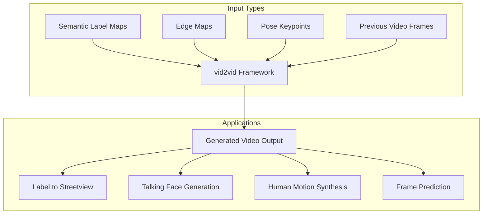
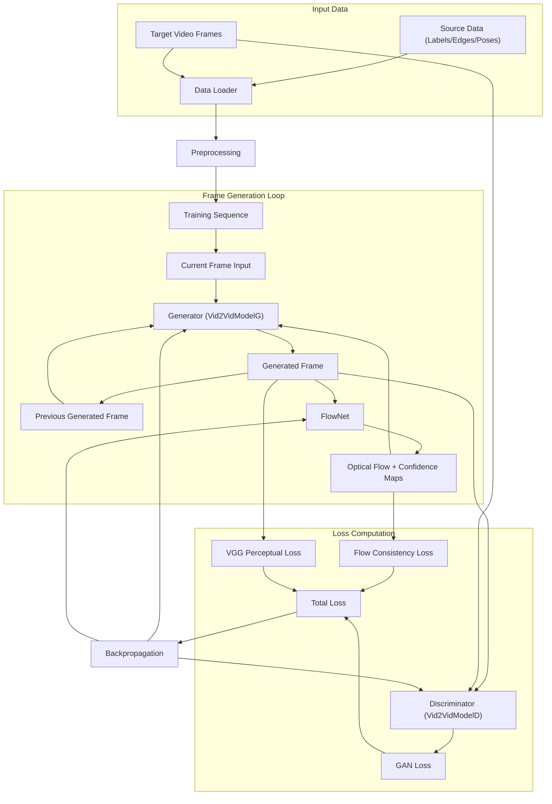
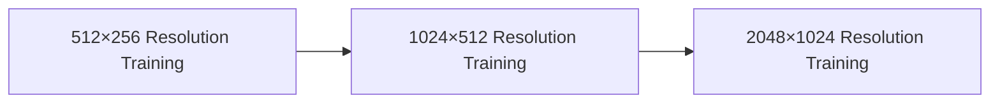

<!-- source: DeepWiki mcp.deepwiki.com · repo NVIDIA/vid2vid · page 1 Overview · fetched 2026-10-26 -->

# Overview

<details>
<summary>Relevant source files</summary>

The following files were used as context for generating this wiki page:

- [README.md](README.md)

</details>


This document provides a comprehensive introduction to vid2vid, a high-resolution photorealistic video-to-video translation framework developed by NVIDIA. Vid2vid enables the generation of temporally consistent video sequences from various input formats such as semantic label maps, edge maps, or pose keypoints.

## What is vid2vid?

Vid2vid is a PyTorch-based implementation for high-resolution (up to 2048x1024) photorealistic video-to-video translation. It builds upon image-to-image translation techniques (specifically pix2pixHD) but extends them with temporal consistency mechanisms to produce coherent video outputs.

The framework supports several key applications:
- Converting semantic label maps into photo-realistic street scene videos
- Synthesizing talking face videos from edge maps
- Generating realistic human motion videos from pose keypoints
- Frame prediction for video sequences



Sources: [README.md:8-13](), [README.md:14-35]()

## System Architecture

The vid2vid system is comprised of three primary components that work together to achieve temporally consistent video translation:

```mermaid
classDiagram
    class "Vid2VidModelG (Generator)" {
        +forward()
        +generate_frame_train()
        +generate_first_frame()
        +inference()
    }
    
    class "Vid2VidModelD (Discriminator)" {
        +forward()
        +compute_loss_D()
        +compute_loss_D_T()
        +GAN_and_FM_loss()
    }
    
    class "FlowNet" {
        +forward()
        +compute_flow_and_conf()
    }
    
    class "Data Pipeline" {
        +BaseDataset
        +FaceDataset
        +PoseDataset
        +TemporalDataset
    }
    
    class "Training Process (train.py)" {
        +main()
        +setup options
        +create model
        +train epochs
    }
    
    class "Inference Process (test.py)" {
        +main()
        +setup options
        +load model
        +generate frames
    }
    
    "Training Process (train.py)" --> "Vid2VidModelG (Generator)"
    "Training Process (train.py)" --> "Vid2VidModelD (Discriminator)"
    "Training Process (train.py)" --> "FlowNet"
    "Training Process (train.py)" --> "Data Pipeline"
    
    "Inference Process (test.py)" --> "Vid2VidModelG (Generator)"
    "Inference Process (test.py)" --> "FlowNet"
    "Inference Process (test.py)" --> "Data Pipeline"
    
    "Vid2VidModelG (Generator)" --> "FlowNet": Uses for temporal consistency
```

Sources: [README.md:175-191]()

### Generator

The Generator model (Vid2VidModelG) is responsible for synthesizing realistic video frames based on the input data (semantic maps, edge maps, or pose keypoints) while maintaining temporal consistency with previously generated frames. It leverages optical flow information to warp previous frames before generating new content.

For more details on the Generator's architecture, see [Generator Architecture](#2.1).

### Discriminator

The Discriminator model (Vid2VidModelD) evaluates the realism of generated frames from both spatial and temporal perspectives. It contains multiple sub-discriminators that operate at different scales to capture both fine details and global structure.

For more details on the Discriminator's architecture, see [Discriminator Architecture](#2.2).

### FlowNet

FlowNet estimates optical flow between consecutive frames, which is crucial for maintaining temporal consistency in the generated videos. It helps the Generator understand how objects move across frames.

For more details on the FlowNet component, see [Optical Flow Estimation (FlowNet)](#2.3).

## Data Flow and Processing Pipeline

The following diagram illustrates how data flows through the vid2vid system during the training process:



Sources: [README.md:175-191]()

## Key Features and Technical Innovations

### Temporal Consistency

A core innovation of vid2vid is its ability to maintain temporal consistency across video frames. This is achieved through:

1. Optical flow estimation between frames
2. Flow-based warping of previous frames
3. Multi-frame conditioning (using previous frames as context)

### Multi-Scale Processing

Vid2vid employs multi-scale processing in both spatial and temporal domains:

- **Spatial scales**: Processing at multiple resolutions (e.g., 512×256, 1024×512, 2048×1024)
- **Temporal scales**: Evaluating frame sequences at different temporal resolutions

### Coarse-to-Fine Training

The system employs a coarse-to-fine training approach:



This progressive approach allows the model to first learn global structure before refining details at higher resolutions.

Sources: [README.md:115-137]()

## Supported Applications

### Label-to-Streetview (Cityscapes)

Converts semantic segmentation maps into photorealistic street scenes. The model understands different object classes (roads, buildings, vehicles, etc.) and generates temporally consistent video outputs.

### Edge-to-Face

Synthesizes realistic talking face videos from edge maps. The system can maintain consistent identity while generating natural facial movements and expressions.

### Pose-to-Body

Transforms human pose keypoints into full-body videos with realistic appearance and motion. This can be used for human motion transfer and video synthesis.

### Frame Prediction

Predicts future video frames based on past frames, enabling applications in video forecasting and simulation.

Sources: [README.md:14-35]()

## System Requirements and Setup

Vid2vid requires:
- Linux or macOS operating system
- NVIDIA GPU with CUDA and cuDNN
- PyTorch 0.4
- Python 3
- Additional dependencies for specific applications (DensePose, OpenPose, dlib)

For detailed setup instructions and environment configuration, see [Docker Environment](#6).

Sources: [README.md:37-61]()

## Additional Resources

- [Training Process](#4): Details on how to train models for different applications
- [Testing and Inference](#5): Instructions for running inference with trained models
- [Data Pipeline](#3): Information about dataset preparation and processing

---

