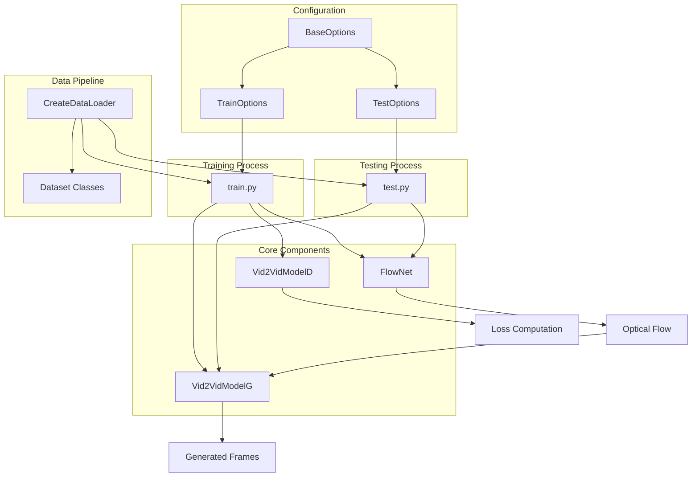
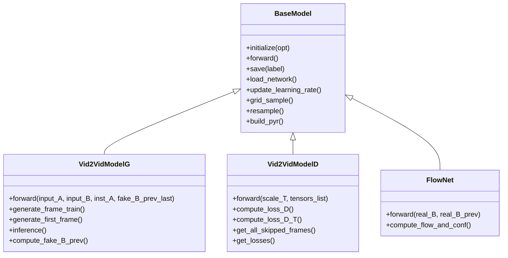
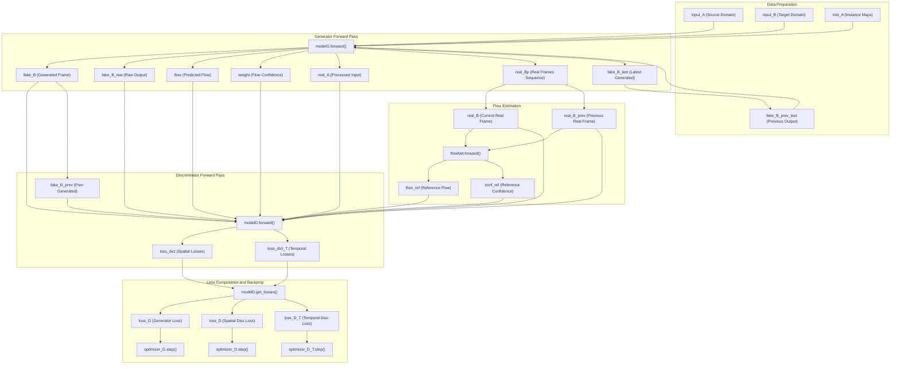
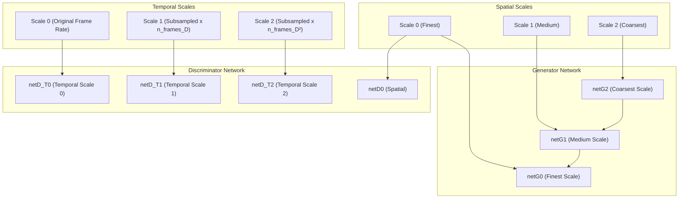
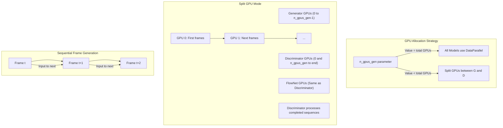
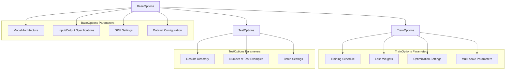

<!-- source: DeepWiki mcp.deepwiki.com · repo NVIDIA/vid2vid · page 2 System Architecture · fetched 2026-10-26 -->

# System Architecture

Relevant source files

The following files were used as context for generating this wiki page:

- [README.md](README.md)
- [models/base_model.py](models/base_model.py)
- [models/models.py](models/models.py)
- [train.py](train.py)

This document provides a comprehensive overview of the vid2vid system architecture, explaining how different components interact to enable high-resolution photorealistic video-to-video translation. The vid2vid system translates videos from one domain to another (e.g., semantic maps to photo-realistic videos, face edges to talking faces, or poses to human motions) while maintaining temporal consistency.

For specific implementation details about individual components, see [Generator Architecture](#2.1), [Discriminator Architecture](#2.2), and [Optical Flow Estimation (FlowNet)](#2.3).

## Core Architecture Overview

The vid2vid system consists of several interacting components that work together to achieve video-to-video translation:

Sources: [train.py:14-128](), [models/models.py:61-84]()

## Component Architecture and Relationships

All models in the vid2vid system inherit from a common `BaseModel` class that provides shared functionality:

Sources: [models/base_model.py:6-196](), [models/models.py:61-84]()

### Component Responsibilities

1. **Generator (Vid2VidModelG)**:
   - Transforms input from the source domain to the target domain
   - Handles temporal consistency via flow-based warping
   - Works across multiple spatial scales
   - Can generate the first frame or use a separate pre-trained model

2. **Discriminator (Vid2VidModelD)**:
   - Contains both spatial and temporal discriminators
   - Evaluates frame quality individually and as sequences
   - Operates at multiple spatial and temporal scales
   - Computes various losses (adversarial, feature matching, etc.)

3. **FlowNet**:
   - Estimates optical flow between consecutive frames
   - Produces confidence maps for the flow estimates
   - Provides reference flow to guide the generator

4. **Data Loader System**:
   - Handles different types of datasets (face, pose, cityscapes)
   - Prepares data batches for the models
   - Manages sequence length and temporal sampling

5. **Options System**:
   - Configures all aspects through command-line arguments
   - Provides default values and validates parameters
   - Organizes related parameters in hierarchical classes

## Training Data Flow

The training process involves a complex flow of data between multiple models. Here's how data flows through the system during training:

Sources: [train.py:49-94]()

## Multi-Scale Processing Architecture

A key feature of vid2vid is its multi-scale approach in both spatial and temporal dimensions:

Sources: [models/base_model.py:122-134](), [README.md:175-181]()

This multi-scale approach allows the system to:
- Handle different levels of spatial detail (from coarse structure to fine details)
- Capture temporal dynamics at different time scales
- Train efficiently through a coarse-to-fine strategy

## Multi-GPU Architecture

The vid2vid system has a sophisticated multi-GPU processing architecture to handle the computational demands of video generation:

Sources: [models/models.py:10-60](), [README.md:175-187]()

The system offers two main modes of GPU utilization:

1. **Split GPU Mode**: Separate GPUs for generator and discriminator
   - First `n_gpus_gen` GPUs dedicated to the generator
   - Remaining GPUs used for discriminator and FlowNet
   - Sequential generation of frames across generator GPUs

2. **DataParallel Mode**: All models use standard PyTorch DataParallel
   - Used when `n_gpus_gen` equals the total number of GPUs
   - Both generator and discriminator distributed across all GPUs

## Training Process Architecture

The training process follows a sophisticated schedule to gradually increase complexity:

```mermaid
graph TD
    subgraph "Training Schedule"
        E1["Initial epochs"]
        E2["Middle epochs"]
        E3["Final epochs"]
        
        E1 --> |"Increase sequence length"| E2
        E2 --> |"Finetune all scales"| E3
        E3 --> |"Learning rate decay"| EF["Training complete"]
    end
    
    subgraph "Sequence Length Growth"
        SL["n_frames_total parameter"]
        NS["niter_step parameter"]
        
        NS --> |"Every niter_step epochs"| DB["Double sequence length"]
        DB --> SL
    end
    
    subgraph "Scale Training Strategy"
        FS["niter_fix_global parameter"]
        FS --> |"After niter_fix_global epochs"| AS["Train all scales together"]
    end
    
    subgraph "Learning Rate Schedule"
        NI["niter parameter"]
        ND["niter_decay parameter"]
        
        NI --> |"After niter epochs"| LRD["Linear learning rate decay"]
        ND --> |"For niter_decay epochs"| LRD
    end
```

Sources: [train.py:37-128](), [models/models.py:151-164](), [README.md:175-187]()

The training process incorporates several strategies:

1. **Gradual Sequence Length Increase**:
   - Starts with short sequences and gradually increases length
   - Controlled by `niter_step` parameter

2. **Coarse-to-Fine Training**:
   - Initially trains only the finest spatial scale
   - After `niter_fix_global` epochs, trains all scales together

3. **Learning Rate Schedule**:
   - Maintains constant learning rate for `niter` epochs
   - Linearly decays learning rate for `niter_decay` epochs

## Configuration System Architecture

The vid2vid configuration system has a hierarchical structure:

Sources: [train.py:15](), [README.md:175-192]()

The configuration system provides:
- Separation between common, training-specific, and testing-specific parameters
- Command-line argument parsing
- Default values for all parameters
- Parameter validation and interdependency enforcement

## Summary

The vid2vid system architecture is designed for efficient and high-quality video-to-video translation through:

1. **Multi-Model Approach**: Specialized generator, discriminator, and flow estimation networks
2. **Temporal Consistency**: Flow-based warping and temporal discriminators
3. **Multi-Scale Processing**: Both spatial and temporal scales for comprehensive quality
4. **Efficient GPU Utilization**: Sophisticated strategies for multi-GPU processing
5. **Progressive Training**: Gradual complexity increase for stable and efficient training
6. **Flexible Configuration**: Comprehensive parameter system for experimentation

This architecture enables the system to generate high-resolution, temporally coherent videos across a variety of domains including city scenes, human faces, and human poses.

Sources: [README.md:8-13](), [train.py:14-147](), [models/models.py:61-164](), [models/base_model.py:6-196]()

---

