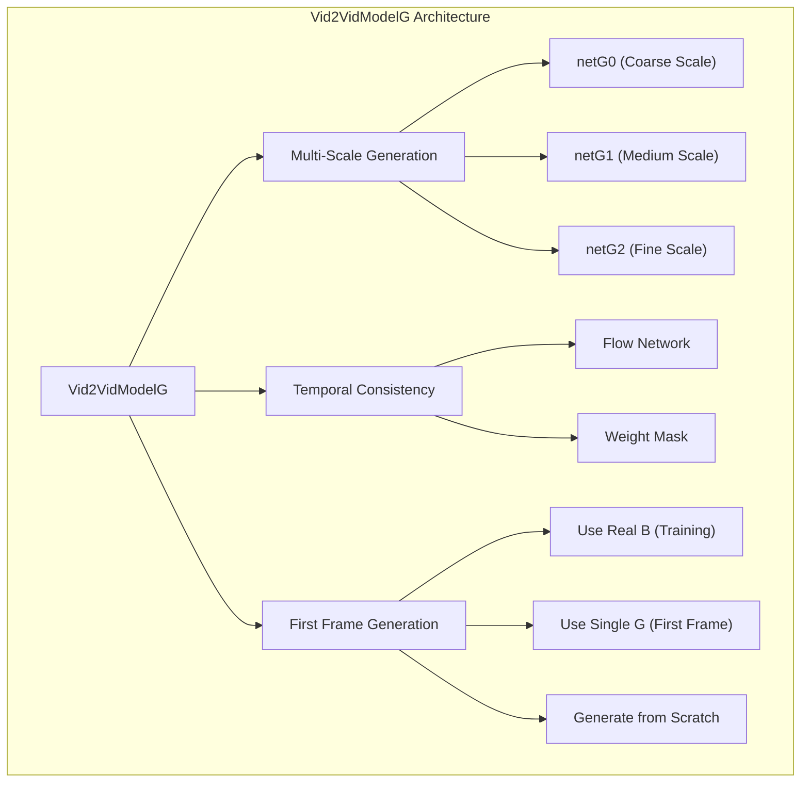
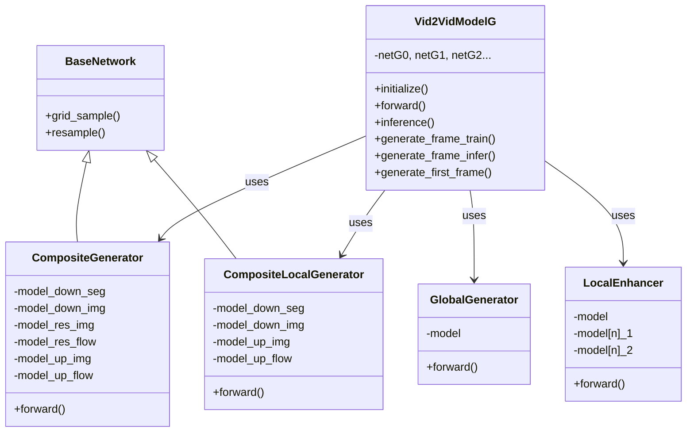
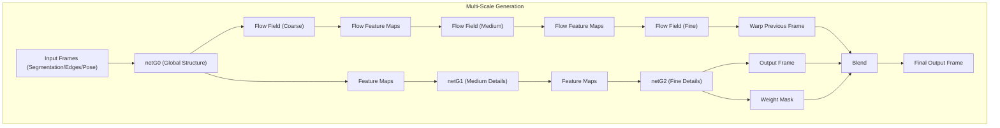
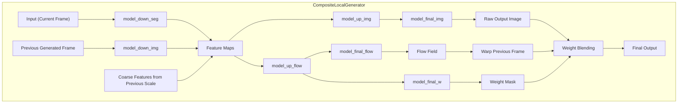
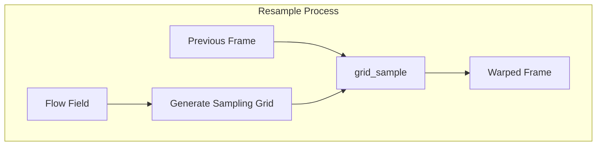
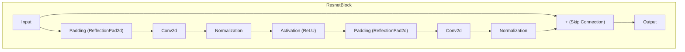

<!-- source: DeepWiki mcp.deepwiki.com · repo NVIDIA/vid2vid · page 2.1 Generator Architecture · fetched 2026-10-26 -->

# Generator Architecture

Relevant source files

The following files were used as context for generating this wiki page:

- [.gitignore](.gitignore)
- [models/networks.py](models/networks.py)
- [models/vid2vid_model_G.py](models/vid2vid_model_G.py)
- [util/util.py](util/util.py)

## Purpose and Scope

This document details the Generator architecture in the vid2vid system, which is responsible for transforming source video frames (e.g., segmentation maps, edge maps, or pose keypoints) into photorealistic output video frames. The Generator is designed to maintain temporal consistency across frames while generating high-quality outputs at multiple resolutions. For information about the Discriminator architecture that evaluates these generated frames, see [Discriminator Architecture](#2.2).

## Architecture Overview

The vid2vid Generator employs a coarse-to-fine, multi-scale architecture with specialized components for handling optical flow to ensure temporal consistency between consecutive frames. The system can function in both training and inference modes, with special handling for the first frame in a sequence.

Sources: [models/vid2vid_model_G.py:15-337](models/vid2vid_model_G.py:15-337), [models/networks.py:32-59](models/networks.py:32-59)

## Generator Components Hierarchy

The Generator consists of several specialized network components that work together to produce temporally consistent video outputs:

Sources: [models/vid2vid_model_G.py:15-37](models/vid2vid_model_G.py:15-37), [models/networks.py:98-132](models/networks.py:98-132), [models/networks.py:117-233](models/networks.py:117-233), [models/networks.py:234-326](models/networks.py:234-326), [models/networks.py:327-359](models/networks.py:327-359), [models/networks.py:361-419](models/networks.py:361-419)

## Multi-Scale Generation

The vid2vid Generator employs a multi-scale approach to generate high-quality outputs at different resolutions. This coarse-to-fine structure helps maintain both global structure and fine details.

### Network Structure

The Generator instantiates multiple networks for different scales:
- **netG0**: Coarse-scale generator that captures global structure
- **netG1 to netGn**: Finer-scale generators that add details, using outputs from the coarser scale

Sources: [models/vid2vid_model_G.py:37-43](models/vid2vid_model_G.py:37-43), [models/vid2vid_model_G.py:147-195](models/vid2vid_model_G.py:147-195)

### Coarse-to-Fine Approach

During both training and inference, the system follows a coarse-to-fine strategy:

1. Generate features and flow at the coarsest scale.
2. Pass these features to the next finer scale.
3. Generate refined features and flow at each subsequent scale.
4. Continue until reaching the finest scale.
5. Generate the final output frame using features and flow from all scales.

The multi-scale approach is defined by the `n_scales_spatial` parameter and implemented in the `generate_frame_train` and `generate_frame_infer` methods of `Vid2VidModelG`.

Sources: [models/vid2vid_model_G.py:139-196](models/vid2vid_model_G.py:139-196), [models/vid2vid_model_G.py:211-229](models/vid2vid_model_G.py:211-229)

## Composite Generator Architecture

The core of the Generator is the `CompositeGenerator` and `CompositeLocalGenerator` classes, which handle both image generation and optical flow estimation:

### CompositeGenerator Components

| Component | Purpose | Key Operations |
|-----------|---------|----------------|
| model_down_seg | Encodes input segmentation/edge maps | Downsampling, feature extraction |
| model_down_img | Encodes previous frame | Downsampling, feature extraction |
| model_res_img | Processes image features | Multiple ResNet blocks |
| model_res_flow | Processes flow features | Multiple ResNet blocks |
| model_up_img | Decodes image features | Upsampling, feature refinement |
| model_up_flow | Decodes flow features | Upsampling, feature refinement |
| model_final_img | Generates raw output image | Final convolution, Tanh activation |
| model_final_flow | Generates optical flow field | Final convolution |
| model_final_w | Generates blending weight mask | Final convolution, Sigmoid activation |

The CompositeGenerator creates both a direct image output and a warped output based on optical flow:
- **Raw output**: Direct generation from input features
- **Flow-based output**: Previous frame warped according to estimated flow
- **Final output**: Weighted combination of raw and flow-based outputs

Sources: [models/networks.py:117-233](models/networks.py:117-233)

### CompositeLocalGenerator

The `CompositeLocalGenerator` is a lighter version designed for finer scales, using features from the coarser scale:

Sources: [models/networks.py:234-326](models/networks.py:234-326)

## Temporal Consistency Mechanism

A key feature of the vid2vid Generator is maintaining temporal consistency between consecutive frames. This is achieved through optical flow estimation and warping.

### Flow-Based Frame Generation

For each new frame:

1. Direct generation of a raw frame from input features
2. Estimation of optical flow between previous and current frame
3. Warping of previous frame using estimated flow
4. Generation of a blending mask
5. Final output is a weighted combination of raw generation and warped previous frame

The blending weight determines how much to trust direct generation versus warped previous frame. This mechanism helps maintain temporal consistency while adapting to new content.

Sources: [models/networks.py:203-232](models/networks.py:203-232), [models/networks.py:297-325](models/networks.py:297-325), [models/vid2vid_model_G.py:176-194](models/vid2vid_model_G.py:176-194)

### Resample Function

The `resample` function is a critical component for the flow-based warping, which uses the grid_sample operation to warp frames according to estimated flow:

Sources: [models/networks.py:108-115](models/networks.py:108-115)

## First Frame Generation

The first frame in a sequence requires special handling since there's no previous frame to use for flow-based generation. The system provides several options:

### First Frame Options

| Method | Description | When Used |
|--------|-------------|-----------|
| Use Real Image | Use ground truth frame | Training mode or when real image is available |
| Single G Generator | Use a specialized single-image generator | Testing mode with no previous frame |
| Generate from Scratch | Generate without using flow-based components | When no_first_img option is set |

The first frame generation process is managed by the `generate_first_frame` method in `Vid2VidModelG`.

Sources: [models/vid2vid_model_G.py:231-251](models/vid2vid_model_G.py:231-251), [models/vid2vid_model_G.py:261-289](models/vid2vid_model_G.py:261-289)

## Training vs. Inference Mode

The Generator operates differently during training and inference:

### Training Mode

- Processes multiple frames in a sequence simultaneously
- Uses parallel processing across multiple GPUs for efficiency
- Backpropagates loss through a limited number of frames
- Updates coarse or all scales based on training phase

Sources: [models/vid2vid_model_G.py:56-83](models/vid2vid_model_G.py:56-83), [models/vid2vid_model_G.py:114-137](models/vid2vid_model_G.py:114-137)

### Inference Mode

- Processes one frame at a time
- Maintains state between frames (previous generated frames)
- Uses features from previous scales for efficiency
- Handles first frame generation specially

Sources: [models/vid2vid_model_G.py:198-209](models/vid2vid_model_G.py:198-209), [models/vid2vid_model_G.py:211-229](models/vid2vid_model_G.py:211-229)

## Generator Network Selection

The system supports different types of generator architectures selected through the `netG` parameter:

| Generator Type | Description | Use Case |
|----------------|-------------|----------|
| 'global' | Global generator with downsampling-upsampling architecture | Base-level generation |
| 'local' | Local enhancer with multi-resolution generation | Enhanced detail generation |
| 'composite' | Specialized generator with flow estimation | Video generation with temporal consistency |
| 'compositeLocal' | Local version of composite generator | Fine detail refinement with temporal consistency |
| 'global_with_features' | Global generator with additional feature inputs | Face generation with feature guidance |
| 'local_with_features' | Local generator with additional feature inputs | Detailed face generation with feature guidance |

Sources: [models/networks.py:32-59](models/networks.py:32-59)

## ResNet Blocks

All generator variants use ResNet blocks as their core building blocks. These maintain the same channel dimensions and use skip connections to facilitate gradient flow:

Sources: [models/networks.py:553-593](models/networks.py:553-593)

## Integration with Overall Vid2Vid System

The Generator works in conjunction with other components of the vid2vid system:

1. Receives inputs from the data pipeline (segmentation maps, edge maps, or pose data)
2. Generates fake frames that are evaluated by the Discriminator
3. Uses FlowNet for reference optical flow (for training)
4. Outputs final generated video frames

Throughout the generation process, the model balances photorealism (raw generation) with temporal consistency (flow-based warping) to produce visually pleasing and coherent video outputs.

Sources: [models/vid2vid_model_G.py:114-137](models/vid2vid_model_G.py:114-137)

---

