<!-- source: DeepWiki mcp.deepwiki.com · repo NVIDIA/vid2vid · page 2.2 Discriminator Architecture · fetched 2026-10-26 -->

# Discriminator Architecture

Relevant source files

The following files were used as context for generating this wiki page:

- [models/networks.py](models/networks.py)
- [models/vid2vid_model_D.py](models/vid2vid_model_D.py)

This document describes the discriminator component of the vid2vid (video-to-video translation) framework. The discriminator evaluates the realism of generated video frames, providing feedback that helps the generator produce more convincing outputs. For information about the generator architecture, see [Generator Architecture](#2.1).

## 1. Overview

The vid2vid discriminator consists of multiple specialized sub-networks that evaluate both spatial and temporal aspects of generated video frames. This multi-faceted approach ensures that generated videos maintain both per-frame visual quality and temporal consistency across frames.

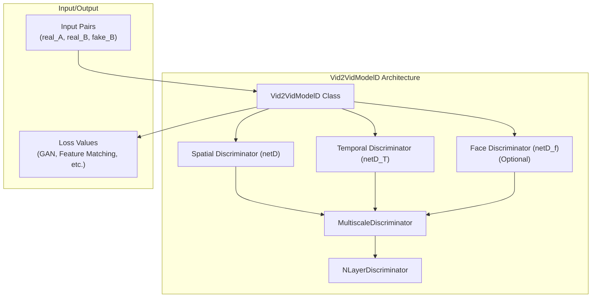

Sources: [models/vid2vid_model_D.py:13-272]()

## 2. Main Discriminator Components

The vid2vid discriminator system is implemented in the `Vid2VidModelD` class which inherits from `BaseModel`. It orchestrates multiple specialized discriminator networks:

### 2.1 Spatial Discriminator (netD)

The spatial discriminator evaluates the quality of individual frames. It takes pairs of input conditions (e.g., semantic maps) and output frames (real or generated) to determine if the output frames look realistic.

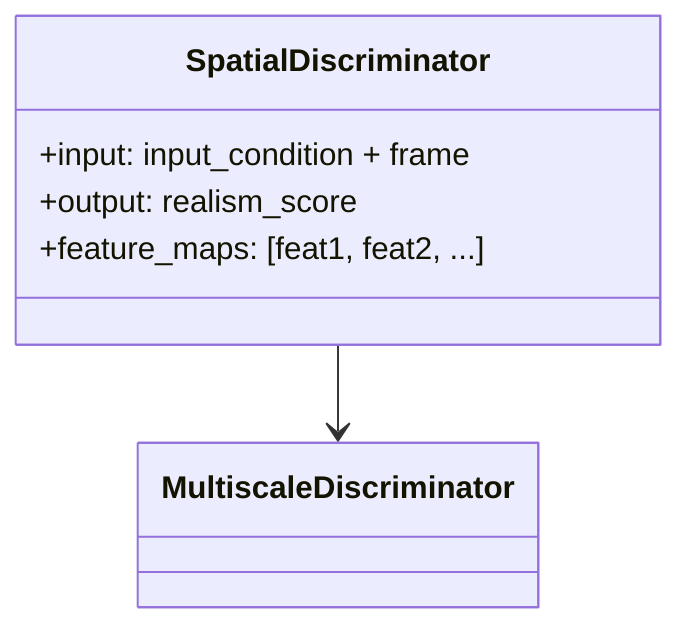

Sources: [models/vid2vid_model_D.py:29-36]()

### 2.2 Temporal Discriminator (netD_T)

The temporal discriminator assesses the temporal coherence between consecutive frames. It takes sequences of frames (and optionally optical flow) to ensure smooth and realistic transitions in the generated video.

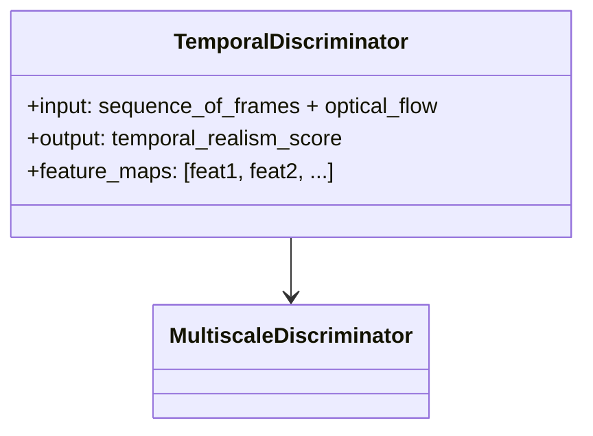

Sources: [models/vid2vid_model_D.py:42-46]()

### 2.3 Face Discriminator (netD_f) - Optional

When enabled, this specialized discriminator focuses exclusively on the face regions of generated frames, improving the quality of facial details in human subjects.

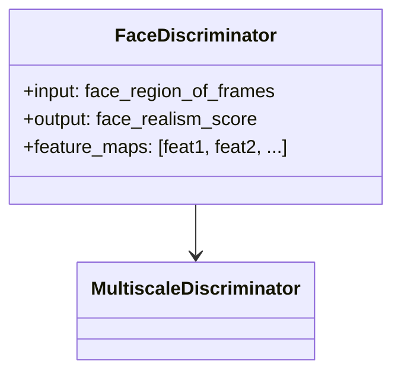

Sources: [models/vid2vid_model_D.py:38-40]()

## 3. Discriminator Network Implementation

### 3.1 MultiscaleDiscriminator

The `MultiscaleDiscriminator` class handles evaluation at multiple scales, allowing the system to assess both fine details and overall structure of the generated frames.

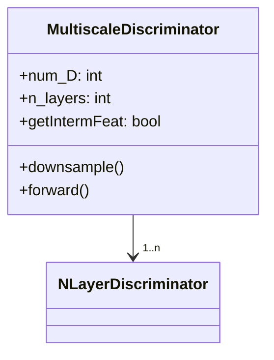

Key characteristics:
- Contains multiple `NLayerDiscriminator` instances, each operating at a different resolution
- Each sub-discriminator evaluates a progressively downsampled version of the input
- Returns per-scale discrimination results and optional intermediate features

Sources: [models/networks.py:634-675]()

### 3.2 NLayerDiscriminator

The `NLayerDiscriminator` is the fundamental PatchGAN discriminator network used within the `MultiscaleDiscriminator`.

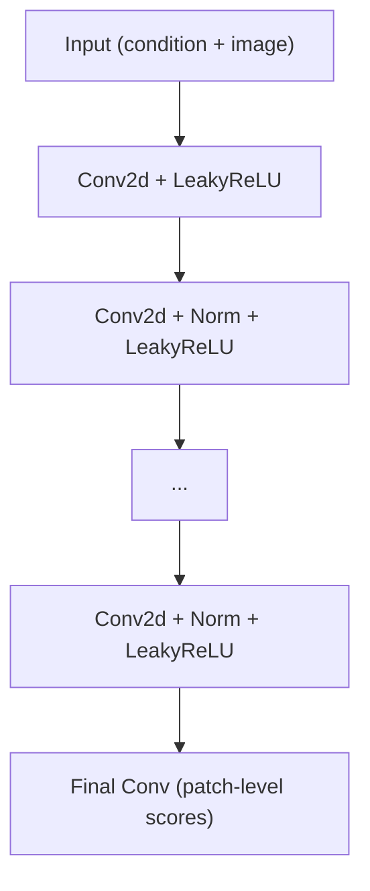

Key characteristics:
- PatchGAN architecture that evaluates realism of image patches rather than the entire image
- Series of convolutional layers with stride=2 for downsampling
- Produces a grid of real/fake predictions for different image patches
- Optional intermediate feature outputs for feature matching loss

Sources: [models/networks.py:679-725]()

## 4. Forward Pass and Loss Computation

### 4.1 Spatial Discriminator Forward Pass

The spatial discriminator processes input condition and output frame pairs:

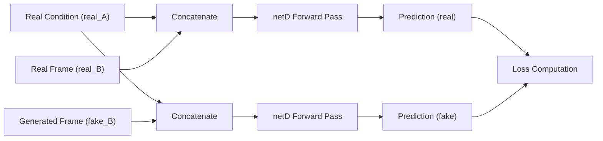

Sources: [models/vid2vid_model_D.py:168-177]()

### 4.2 Temporal Discriminator Forward Pass

The temporal discriminator evaluates sequences of frames to ensure temporal consistency:

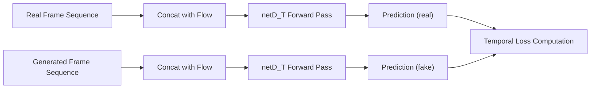

Sources: [models/vid2vid_model_D.py:181-197]()

### 4.3 Loss Functions

The discriminator utilizes several loss functions:

| Loss Type | Purpose |
|-----------|---------|
| GAN Loss | Standard adversarial loss for discriminator training |
| Feature Matching Loss | Encourages generator to match statistics of real images |
| VGG Loss | Perceptual loss based on VGG network features |
| Flow Loss | Ensures optical flow consistency between frames |
| Warp Loss | Penalizes inconsistencies when warping previous frames |

Sources: [models/vid2vid_model_D.py:60-74](), [models/networks.py:730-812]()

## 5. Optimization and Training

The vid2vid discriminator uses separate optimizers for spatial and temporal components:

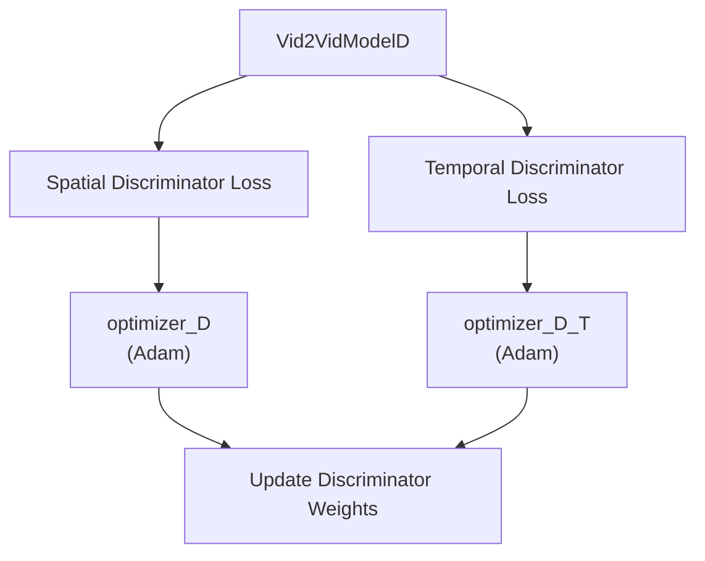

Key optimization parameters:
- Adam optimizer with configurable learning rate and beta parameters
- Optional Two Time-scale Update Rule (TTUR) for stable GAN training
- Multiple scales for both spatial and temporal discrimination

Sources: [models/vid2vid_model_D.py:76-91]()

## 6. Face Region Processing

For models that require high-quality face generation, the system includes specialized face detection and processing:

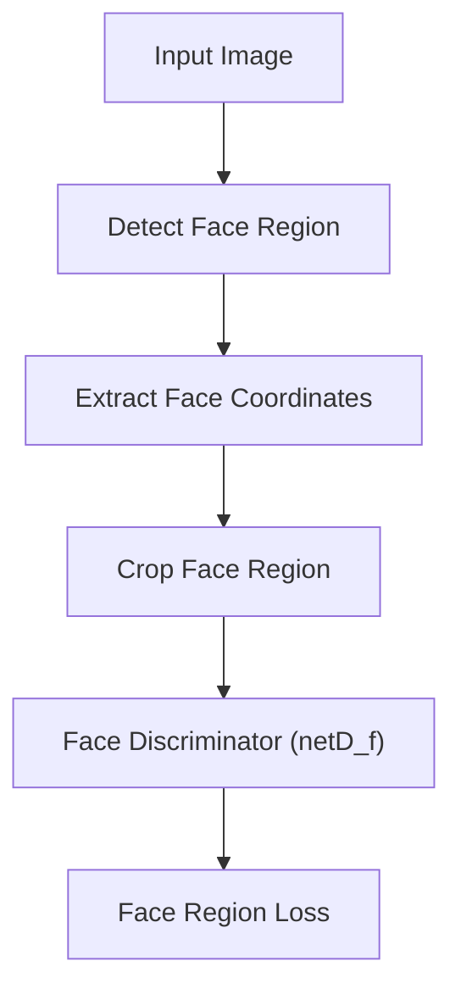

The face region is detected either through:
- Face keypoints (for face datasets)
- OpenPose landmarks (for human pose datasets)

Sources: [models/vid2vid_model_D.py:215-230]()

## 7. Temporal Frame Skipping

For efficient processing of long video sequences, the vid2vid discriminator implements a frame skipping mechanism that evaluates frames at different temporal scales.

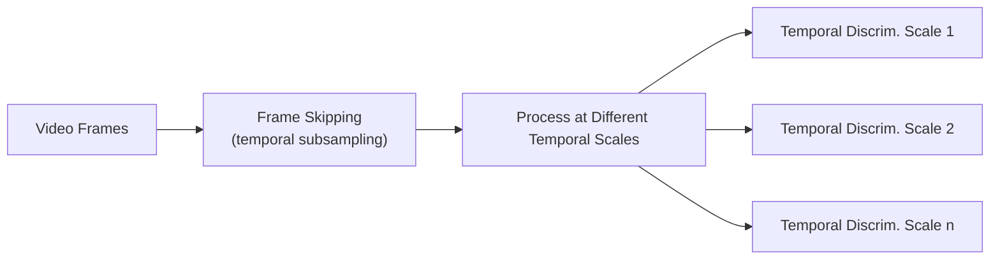

This allows the discriminator to evaluate both short-term consistency between adjacent frames and long-term consistency across multiple frames.

Sources: [models/vid2vid_model_D.py:232-247](), [models/vid2vid_model_D.py:274-328]()

## Summary

The vid2vid discriminator architecture employs multiple specialized networks to evaluate both spatial and temporal aspects of generated videos. This comprehensive approach enables the generation of visually realistic and temporally coherent video outputs from various input conditions like semantic maps, edge maps, or pose keypoints.

---

