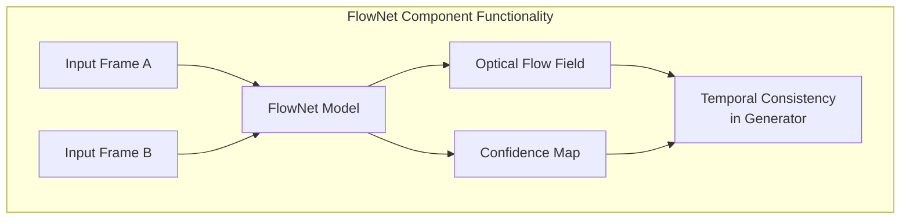
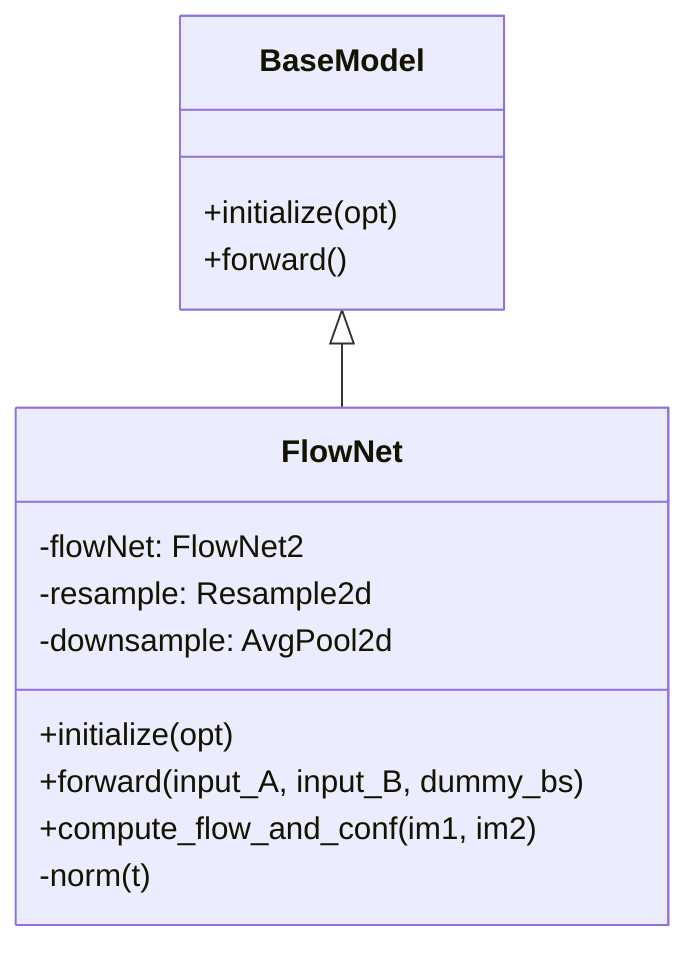
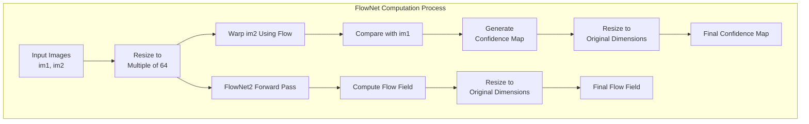
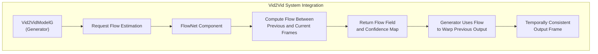
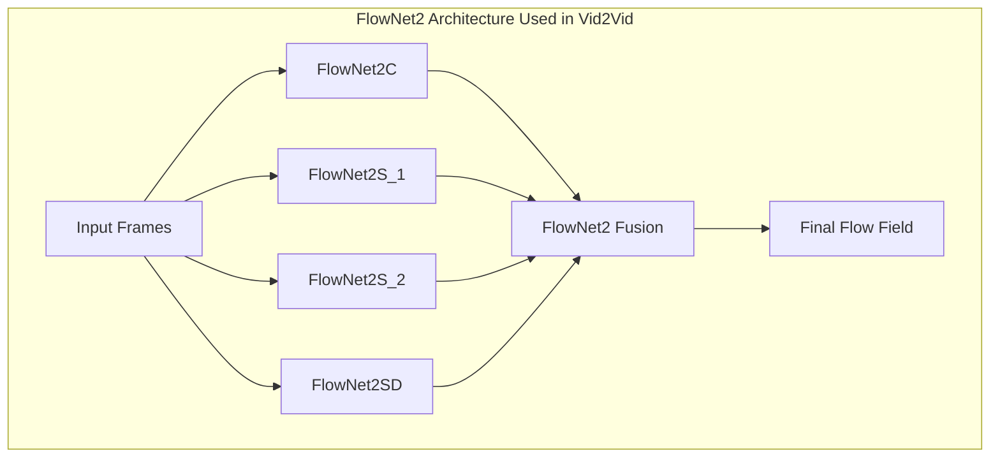

<!-- source: DeepWiki mcp.deepwiki.com · repo NVIDIA/vid2vid · page 2.3 Optical Flow Estimation (FlowNet) · fetched 2026-10-26 -->

# Optical Flow Estimation (FlowNet)

<details>
<summary>Relevant source files</summary>

The following files were used as context for generating this wiki page:

- [models/flownet.py](models/flownet.py)
- [models/flownet2_pytorch/README.md](models/flownet2_pytorch/README.md)
- [models/flownet2_pytorch/convert.py](models/flownet2_pytorch/convert.py)
- [scripts/download_flownet2.py](scripts/download_flownet2.py)

</details>


## Purpose and Scope

This document details the Optical Flow Estimation component (FlowNet) within the vid2vid system. The FlowNet module plays a critical role in maintaining temporal consistency between generated video frames by computing pixel-level motion. It estimates the optical flow between consecutive frames, which the Generator component uses to create temporally coherent video outputs. For information about how the Generator uses this flow information, see [Generator Architecture](#2.1).

## Overview

Optical flow estimation is a fundamental computer vision task that calculates the pixel displacement between consecutive frames. In the vid2vid framework, accurate optical flow is essential for generating videos with realistic motion. The system implements this functionality through a pre-trained FlowNet2 model, which represents the state-of-the-art in optical flow estimation.



Sources: [models/flownet.py:25-41](). [models/flownet.py:43-59]()

## Implementation Details

The FlowNet component is implemented as a Python class that inherits from `BaseModel`. It wraps the pre-trained FlowNet2 model and provides interfaces for computing optical flow and confidence maps.

### Class Structure



Sources: [models/flownet.py:6-9](). [models/flownet.py:10-23]()

### Initialization Process

During initialization, the FlowNet component:

1. Loads the pre-trained FlowNet2 model from a checkpoint
2. Sets up the `Resample2d` module for image warping
3. Creates a downsampling layer for preprocessing

```python
self.flowNet = flownet2_tools.module_to_dict(flownet2_models)['FlowNet2'](fp16=opt.fp16).cuda(self.gpu_ids[0])        
checkpoint = torch.load('models/flownet2_pytorch/FlowNet2_checkpoint.pth.tar')
self.flowNet.load_state_dict(checkpoint['state_dict'])
self.flowNet.eval() 
self.resample = Resample2d()
self.downsample = torch.nn.AvgPool2d(3, stride=2, padding=[1, 1], count_include_pad=False)
```

Sources: [models/flownet.py:10-23]()

### Forward Pass and Flow Computation

The forward pass of the FlowNet component handles both individual frame pairs and batches of sequences:

1. For a batch of sequences (5D tensor), it reshapes the input to a batch of frame pairs
2. Calls `compute_flow_and_conf` to calculate optical flow and confidence maps
3. Reshapes the output back to match the input dimensions

The `compute_flow_and_conf` method:

1. Ensures input dimensions are multiples of 64 (required by FlowNet2)
2. Computes optical flow using the FlowNet2 model
3. Generates a confidence map by comparing the first frame with the warped second frame
4. Upsamples results to the original resolution if needed



Sources: [models/flownet.py:25-41](). [models/flownet.py:43-59]()

## Integration with Vid2Vid Architecture

The FlowNet component connects with the Generator in the vid2vid pipeline, providing essential motion information to create temporally consistent video outputs.



Sources: [models/flownet.py:25-41]()

## Technical Implementation of Flow Computation

The core flow computation is performed in the `compute_flow_and_conf` method:

```python
def compute_flow_and_conf(self, im1, im2):
    assert(im1.size()[1] == 3)
    assert(im1.size() == im2.size())        
    old_h, old_w = im1.size()[2], im1.size()[3]
    new_h, new_w = old_h//64*64, old_w//64*64
    if old_h != new_h:
        downsample = torch.nn.Upsample(size=(new_h, new_w), mode='bilinear')
        upsample = torch.nn.Upsample(size=(old_h, old_w), mode='bilinear')
        im1 = downsample(im1)
        im2 = downsample(im2)        
    data1 = torch.cat([im1.unsqueeze(2), im2.unsqueeze(2)], dim=2)            
    flow1 = self.flowNet(data1)
    conf = (self.norm(im1 - self.resample(im2, flow1)) < 0.02).float()
    if old_h != new_h:
        flow1 = upsample(flow1) * old_h / new_h
        conf = upsample(conf)
    return flow1.detach(), conf.detach()
```

The confidence map is generated by:
1. Warping the second image (`im2`) using the computed flow
2. Comparing it with the first image (`im1`) using L2 norm
3. Thresholding the difference to create a binary mask (values < 0.02 are considered reliable)

Sources: [models/flownet.py:43-59]()

## FlowNet2 Model Details

Vid2vid utilizes the FlowNet2 architecture, which is a state-of-the-art model for optical flow estimation. FlowNet2 consists of multiple sub-networks:

| Sub-Network | Purpose |
|-------------|---------|
| FlowNet2C   | Basic flow estimation optimized for small displacements |
| FlowNet2S   | Basic flow estimation with simple architecture |
| FlowNet2SD  | Handles large displacements |
| FlowNet2CSS | Cascade of multiple networks for refined flow |
| FlowNet2    | Full model combining all sub-networks |

The vid2vid system uses the complete FlowNet2 model for maximum accuracy.



Sources: [models/flownet2_pytorch/README.md:13-22](). [models/flownet2_pytorch/convert.py:57-69]()

## Downloading and Setup

The FlowNet2 model is not included directly in the repository but is downloaded as a pre-trained checkpoint. The `download_flownet2.py` script handles the installation of the FlowNet2 model:

```python
chpt_path = './models/'
if not os.path.isdir(chpt_path):
    os.makedirs(chpt_path)
os.system('cd %s/flownet2_pytorch/; bash install.sh; cd ../../' % chpt_path)
```

The script runs the installation shell script in the FlowNet2 directory, which sets up custom CUDA layers required by the model.

Sources: [scripts/download_flownet2.py:12-18]()

## Performance Considerations

The FlowNet component includes several optimizations for efficient inference:

1. **Resolution Management**: Input images are resized to dimensions that are multiples of 64 to optimize FlowNet2 performance, then upscaled back to the original resolution.

2. **GPU Acceleration**: The model is loaded directly onto the GPU specified in the options.

3. **No Gradient Computation**: The `forward` method is wrapped with `torch.no_grad()` to disable gradient computation during inference, reducing memory usage and improving speed.

4. **Tensor Detachment**: Flow fields and confidence maps are detached from the computation graph with `detach()` to prevent unnecessary memory retention.

Sources: [models/flownet.py:25-26](). [models/flownet.py:48-52](). [models/flownet.py:58-59]()

---

