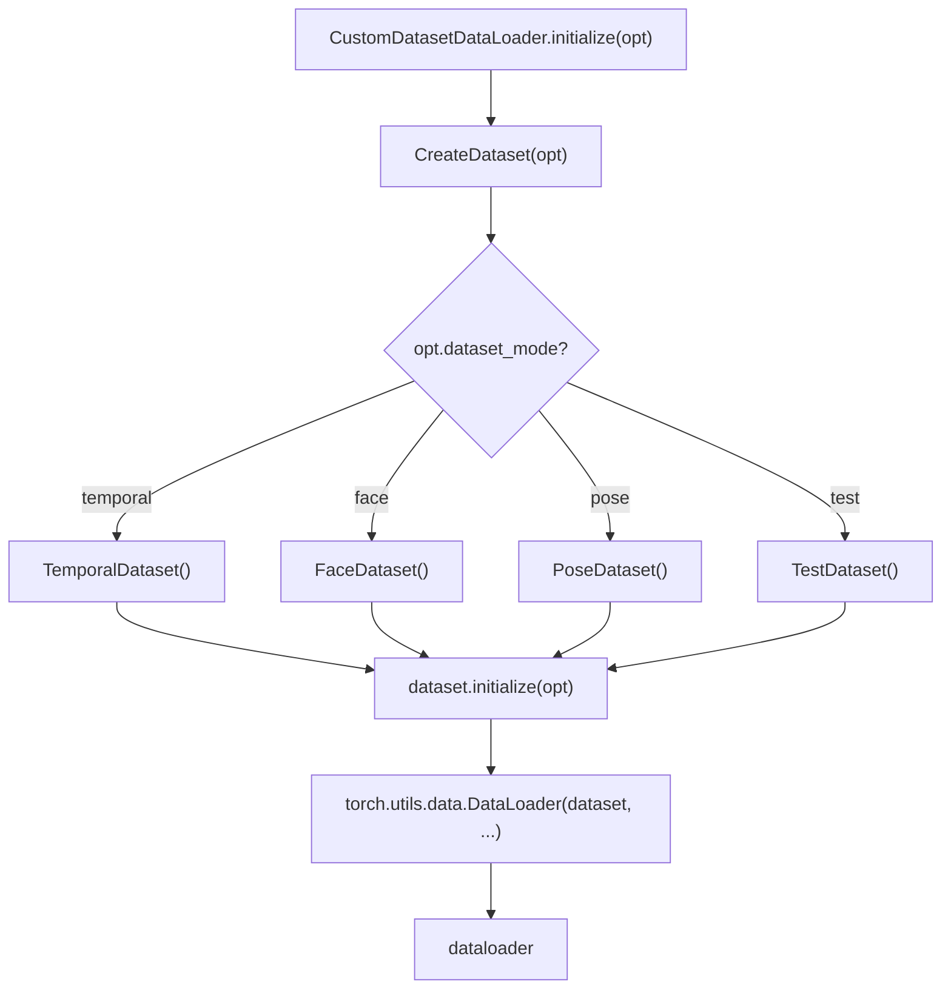
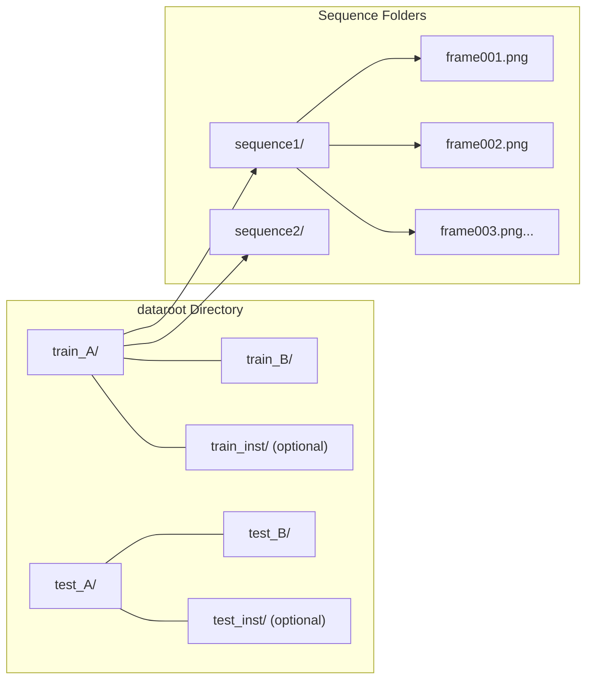
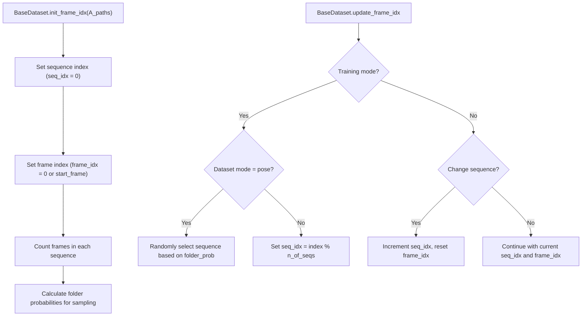
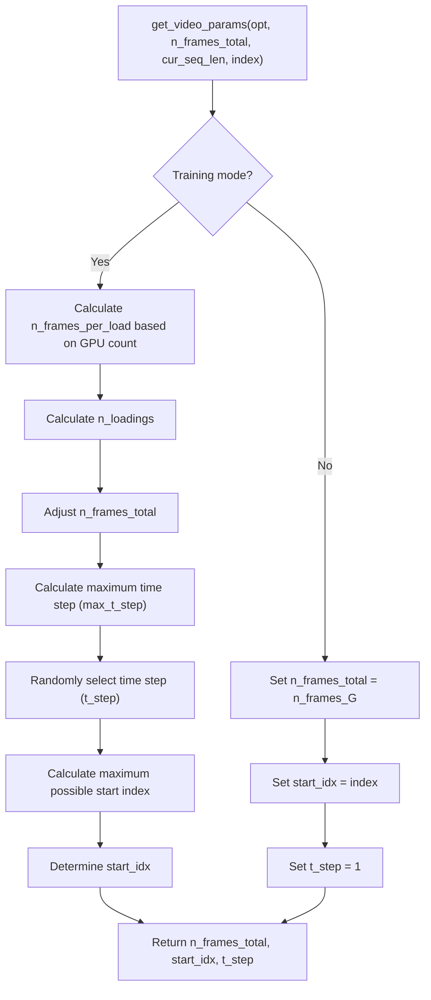
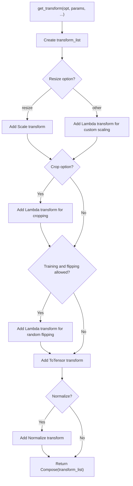
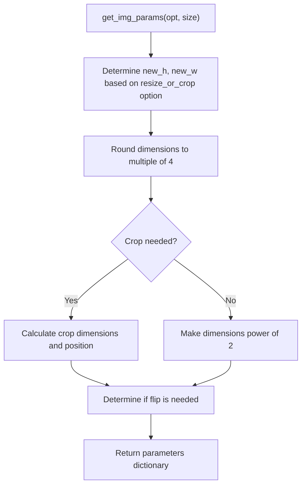
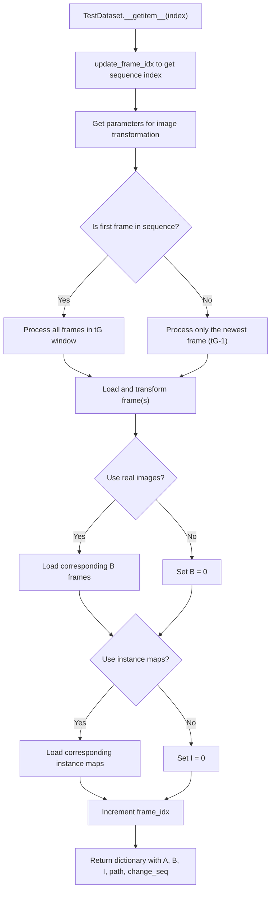
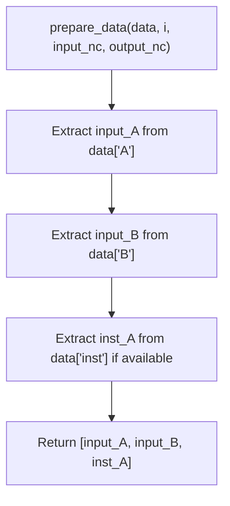

<!-- source: DeepWiki mcp.deepwiki.com · repo NVIDIA/vid2vid · page 3 Data Pipeline · fetched 2026-10-26 -->

# Data Pipeline

<details>
<summary>Relevant source files</summary>

The following files were used as context for generating this wiki page:

- [data/base_dataset.py](data/base_dataset.py)
- [data/custom_dataset_data_loader.py](data/custom_dataset_data_loader.py)
- [data/image_folder.py](data/image_folder.py)
- [data/test_dataset.py](data/test_dataset.py)

</details>


## Overview

The data pipeline in the vid2vid system is responsible for loading, preprocessing, and delivering video frame sequences to both the training and inference components. This page documents the core data processing components, their interactions, and how they handle video data for different use cases (face animation, pose-to-body translation, etc.).

For information on specific dataset implementations, see:
- [Face Dataset](#3.1)
- [Pose Dataset](#3.2)
- [Temporal Dataset](#3.3)

## Data Pipeline Architecture

The vid2vid data pipeline follows a hierarchical structure with base classes providing common functionality and specialized implementations handling domain-specific processing.

```mermaid
classDiagram
    class "BaseDataset" {
        +initialize(opt)
        +update_training_batch(ratio)
        +init_frame_idx(A_paths)
        +update_frame_idx(A_paths, index)
        +init_data_params(data, n_gpus, tG)
        +init_data(t_scales)
        +prepare_data(data, i, input_nc, output_nc)
    }
    
    class "CustomDatasetDataLoader" {
        +initialize(opt)
        +load_data()
        -dataset
        -dataloader
    }
    
    class "FaceDataset" {
        +initialize(opt)
        +__getitem__(index)
    }
    
    class "PoseDataset" {
        +initialize(opt)
        +__getitem__(index)
    }
    
    class "TemporalDataset" {
        +initialize(opt)
        +__getitem__(index)
    }
    
    class "TestDataset" {
        +initialize(opt)
        +__getitem__(index)
        +get_image(A_path, transform, is_label)
    }
    
    BaseDataset <|-- FaceDataset
    BaseDataset <|-- PoseDataset
    BaseDataset <|-- TemporalDataset
    BaseDataset <|-- TestDataset
    CustomDatasetDataLoader o-- BaseDataset : creates
```

Sources: [data/base_dataset.py:9-72](), [data/custom_dataset_data_loader.py:5-44](), [data/test_dataset.py:10-77]()

## Dataset Creation Process

The dataset creation process starts with `CustomDatasetDataLoader`, which selects and instantiates the appropriate dataset class based on the specified mode.



Sources: [data/custom_dataset_data_loader.py:5-44]()

## Data Directory Structure

The vid2vid system expects data to be organized in a specific directory structure. The image loading utilities scan these directories to create datasets of image sequences.



Each sequence folder contains ordered frames that represent a continuous video sequence. The `make_grouped_dataset` function in `image_folder.py` is responsible for loading these grouped sequences.

Sources: [data/image_folder.py:36-48](), [data/test_dataset.py:12-28]()

## Frame Management

Frame management is a critical aspect of the vid2vid data pipeline. The system needs to carefully track frame indices, sequence boundaries, and frame relationships to maintain temporal consistency.

### Frame Indexing and Sequence Management



Sources: [data/base_dataset.py:26-54]()

### Video Frame Sampling

For training, the system samples frames strategically to create diverse training examples while maintaining temporal relationships:



Sources: [data/base_dataset.py:177-202]()

## Data Preprocessing and Transformation

The vid2vid system applies a series of preprocessing steps to prepare images for the models:

### Image Transformation Pipeline



Sources: [data/base_dataset.py:130-158]()

### Image Parameters Selection



Sources: [data/base_dataset.py:85-128]()

## Data Loading Process for Training vs Testing

The data loading process differs significantly between training and testing:

### Training Data Flow

During training, the system loads multiple frames at once and manages frame sequences to ensure temporal consistency:

1. Dataset is initialized with training options
2. Frames are sampled according to the video parameters (n_frames_total, start_idx, t_step)
3. Images are loaded, transformed, and normalized
4. Data is batched and fed to the model

### Testing Data Flow

During testing/inference, the system processes frames sequentially:



Sources: [data/test_dataset.py:30-61]()

## Data Types and Processing

Different types of data require specialized processing:

| Data Type | Source | Processing |
|-----------|--------|------------|
| RGB Images | Image files in dataset directories | Loaded, resized, normalized to [-1, 1] |
| Label Maps | Image files with segmentation labels | Loaded, resized, multiplied by 255 to maintain label indices |
| Instance Maps | Instance segmentation maps | Loaded, resized, multiplied by 255 to maintain instance IDs |
| Face Keypoints | Extracted from faces | Converted to edge maps, distance transforms |
| Pose Data | OpenPose or DensePose outputs | Combined into unified pose representations |

Sources: [data/base_dataset.py:130-158](), [data/test_dataset.py:63-68]()

## Temporal Consistency Handling

The vid2vid system emphasizes temporal consistency in video generation. The data pipeline supports this by:

1. **Providing frame sequences**: Loading consecutive frames with appropriate temporal spacing
2. **Managing sequence boundaries**: Handling transitions between different sequences
3. **Frame indexing**: Tracking frame positions within sequences
4. **Updating sequence length**: Dynamically adjusting training sequence length during training with `update_training_batch`

Sources: [data/base_dataset.py:19-24](), [data/base_dataset.py:40-54]()

## Data Batch Preparation

The data pipeline prepares data in a specific tensor format for the models:



Data is organized as 5D tensors with dimensions:
- Batch size
- Number of frames
- Number of channels
- Height
- Width

This structure allows the models to process temporal information effectively.

Sources: [data/base_dataset.py:74-80]()

## Summary

The vid2vid data pipeline provides a robust framework for loading and processing video data for video-to-video translation tasks. It handles various dataset types, manages frame sequences, applies appropriate transformations, and ensures temporal consistency. The modular design allows for specialized processing for different applications like face animation and pose-to-body translation while sharing common functionality through the base classes.

---

