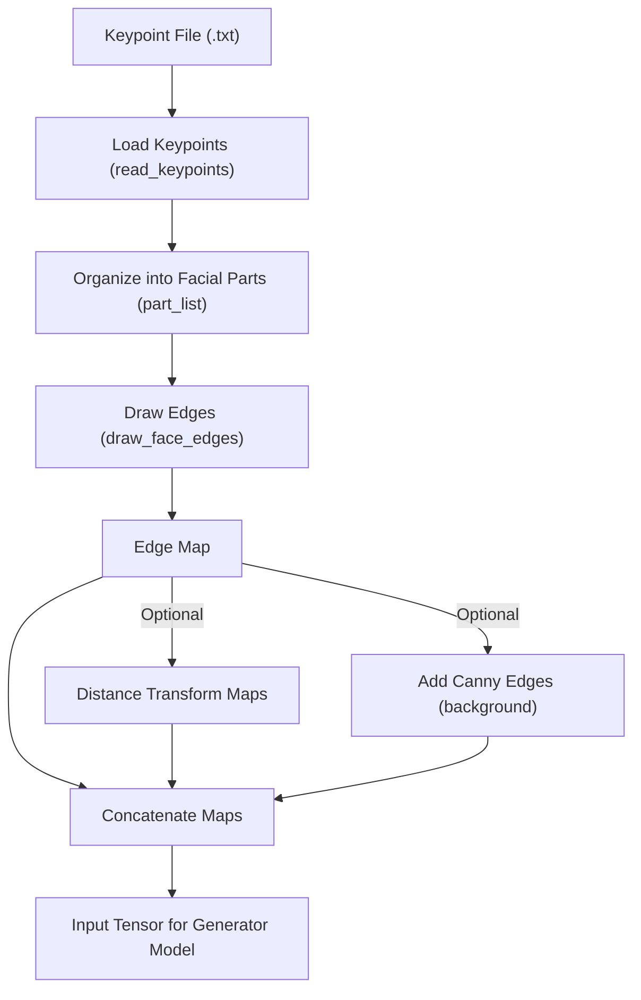
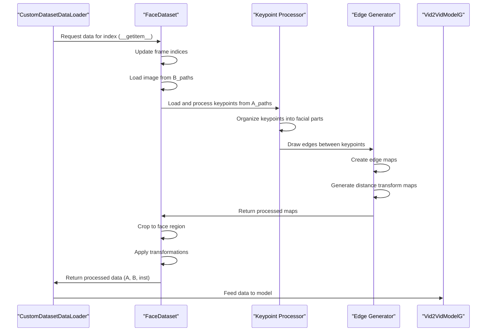
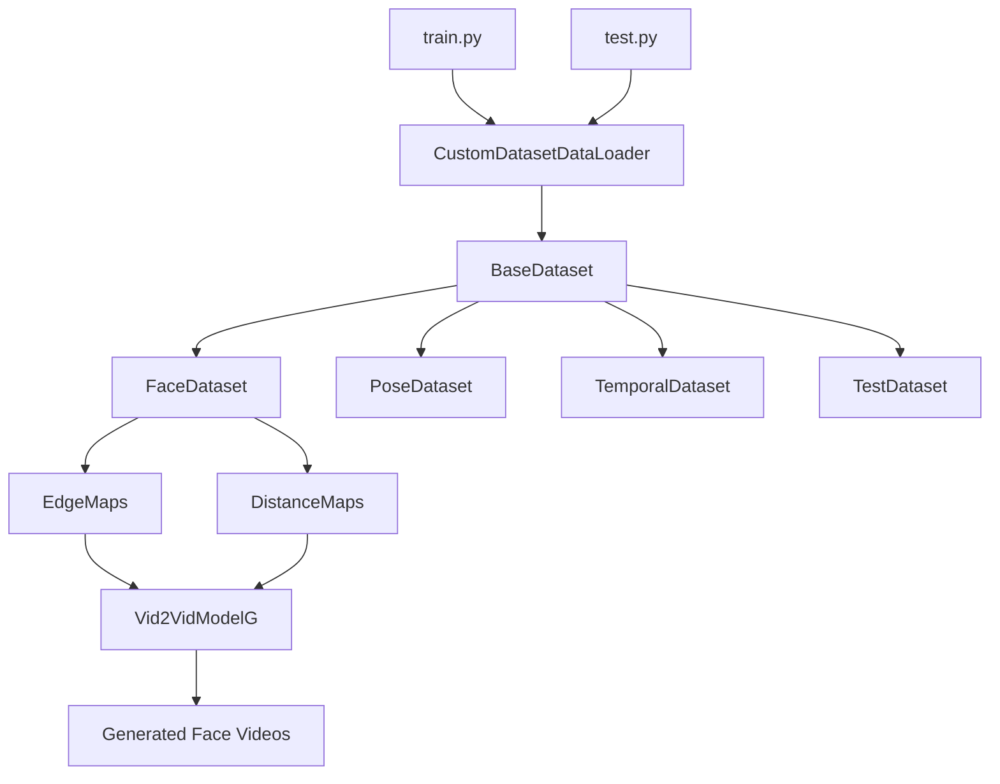

<!-- source: DeepWiki mcp.deepwiki.com · repo NVIDIA/vid2vid · page 3.1 Face Dataset · fetched 2026-10-26 -->

# Face Dataset

<details>
<summary>Relevant source files</summary>

The following files were used as context for generating this wiki page:

- [data/face_dataset.py](data/face_dataset.py)
- [data/keypoint2img.py](data/keypoint2img.py)
- [imgs/face.gif](imgs/face.gif)
- [imgs/framePredict.gif](imgs/framePredict.gif)
- [imgs/pose.gif](imgs/pose.gif)

</details>


## Purpose and Overview

The Face Dataset is a specialized component in the vid2vid system that processes facial data for video-to-video translation tasks. It handles the loading, processing, and organization of facial keypoint data and corresponding images to enable applications such as realistic talking face generation from edge maps. This dataset module plays a crucial role in preparing facial structure representations for the generator model.

For information about other types of datasets in the system, see [Pose Dataset](#3.2) or [Temporal Dataset](#3.3).

Sources: [data/face_dataset.py:13-213]()

## Dataset Structure

The FaceDataset class inherits from BaseDataset and expects a specific directory structure organized as follows:

```
dataroot/
├── [phase]_keypoints/
│   ├── sequence1/
│   │   ├── frame1.txt
│   │   ├── frame2.txt
│   │   └── ...
│   └── sequence2/
│       └── ...
└── [phase]_img/
    ├── sequence1/
    │   ├── frame1.jpg
    │   ├── frame2.jpg
    │   └── ...
    └── sequence2/
        └── ...
```

Where:
- `[phase]` is typically "train" or "test"
- Keypoint files contain facial landmark coordinates
- Image files contain the corresponding face images

The initialization of these paths happens in the `initialize` method:

```python
def initialize(self, opt):
    self.opt = opt
    self.root = opt.dataroot                
    self.dir_A = os.path.join(opt.dataroot, opt.phase + '_keypoints')
    self.dir_B = os.path.join(opt.dataroot, opt.phase + '_img')
```

Sources: [data/face_dataset.py:14-18]()

## Facial Keypoint Structure

### Keypoint Organization

The Face Dataset organizes facial keypoints into specific parts, which are defined in the `read_keypoints` method:

| Facial Part      | Keypoint Indices   |
|------------------|-------------------|
| Face             | 0-16, 68-83       |
| Right Eyebrow    | 17-21             |
| Left Eyebrow     | 22-26             |
| Nose             | 28-35             |
| Right Eye        | 36-41             |
| Left Eye         | 42-47             |
| Mouth            | 48-59             |
| Tongue           | 60-67             |

These parts are organized in a nested list structure as follows:

```python
part_list = [[list(range(0, 17)) + list(range(68, 83)) + [0]], # face
             [range(17, 22)],                                  # right eyebrow
             [range(22, 27)],                                  # left eyebrow
             [[28, 31], range(31, 36), [35, 28]],              # nose
             [[36,37,38,39], [39,40,41,36]],                   # right eye
             [[42,43,44,45], [45,46,47,42]],                   # left eye
             [range(48, 55), [54,55,56,57,58,59,48]],          # mouth
             [range(60, 65), [64,65,66,67,60]]                 # tongue
            ]
```

Each part is assigned a label in the `label_list` to create a labeled mask for the facial regions.

### Facial Keypoint Processing Diagram



Sources: [data/face_dataset.py:91-127](), [data/face_dataset.py:129-157]()

## Data Processing Pipeline

### Data Flow in Face Dataset



When a dataloader requests an item from the FaceDataset, the following process occurs:

1. The FaceDataset retrieves data for the requested index through its `__getitem__` method
2. It loads the corresponding image and keypoint files
3. The keypoints are processed to create edge maps and optionally distance transform maps
4. The result is returned as a dictionary with keys 'A' (input), 'B' (target image), and 'inst' (instance maps)

Sources: [data/face_dataset.py:29-64]()

### Key Processing Methods

The Face Dataset processes facial data using several key methods:

#### get_face_image

This method creates edge maps and distance transform maps from facial keypoints:

```python
def get_face_image(self, A_path, transform_A, transform_L, size, img):
    # read face keypoints from path and crop face region
    keypoints, part_list, part_labels = self.read_keypoints(A_path, size)

    # draw edges and possibly add distance transform maps
    add_dist_map = not self.opt.no_dist_map
    im_edges, dist_tensor = self.draw_face_edges(keypoints, part_list, transform_A, size, add_dist_map)
    
    # canny edge for background
    if not self.opt.no_canny_edge:
        edges = feature.canny(np.array(img.convert('L')))        
        edges = edges * (part_labels == 0)  # remove edges within face
        im_edges += (edges * 255).astype(np.uint8)
    edge_tensor = transform_A(Image.fromarray(self.crop(im_edges)))

    # final input tensor
    input_tensor = torch.cat([edge_tensor, dist_tensor]) if add_dist_map else edge_tensor
    label_tensor = transform_L(Image.fromarray(self.crop(part_labels.astype(np.uint8)))) * 255.0
    return input_tensor, label_tensor
```

#### read_keypoints

This method reads keypoints from a file and organizes them into facial parts:

```python
def read_keypoints(self, A_path, size):        
    # mapping from keypoints to face part 
    part_list = [[list(range(0, 17)) + list(range(68, 83)) + [0]], # face
                 [range(17, 22)],                                  # right eyebrow
                 [range(22, 27)],                                  # left eyebrow
                 [[28, 31], range(31, 36), [35, 28]],              # nose
                 [[36,37,38,39], [39,40,41,36]],                   # right eye
                 [[42,43,44,45], [45,46,47,42]],                   # left eye
                 [range(48, 55), [54,55,56,57,58,59,48]],          # mouth
                 [range(60, 65), [64,65,66,67,60]]                 # tongue
                ]
    label_list = [1, 2, 2, 3, 4, 4, 5, 6] # labeling for different facial parts        
    keypoints = np.loadtxt(A_path, delimiter=',')
    
    # additional processing...
    return keypoints, part_list, part_labels
```

#### draw_face_edges

This method draws edges between keypoints to create a structural representation of the face:

```python
def draw_face_edges(self, keypoints, part_list, transform_A, size, add_dist_map):
    w, h = size
    edge_len = 3  # interpolate 3 keypoints to form a curve when drawing edges
    # edge map for face region from keypoints
    im_edges = np.zeros((h, w), np.uint8) # edge map for all edges
    dist_tensor = 0
    
    # drawing logic...
    return im_edges, dist_tensor
```

Sources: [data/face_dataset.py:71-89](), [data/face_dataset.py:91-127](), [data/face_dataset.py:129-157]()

## Face Region Management

### Crop Coordinates

The Face Dataset automatically determines the crop region around the face based on keypoints:

```python
def get_crop_coords(self, keypoints, size):                
    min_y, max_y = keypoints[:,1].min(), keypoints[:,1].max()
    min_x, max_x = keypoints[:,0].min(), keypoints[:,0].max()                
    xc = (min_x + max_x) // 2
    yc = (min_y*3 + max_y) // 4
    h = w = (max_x - min_x) * 2.5        
    xc = min(max(0, xc - w//2) + w, size[0]) - w//2
    yc = min(max(0, yc - h//2) + h, size[1]) - h//2
    min_x, max_x = xc - w//2, xc + w//2
    min_y, max_y = yc - h//2, yc + h//2        
    self.min_y, self.max_y, self.min_x, self.max_x = int(min_y), int(max_y), int(min_x), int(max_x)        
```

Once the crop coordinates are determined, the `crop` method is used to crop images and arrays to focus on the face region:

```python
def crop(self, img):
    if isinstance(img, np.ndarray):
        return img[self.min_y:self.max_y, self.min_x:self.max_x]
    else:
        return img.crop((self.min_x, self.min_y, self.max_x, self.max_y))
```

Sources: [data/face_dataset.py:159-169](), [data/face_dataset.py:171-175]()

## Data Augmentation

The Face Dataset includes methods for data augmentation, such as scaling keypoints:

```python
def scale_points(self, keypoints, part, index, sym=False):
    if sym:
        # Scale paired facial parts (e.g., eyes, eyebrows) symmetrically
        # ...
    else:            
        # Scale individual facial parts
        # ...
```

This method allows for scaling different parts of the face independently or symmetrically, enabling the generation of diverse facial expressions and variations.

Sources: [data/face_dataset.py:177-204]()

## Integration with Edge Generation

The FaceDataset relies on utility functions from `keypoint2img.py` for edge generation:

### interpPoints

This function interpolates keypoints to create smooth curves:

```python
def interpPoints(x, y):    
    if abs(x[:-1] - x[1:]).max() < abs(y[:-1] - y[1:]).max():
        curve_y, curve_x = interpPoints(y, x)
        if curve_y is None:
            return None, None
    else:        
        # Fit a polynomial or linear function to the points
        # ...
    return curve_x.astype(int), curve_y.astype(int)
```

### drawEdge

This function draws edges on an image using the interpolated points:

```python
def drawEdge(im, x, y, bw=1, color=(255,255,255), draw_end_points=False):
    if x is not None and x.size:
        h, w = im.shape[0], im.shape[1]
        # Draw the edge
        # ...
        # Optionally draw endpoints
        # ...
```

Sources: [data/keypoint2img.py:45-67](), [data/keypoint2img.py:26-43]()

## Position in the vid2vid System



The FaceDataset is one of several dataset implementations in the vid2vid system. It inherits from BaseDataset and specializes in processing facial data. The dataset is used by the CustomDatasetDataLoader, which feeds the processed data to the training and testing scripts. The processed data (edge maps and distance maps) serves as input to the generator model, which produces realistic face videos.

Sources: [data/face_dataset.py:13-213]()

## Usage Example

To use the Face Dataset in the vid2vid system, you need to:

1. Prepare your data in the expected directory structure
2. Configure options related to face data processing
3. Create a dataloader using the Face Dataset

Example configuration options:

| Option | Description | Default |
|--------|-------------|---------|
| `--dataroot` | Path to the dataset root directory | required |
| `--phase` | Dataset phase (train/test) | required |
| `--no_dist_map` | Disable distance transform maps | False |
| `--no_canny_edge` | Disable Canny edges for background | False |
| `--random_scale_points` | Enable random scaling of keypoints | False |

Sources: [data/face_dataset.py:14-28](), [data/face_dataset.py:71-89]()

---

