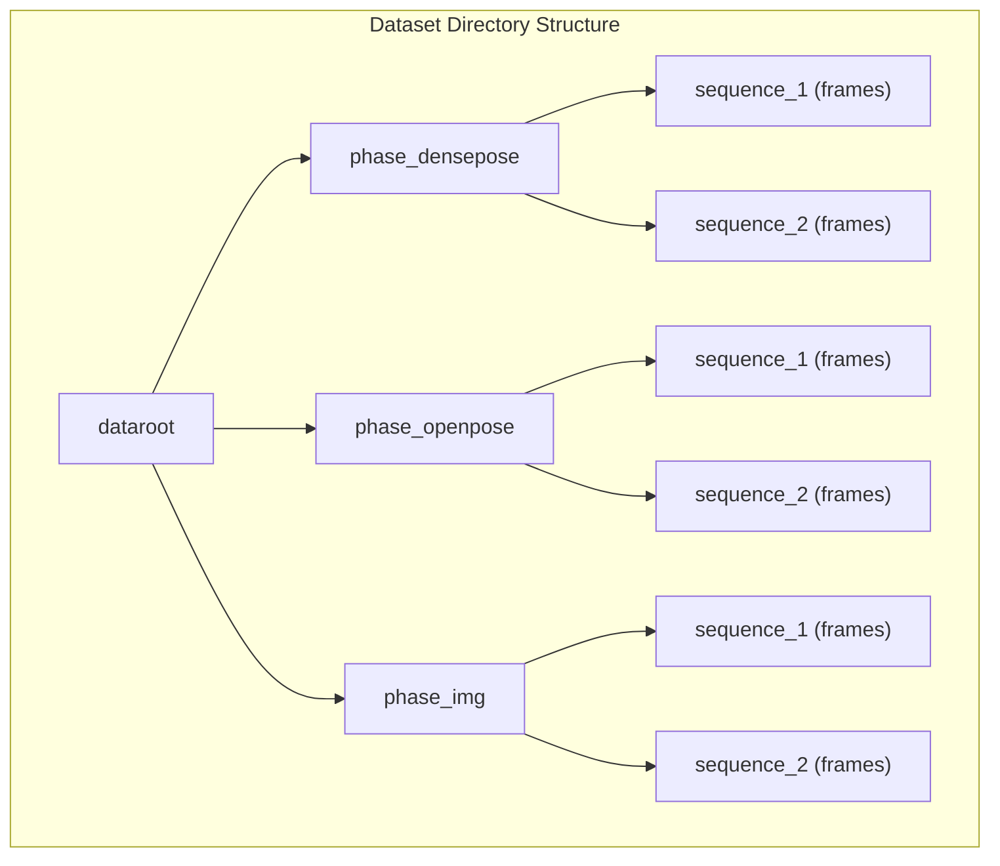
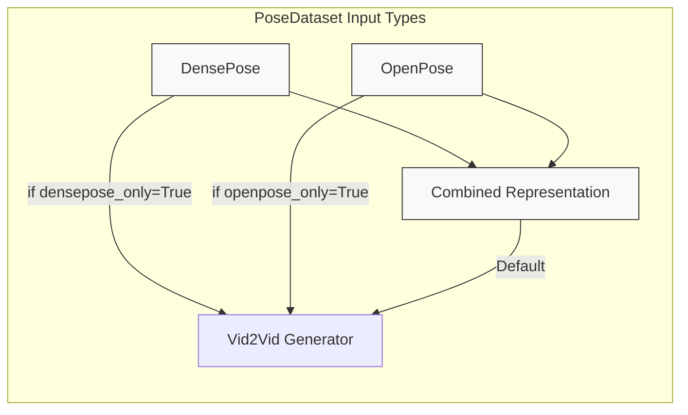
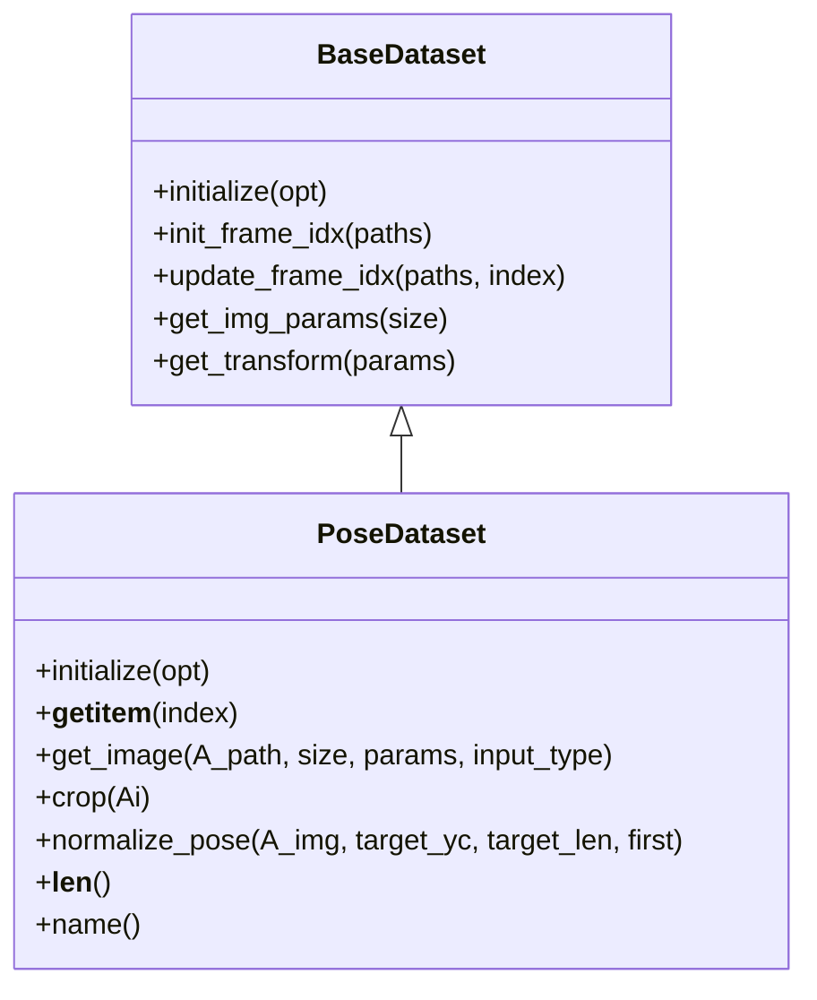
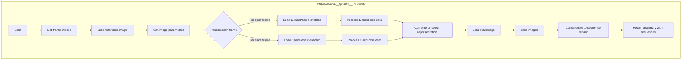
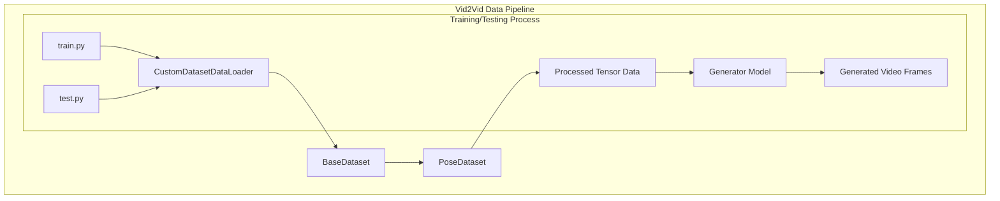

<!-- source: DeepWiki mcp.deepwiki.com · repo NVIDIA/vid2vid · page 3.2 Pose Dataset · fetched 2026-10-26 -->

# Pose Dataset

<details>
<summary>Relevant source files</summary>

The following files were used as context for generating this wiki page:

- [data/pose_dataset.py](data/pose_dataset.py)
- [imgs/face.gif](imgs/face.gif)
- [imgs/framePredict.gif](imgs/framePredict.gif)
- [imgs/pose.gif](imgs/pose.gif)
- [scripts/face/download_models.py](scripts/face/download_models.py)

</details>


## Purpose and Scope

The Pose Dataset component is responsible for loading, preprocessing, and managing human pose data for use in vid2vid's video-to-video translation tasks. It supports two types of pose representations (DensePose and OpenPose) that serve as conditioning input for generating realistic human motion videos. This dataset implementation enables the system to learn mappings from sequential pose representations to photorealistic video frames.

For information about other dataset implementations, see [Face Dataset](#3.1) or [Temporal Dataset](#3.3).

Sources: [data/pose_dataset.py:11-138]()

## Data Structure and Organization

The Pose Dataset expects data to be organized in a specific directory structure, with separate directories for different types of pose representations and their corresponding real images:



Where:
- `phase` is either "train" or "test"
- `_densepose` directories contain dense body surface representations
- `_openpose` directories contain skeletal keypoint representations
- `_img` directories contain the corresponding real images

Each sequence consists of numbered frames that maintain temporal correspondence across the different representation types.

Sources: [data/pose_dataset.py:16-25]()

## Pose Representations

The Pose Dataset handles two complementary types of pose representations:



### DensePose Representation
DensePose provides a dense mapping of the human body surface, with each pixel containing:
- UV coordinates (defines position on body part)
- Part label (identifies which body part)

The dataset maps 24 different body part labels:
- Background (0)
- Torso (1, 2)
- Limbs (3-22)
- Head (23, 24)

### OpenPose Representation
OpenPose provides skeletal keypoints for the human body, including:
- Body joint positions
- Confidence scores for each joint

Sources: [data/pose_dataset.py:42-54](), [data/pose_dataset.py:140-156]()

## Implementation Details

The `PoseDataset` class inherits from `BaseDataset` and implements functionality specific to handling pose data:



Key methods include:

1. **initialize**: Sets up dataset paths and validates the data structure
2. **__getitem__**: The core method that loads and processes pose frames
3. **get_image**: Loads specific image types (densepose, openpose, or real image)
4. **crop**: Performs center cropping for efficiency
5. **normalize_pose**: Normalizes pose orientation and scale

Sources: [data/pose_dataset.py:11-138]()

## Data Loading Process

The data loading process involves several steps to prepare the pose data for the generator:



The dataset returns a dictionary containing:
- `A`: Tensor of pose representations (input)
- `B`: Tensor of real images (target)
- `inst`: Instance information (0 for pose dataset)
- `A_path`: Path to the source data
- `change_seq`: Flag indicating sequence boundary

Sources: [data/pose_dataset.py:29-67]()

## Data Augmentation Techniques

The Pose Dataset implements several data augmentation techniques:

1. **Random Label Dropping**: During training, body part labels can be randomly removed to improve robustness
   ```python
   # Randomly drop body part labels during training
   if (np.random.rand() < self.opt.random_drop_prob):
       A_np[(part_labels == part_id), :] = 0
   ```

2. **Face Label Removal**: Option to remove face labels, forcing the model to infer faces
   ```python
   # Remove face labels if configured
   if self.opt.remove_face_labels:
       A_np[(part_labels == 23) | (part_labels == 24), :] = 0
   ```

3. **Basic Points Only**: Option to use only basic keypoints in OpenPose data

Sources: [data/pose_dataset.py:76-85]()

## Configuration Options

The Pose Dataset behavior is controlled through various configuration options in the `opt` object:

| Option | Description | Default |
|--------|-------------|---------|
| `dataroot` | Root directory for dataset | Required |
| `phase` | Dataset phase (train/test) | Required |
| `densepose_only` | Use only DensePose data | False |
| `openpose_only` | Use only OpenPose data | False |
| `random_drop_prob` | Probability of randomly dropping labels | 0.05 |
| `remove_face_labels` | Remove face labels during training | False |
| `basic_point_only` | Use only basic keypoints in OpenPose | False |
| `isTrain` | Whether in training mode | True/False |
| `n_frames_total` | Number of frames in a sequence | Varies |

Sources: [data/pose_dataset.py:12-27]()

## Integration with Vid2Vid System

The Pose Dataset integrates with the vid2vid system as follows:



During training and testing:
1. The custom data loader requests batches from the Pose Dataset
2. The dataset provides pose representations and corresponding real images
3. The generator model uses the pose data as input to generate realistic video frames
4. During training, the real images are used as ground truth for computing losses

Sources: [data/pose_dataset.py:11-14]()

## Practical Usage

### Data Preparation

To use the Pose Dataset, you need to:

1. Prepare your data in the expected directory structure
2. Generate DensePose and/or OpenPose data for your video sequences
3. Ensure frame numbers match between pose representations and real images

### Example Directory Setup

```
/path/to/dataset/
├── train_densepose/
│   ├── subject1/
│   │   ├── 000001.jpg
│   │   ├── 000002.jpg
│   │   └── ...
│   └── ...
├── train_openpose/
│   ├── subject1/
│   │   ├── 000001.json
│   │   ├── 000002.json
│   │   └── ...
│   └── ...
└── train_img/
    ├── subject1/
    │   ├── 000001.jpg
    │   ├── 000002.jpg
    │   └── ...
    └── ...
```

### Loading the Dataset

The dataset is loaded automatically by the training and testing scripts using the appropriate command-line options.

Sources: [data/pose_dataset.py:16-25]()

---

