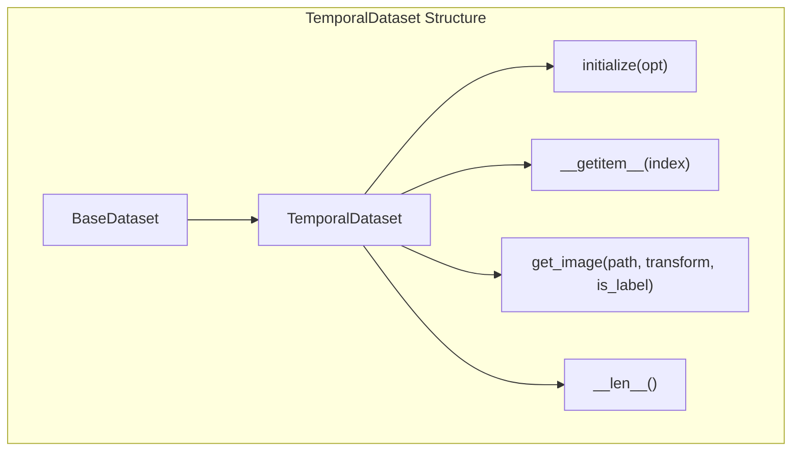
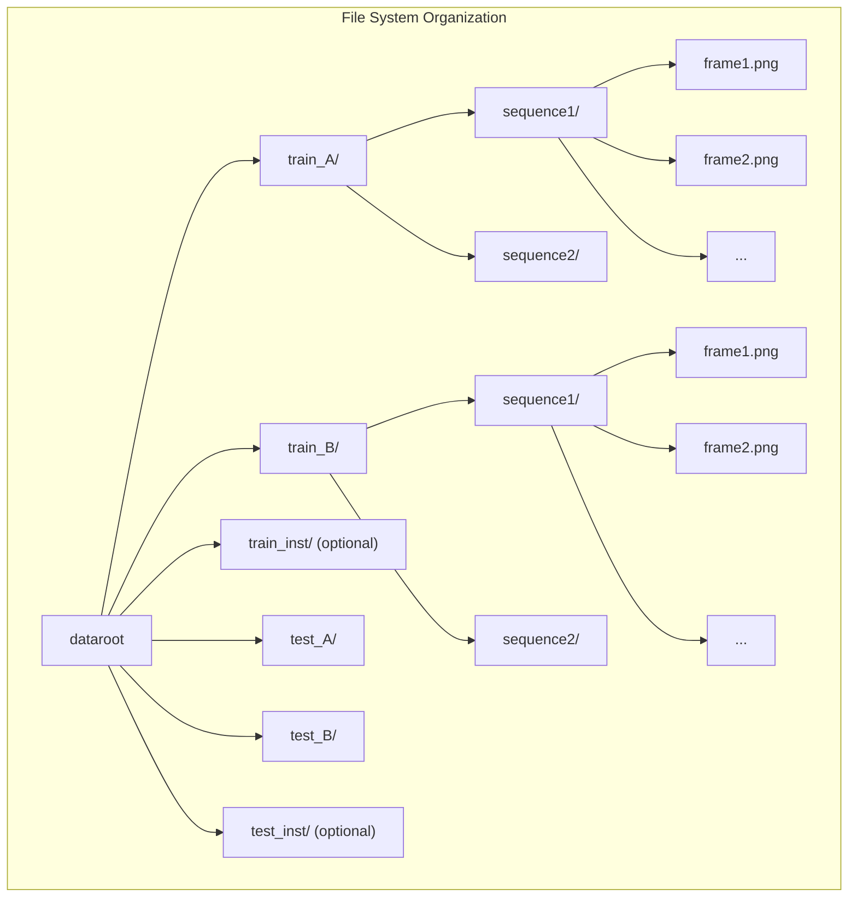
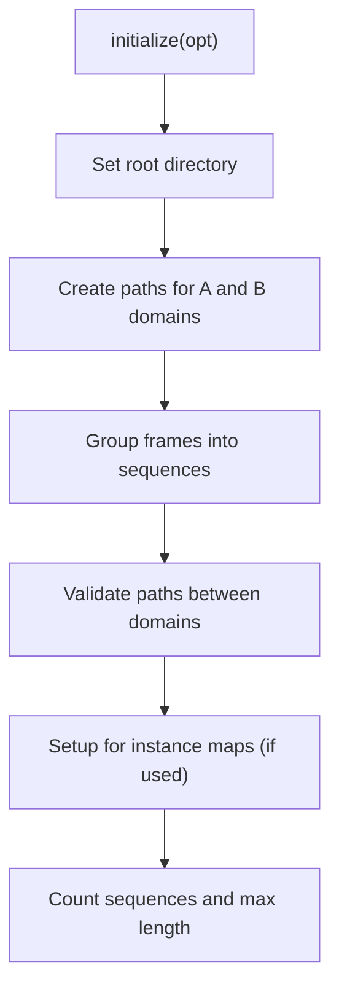
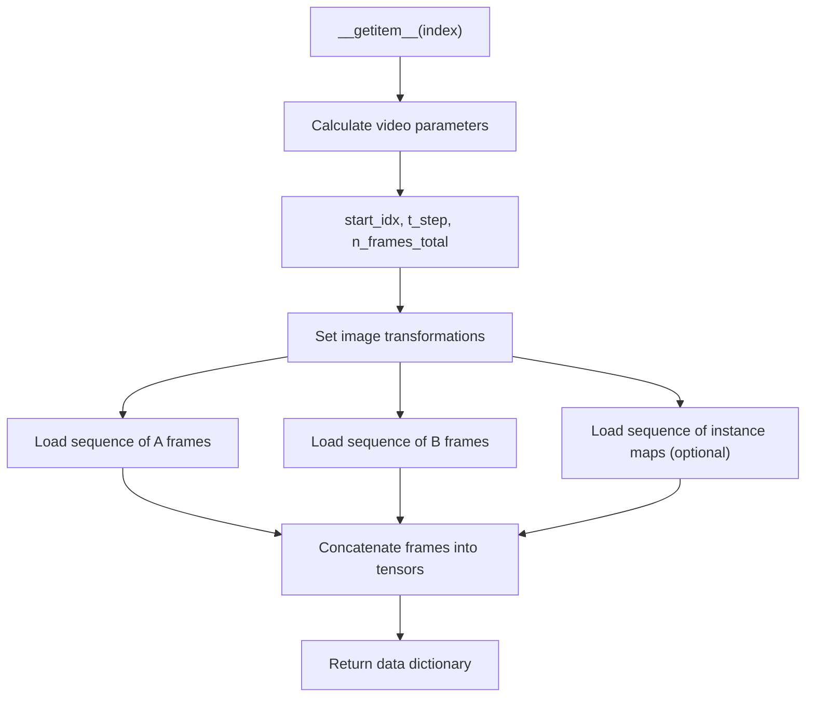
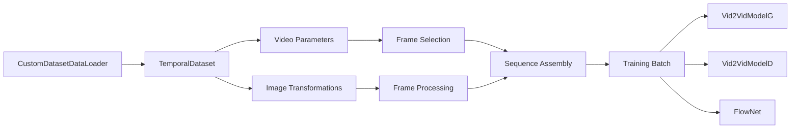

<!-- source: DeepWiki mcp.deepwiki.com · repo NVIDIA/vid2vid · page 3.3 Temporal Dataset · fetched 2026-10-26 -->

# Temporal Dataset

<details>
<summary>Relevant source files</summary>

The following files were used as context for generating this wiki page:

- [data/temporal_dataset.py](data/temporal_dataset.py)

</details>


## Purpose and Scope

The Temporal Dataset component in the vid2vid system is responsible for loading and managing sequences of video frames for training and testing video-to-video translation models. It specifically handles the temporal relationships between frames, which is essential for generating temporally coherent output videos. This page documents the implementation, data structure, and usage of the `TemporalDataset` class.

For information about domain-specific datasets like face or pose data, see [Face Dataset](#3.1) and [Pose Dataset](#3.2).

## Overview

The Temporal Dataset is a core component of the data pipeline in vid2vid, providing a structured way to process sequential image data while maintaining temporal relationships. It loads sequences of source images (domain A) and target images (domain B), along with optional instance maps, and serves them to the training process in temporally coherent batches.



Sources: [data/temporal_dataset.py:11-77]()

## Data Organization

The Temporal Dataset expects a specific folder structure for input data:



Sources: [data/temporal_dataset.py:14-25]()

Each sequence folder contains ordered frames (typically named numerically). The dataset maintains the temporal order between corresponding frames in domains A and B, which is crucial for training models that learn to convert from one video domain to another.

## Key Components and Functionality

### Initialization Process

When initialized, the `TemporalDataset` sets up paths to the data directories and organizes the frame sequences:



Sources: [data/temporal_dataset.py:12-29]()

### Frame Sampling Logic

The dataset implements a sophisticated frame sampling mechanism to handle videos of different lengths:



Sources: [data/temporal_dataset.py:31-64]()

The `get_video_params` function determines:
- How many frames to include in a training sample
- Which frame to start from
- The step size between frames (to handle different temporal scales)

## Data Processing

### Image Transformation Pipeline

Each image goes through a transformation pipeline:

1. Load image from path
2. Apply spatial transformations (resize, crop, etc.)
3. Convert to tensor
4. Apply normalization (except for label maps)
5. Concatenate with other frames in the sequence

Sources: [data/temporal_dataset.py:66-71]()

### Special Handling for Label Maps

When the input images in domain A are label maps (semantic segmentation maps):

1. The dataset sets `A_is_label = True`
2. Label maps use nearest-neighbor interpolation instead of bilinear
3. Label maps are not normalized in the same way as RGB images
4. Label pixel values are multiplied by 255.0

Sources: [data/temporal_dataset.py:17, 45, 70]()

## Data Structure

The dataset returns a dictionary with the following elements:

| Key | Description | Shape |
|-----|-------------|-------|
| `A` | Source domain sequence | `[n_frames_total × channels × height × width]` |
| `B` | Target domain sequence | `[n_frames_total × 3 × height × width]` |
| `inst` | Instance maps (optional) | `[n_frames_total × 1 × height × width]` |
| `A_path` | Path to the last A frame | String |
| `B_paths` | Path to the last B frame | String |

Sources: [data/temporal_dataset.py:63-64]()

## Integration with Training Pipeline

The Temporal Dataset integrates with the vid2vid training process through the following workflow:



Sources: [data/temporal_dataset.py:31-64]()

## Handling Variable-Length Sequences

The dataset handles sequences of variable length through several mechanisms:

1. Tracks the maximum sequence length in the dataset
2. For each training iteration, selects a subset of frames based on:
   - The current iteration number
   - The configured number of frames for training
   - The length of the current sequence
3. Uses a time step parameter (`t_step`) to skip frames for longer sequences or when training with temporal downsampling

Sources: [data/temporal_dataset.py:39]()

## Usage Example

When using the Temporal Dataset in training, it would typically be configured through command line parameters:

```
python train.py --dataroot ./datasets/my_video_dataset \
                --n_frames_total 12 \
                --label_nc 0 \
                --no_instance
```

For testing:

```
python test.py --dataroot ./datasets/my_video_dataset \
               --n_frames_total 12 \
               --label_nc 0 \
               --no_instance
```

The dataset will then load sequential frames from the specified directories, process them according to the configuration, and provide them to the vid2vid models for training or inference.

Sources: [data/temporal_dataset.py:11-77]()

---

