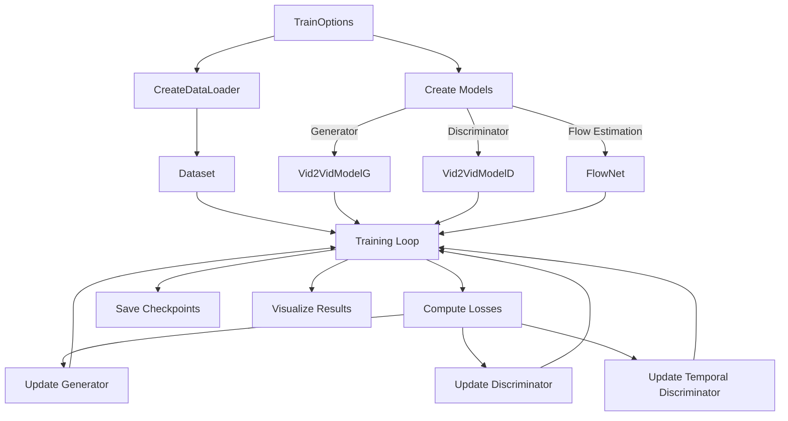
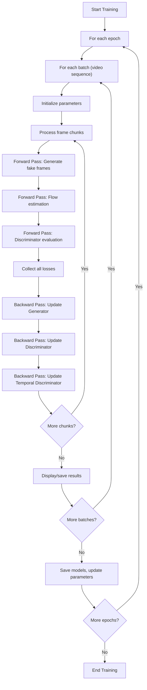
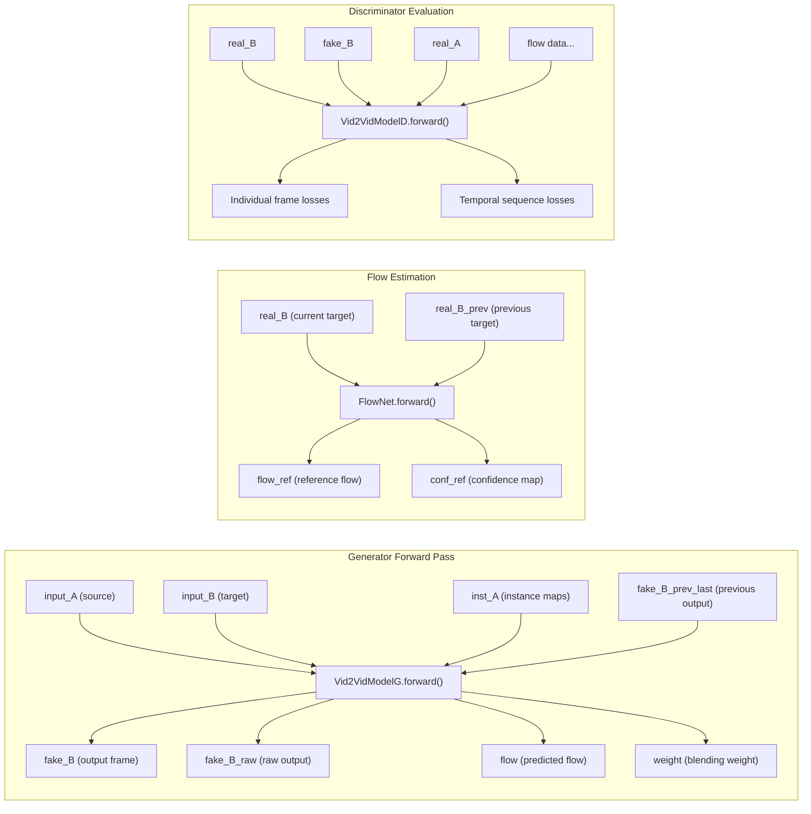
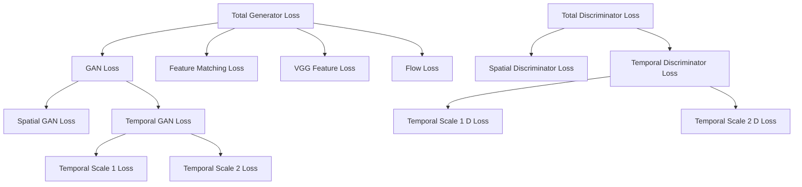
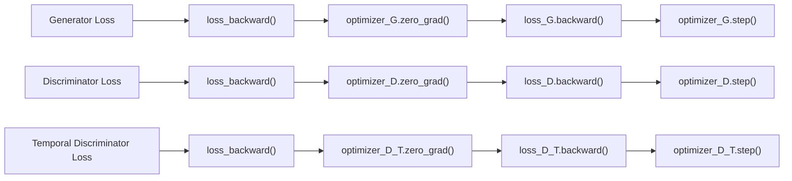

<!-- source: DeepWiki mcp.deepwiki.com · repo NVIDIA/vid2vid · page 4 Training Process · fetched 2026-10-26 -->

# Training Process

Relevant source files

The following files were used as context for generating this wiki page:

- [options/base_options.py](options/base_options.py)
- [options/train_options.py](options/train_options.py)
- [train.py](train.py)

This page documents the training process for the vid2vid system, which translates videos from one domain to another. The training process involves optimizing the generator and discriminator models using adversarial learning, feature matching, and temporal consistency constraints. For information about testing and inference, see [Testing and Inference](#5).

## Overview of Training Pipeline

The vid2vid training process follows a structured pipeline that leverages a specialized dataset loader, advanced neural network models, and carefully designed optimization strategies. The training is managed by the [`train.py`]() script, which coordinates the entire process.

Sources: [train.py:14-148]()

## Configuration Options

The training process is highly configurable through command-line parameters defined in the TrainOptions class. These options control various aspects of training including network architecture, optimization parameters, and loss weights.

### Key Training Parameters

| Parameter | Default | Description |
|-----------|---------|-------------|
| `niter` | 10 | Number of epochs with initial learning rate |
| `niter_decay` | 10 | Number of epochs with linearly decaying learning rate |
| `lr` | 0.0002 | Initial learning rate |
| `beta1` | 0.5 | Momentum term for Adam optimizer |
| `display_freq` | 100 | Frequency of showing training results on screen |
| `save_latest_freq` | 1000 | Frequency of saving latest models |
| `save_epoch_freq` | 1 | Frequency of saving checkpoints at end of epochs |
| `n_frames_total` | 30 | Total number of frames in a training sequence |
| `max_frames_per_gpu` | 1 | Maximum number of frames to load on GPU at once |
| `max_frames_backpropagate` | 1 | Maximum number of frames to backpropagate through |

### Loss Weight Parameters

| Parameter | Default | Description |
|-----------|---------|-------------|
| `lambda_feat` | 10.0 | Weight for feature matching loss |
| `lambda_T` | 10.0 | Weight for temporal loss |
| `lambda_F` | 10.0 | Weight for flow loss |
| `gan_mode` | 'ls' | GAN loss mode (ls, original, or hinge) |

Sources: [options/train_options.py:1-43](), [options/base_options.py:1-129]()

## Training Loop Structure

The training loop processes video sequences frame by frame while maintaining temporal consistency between generated frames.

Sources: [train.py:37-128]()

## Forward Pass Details

During training, the forward pass consists of multiple steps that generate frames, compute optical flow, and evaluate realism through discriminators.

Sources: [train.py:51-82]()

## Loss Function Hierarchy

The training process uses a sophisticated loss function hierarchy that combines adversarial, feature matching, and temporal consistency losses.

Sources: [train.py:64-82]()

## Optimization Process

The optimization process involves updating both the generator and discriminator networks using calculated gradients from the respective loss functions.

### Gradient Flow

Sources: [train.py:85-93](), [train.py:130-138]()

## Detailed Training Process Flow

The training process for vid2vid consists of the following steps:

1. **Configuration Initialization**:
   - Parse command-line arguments through `TrainOptions().parse()`
   - Configure debugging parameters if in debug mode
   - Set up thread count and GPU utilization

2. **Data Initialization**:
   - Create data loader using `CreateDataLoader(opt)`
   - Load dataset with `data_loader.load_data()`
   - Print training dataset size

3. **Model Initialization**:
   - Create models with `create_model(opt)`
   - Create optimizers for Generator, Discriminator, and Temporal Discriminator
   - Initialize parameters including scales, epoch tracking, and paths

4. **Training Loop**:
   - For each epoch:
     - For each batch in the dataset:
       - Initialize data parameters for the current batch
       - Process frames in chunks to manage memory
       - For each chunk:
         - Prepare input and target data
         - Forward pass through generator to produce fake frames
         - Calculate optical flow between real frames using FlowNet
         - Compute losses from spatial and temporal discriminators
         - Backward pass to update Generator, Discriminator, and Temporal Discriminator
       - Display training progress and errors
       - Save generated images periodically
       - Save latest model checkpoints
     - End of epoch operations:
       - Print epoch summary
       - Save model checkpoints
       - Update model parameters (learning rate decay)

5. **Loss Calculation**:
   - Spatial losses include:
     - GAN loss for making generated frames realistic
     - Feature matching loss for content preservation
     - VGG loss for perceptual similarity (if enabled)
   - Temporal losses include:
     - Temporal GAN loss for realistic motion
     - Flow consistency loss for smooth transitions

6. **Optimization**:
   - Use `loss_backward()` function to handle gradient calculation
   - Support for mixed precision training with FP16 option
   - Handle zero_grad, backward, and step operations for all optimizers

7. **Visualization and Checkpointing**:
   - Display current errors at intervals defined by `print_freq`
   - Plot error curves using Visualizer
   - Display generated images at intervals defined by `display_freq`
   - Save models at intervals and at the end of each epoch

Sources: [train.py:14-148]()

## Memory Management

The vid2vid training process employs several techniques to manage GPU memory efficiently:

1. **Chunk Processing**: Frames are processed in smaller chunks defined by `n_frames_load` to fit within GPU memory constraints

2. **Limited Backpropagation**: Only a subset of frames (defined by `max_frames_backpropagate`) are used for gradient computation

3. **Progressive Training**: Training starts with shorter sequences and gradually increases to handle longer videos

4. **Multi-GPU Support**: Training can be distributed across multiple GPUs with the generator and discriminator potentially on different devices

Sources: [train.py:47-50](), [options/train_options.py:36-38]()

## Training Visualization

The training progress is visualized through:

1. **Console Output**: Loss values and training stats printed at intervals
2. **Web Interface**: Generated images displayed in a web interface
3. **TensorBoard** (optional): Loss curves and images logged to TensorBoard if enabled

Sources: [train.py:102-113]()

---

