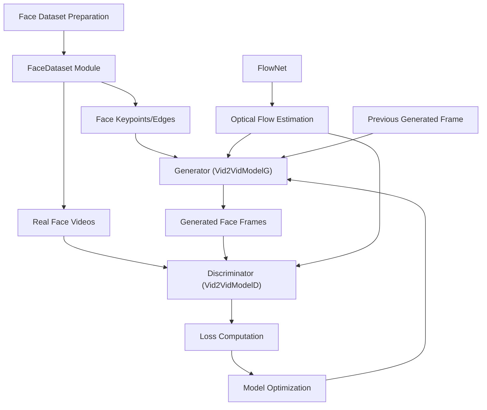
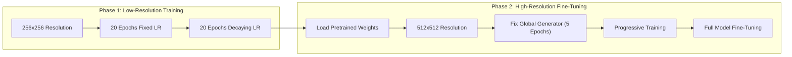
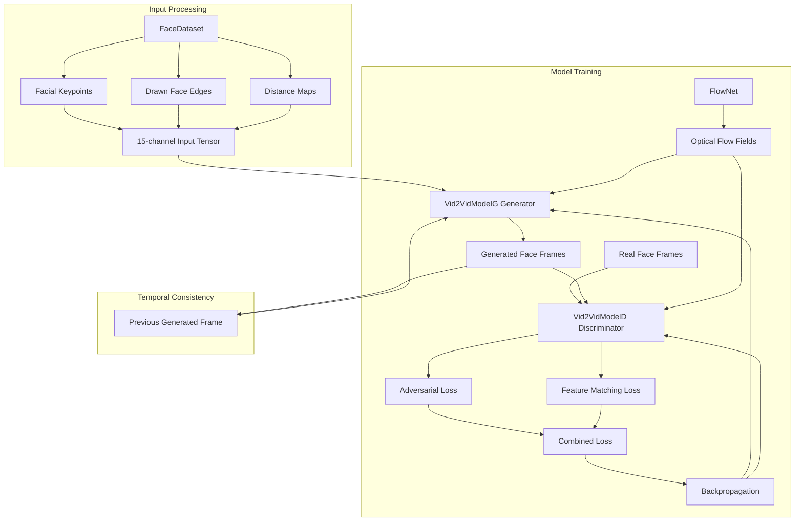

<!-- source: DeepWiki mcp.deepwiki.com · repo NVIDIA/vid2vid · page 4.1 Face Model Training · fetched 2026-10-26 -->

# Face Model Training

<details>
<summary>Relevant source files</summary>

The following files were used as context for generating this wiki page:

- [scripts/face/train_512.sh](scripts/face/train_512.sh)
- [scripts/face/train_g1_256.sh](scripts/face/train_g1_256.sh)
- [scripts/face/train_g1_512.sh](scripts/face/train_g1_512.sh)

</details>


## Purpose and Scope

This document provides a detailed explanation of the training process for the face video generation models in the vid2vid framework. The system is designed to transform facial edge maps or keypoints into realistic face videos, maintaining temporal consistency across frames. For information about training pose-based human body generation models, see [Pose Model Training](#4.2).

## Overview of Face Model Training

Face model training in vid2vid involves converting facial landmarks or edge maps to photorealistic face videos. The training process utilizes a specialized dataset pipeline, progressive resolution strategy, and carefully tuned parameters to achieve high-quality results.



Sources: [scripts/face/train_512.sh](), [scripts/face/train_g1_256.sh](), [scripts/face/train_g1_512.sh]()

## Face Data Processing

The training process uses the `FaceDataset` module, which handles facial landmark/edge preparation. The input data consists of 15 channels (`--input_nc 15`), which represent the facial structure through keypoints and edge maps.

### Input Data Format

| Channel | Content | Purpose |
|---------|---------|---------|
| 1-15 | Facial landmarks/edges | Represent facial structure, expressions, and movement |

The `FaceDataset` module processes these inputs and pairs them with corresponding real face video frames for the generator and discriminator training.

Sources: [scripts/face/train_512.sh:2-3](), [scripts/face/train_g1_256.sh:2-3](), [scripts/face/train_g1_512.sh:2-4]()

## Progressive Training Strategy

A key aspect of the face model training is the progressive resolution approach, which improves training stability and final output quality. Training proceeds in two main phases:



Sources: [scripts/face/train_g1_256.sh:3-5](), [scripts/face/train_g1_512.sh:3-6]()

## Training Parameters

### Low-Resolution (256x256) Training

The initial training phase uses these key parameters:

- Resolution: 256x256 (`--loadSize 256`)
- Generator filters: 64 (`--ngf 64`)
- Temporal frames: 12 (`--n_frames_total 12`)
- Maximum frames per GPU: 6 (`--max_frames_per_gpu 6`)
- Training schedule: 20 epochs fixed rate + 20 epochs decay (`--niter 20 --niter_decay 20`)

Sources: [scripts/face/train_g1_256.sh:3-5]()

### High-Resolution (512x512) Training

After the low-resolution model is trained, training continues at higher resolution:

- Resolution: 512x512 (`--loadSize 512`)
- Spatial scales: 2 (`--n_scales_spatial 2`)
- Discriminators: 3 (`--num_D 3`)
- Temporal frames: 6 (`--n_frames_total 6`) - reduced from low-res training
- Progressive training step size: 2 (`--niter_step 2`)
- Global generator fixed epochs: 5 (`--niter_fix_global 5`)
- Pretrained weights: Loaded from 256x256 model (`--load_pretrain checkpoints/edge2face_256_g1`)

Sources: [scripts/face/train_g1_512.sh:3-6]()

### Multi-GPU Training Configuration

For faster training on multiple GPUs, a specific configuration is available:

- Using 8 GPUs (`--gpu_ids 0,1,2,3,4,5,6,7`)
- Generator distributed across 6 GPUs (`--n_gpus_gen 6`)
- 3 discriminator scales (`--num_D 3`)

Sources: [scripts/face/train_512.sh:3-5]()

## Training Process Workflow

The actual training process involves several interconnected components, as shown in the diagram below:



Sources: [scripts/face/train_512.sh](), [scripts/face/train_g1_256.sh](), [scripts/face/train_g1_512.sh]()

## Running Face Model Training

The repository provides three main scripts for face model training:

1. **Basic 256x256 Training**:
   ```bash
   ./scripts/face/train_g1_256.sh
   ```
   This script trains the initial lower-resolution model.

2. **Progressive 512x512 Training**:
   ```bash
   ./scripts/face/train_g1_512.sh
   ```
   This script loads the 256x256 model weights and continues training at 512x512 resolution using a progressive approach.

3. **Multi-GPU 512x512 Training**:
   ```bash
   ./scripts/face/train_512.sh
   ```
   This script uses multiple GPUs for faster training at 512x512 resolution.

Sources: [scripts/face/train_512.sh:1-5](), [scripts/face/train_g1_256.sh:1-5](), [scripts/face/train_g1_512.sh:1-6]()

## Key Training Parameters Table

The following table summarizes the key training parameters for face model training:

| Parameter | 256x256 Model | 512x512 Model | Multi-GPU 512x512 |
|-----------|---------------|---------------|-------------------|
| Resolution | 256x256 | 512x512 | 512x512 |
| Generator Filters | 64 | 64 | Default |
| Discriminators | Default | 3 | 3 |
| Spatial Scales | Default | 2 | Default |
| Temporal Frames | 12 | 6 | 12 |
| Training Epochs | 20+20 | Based on pretrained | 20+20 |
| GPU Configuration | Single | Single | 8 GPUs, 6 for generator |
| Pretrained Model | None | 256x256 model | None |

Sources: [scripts/face/train_512.sh](), [scripts/face/train_g1_256.sh](), [scripts/face/train_g1_512.sh]()

## Training Output and Checkpoints

During training, the system saves model checkpoints periodically. For the face models, checkpoints are saved with names such as:
- `checkpoints/edge2face_256_g1/` for the 256x256 model
- `checkpoints/edge2face_512_g1/` for the 512x512 model
- `checkpoints/edge2face_512/` for the multi-GPU 512x512 model

These checkpoints can be used for inference or further training, as demonstrated in the progressive training approach where the 512x512 model loads weights from the 256x256 model.

Sources: [scripts/face/train_g1_512.sh:6]()

---

