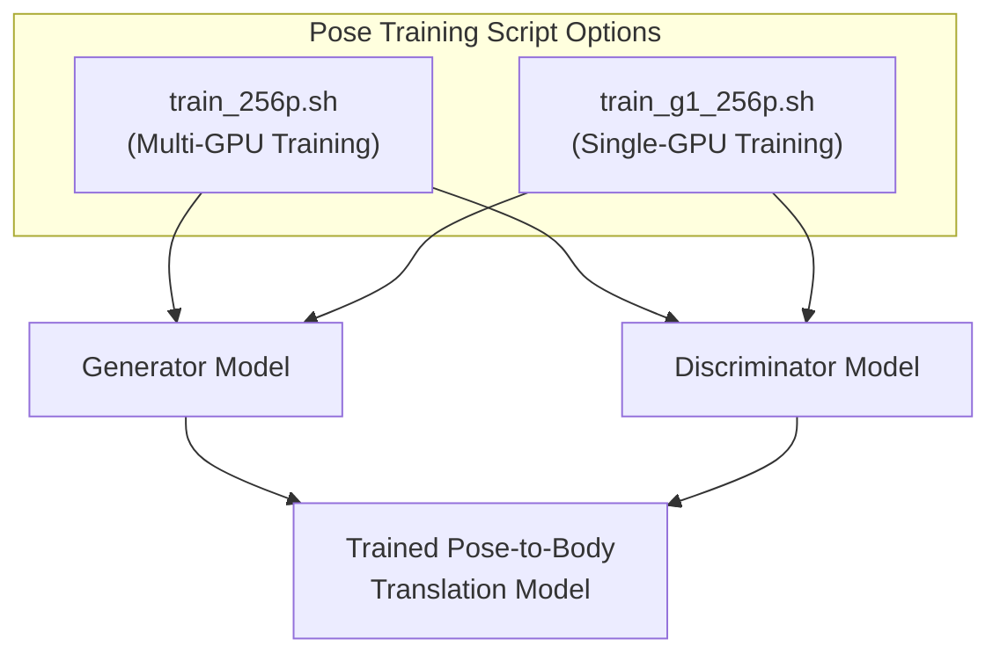
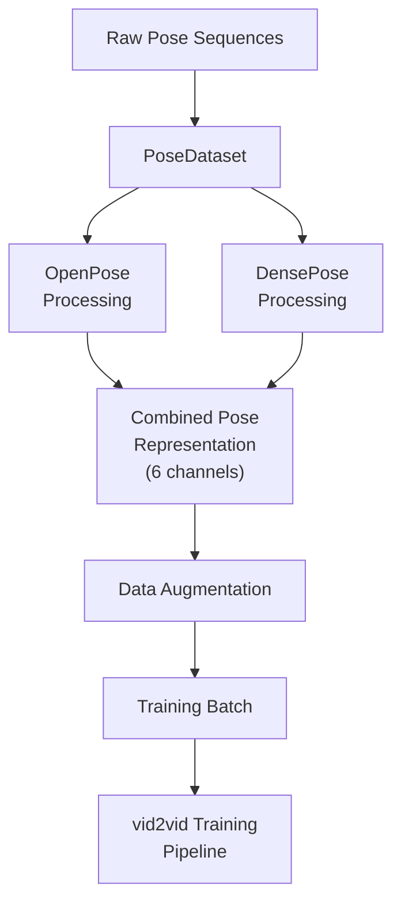
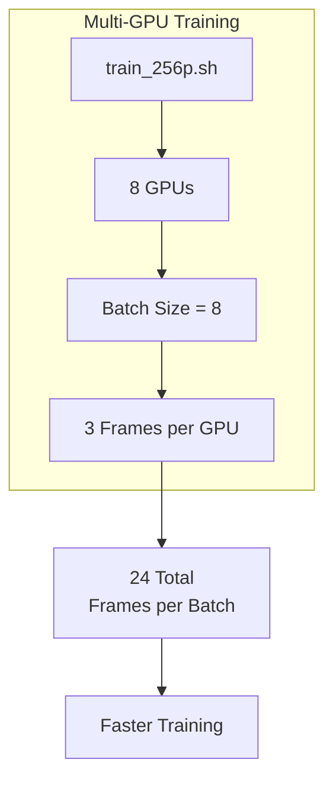
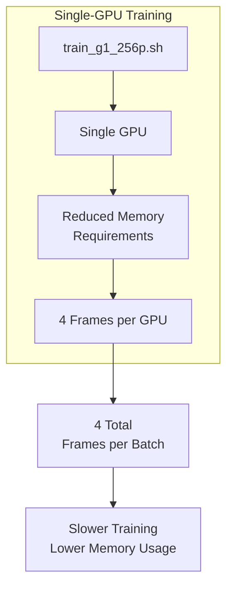
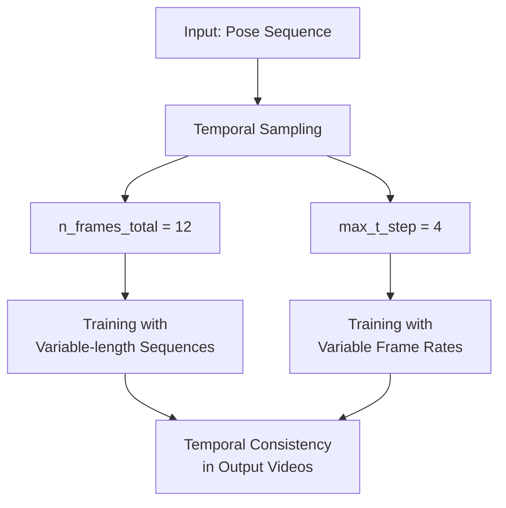

<!-- source: DeepWiki mcp.deepwiki.com · repo NVIDIA/vid2vid · page 4.2 Pose Model Training · fetched 2026-10-26 -->

# Pose Model Training

<details>
<summary>Relevant source files</summary>

The following files were used as context for generating this wiki page:

- [scripts/pose/train_256p.sh](scripts/pose/train_256p.sh)
- [scripts/pose/train_g1_256p.sh](scripts/pose/train_g1_256p.sh)

</details>


## Purpose and Scope

This document details the specific training process for the pose-to-body video generation models in the vid2vid system. It focuses on the configuration, process, and parameters needed to train a model that can generate realistic human body videos from pose sequences. For information about training face models, see [Face Model Training](#4.1). For general information on the training process, see [Training Process](#4).

## Training Configuration

The pose model training in vid2vid has specific requirements and parameters optimized for human pose-to-body translation. The system uses scripts with predefined configurations for common training scenarios.

### Available Training Scripts

Two primary scripts are available for pose model training:

1. **Standard multi-GPU training script** - For training with multiple GPUs
2. **Single-GPU variant** - For training with limited hardware resources



Sources: [scripts/pose/train_256p.sh](), [scripts/pose/train_g1_256p.sh]()

### Key Parameters

The training scripts include several important parameters tailored specifically for pose-to-body translation:

| Parameter | Value | Description |
|-----------|-------|-------------|
| `dataset_mode` | pose | Specifies pose dataset handling |
| `input_nc` | 6 | Number of input channels (pose representation) |
| `num_D` | 2 | Number of discriminator scales |
| `n_frames_total` | 12 | Number of frames in a training sequence |
| `max_t_step` | 4 | Maximum temporal skip between frames |
| `no_first_img` | enabled | Skip first image in training sequences |
| `loadSize` | 384 | Initial load size for augmentation |
| `fineSize` | 256 | Final crop size after augmentation |

Sources: [scripts/pose/train_256p.sh:1-7](), [scripts/pose/train_g1_256p.sh:1-6]()

## Training Data Process

The pose model training utilizes a specialized data pipeline that processes human pose information for video generation.



Sources: [scripts/pose/train_256p.sh:2-4](), [scripts/pose/train_g1_256p.sh:2-4]()

### Pose Data Representation

The pose model accepts a 6-channel input representing human pose information:

1. **Channels 1-3**: OpenPose skeleton information
2. **Channels 4-6**: DensePose surface representation

This combination provides both skeletal structure and body surface information, allowing the model to generate realistic human appearances.

Sources: [scripts/pose/train_256p.sh:3](), [scripts/pose/train_g1_256p.sh:3]()

## Training Process

### Initialization and Setup

The training process begins with model initialization and dataset preparation.

```mermaid
sequenceDiagram
    participant TR as "train.py"
    participant OPT as "TrainOptions"
    participant DS as "PoseDataset"
    participant GEN as "Vid2VidModelG"
    participant DISC as "Vid2VidModelD"
    participant FLOW as "FlowNet"
    
    TR->>OPT: "Parse arguments"
    OPT->>TR: "Return configuration"
    TR->>DS: "Initialize dataset"
    TR->>GEN: "Initialize generator"
    TR->>DISC: "Initialize discriminator"
    TR->>FLOW: "Initialize FlowNet"
    
    DS->>TR: "Provide pose sequences"
    TR->>GEN: "Forward pass"
    GEN->>FLOW: "Compute optical flow"
    FLOW->>GEN: "Return flow and confidence"
    GEN->>TR: "Return generated frames"
    TR->>DISC: "Evaluate generated frames"
    DISC->>TR: "Return discriminator loss"
    TR->>GEN: "Backpropagate generator"
    TR->>DISC: "Backpropagate discriminator"
```

Sources: [scripts/pose/train_256p.sh:1-7](), [scripts/pose/train_g1_256p.sh:1-6]()

### Training Configuration Options

The pose training uses specific training schedules and optimization parameters:

1. **Training Schedule**: 5 epochs with fixed learning rate + 5 epochs with decaying rate
2. **Temporal Sampling**: Training sequences of 12 frames with max temporal step of 4
3. **Data Augmentation**: Random scale height and crop operations for robustness

Sources: [scripts/pose/train_256p.sh:6-7](), [scripts/pose/train_g1_256p.sh:5-6]()

## Multi-GPU vs. Single-GPU Training

The system offers two training configurations to accommodate different hardware setups:

### Multi-GPU Configuration

The standard training script utilizes multiple GPUs for faster training:



Sources: [scripts/pose/train_256p.sh:5]()

### Single-GPU Configuration

For users with limited hardware, a single-GPU variant is available:



Sources: [scripts/pose/train_g1_256p.sh:6]()

## Data Augmentation Strategy

The pose model training employs specific data augmentation techniques to improve generalization:

1. **Initial Loading Size**: Images loaded at 384px height
2. **Random Scale Height**: Variable scaling of the image height
3. **Scaled Crop**: Cropping to final size of 256px
4. **Sequential Sampling**: Consecutive frames with variable time steps

This combination of augmentations helps the model learn to generate realistic human motion regardless of the subject's size or movement speed.

Sources: [scripts/pose/train_256p.sh:4](), [scripts/pose/train_g1_256p.sh:4]()

## Temporal Modeling

The pose model training pays special attention to temporal consistency through:



Sources: [scripts/pose/train_256p.sh:7](), [scripts/pose/train_g1_256p.sh:6]()

## Running the Training

To start training a pose model, you can use one of the provided scripts:

For multi-GPU setup:
```bash
sh scripts/pose/train_256p.sh
```

For single-GPU setup:
```bash
sh scripts/pose/train_g1_256p.sh
```

The training will automatically save checkpoints at regular intervals, which can be used for inference later.

Sources: [scripts/pose/train_256p.sh](), [scripts/pose/train_g1_256p.sh]()

## Expected Training Time and Resources

Training a pose model requires significant computational resources:

- **Multi-GPU setup**: Approximately 2-3 days on 8 GPUs
- **Single-GPU setup**: Approximately 2-3 weeks on a single GPU

The multi-GPU setup is recommended for practical development cycles.

Sources: [scripts/pose/train_256p.sh:5](), [scripts/pose/train_g1_256p.sh]()

---

