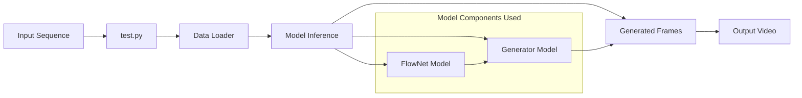
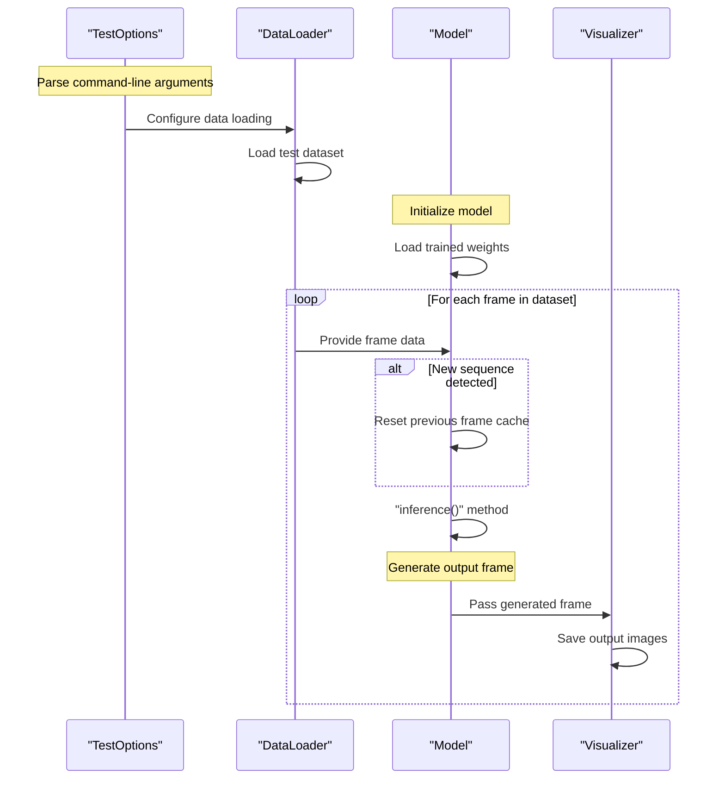
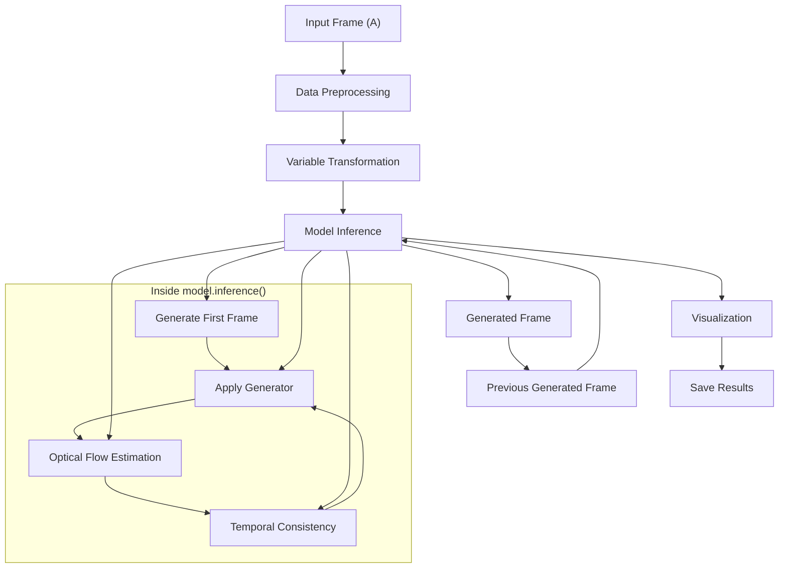
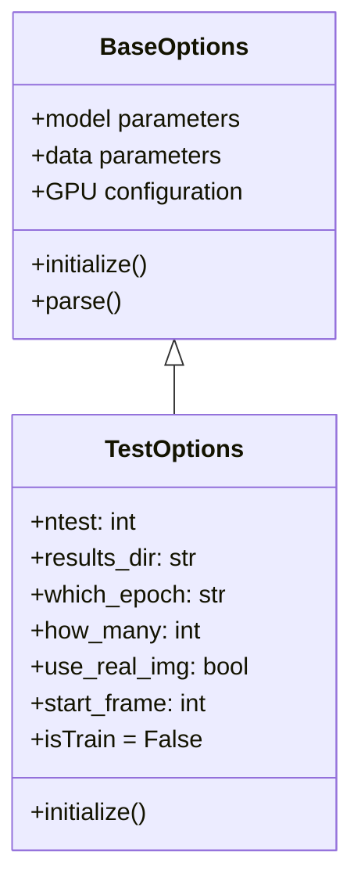

<!-- source: DeepWiki mcp.deepwiki.com · repo NVIDIA/vid2vid · page 5 Testing and Inference · fetched 2026-10-26 -->

# Testing and Inference

<details>
<summary>Relevant source files</summary>

The following files were used as context for generating this wiki page:

- [options/test_options.py](options/test_options.py)
- [scripts/download_models_flownet2.py](scripts/download_models_flownet2.py)
- [test.py](test.py)

</details>


This document explains how to use the vid2vid system for inference (generating videos) with trained models. It covers the process of running the test script, configuring test options, and understanding the inference workflow. For information about training models, see [Training Process](#4).

## Overview of the Inference Process

The vid2vid system provides a streamlined mechanism for generating videos from various input formats using pre-trained models. The inference process translates source videos (or sequences of images) from one domain to another, maintaining temporal consistency between frames.



Sources: [test.py:15-54]()

## Running Inference

To run inference with a trained model, use the `test.py` script. This script handles loading the test data, processing it through the model, and saving the generated results.

### Basic Usage

```
python test.py --name [experiment_name] --dataroot [path_to_data] --checkpoints_dir [path_to_checkpoints] --results_dir [path_to_save_results]
```

The script processes each frame in the input sequence, applying the trained generator to produce output frames.

### Key Test Parameters

The following parameters control the inference process:

| Parameter | Description | Default Value |
|-----------|-------------|---------------|
| `--name` | Name of the experiment | Required |
| `--dataroot` | Path to input data | Required |
| `--results_dir` | Directory to save results | `./results/` |
| `--which_epoch` | Which model epoch to load | `latest` |
| `--how_many` | Maximum number of test frames to process | 300 |
| `--use_real_img` | Use real image for first frame | False |
| `--start_frame` | Frame index to start inference from | 0 |

Sources: [options/test_options.py:4-15](), [test.py:15-19]()

## Inference Workflow

The inference process follows a clear workflow from data loading to output generation:



Sources: [test.py:23-54]()

## Data Flow During Inference

During inference, the data flows through the system as follows:



Sources: [test.py:30-54]()

## Inference Implementation Details

The core of the inference process happens in the model's `inference()` method. While the exact implementation isn't shown in the provided files, based on the system architecture, we can infer that:

1. The model processes input tensors `A` (source), optionally `B` (target, if available for the first frame), and `inst` (instance maps if available)
2. If processing the first frame or a new sequence, it generates the initial frame
3. For subsequent frames, it uses the previously generated frame and optical flow to maintain temporal consistency
4. The FlowNet component estimates motion between frames
5. The Generator produces the output frame

The inference function is called with:

```python
generated = model.inference(A, B, inst)
```

Where:
- `A` is the input source frame
- `B` is the optional target frame (used for initial frame if available)
- `inst` is the optional instance map

Sources: [test.py:41]()

## Output and Visualization

The test script saves generated frames in the following directory structure:

```
[results_dir]/[experiment_name]/test_[epoch]/
```

For each frame, it saves:
1. The input frame (`real_A`)
2. The generated output frame (`fake_B`)

The visualization system creates an ordered dictionary of images to save:

```python
visual_list = [('real_A', real_A), 
               ('fake_B', util.tensor2im(generated[0].data[0]))]
```

Sources: [test.py:49-53]()

## Using Pre-trained Models

To use pre-trained models for inference, you need to:

1. Download the models (either your own trained models or the ones provided by the authors)
2. For some tasks, download the FlowNet2 pre-trained model:

```
python scripts/download_models_flownet2.py
```

3. Run the test script with the appropriate options pointing to these models

Sources: [scripts/download_models_flownet2.py:1-7]()

## Configuring Test Options

The `TestOptions` class in `options/test_options.py` provides configuration options for testing. These include:



Important test-specific options include:
- `ntest`: Maximum number of test examples to run (default: infinity)
- `how_many`: Actual number of frames to process (default: 300)
- `which_epoch`: Which trained model to load (default: "latest")
- `use_real_img`: Whether to use real image for the first frame (default: False)
- `start_frame`: Frame index to start inference from (default: 0)

Sources: [options/test_options.py:4-15]()

## Test-time Constraints

The test script enforces certain constraints to ensure proper inference:

```python
opt.nThreads = 1    # test code only supports nThreads = 1
opt.batchSize = 1   # test code only supports batchSize = 1
opt.serial_batches = True  # no shuffle
opt.no_flip = True  # no flip
```

These constraints ensure deterministic processing of frames in the correct sequence order, which is critical for video generation where temporal consistency matters.

Sources: [test.py:16-19]()

## Common Use Cases

The vid2vid inference can be used for several applications:

1. **Face video generation**: Animating face videos from landmarks or edge maps
2. **Human motion transfer**: Generating realistic body movements from pose sequences
3. **Street scene video synthesis**: Converting semantic segmentation maps to photorealistic videos

For each use case, specific pre-trained models and data preprocessing steps may be required. Refer to the specific model training pages ([Face Model Training](#4.1) or [Pose Model Training](#4.2)) for details on the corresponding models.

## Troubleshooting

When running inference, you might encounter issues related to:

1. **Memory limitations**: Processing high-resolution videos may require significant GPU memory
2. **Missing dependencies**: Ensure all required modules are installed, especially FlowNet2 dependencies
3. **Model compatibility**: Make sure the test data format matches what the model was trained on

For memory issues, you can reduce the resolution of input frames or process fewer frames at a time by adjusting the `how_many` parameter.

---

