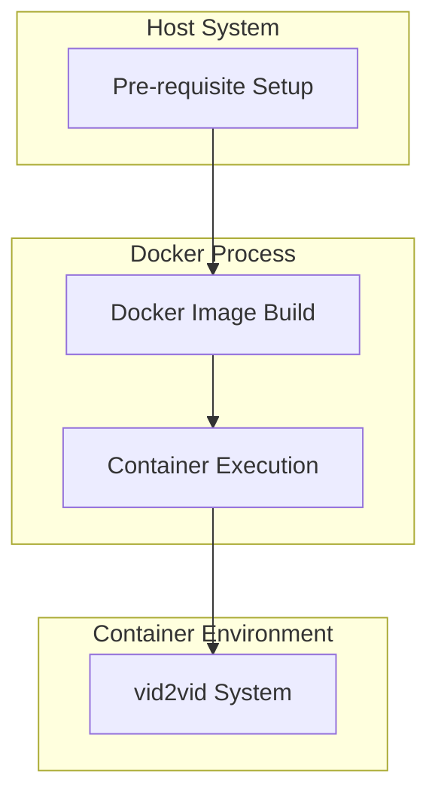
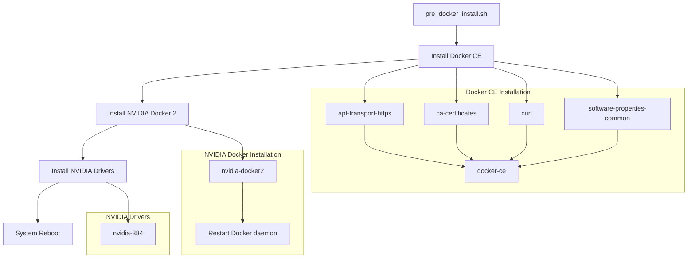
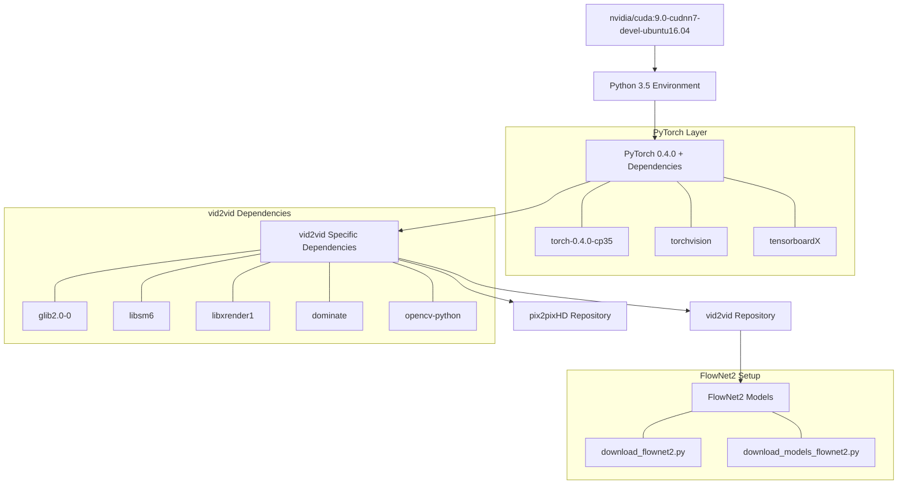
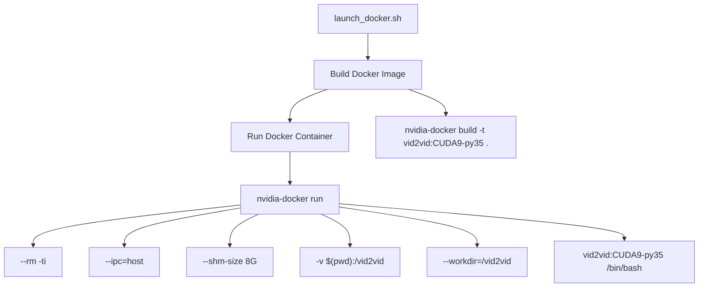

<!-- source: DeepWiki mcp.deepwiki.com · repo NVIDIA/vid2vid · page 6 Docker Environment · fetched 2026-10-26 -->

# Docker Environment

<details>
<summary>Relevant source files</summary>

The following files were used as context for generating this wiki page:

- [docker/Dockerfile](docker/Dockerfile)
- [docker/launch_docker.sh](docker/launch_docker.sh)
- [docker/pre_docker_install.sh](docker/pre_docker_install.sh)

</details>


This document describes the Docker environment provided for running the vid2vid system. The Docker setup encapsulates all dependencies and configurations needed to build, train, and test video-to-video translation models without dealing with complex dependency management.

## Overview

The vid2vid repository provides Docker files that create a containerized environment with all necessary dependencies pre-installed. This includes CUDA, cuDNN, PyTorch, and all required Python packages, as well as pre-cloned repositories and downloaded model dependencies.



Sources: [docker/pre_docker_install.sh](), [docker/Dockerfile](), [docker/launch_docker.sh]()

## System Requirements

Before setting up the Docker environment, ensure your system meets these requirements:

| Requirement | Specification |
|-------------|---------------|
| GPU | NVIDIA GPU with CUDA support |
| Operating System | Ubuntu Linux (preferably 16.04 or later) |
| Disk Space | At least 10GB for Docker images and containers |
| RAM | Minimum 8GB (16GB+ recommended for larger models) |
| Software | Ability to install NVIDIA drivers and Docker |

## Installation Process

### 1. Installing Prerequisites

The repository provides a script to set up all prerequisites including Docker CE, NVIDIA Docker 2, and NVIDIA drivers on your host system.



To install these prerequisites, run:

```bash
sh docker/pre_docker_install.sh
```

This script will:
1. Install Docker CE and dependencies
2. Install NVIDIA Docker 2
3. Install NVIDIA driver version 384
4. Reboot your system to complete driver installation

Sources: [docker/pre_docker_install.sh:3-43]()

### 2. Docker Image Contents

The Docker image is defined in the Dockerfile and includes all components needed for vid2vid:



Sources: [docker/Dockerfile:1-31]()

### 3. Building and Running the Docker Container

The repository provides a script that builds the Docker image and runs a container:



To build and run the Docker container:

```bash
sh docker/launch_docker.sh
```

This script:
1. Builds a Docker image tagged as `vid2vid:CUDA9-py35`
2. Launches a Docker container with the following settings:
   - Uses NVIDIA Docker runtime to access GPUs
   - Removes the container after exit (`--rm`)
   - Runs in interactive mode with a TTY (`-ti`)
   - Sets up IPC host mode for better process communication
   - Allocates 8GB of shared memory
   - Mounts the current directory to `/vid2vid` inside the container
   - Sets the working directory to `/vid2vid`
   - Runs a bash shell inside the container

Sources: [docker/launch_docker.sh:1-6]()

## Docker Configuration Details

### Base Image

The Docker image uses NVIDIA's CUDA 9.0 with cuDNN 7 on Ubuntu 16.04 as its base. This provides the necessary GPU acceleration components:

```
FROM nvidia/cuda:9.0-cudnn7-devel-ubuntu16.04
```

### Python Environment

The container sets up Python 3.5 with pip and configures it as the default Python interpreter:

```
RUN apt-get install python3-pip -y
RUN ln -s /usr/bin/python3 /usr/bin/python
RUN pip3 install --upgrade pip
```

### PyTorch Installation

The container installs PyTorch 0.4.0 with CUDA 8.0 support and related packages:

```
RUN pip install http://download.pytorch.org/whl/cu80/torch-0.4.0-cp35-cp35m-linux_x86_64.whl 
RUN pip install torchvision cffi tensorboardX
```

Note: There appears to be a version mismatch between the CUDA 9.0 base image and the CUDA 8.0 PyTorch wheel. This is intentional and the setup has been tested to work correctly.

### Additional Dependencies

The container installs vid2vid-specific dependencies:

```
RUN apt-get install libglib2.0-0 libsm6 libxrender1 -y
RUN pip install dominate requests opencv-python
```

### Repository Setup

The container clones two repositories:
1. pix2pixHD (required for initializing training)
2. vid2vid (the main repository)

```
RUN git clone https://github.com/NVIDIA/pix2pixHD /pix2pixHD
RUN git clone https://github.com/NVIDIA/vid2vid /vid2vid
```

### FlowNet2 Model Download

The container downloads FlowNet2 dependencies needed for optical flow estimation:

```
RUN python scripts/download_flownet2.py
RUN python scripts/download_models_flownet2.py
```

Sources: [docker/Dockerfile:1-31]()

## Usage

Once inside the Docker container, you can:

1. Train models using scripts in the vid2vid repository 
2. Test trained models
3. Run inference on new inputs

For specific training and testing procedures, refer to the [Training Process](#4) and [Testing and Inference](#5) documentation.

## Troubleshooting

### FlowNet2 Model Download Issues

As noted in the Dockerfile, there have been instances where the FlowNet2 scripts needed to be re-run after launching the Docker container:

```bash
python scripts/download_flownet2.py
python scripts/download_models_flownet2.py
```

### NVIDIA Driver Compatibility

The pre-installation script installs NVIDIA driver version 384, which may not be compatible with all GPUs. If you encounter GPU-related errors, consider installing a driver version appropriate for your GPU model.

### Shared Memory Issues

If you encounter "bus error" or crashes during training with large datasets, you might need to increase the shared memory allocation. Modify the `--shm-size` parameter in the launch script.

### Permission Issues

If you encounter permission issues with Docker commands, ensure your user is added to the Docker group:

```bash
sudo usermod -aG docker $USER
```

Log out and log back in for the changes to take effect.

Sources: [docker/Dockerfile:25-28](), [docker/pre_docker_install.sh:33-40](), [docker/launch_docker.sh:5]()