# Page: Overview

# Overview

<details>
<summary>Relevant source files</summary>

The following files were used as context for generating this wiki page:

- [README.md](README.md)

</details>


This document provides a comprehensive introduction to vid2vid, a high-resolution photorealistic video-to-video translation framework developed by NVIDIA. Vid2vid enables the generation of temporally consistent video sequences from various input formats such as semantic label maps, edge maps, or pose keypoints.

## What is vid2vid?

Vid2vid is a PyTorch-based implementation for high-resolution (up to 2048x1024) photorealistic video-to-video translation. It builds upon image-to-image translation techniques (specifically pix2pixHD) but extends them with temporal consistency mechanisms to produce coherent video outputs.

The framework supports several key applications:
- Converting semantic label maps into photo-realistic street scene videos
- Synthesizing talking face videos from edge maps
- Generating realistic human motion videos from pose keypoints
- Frame prediction for video sequences

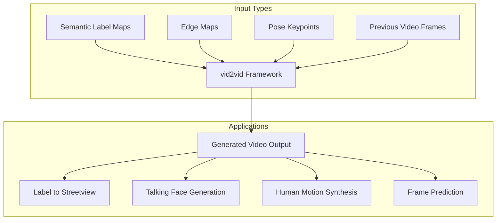

Sources: [README.md:8-13](), [README.md:14-35]()

## System Architecture

The vid2vid system is comprised of three primary components that work together to achieve temporally consistent video translation:

```mermaid
classDiagram
    class "Vid2VidModelG (Generator)" {
        +forward()
        +generate_frame_train()
        +generate_first_frame()
        +inference()
    }
    
    class "Vid2VidModelD (Discriminator)" {
        +forward()
        +compute_loss_D()
        +compute_loss_D_T()
        +GAN_and_FM_loss()
    }
    
    class "FlowNet" {
        +forward()
        +compute_flow_and_conf()
    }
    
    class "Data Pipeline" {
        +BaseDataset
        +FaceDataset
        +PoseDataset
        +TemporalDataset
    }
    
    class "Training Process (train.py)" {
        +main()
        +setup options
        +create model
        +train epochs
    }
    
    class "Inference Process (test.py)" {
        +main()
        +setup options
        +load model
        +generate frames
    }
    
    "Training Process (train.py)" --> "Vid2VidModelG (Generator)"
    "Training Process (train.py)" --> "Vid2VidModelD (Discriminator)"
    "Training Process (train.py)" --> "FlowNet"
    "Training Process (train.py)" --> "Data Pipeline"
    
    "Inference Process (test.py)" --> "Vid2VidModelG (Generator)"
    "Inference Process (test.py)" --> "FlowNet"
    "Inference Process (test.py)" --> "Data Pipeline"
    
    "Vid2VidModelG (Generator)" --> "FlowNet": Uses for temporal consistency
```

Sources: [README.md:175-191]()

### Generator

The Generator model (Vid2VidModelG) is responsible for synthesizing realistic video frames based on the input data (semantic maps, edge maps, or pose keypoints) while maintaining temporal consistency with previously generated frames. It leverages optical flow information to warp previous frames before generating new content.

For more details on the Generator's architecture, see [Generator Architecture](#2.1).

### Discriminator

The Discriminator model (Vid2VidModelD) evaluates the realism of generated frames from both spatial and temporal perspectives. It contains multiple sub-discriminators that operate at different scales to capture both fine details and global structure.

For more details on the Discriminator's architecture, see [Discriminator Architecture](#2.2).

### FlowNet

FlowNet estimates optical flow between consecutive frames, which is crucial for maintaining temporal consistency in the generated videos. It helps the Generator understand how objects move across frames.

For more details on the FlowNet component, see [Optical Flow Estimation (FlowNet)](#2.3).

## Data Flow and Processing Pipeline

The following diagram illustrates how data flows through the vid2vid system during the training process:

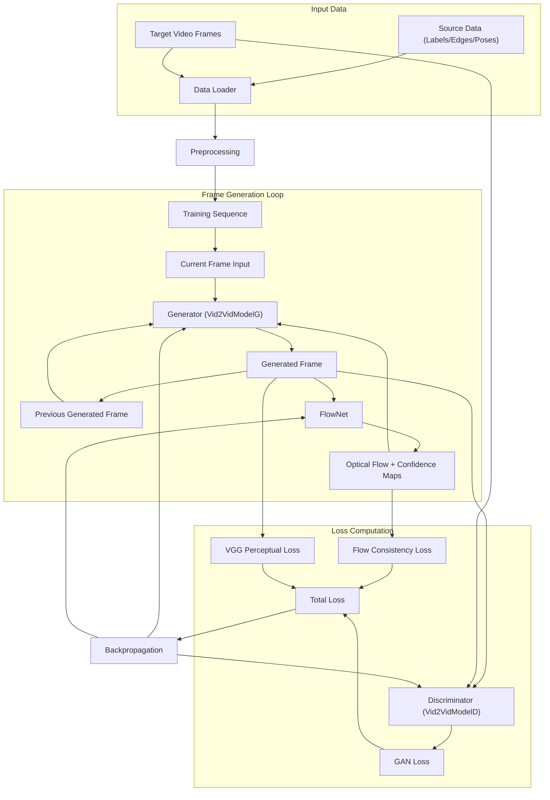

Sources: [README.md:175-191]()

## Key Features and Technical Innovations

### Temporal Consistency

A core innovation of vid2vid is its ability to maintain temporal consistency across video frames. This is achieved through:

1. Optical flow estimation between frames
2. Flow-based warping of previous frames
3. Multi-frame conditioning (using previous frames as context)

### Multi-Scale Processing

Vid2vid employs multi-scale processing in both spatial and temporal domains:

- **Spatial scales**: Processing at multiple resolutions (e.g., 512×256, 1024×512, 2048×1024)
- **Temporal scales**: Evaluating frame sequences at different temporal resolutions

### Coarse-to-Fine Training

The system employs a coarse-to-fine training approach:


This progressive approach allows the model to first learn global structure before refining details at higher resolutions.

Sources: [README.md:115-137]()

## Supported Applications

### Label-to-Streetview (Cityscapes)

Converts semantic segmentation maps into photorealistic street scenes. The model understands different object classes (roads, buildings, vehicles, etc.) and generates temporally consistent video outputs.

### Edge-to-Face

Synthesizes realistic talking face videos from edge maps. The system can maintain consistent identity while generating natural facial movements and expressions.

### Pose-to-Body

Transforms human pose keypoints into full-body videos with realistic appearance and motion. This can be used for human motion transfer and video synthesis.

### Frame Prediction

Predicts future video frames based on past frames, enabling applications in video forecasting and simulation.

Sources: [README.md:14-35]()

## System Requirements and Setup

Vid2vid requires:
- Linux or macOS operating system
- NVIDIA GPU with CUDA and cuDNN
- PyTorch 0.4
- Python 3
- Additional dependencies for specific applications (DensePose, OpenPose, dlib)

For detailed setup instructions and environment configuration, see [Docker Environment](#6).

Sources: [README.md:37-61]()

## Additional Resources

- [Training Process](#4): Details on how to train models for different applications
- [Testing and Inference](#5): Instructions for running inference with trained models
- [Data Pipeline](#3): Information about dataset preparation and processing

---

# Page: System Architecture

# System Architecture

<details>
<summary>Relevant source files</summary>

The following files were used as context for generating this wiki page:

- [README.md](README.md)
- [models/base_model.py](models/base_model.py)
- [models/models.py](models/models.py)
- [train.py](train.py)

</details>


This document provides a comprehensive overview of the vid2vid system architecture, explaining how different components interact to enable high-resolution photorealistic video-to-video translation. The vid2vid system translates videos from one domain to another (e.g., semantic maps to photo-realistic videos, face edges to talking faces, or poses to human motions) while maintaining temporal consistency.

For specific implementation details about individual components, see [Generator Architecture](#2.1), [Discriminator Architecture](#2.2), and [Optical Flow Estimation (FlowNet)](#2.3).

## Core Architecture Overview

The vid2vid system consists of several interacting components that work together to achieve video-to-video translation:

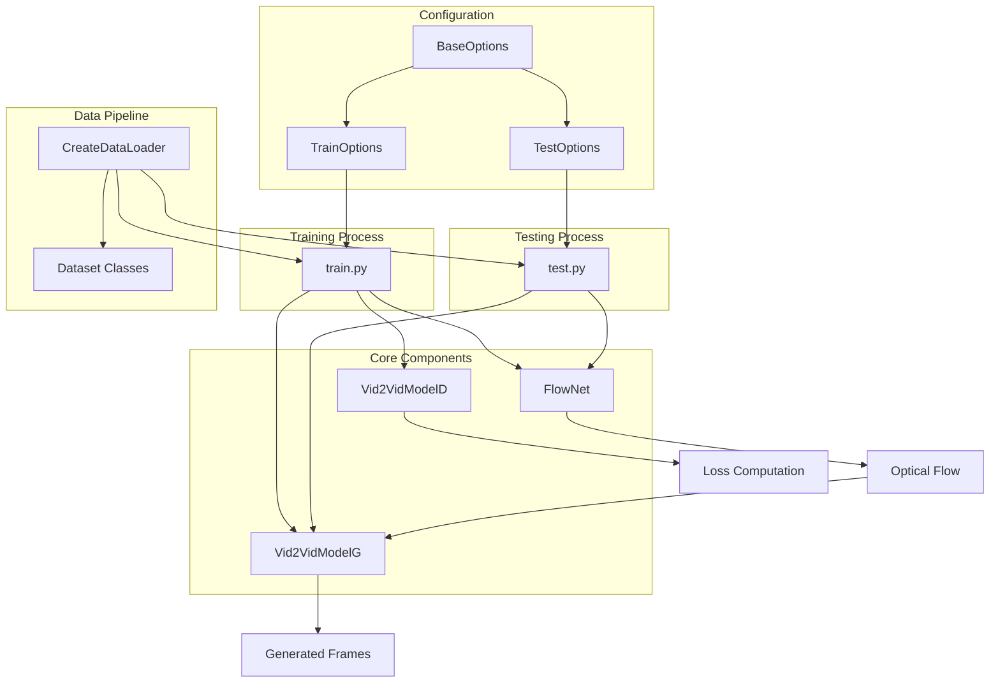

Sources: [train.py:14-128](), [models/models.py:61-84]()

## Component Architecture and Relationships

All models in the vid2vid system inherit from a common `BaseModel` class that provides shared functionality:

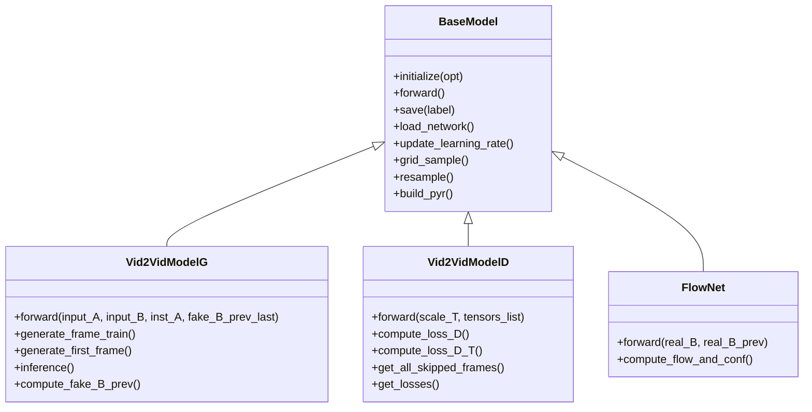

Sources: [models/base_model.py:6-196](), [models/models.py:61-84]()

### Component Responsibilities

1. **Generator (Vid2VidModelG)**:
   - Transforms input from the source domain to the target domain
   - Handles temporal consistency via flow-based warping
   - Works across multiple spatial scales
   - Can generate the first frame or use a separate pre-trained model

2. **Discriminator (Vid2VidModelD)**:
   - Contains both spatial and temporal discriminators
   - Evaluates frame quality individually and as sequences
   - Operates at multiple spatial and temporal scales
   - Computes various losses (adversarial, feature matching, etc.)

3. **FlowNet**:
   - Estimates optical flow between consecutive frames
   - Produces confidence maps for the flow estimates
   - Provides reference flow to guide the generator

4. **Data Loader System**:
   - Handles different types of datasets (face, pose, cityscapes)
   - Prepares data batches for the models
   - Manages sequence length and temporal sampling

5. **Options System**:
   - Configures all aspects through command-line arguments
   - Provides default values and validates parameters
   - Organizes related parameters in hierarchical classes

## Training Data Flow

The training process involves a complex flow of data between multiple models. Here's how data flows through the system during training:

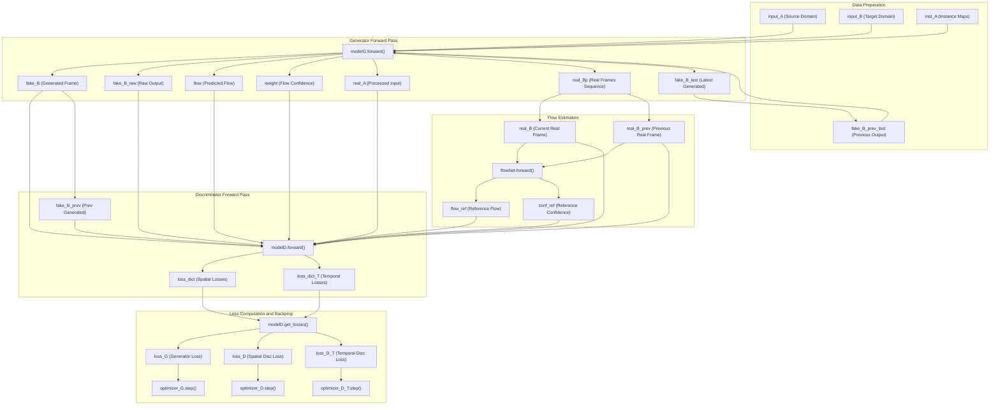

Sources: [train.py:49-94]()

## Multi-Scale Processing Architecture

A key feature of vid2vid is its multi-scale approach in both spatial and temporal dimensions:

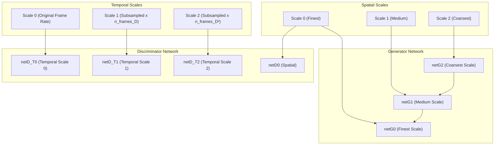

Sources: [models/base_model.py:122-134](), [README.md:175-181]()

This multi-scale approach allows the system to:
- Handle different levels of spatial detail (from coarse structure to fine details)
- Capture temporal dynamics at different time scales
- Train efficiently through a coarse-to-fine strategy

## Multi-GPU Architecture

The vid2vid system has a sophisticated multi-GPU processing architecture to handle the computational demands of video generation:

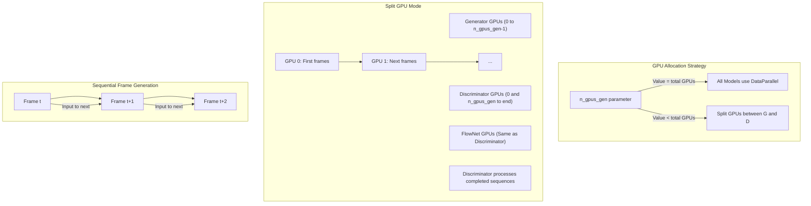

Sources: [models/models.py:10-60](), [README.md:175-187]()

The system offers two main modes of GPU utilization:

1. **Split GPU Mode**: Separate GPUs for generator and discriminator
   - First `n_gpus_gen` GPUs dedicated to the generator
   - Remaining GPUs used for discriminator and FlowNet
   - Sequential generation of frames across generator GPUs

2. **DataParallel Mode**: All models use standard PyTorch DataParallel
   - Used when `n_gpus_gen` equals the total number of GPUs
   - Both generator and discriminator distributed across all GPUs

## Training Process Architecture

The training process follows a sophisticated schedule to gradually increase complexity:

```mermaid
graph TD
    subgraph "Training Schedule"
        E1["Initial epochs"]
        E2["Middle epochs"]
        E3["Final epochs"]
        
        E1 --> |"Increase sequence length"| E2
        E2 --> |"Finetune all scales"| E3
        E3 --> |"Learning rate decay"| EF["Training complete"]
    end
    
    subgraph "Sequence Length Growth"
        SL["n_frames_total parameter"]
        NS["niter_step parameter"]
        
        NS --> |"Every niter_step epochs"| DB["Double sequence length"]
        DB --> SL
    end
    
    subgraph "Scale Training Strategy"
        FS["niter_fix_global parameter"]
        FS --> |"After niter_fix_global epochs"| AS["Train all scales together"]
    end
    
    subgraph "Learning Rate Schedule"
        NI["niter parameter"]
        ND["niter_decay parameter"]
        
        NI --> |"After niter epochs"| LRD["Linear learning rate decay"]
        ND --> |"For niter_decay epochs"| LRD
    end
```

Sources: [train.py:37-128](), [models/models.py:151-164](), [README.md:175-187]()

The training process incorporates several strategies:

1. **Gradual Sequence Length Increase**:
   - Starts with short sequences and gradually increases length
   - Controlled by `niter_step` parameter

2. **Coarse-to-Fine Training**:
   - Initially trains only the finest spatial scale
   - After `niter_fix_global` epochs, trains all scales together

3. **Learning Rate Schedule**:
   - Maintains constant learning rate for `niter` epochs
   - Linearly decays learning rate for `niter_decay` epochs

## Configuration System Architecture

The vid2vid configuration system has a hierarchical structure:

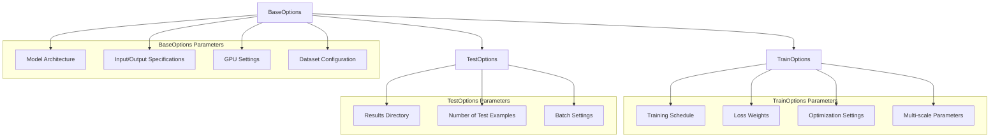

Sources: [train.py:15](), [README.md:175-192]()

The configuration system provides:
- Separation between common, training-specific, and testing-specific parameters
- Command-line argument parsing
- Default values for all parameters
- Parameter validation and interdependency enforcement

## Summary

The vid2vid system architecture is designed for efficient and high-quality video-to-video translation through:

1. **Multi-Model Approach**: Specialized generator, discriminator, and flow estimation networks
2. **Temporal Consistency**: Flow-based warping and temporal discriminators
3. **Multi-Scale Processing**: Both spatial and temporal scales for comprehensive quality
4. **Efficient GPU Utilization**: Sophisticated strategies for multi-GPU processing
5. **Progressive Training**: Gradual complexity increase for stable and efficient training
6. **Flexible Configuration**: Comprehensive parameter system for experimentation

This architecture enables the system to generate high-resolution, temporally coherent videos across a variety of domains including city scenes, human faces, and human poses.

Sources: [README.md:8-13](), [train.py:14-147](), [models/models.py:61-164](), [models/base_model.py:6-196]()

---

# Page: Generator Architecture

# Generator Architecture

<details>
<summary>Relevant source files</summary>

The following files were used as context for generating this wiki page:

- [.gitignore](.gitignore)
- [models/networks.py](models/networks.py)
- [models/vid2vid_model_G.py](models/vid2vid_model_G.py)
- [util/util.py](util/util.py)

</details>


## Purpose and Scope

This document details the Generator architecture in the vid2vid system, which is responsible for transforming source video frames (e.g., segmentation maps, edge maps, or pose keypoints) into photorealistic output video frames. The Generator is designed to maintain temporal consistency across frames while generating high-quality outputs at multiple resolutions. For information about the Discriminator architecture that evaluates these generated frames, see [Discriminator Architecture](#2.2).

## Architecture Overview

The vid2vid Generator employs a coarse-to-fine, multi-scale architecture with specialized components for handling optical flow to ensure temporal consistency between consecutive frames. The system can function in both training and inference modes, with special handling for the first frame in a sequence.

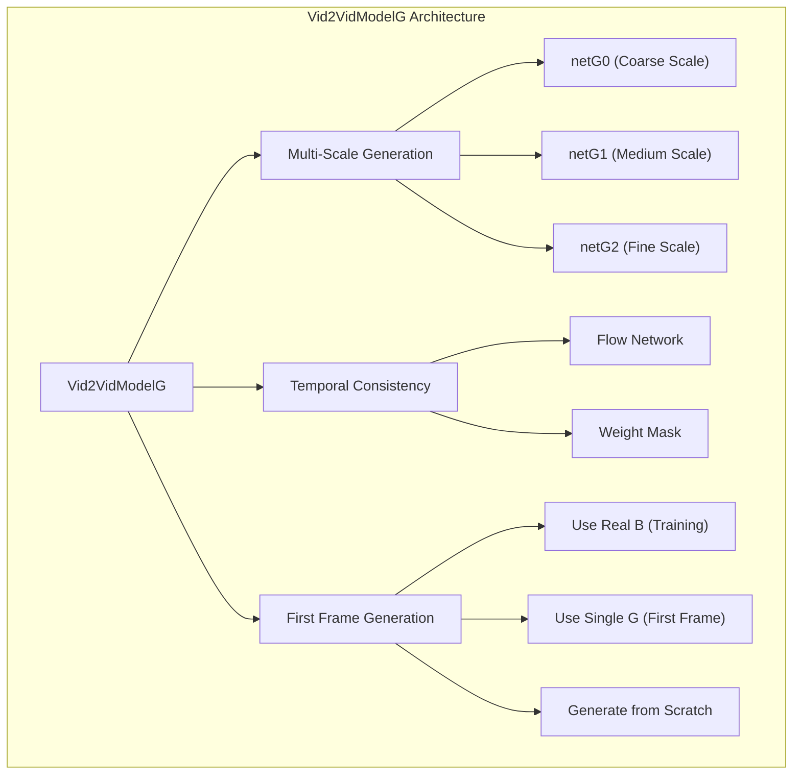

Sources: [models/vid2vid_model_G.py:15-337](models/vid2vid_model_G.py:15-337), [models/networks.py:32-59](models/networks.py:32-59)

## Generator Components Hierarchy

The Generator consists of several specialized network components that work together to produce temporally consistent video outputs:

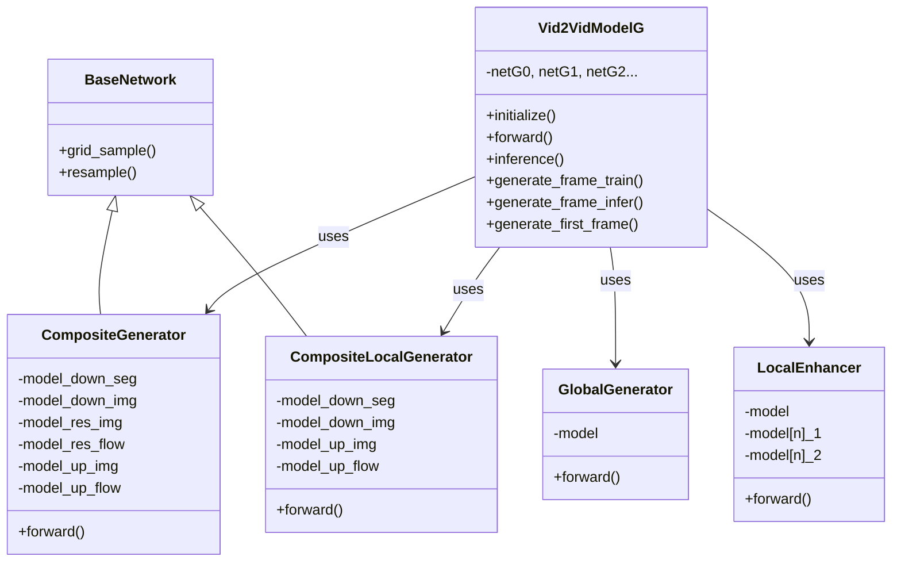

Sources: [models/vid2vid_model_G.py:15-37](models/vid2vid_model_G.py:15-37), [models/networks.py:98-132](models/networks.py:98-132), [models/networks.py:117-233](models/networks.py:117-233), [models/networks.py:234-326](models/networks.py:234-326), [models/networks.py:327-359](models/networks.py:327-359), [models/networks.py:361-419](models/networks.py:361-419)

## Multi-Scale Generation

The vid2vid Generator employs a multi-scale approach to generate high-quality outputs at different resolutions. This coarse-to-fine structure helps maintain both global structure and fine details.

### Network Structure

The Generator instantiates multiple networks for different scales:
- **netG0**: Coarse-scale generator that captures global structure
- **netG1 to netGn**: Finer-scale generators that add details, using outputs from the coarser scale

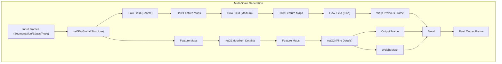

Sources: [models/vid2vid_model_G.py:37-43](models/vid2vid_model_G.py:37-43), [models/vid2vid_model_G.py:147-195](models/vid2vid_model_G.py:147-195)

### Coarse-to-Fine Approach

During both training and inference, the system follows a coarse-to-fine strategy:

1. Generate features and flow at the coarsest scale.
2. Pass these features to the next finer scale.
3. Generate refined features and flow at each subsequent scale.
4. Continue until reaching the finest scale.
5. Generate the final output frame using features and flow from all scales.

The multi-scale approach is defined by the `n_scales_spatial` parameter and implemented in the `generate_frame_train` and `generate_frame_infer` methods of `Vid2VidModelG`.

Sources: [models/vid2vid_model_G.py:139-196](models/vid2vid_model_G.py:139-196), [models/vid2vid_model_G.py:211-229](models/vid2vid_model_G.py:211-229)

## Composite Generator Architecture

The core of the Generator is the `CompositeGenerator` and `CompositeLocalGenerator` classes, which handle both image generation and optical flow estimation:

### CompositeGenerator Components

| Component | Purpose | Key Operations |
|-----------|---------|----------------|
| model_down_seg | Encodes input segmentation/edge maps | Downsampling, feature extraction |
| model_down_img | Encodes previous frame | Downsampling, feature extraction |
| model_res_img | Processes image features | Multiple ResNet blocks |
| model_res_flow | Processes flow features | Multiple ResNet blocks |
| model_up_img | Decodes image features | Upsampling, feature refinement |
| model_up_flow | Decodes flow features | Upsampling, feature refinement |
| model_final_img | Generates raw output image | Final convolution, Tanh activation |
| model_final_flow | Generates optical flow field | Final convolution |
| model_final_w | Generates blending weight mask | Final convolution, Sigmoid activation |

The CompositeGenerator creates both a direct image output and a warped output based on optical flow:
- **Raw output**: Direct generation from input features
- **Flow-based output**: Previous frame warped according to estimated flow
- **Final output**: Weighted combination of raw and flow-based outputs

Sources: [models/networks.py:117-233](models/networks.py:117-233)

### CompositeLocalGenerator

The `CompositeLocalGenerator` is a lighter version designed for finer scales, using features from the coarser scale:

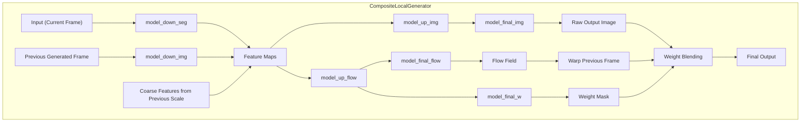

Sources: [models/networks.py:234-326](models/networks.py:234-326)

## Temporal Consistency Mechanism

A key feature of the vid2vid Generator is maintaining temporal consistency between consecutive frames. This is achieved through optical flow estimation and warping.

### Flow-Based Frame Generation

For each new frame:

1. Direct generation of a raw frame from input features
2. Estimation of optical flow between previous and current frame
3. Warping of previous frame using estimated flow
4. Generation of a blending mask
5. Final output is a weighted combination of raw generation and warped previous frame

The blending weight determines how much to trust direct generation versus warped previous frame. This mechanism helps maintain temporal consistency while adapting to new content.

Sources: [models/networks.py:203-232](models/networks.py:203-232), [models/networks.py:297-325](models/networks.py:297-325), [models/vid2vid_model_G.py:176-194](models/vid2vid_model_G.py:176-194)

### Resample Function

The `resample` function is a critical component for the flow-based warping, which uses the grid_sample operation to warp frames according to estimated flow:

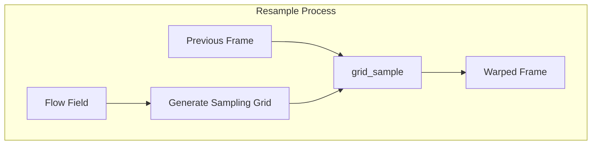

Sources: [models/networks.py:108-115](models/networks.py:108-115)

## First Frame Generation

The first frame in a sequence requires special handling since there's no previous frame to use for flow-based generation. The system provides several options:

### First Frame Options

| Method | Description | When Used |
|--------|-------------|-----------|
| Use Real Image | Use ground truth frame | Training mode or when real image is available |
| Single G Generator | Use a specialized single-image generator | Testing mode with no previous frame |
| Generate from Scratch | Generate without using flow-based components | When no_first_img option is set |

The first frame generation process is managed by the `generate_first_frame` method in `Vid2VidModelG`.

Sources: [models/vid2vid_model_G.py:231-251](models/vid2vid_model_G.py:231-251), [models/vid2vid_model_G.py:261-289](models/vid2vid_model_G.py:261-289)

## Training vs. Inference Mode

The Generator operates differently during training and inference:

### Training Mode

- Processes multiple frames in a sequence simultaneously
- Uses parallel processing across multiple GPUs for efficiency
- Backpropagates loss through a limited number of frames
- Updates coarse or all scales based on training phase

Sources: [models/vid2vid_model_G.py:56-83](models/vid2vid_model_G.py:56-83), [models/vid2vid_model_G.py:114-137](models/vid2vid_model_G.py:114-137)

### Inference Mode

- Processes one frame at a time
- Maintains state between frames (previous generated frames)
- Uses features from previous scales for efficiency
- Handles first frame generation specially

Sources: [models/vid2vid_model_G.py:198-209](models/vid2vid_model_G.py:198-209), [models/vid2vid_model_G.py:211-229](models/vid2vid_model_G.py:211-229)

## Generator Network Selection

The system supports different types of generator architectures selected through the `netG` parameter:

| Generator Type | Description | Use Case |
|----------------|-------------|----------|
| 'global' | Global generator with downsampling-upsampling architecture | Base-level generation |
| 'local' | Local enhancer with multi-resolution generation | Enhanced detail generation |
| 'composite' | Specialized generator with flow estimation | Video generation with temporal consistency |
| 'compositeLocal' | Local version of composite generator | Fine detail refinement with temporal consistency |
| 'global_with_features' | Global generator with additional feature inputs | Face generation with feature guidance |
| 'local_with_features' | Local generator with additional feature inputs | Detailed face generation with feature guidance |

Sources: [models/networks.py:32-59](models/networks.py:32-59)

## ResNet Blocks

All generator variants use ResNet blocks as their core building blocks. These maintain the same channel dimensions and use skip connections to facilitate gradient flow:

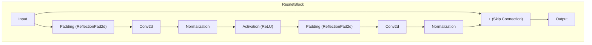

Sources: [models/networks.py:553-593](models/networks.py:553-593)

## Integration with Overall Vid2Vid System

The Generator works in conjunction with other components of the vid2vid system:

1. Receives inputs from the data pipeline (segmentation maps, edge maps, or pose data)
2. Generates fake frames that are evaluated by the Discriminator
3. Uses FlowNet for reference optical flow (for training)
4. Outputs final generated video frames

Throughout the generation process, the model balances photorealism (raw generation) with temporal consistency (flow-based warping) to produce visually pleasing and coherent video outputs.

Sources: [models/vid2vid_model_G.py:114-137](models/vid2vid_model_G.py:114-137)

---

# Page: Discriminator Architecture

# Discriminator Architecture

<details>
<summary>Relevant source files</summary>

The following files were used as context for generating this wiki page:

- [models/networks.py](models/networks.py)
- [models/vid2vid_model_D.py](models/vid2vid_model_D.py)

</details>


This document describes the discriminator component of the vid2vid (video-to-video translation) framework. The discriminator evaluates the realism of generated video frames, providing feedback that helps the generator produce more convincing outputs. For information about the generator architecture, see [Generator Architecture](#2.1).

## 1. Overview

The vid2vid discriminator consists of multiple specialized sub-networks that evaluate both spatial and temporal aspects of generated video frames. This multi-faceted approach ensures that generated videos maintain both per-frame visual quality and temporal consistency across frames.

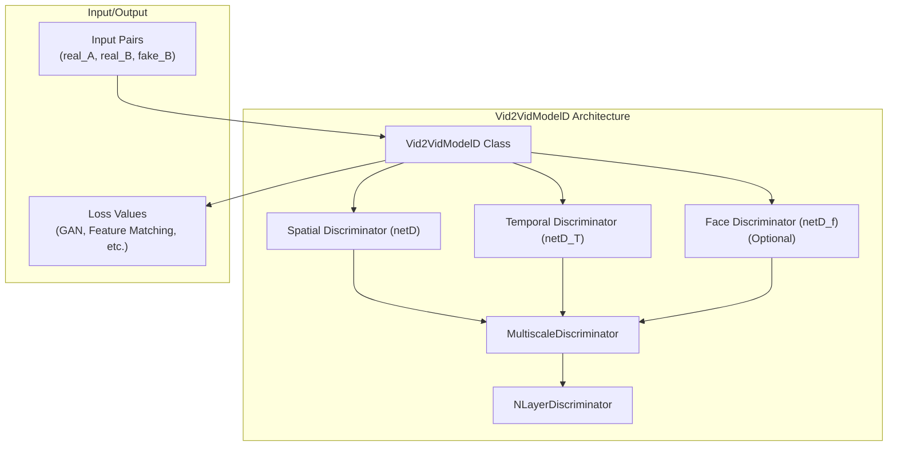

Sources: [models/vid2vid_model_D.py:13-272]()

## 2. Main Discriminator Components

The vid2vid discriminator system is implemented in the `Vid2VidModelD` class which inherits from `BaseModel`. It orchestrates multiple specialized discriminator networks:

### 2.1 Spatial Discriminator (netD)

The spatial discriminator evaluates the quality of individual frames. It takes pairs of input conditions (e.g., semantic maps) and output frames (real or generated) to determine if the output frames look realistic.

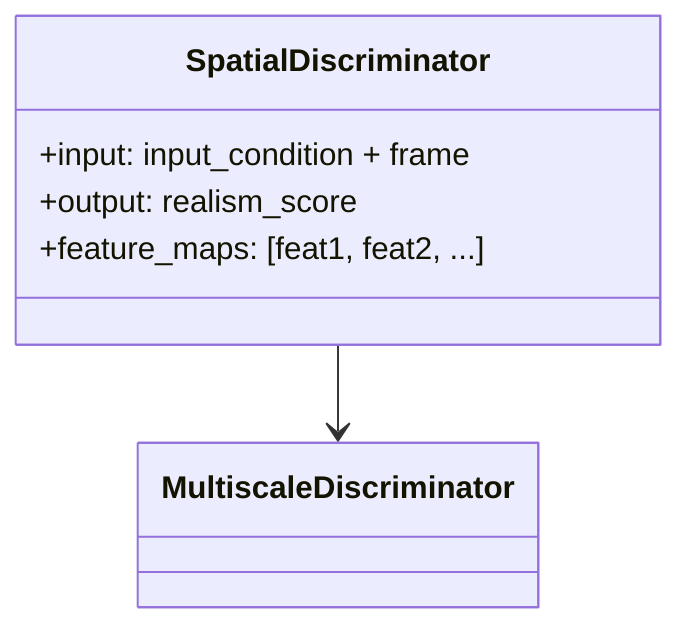

Sources: [models/vid2vid_model_D.py:29-36]()

### 2.2 Temporal Discriminator (netD_T)

The temporal discriminator assesses the temporal coherence between consecutive frames. It takes sequences of frames (and optionally optical flow) to ensure smooth and realistic transitions in the generated video.

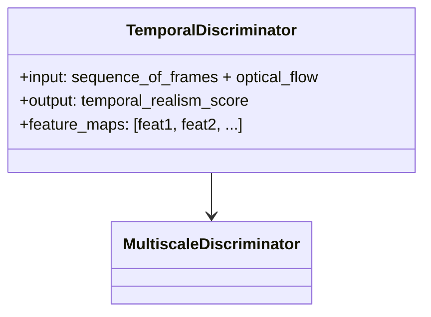

Sources: [models/vid2vid_model_D.py:42-46]()

### 2.3 Face Discriminator (netD_f) - Optional

When enabled, this specialized discriminator focuses exclusively on the face regions of generated frames, improving the quality of facial details in human subjects.

```mermaid
classDiagram
    class FaceDiscriminator {
        +input: face_region_of_frames
        +output: face_realism_score
        +feature_maps: [feat1, feat2, ...]
    }
    
    FaceDiscriminator --> MultiscaleDiscriminator
```

Sources: [models/vid2vid_model_D.py:38-40]()

## 3. Discriminator Network Implementation

### 3.1 MultiscaleDiscriminator

The `MultiscaleDiscriminator` class handles evaluation at multiple scales, allowing the system to assess both fine details and overall structure of the generated frames.

```mermaid
classDiagram
    class MultiscaleDiscriminator {
        +num_D: int
        +n_layers: int
        +getIntermFeat: bool
        +downsample()
        +forward()
    }
    
    MultiscaleDiscriminator --> "1..n" NLayerDiscriminator
```

Key characteristics:
- Contains multiple `NLayerDiscriminator` instances, each operating at a different resolution
- Each sub-discriminator evaluates a progressively downsampled version of the input
- Returns per-scale discrimination results and optional intermediate features

Sources: [models/networks.py:634-675]()

### 3.2 NLayerDiscriminator

The `NLayerDiscriminator` is the fundamental PatchGAN discriminator network used within the `MultiscaleDiscriminator`.

```mermaid
flowchart TD
    Input["Input (condition + image)"] --> Conv1["Conv2d + LeakyReLU"]
    Conv1 --> Conv2["Conv2d + Norm + LeakyReLU"]
    Conv2 --> Conv3["..."]
    Conv3 --> Conv4["Conv2d + Norm + LeakyReLU"]
    Conv4 --> Output["Final Conv (patch-level scores)"]
```

Key characteristics:
- PatchGAN architecture that evaluates realism of image patches rather than the entire image
- Series of convolutional layers with stride=2 for downsampling
- Produces a grid of real/fake predictions for different image patches
- Optional intermediate feature outputs for feature matching loss

Sources: [models/networks.py:679-725]()

## 4. Forward Pass and Loss Computation

### 4.1 Spatial Discriminator Forward Pass

The spatial discriminator processes input condition and output frame pairs:

```mermaid
flowchart LR
    RealA["Real Condition (real_A)"] --> Concat["Concatenate"]
    RealB["Real Frame (real_B)"] --> Concat
    Concat --> NetD["netD Forward Pass"]
    NetD --> PredReal["Prediction (real)"]
    
    RealA --> Concat2["Concatenate"]
    FakeB["Generated Frame (fake_B)"] --> Concat2
    Concat2 --> NetD2["netD Forward Pass"]
    NetD2 --> PredFake["Prediction (fake)"]
    
    PredReal --> Loss["Loss Computation"]
    PredFake --> Loss
```

Sources: [models/vid2vid_model_D.py:168-177]()

### 4.2 Temporal Discriminator Forward Pass

The temporal discriminator evaluates sequences of frames to ensure temporal consistency:

```mermaid
flowchart LR
    RealSeq["Real Frame Sequence"] --> OptFlow["Concat with Flow"]
    OptFlow --> NetDT["netD_T Forward Pass"]
    NetDT --> PredRealT["Prediction (real)"]
    
    FakeSeq["Generated Frame Sequence"] --> OptFlow2["Concat with Flow"]
    OptFlow2 --> NetDT2["netD_T Forward Pass"]
    NetDT2 --> PredFakeT["Prediction (fake)"]
    
    PredRealT --> LossT["Temporal Loss Computation"]
    PredFakeT --> LossT
```

Sources: [models/vid2vid_model_D.py:181-197]()

### 4.3 Loss Functions

The discriminator utilizes several loss functions:

| Loss Type | Purpose |
|-----------|---------|
| GAN Loss | Standard adversarial loss for discriminator training |
| Feature Matching Loss | Encourages generator to match statistics of real images |
| VGG Loss | Perceptual loss based on VGG network features |
| Flow Loss | Ensures optical flow consistency between frames |
| Warp Loss | Penalizes inconsistencies when warping previous frames |

Sources: [models/vid2vid_model_D.py:60-74](), [models/networks.py:730-812]()

## 5. Optimization and Training

The vid2vid discriminator uses separate optimizers for spatial and temporal components:

```mermaid
flowchart TD
    D["Vid2VidModelD"] --> SDLoss["Spatial Discriminator Loss"]
    D --> TDLoss["Temporal Discriminator Loss"]
    
    SDLoss --> SDOpt["optimizer_D\n(Adam)"]
    TDLoss --> TDOpt["optimizer_D_T\n(Adam)"]
    
    SDOpt --> Update["Update Discriminator Weights"]
    TDOpt --> Update
```

Key optimization parameters:
- Adam optimizer with configurable learning rate and beta parameters
- Optional Two Time-scale Update Rule (TTUR) for stable GAN training
- Multiple scales for both spatial and temporal discrimination

Sources: [models/vid2vid_model_D.py:76-91]()

## 6. Face Region Processing

For models that require high-quality face generation, the system includes specialized face detection and processing:

```mermaid
flowchart TD
    Input["Input Image"] --> FaceDetect["Detect Face Region"]
    FaceDetect --> Extract["Extract Face Coordinates"]
    Extract --> Crop["Crop Face Region"]
    Crop --> FaceD["Face Discriminator (netD_f)"]
    FaceD --> FaceLoss["Face Region Loss"]
```

The face region is detected either through:
- Face keypoints (for face datasets)
- OpenPose landmarks (for human pose datasets)

Sources: [models/vid2vid_model_D.py:215-230]()

## 7. Temporal Frame Skipping

For efficient processing of long video sequences, the vid2vid discriminator implements a frame skipping mechanism that evaluates frames at different temporal scales.

```mermaid
flowchart LR
    Frames["Video Frames"] --> Skip["Frame Skipping\n(temporal subsampling)"]
    Skip --> Process["Process at Different Temporal Scales"]
    Process --> TD1["Temporal Discrim. Scale 1"]
    Process --> TD2["Temporal Discrim. Scale 2"]
    Process --> TDn["Temporal Discrim. Scale n"]
```

This allows the discriminator to evaluate both short-term consistency between adjacent frames and long-term consistency across multiple frames.

Sources: [models/vid2vid_model_D.py:232-247](), [models/vid2vid_model_D.py:274-328]()

## Summary

The vid2vid discriminator architecture employs multiple specialized networks to evaluate both spatial and temporal aspects of generated videos. This comprehensive approach enables the generation of visually realistic and temporally coherent video outputs from various input conditions like semantic maps, edge maps, or pose keypoints.

---

# Page: Optical Flow Estimation (FlowNet)

# Optical Flow Estimation (FlowNet)

<details>
<summary>Relevant source files</summary>

The following files were used as context for generating this wiki page:

- [models/flownet.py](models/flownet.py)
- [models/flownet2_pytorch/README.md](models/flownet2_pytorch/README.md)
- [models/flownet2_pytorch/convert.py](models/flownet2_pytorch/convert.py)
- [scripts/download_flownet2.py](scripts/download_flownet2.py)

</details>


## Purpose and Scope

This document details the Optical Flow Estimation component (FlowNet) within the vid2vid system. The FlowNet module plays a critical role in maintaining temporal consistency between generated video frames by computing pixel-level motion. It estimates the optical flow between consecutive frames, which the Generator component uses to create temporally coherent video outputs. For information about how the Generator uses this flow information, see [Generator Architecture](#2.1).

## Overview

Optical flow estimation is a fundamental computer vision task that calculates the pixel displacement between consecutive frames. In the vid2vid framework, accurate optical flow is essential for generating videos with realistic motion. The system implements this functionality through a pre-trained FlowNet2 model, which represents the state-of-the-art in optical flow estimation.

```mermaid
graph TD
    subgraph "FlowNet Component Functionality"
        A["Input Frame A"] --> C["FlowNet Model"]
        B["Input Frame B"] --> C
        C --> D["Optical Flow Field"]
        C --> E["Confidence Map"]
        
        D --> F["Temporal Consistency<br/>in Generator"]
        E --> F
    end
```

Sources: [models/flownet.py:25-41](). [models/flownet.py:43-59]()

## Implementation Details

The FlowNet component is implemented as a Python class that inherits from `BaseModel`. It wraps the pre-trained FlowNet2 model and provides interfaces for computing optical flow and confidence maps.

### Class Structure

```mermaid
classDiagram
    BaseModel <|-- FlowNet
    
    class BaseModel {
        +initialize(opt)
        +forward()
    }
    
    class FlowNet {
        -flowNet: FlowNet2
        -resample: Resample2d
        -downsample: AvgPool2d
        +initialize(opt)
        +forward(input_A, input_B, dummy_bs)
        +compute_flow_and_conf(im1, im2)
        -norm(t)
    }
```

Sources: [models/flownet.py:6-9](). [models/flownet.py:10-23]()

### Initialization Process

During initialization, the FlowNet component:

1. Loads the pre-trained FlowNet2 model from a checkpoint
2. Sets up the `Resample2d` module for image warping
3. Creates a downsampling layer for preprocessing

```python
self.flowNet = flownet2_tools.module_to_dict(flownet2_models)['FlowNet2'](fp16=opt.fp16).cuda(self.gpu_ids[0])        
checkpoint = torch.load('models/flownet2_pytorch/FlowNet2_checkpoint.pth.tar')
self.flowNet.load_state_dict(checkpoint['state_dict'])
self.flowNet.eval() 
self.resample = Resample2d()
self.downsample = torch.nn.AvgPool2d(3, stride=2, padding=[1, 1], count_include_pad=False)
```

Sources: [models/flownet.py:10-23]()

### Forward Pass and Flow Computation

The forward pass of the FlowNet component handles both individual frame pairs and batches of sequences:

1. For a batch of sequences (5D tensor), it reshapes the input to a batch of frame pairs
2. Calls `compute_flow_and_conf` to calculate optical flow and confidence maps
3. Reshapes the output back to match the input dimensions

The `compute_flow_and_conf` method:

1. Ensures input dimensions are multiples of 64 (required by FlowNet2)
2. Computes optical flow using the FlowNet2 model
3. Generates a confidence map by comparing the first frame with the warped second frame
4. Upsamples results to the original resolution if needed

```mermaid
flowchart TD
    subgraph "FlowNet Computation Process"
        A["Input Images<br/>im1, im2"] --> B["Resize to<br/>Multiple of 64"]
        B --> C["FlowNet2 Forward Pass"]
        C --> D["Compute Flow Field"]
        B --> E["Warp im2 Using Flow"]
        E --> F["Compare with im1"]
        F --> G["Generate<br/>Confidence Map"]
        D --> H["Resize to<br/>Original Dimensions"]
        G --> I["Resize to<br/>Original Dimensions"]
        H --> J["Final Flow Field"]
        I --> K["Final Confidence Map"]
    end
```

Sources: [models/flownet.py:25-41](). [models/flownet.py:43-59]()

## Integration with Vid2Vid Architecture

The FlowNet component connects with the Generator in the vid2vid pipeline, providing essential motion information to create temporally consistent video outputs.

```mermaid
graph TD
    subgraph "Vid2Vid System Integration"
        A["Vid2VidModelG<br/>(Generator)"] --> B["Request Flow Estimation"]
        B --> C["FlowNet Component"]
        C --> D["Compute Flow Between<br/>Previous and Current Frames"]
        D --> E["Return Flow Field<br/>and Confidence Map"]
        E --> F["Generator Uses Flow<br/>to Warp Previous Output"]
        F --> G["Temporally Consistent<br/>Output Frame"]
    end
```

Sources: [models/flownet.py:25-41]()

## Technical Implementation of Flow Computation

The core flow computation is performed in the `compute_flow_and_conf` method:

```python
def compute_flow_and_conf(self, im1, im2):
    assert(im1.size()[1] == 3)
    assert(im1.size() == im2.size())        
    old_h, old_w = im1.size()[2], im1.size()[3]
    new_h, new_w = old_h//64*64, old_w//64*64
    if old_h != new_h:
        downsample = torch.nn.Upsample(size=(new_h, new_w), mode='bilinear')
        upsample = torch.nn.Upsample(size=(old_h, old_w), mode='bilinear')
        im1 = downsample(im1)
        im2 = downsample(im2)        
    data1 = torch.cat([im1.unsqueeze(2), im2.unsqueeze(2)], dim=2)            
    flow1 = self.flowNet(data1)
    conf = (self.norm(im1 - self.resample(im2, flow1)) < 0.02).float()
    if old_h != new_h:
        flow1 = upsample(flow1) * old_h / new_h
        conf = upsample(conf)
    return flow1.detach(), conf.detach()
```

The confidence map is generated by:
1. Warping the second image (`im2`) using the computed flow
2. Comparing it with the first image (`im1`) using L2 norm
3. Thresholding the difference to create a binary mask (values < 0.02 are considered reliable)

Sources: [models/flownet.py:43-59]()

## FlowNet2 Model Details

Vid2vid utilizes the FlowNet2 architecture, which is a state-of-the-art model for optical flow estimation. FlowNet2 consists of multiple sub-networks:

| Sub-Network | Purpose |
|-------------|---------|
| FlowNet2C   | Basic flow estimation optimized for small displacements |
| FlowNet2S   | Basic flow estimation with simple architecture |
| FlowNet2SD  | Handles large displacements |
| FlowNet2CSS | Cascade of multiple networks for refined flow |
| FlowNet2    | Full model combining all sub-networks |

The vid2vid system uses the complete FlowNet2 model for maximum accuracy.

```mermaid
graph TD
    subgraph "FlowNet2 Architecture Used in Vid2Vid"
        A["Input Frames"] --> B["FlowNet2C"]
        A --> C["FlowNet2S_1"]
        A --> D["FlowNet2S_2"]
        A --> E["FlowNet2SD"]
        
        B --> F["FlowNet2 Fusion"]
        C --> F
        D --> F
        E --> F
        
        F --> G["Final Flow Field"]
    end
```

Sources: [models/flownet2_pytorch/README.md:13-22](). [models/flownet2_pytorch/convert.py:57-69]()

## Downloading and Setup

The FlowNet2 model is not included directly in the repository but is downloaded as a pre-trained checkpoint. The `download_flownet2.py` script handles the installation of the FlowNet2 model:

```python
chpt_path = './models/'
if not os.path.isdir(chpt_path):
    os.makedirs(chpt_path)
os.system('cd %s/flownet2_pytorch/; bash install.sh; cd ../../' % chpt_path)
```

The script runs the installation shell script in the FlowNet2 directory, which sets up custom CUDA layers required by the model.

Sources: [scripts/download_flownet2.py:12-18]()

## Performance Considerations

The FlowNet component includes several optimizations for efficient inference:

1. **Resolution Management**: Input images are resized to dimensions that are multiples of 64 to optimize FlowNet2 performance, then upscaled back to the original resolution.

2. **GPU Acceleration**: The model is loaded directly onto the GPU specified in the options.

3. **No Gradient Computation**: The `forward` method is wrapped with `torch.no_grad()` to disable gradient computation during inference, reducing memory usage and improving speed.

4. **Tensor Detachment**: Flow fields and confidence maps are detached from the computation graph with `detach()` to prevent unnecessary memory retention.

Sources: [models/flownet.py:25-26](). [models/flownet.py:48-52](). [models/flownet.py:58-59]()

---

# Page: Data Pipeline

# Data Pipeline

<details>
<summary>Relevant source files</summary>

The following files were used as context for generating this wiki page:

- [data/base_dataset.py](data/base_dataset.py)
- [data/custom_dataset_data_loader.py](data/custom_dataset_data_loader.py)
- [data/image_folder.py](data/image_folder.py)
- [data/test_dataset.py](data/test_dataset.py)

</details>


## Overview

The data pipeline in the vid2vid system is responsible for loading, preprocessing, and delivering video frame sequences to both the training and inference components. This page documents the core data processing components, their interactions, and how they handle video data for different use cases (face animation, pose-to-body translation, etc.).

For information on specific dataset implementations, see:
- [Face Dataset](#3.1)
- [Pose Dataset](#3.2)
- [Temporal Dataset](#3.3)

## Data Pipeline Architecture

The vid2vid data pipeline follows a hierarchical structure with base classes providing common functionality and specialized implementations handling domain-specific processing.

```mermaid
classDiagram
    class "BaseDataset" {
        +initialize(opt)
        +update_training_batch(ratio)
        +init_frame_idx(A_paths)
        +update_frame_idx(A_paths, index)
        +init_data_params(data, n_gpus, tG)
        +init_data(t_scales)
        +prepare_data(data, i, input_nc, output_nc)
    }
    
    class "CustomDatasetDataLoader" {
        +initialize(opt)
        +load_data()
        -dataset
        -dataloader
    }
    
    class "FaceDataset" {
        +initialize(opt)
        +__getitem__(index)
    }
    
    class "PoseDataset" {
        +initialize(opt)
        +__getitem__(index)
    }
    
    class "TemporalDataset" {
        +initialize(opt)
        +__getitem__(index)
    }
    
    class "TestDataset" {
        +initialize(opt)
        +__getitem__(index)
        +get_image(A_path, transform, is_label)
    }
    
    BaseDataset <|-- FaceDataset
    BaseDataset <|-- PoseDataset
    BaseDataset <|-- TemporalDataset
    BaseDataset <|-- TestDataset
    CustomDatasetDataLoader o-- BaseDataset : creates
```

Sources: [data/base_dataset.py:9-72](), [data/custom_dataset_data_loader.py:5-44](), [data/test_dataset.py:10-77]()

## Dataset Creation Process

The dataset creation process starts with `CustomDatasetDataLoader`, which selects and instantiates the appropriate dataset class based on the specified mode.

```mermaid
flowchart TD
    A["CustomDatasetDataLoader.initialize(opt)"] --> B["CreateDataset(opt)"]
    B --> C{"opt.dataset_mode?"}
    C -->|"temporal"| D["TemporalDataset()"]
    C -->|"face"| E["FaceDataset()"]
    C -->|"pose"| F["PoseDataset()"]
    C -->|"test"| G["TestDataset()"]
    D --> H["dataset.initialize(opt)"]
    E --> H
    F --> H
    G --> H
    H --> I["torch.utils.data.DataLoader(dataset, ...)"]
    I --> J["dataloader"]
```

Sources: [data/custom_dataset_data_loader.py:5-44]()

## Data Directory Structure

The vid2vid system expects data to be organized in a specific directory structure. The image loading utilities scan these directories to create datasets of image sequences.

```mermaid
flowchart LR
    subgraph "dataroot Directory"
        A["train_A/"] --- B["train_B/"]
        A --- C["train_inst/ (optional)"]
        D["test_A/"] --- E["test_B/"]
        D --- F["test_inst/ (optional)"]
    end
    
    subgraph "Sequence Folders"
        A --> G["sequence1/"]
        A --> H["sequence2/"]
        G --> I["frame001.png"]
        G --> J["frame002.png"]
        G --> K["frame003.png..."]
    end
```

Each sequence folder contains ordered frames that represent a continuous video sequence. The `make_grouped_dataset` function in `image_folder.py` is responsible for loading these grouped sequences.

Sources: [data/image_folder.py:36-48](), [data/test_dataset.py:12-28]()

## Frame Management

Frame management is a critical aspect of the vid2vid data pipeline. The system needs to carefully track frame indices, sequence boundaries, and frame relationships to maintain temporal consistency.

### Frame Indexing and Sequence Management

```mermaid
flowchart TD
    A["BaseDataset.init_frame_idx(A_paths)"] --> B["Set sequence index (seq_idx = 0)"]
    B --> C["Set frame index (frame_idx = 0 or start_frame)"]
    C --> D["Count frames in each sequence"]
    D --> E["Calculate folder probabilities for sampling"]
    
    F["BaseDataset.update_frame_idx"] --> G{"Training mode?"}
    G -->|"Yes"| H{"Dataset mode = pose?"}
    H -->|"Yes"| I["Randomly select sequence based on folder_prob"]
    H -->|"No"| J["Set seq_idx = index % n_of_seqs"]
    G -->|"No"| K{"Change sequence?"}
    K -->|"Yes"| L["Increment seq_idx, reset frame_idx"]
    K -->|"No"| M["Continue with current seq_idx and frame_idx"]
```

Sources: [data/base_dataset.py:26-54]()

### Video Frame Sampling

For training, the system samples frames strategically to create diverse training examples while maintaining temporal relationships:

```mermaid
flowchart TD
    A["get_video_params(opt, n_frames_total, cur_seq_len, index)"] --> B{"Training mode?"}
    
    B -->|"Yes"| C["Calculate n_frames_per_load based on GPU count"]
    C --> D["Calculate n_loadings"]
    D --> E["Adjust n_frames_total"]
    E --> F["Calculate maximum time step (max_t_step)"]
    F --> G["Randomly select time step (t_step)"]
    G --> H["Calculate maximum possible start index"]
    H --> I["Determine start_idx"]
    
    B -->|"No"| J["Set n_frames_total = n_frames_G"]
    J --> K["Set start_idx = index"]
    K --> L["Set t_step = 1"]
    
    I --> M["Return n_frames_total, start_idx, t_step"]
    L --> M
```

Sources: [data/base_dataset.py:177-202]()

## Data Preprocessing and Transformation

The vid2vid system applies a series of preprocessing steps to prepare images for the models:

### Image Transformation Pipeline

```mermaid
flowchart TD
    A["get_transform(opt, params, ...)"] --> B["Create transform_list"]
    
    B --> C{"Resize option?"}
    C -->|"resize"| D["Add Scale transform"]
    C -->|"other"| E["Add Lambda transform for custom scaling"]
    
    D --> F{"Crop option?"}
    E --> F
    F -->|"Yes"| G["Add Lambda transform for cropping"]
    
    G --> H{"Training and flipping allowed?"}
    F -->|"No"| H
    H -->|"Yes"| I["Add Lambda transform for random flipping"]
    
    I --> J["Add ToTensor transform"]
    H -->|"No"| J
    
    J --> K{"Normalize?"}
    K -->|"Yes"| L["Add Normalize transform"]
    
    L --> M["Return Compose(transform_list)"]
    K -->|"No"| M
```

Sources: [data/base_dataset.py:130-158]()

### Image Parameters Selection

```mermaid
flowchart TD
    A["get_img_params(opt, size)"] --> B["Determine new_h, new_w based on resize_or_crop option"]
    B --> C["Round dimensions to multiple of 4"]
    
    C --> D{"Crop needed?"}
    D -->|"Yes"| E["Calculate crop dimensions and position"]
    D -->|"No"| F["Make dimensions power of 2"]
    
    E --> G["Determine if flip is needed"]
    F --> G
    
    G --> H["Return parameters dictionary"]
```

Sources: [data/base_dataset.py:85-128]()

## Data Loading Process for Training vs Testing

The data loading process differs significantly between training and testing:

### Training Data Flow

During training, the system loads multiple frames at once and manages frame sequences to ensure temporal consistency:

1. Dataset is initialized with training options
2. Frames are sampled according to the video parameters (n_frames_total, start_idx, t_step)
3. Images are loaded, transformed, and normalized
4. Data is batched and fed to the model

### Testing Data Flow

During testing/inference, the system processes frames sequentially:

```mermaid
flowchart TD
    A["TestDataset.__getitem__(index)"] --> B["update_frame_idx to get sequence index"]
    B --> C["Get parameters for image transformation"]
    C --> D{"Is first frame in sequence?"}
    
    D -->|"Yes"| E["Process all frames in tG window"]
    D -->|"No"| F["Process only the newest frame (tG-1)"]
    
    E --> G["Load and transform frame(s)"]
    F --> G
    
    G --> H{"Use real images?"}
    H -->|"Yes"| I["Load corresponding B frames"]
    H -->|"No"| J["Set B = 0"]
    
    I --> K{"Use instance maps?"}
    J --> K
    K -->|"Yes"| L["Load corresponding instance maps"]
    K -->|"No"| M["Set I = 0"]
    
    L --> N["Increment frame_idx"]
    M --> N
    
    N --> O["Return dictionary with A, B, I, path, change_seq"]
```

Sources: [data/test_dataset.py:30-61]()

## Data Types and Processing

Different types of data require specialized processing:

| Data Type | Source | Processing |
|-----------|--------|------------|
| RGB Images | Image files in dataset directories | Loaded, resized, normalized to [-1, 1] |
| Label Maps | Image files with segmentation labels | Loaded, resized, multiplied by 255 to maintain label indices |
| Instance Maps | Instance segmentation maps | Loaded, resized, multiplied by 255 to maintain instance IDs |
| Face Keypoints | Extracted from faces | Converted to edge maps, distance transforms |
| Pose Data | OpenPose or DensePose outputs | Combined into unified pose representations |

Sources: [data/base_dataset.py:130-158](), [data/test_dataset.py:63-68]()

## Temporal Consistency Handling

The vid2vid system emphasizes temporal consistency in video generation. The data pipeline supports this by:

1. **Providing frame sequences**: Loading consecutive frames with appropriate temporal spacing
2. **Managing sequence boundaries**: Handling transitions between different sequences
3. **Frame indexing**: Tracking frame positions within sequences
4. **Updating sequence length**: Dynamically adjusting training sequence length during training with `update_training_batch`

Sources: [data/base_dataset.py:19-24](), [data/base_dataset.py:40-54]()

## Data Batch Preparation

The data pipeline prepares data in a specific tensor format for the models:

```mermaid
flowchart TD
    A["prepare_data(data, i, input_nc, output_nc)"] --> B["Extract input_A from data['A']"]
    B --> C["Extract input_B from data['B']"]
    C --> D["Extract inst_A from data['inst'] if available"]
    D --> E["Return [input_A, input_B, inst_A]"]
```

Data is organized as 5D tensors with dimensions:
- Batch size
- Number of frames
- Number of channels
- Height
- Width

This structure allows the models to process temporal information effectively.

Sources: [data/base_dataset.py:74-80]()

## Summary

The vid2vid data pipeline provides a robust framework for loading and processing video data for video-to-video translation tasks. It handles various dataset types, manages frame sequences, applies appropriate transformations, and ensures temporal consistency. The modular design allows for specialized processing for different applications like face animation and pose-to-body translation while sharing common functionality through the base classes.

---

# Page: Face Dataset

# Face Dataset

<details>
<summary>Relevant source files</summary>

The following files were used as context for generating this wiki page:

- [data/face_dataset.py](data/face_dataset.py)
- [data/keypoint2img.py](data/keypoint2img.py)
- [imgs/face.gif](imgs/face.gif)
- [imgs/framePredict.gif](imgs/framePredict.gif)
- [imgs/pose.gif](imgs/pose.gif)

</details>


## Purpose and Overview

The Face Dataset is a specialized component in the vid2vid system that processes facial data for video-to-video translation tasks. It handles the loading, processing, and organization of facial keypoint data and corresponding images to enable applications such as realistic talking face generation from edge maps. This dataset module plays a crucial role in preparing facial structure representations for the generator model.

For information about other types of datasets in the system, see [Pose Dataset](#3.2) or [Temporal Dataset](#3.3).

Sources: [data/face_dataset.py:13-213]()

## Dataset Structure

The FaceDataset class inherits from BaseDataset and expects a specific directory structure organized as follows:

```
dataroot/
├── [phase]_keypoints/
│   ├── sequence1/
│   │   ├── frame1.txt
│   │   ├── frame2.txt
│   │   └── ...
│   └── sequence2/
│       └── ...
└── [phase]_img/
    ├── sequence1/
    │   ├── frame1.jpg
    │   ├── frame2.jpg
    │   └── ...
    └── sequence2/
        └── ...
```

Where:
- `[phase]` is typically "train" or "test"
- Keypoint files contain facial landmark coordinates
- Image files contain the corresponding face images

The initialization of these paths happens in the `initialize` method:

```python
def initialize(self, opt):
    self.opt = opt
    self.root = opt.dataroot                
    self.dir_A = os.path.join(opt.dataroot, opt.phase + '_keypoints')
    self.dir_B = os.path.join(opt.dataroot, opt.phase + '_img')
```

Sources: [data/face_dataset.py:14-18]()

## Facial Keypoint Structure

### Keypoint Organization

The Face Dataset organizes facial keypoints into specific parts, which are defined in the `read_keypoints` method:

| Facial Part      | Keypoint Indices   |
|------------------|-------------------|
| Face             | 0-16, 68-83       |
| Right Eyebrow    | 17-21             |
| Left Eyebrow     | 22-26             |
| Nose             | 28-35             |
| Right Eye        | 36-41             |
| Left Eye         | 42-47             |
| Mouth            | 48-59             |
| Tongue           | 60-67             |

These parts are organized in a nested list structure as follows:

```python
part_list = [[list(range(0, 17)) + list(range(68, 83)) + [0]], # face
             [range(17, 22)],                                  # right eyebrow
             [range(22, 27)],                                  # left eyebrow
             [[28, 31], range(31, 36), [35, 28]],              # nose
             [[36,37,38,39], [39,40,41,36]],                   # right eye
             [[42,43,44,45], [45,46,47,42]],                   # left eye
             [range(48, 55), [54,55,56,57,58,59,48]],          # mouth
             [range(60, 65), [64,65,66,67,60]]                 # tongue
            ]
```

Each part is assigned a label in the `label_list` to create a labeled mask for the facial regions.

### Facial Keypoint Processing Diagram

```mermaid
graph TD
    A["Keypoint File (.txt)"] --> B["Load Keypoints (read_keypoints)"]
    B --> C["Organize into Facial Parts (part_list)"]
    C --> D["Draw Edges (draw_face_edges)"]
    D --> E["Edge Map"]
    E --> |"Optional"| F["Distance Transform Maps"]
    E --> |"Optional"| G["Add Canny Edges (background)"]
    E --> H["Concatenate Maps"]
    F --> H
    G --> H
    H --> I["Input Tensor for Generator Model"]
```

Sources: [data/face_dataset.py:91-127](), [data/face_dataset.py:129-157]()

## Data Processing Pipeline

### Data Flow in Face Dataset

```mermaid
sequenceDiagram
    participant DL as "CustomDatasetDataLoader"
    participant FD as "FaceDataset"
    participant KP as "Keypoint Processor"
    participant EG as "Edge Generator"
    participant VM as "Vid2VidModelG"
    
    DL->>FD: Request data for index (__getitem__)
    FD->>FD: Update frame indices
    FD->>FD: Load image from B_paths
    FD->>KP: Load and process keypoints from A_paths
    KP->>KP: Organize keypoints into facial parts
    KP->>EG: Draw edges between keypoints
    EG->>EG: Create edge maps
    EG->>EG: Generate distance transform maps
    EG->>FD: Return processed maps
    FD->>FD: Crop to face region
    FD->>FD: Apply transformations
    FD->>DL: Return processed data (A, B, inst)
    DL->>VM: Feed data to model
```

When a dataloader requests an item from the FaceDataset, the following process occurs:

1. The FaceDataset retrieves data for the requested index through its `__getitem__` method
2. It loads the corresponding image and keypoint files
3. The keypoints are processed to create edge maps and optionally distance transform maps
4. The result is returned as a dictionary with keys 'A' (input), 'B' (target image), and 'inst' (instance maps)

Sources: [data/face_dataset.py:29-64]()

### Key Processing Methods

The Face Dataset processes facial data using several key methods:

#### get_face_image

This method creates edge maps and distance transform maps from facial keypoints:

```python
def get_face_image(self, A_path, transform_A, transform_L, size, img):
    # read face keypoints from path and crop face region
    keypoints, part_list, part_labels = self.read_keypoints(A_path, size)

    # draw edges and possibly add distance transform maps
    add_dist_map = not self.opt.no_dist_map
    im_edges, dist_tensor = self.draw_face_edges(keypoints, part_list, transform_A, size, add_dist_map)
    
    # canny edge for background
    if not self.opt.no_canny_edge:
        edges = feature.canny(np.array(img.convert('L')))        
        edges = edges * (part_labels == 0)  # remove edges within face
        im_edges += (edges * 255).astype(np.uint8)
    edge_tensor = transform_A(Image.fromarray(self.crop(im_edges)))

    # final input tensor
    input_tensor = torch.cat([edge_tensor, dist_tensor]) if add_dist_map else edge_tensor
    label_tensor = transform_L(Image.fromarray(self.crop(part_labels.astype(np.uint8)))) * 255.0
    return input_tensor, label_tensor
```

#### read_keypoints

This method reads keypoints from a file and organizes them into facial parts:

```python
def read_keypoints(self, A_path, size):        
    # mapping from keypoints to face part 
    part_list = [[list(range(0, 17)) + list(range(68, 83)) + [0]], # face
                 [range(17, 22)],                                  # right eyebrow
                 [range(22, 27)],                                  # left eyebrow
                 [[28, 31], range(31, 36), [35, 28]],              # nose
                 [[36,37,38,39], [39,40,41,36]],                   # right eye
                 [[42,43,44,45], [45,46,47,42]],                   # left eye
                 [range(48, 55), [54,55,56,57,58,59,48]],          # mouth
                 [range(60, 65), [64,65,66,67,60]]                 # tongue
                ]
    label_list = [1, 2, 2, 3, 4, 4, 5, 6] # labeling for different facial parts        
    keypoints = np.loadtxt(A_path, delimiter=',')
    
    # additional processing...
    return keypoints, part_list, part_labels
```

#### draw_face_edges

This method draws edges between keypoints to create a structural representation of the face:

```python
def draw_face_edges(self, keypoints, part_list, transform_A, size, add_dist_map):
    w, h = size
    edge_len = 3  # interpolate 3 keypoints to form a curve when drawing edges
    # edge map for face region from keypoints
    im_edges = np.zeros((h, w), np.uint8) # edge map for all edges
    dist_tensor = 0
    
    # drawing logic...
    return im_edges, dist_tensor
```

Sources: [data/face_dataset.py:71-89](), [data/face_dataset.py:91-127](), [data/face_dataset.py:129-157]()

## Face Region Management

### Crop Coordinates

The Face Dataset automatically determines the crop region around the face based on keypoints:

```python
def get_crop_coords(self, keypoints, size):                
    min_y, max_y = keypoints[:,1].min(), keypoints[:,1].max()
    min_x, max_x = keypoints[:,0].min(), keypoints[:,0].max()                
    xc = (min_x + max_x) // 2
    yc = (min_y*3 + max_y) // 4
    h = w = (max_x - min_x) * 2.5        
    xc = min(max(0, xc - w//2) + w, size[0]) - w//2
    yc = min(max(0, yc - h//2) + h, size[1]) - h//2
    min_x, max_x = xc - w//2, xc + w//2
    min_y, max_y = yc - h//2, yc + h//2        
    self.min_y, self.max_y, self.min_x, self.max_x = int(min_y), int(max_y), int(min_x), int(max_x)        
```

Once the crop coordinates are determined, the `crop` method is used to crop images and arrays to focus on the face region:

```python
def crop(self, img):
    if isinstance(img, np.ndarray):
        return img[self.min_y:self.max_y, self.min_x:self.max_x]
    else:
        return img.crop((self.min_x, self.min_y, self.max_x, self.max_y))
```

Sources: [data/face_dataset.py:159-169](), [data/face_dataset.py:171-175]()

## Data Augmentation

The Face Dataset includes methods for data augmentation, such as scaling keypoints:

```python
def scale_points(self, keypoints, part, index, sym=False):
    if sym:
        # Scale paired facial parts (e.g., eyes, eyebrows) symmetrically
        # ...
    else:            
        # Scale individual facial parts
        # ...
```

This method allows for scaling different parts of the face independently or symmetrically, enabling the generation of diverse facial expressions and variations.

Sources: [data/face_dataset.py:177-204]()

## Integration with Edge Generation

The FaceDataset relies on utility functions from `keypoint2img.py` for edge generation:

### interpPoints

This function interpolates keypoints to create smooth curves:

```python
def interpPoints(x, y):    
    if abs(x[:-1] - x[1:]).max() < abs(y[:-1] - y[1:]).max():
        curve_y, curve_x = interpPoints(y, x)
        if curve_y is None:
            return None, None
    else:        
        # Fit a polynomial or linear function to the points
        # ...
    return curve_x.astype(int), curve_y.astype(int)
```

### drawEdge

This function draws edges on an image using the interpolated points:

```python
def drawEdge(im, x, y, bw=1, color=(255,255,255), draw_end_points=False):
    if x is not None and x.size:
        h, w = im.shape[0], im.shape[1]
        # Draw the edge
        # ...
        # Optionally draw endpoints
        # ...
```

Sources: [data/keypoint2img.py:45-67](), [data/keypoint2img.py:26-43]()

## Position in the vid2vid System

```mermaid
graph TD
    A["BaseDataset"] --> B["FaceDataset"]
    A --> C["PoseDataset"]
    A --> D["TemporalDataset"]
    A --> E["TestDataset"]
    
    F["CustomDatasetDataLoader"] --> A
    G["train.py"] --> F
    H["test.py"] --> F
    
    B --> I["EdgeMaps"]
    B --> J["DistanceMaps"]
    
    I --> K["Vid2VidModelG"]
    J --> K
    
    K --> L["Generated Face Videos"]
```

The FaceDataset is one of several dataset implementations in the vid2vid system. It inherits from BaseDataset and specializes in processing facial data. The dataset is used by the CustomDatasetDataLoader, which feeds the processed data to the training and testing scripts. The processed data (edge maps and distance maps) serves as input to the generator model, which produces realistic face videos.

Sources: [data/face_dataset.py:13-213]()

## Usage Example

To use the Face Dataset in the vid2vid system, you need to:

1. Prepare your data in the expected directory structure
2. Configure options related to face data processing
3. Create a dataloader using the Face Dataset

Example configuration options:

| Option | Description | Default |
|--------|-------------|---------|
| `--dataroot` | Path to the dataset root directory | required |
| `--phase` | Dataset phase (train/test) | required |
| `--no_dist_map` | Disable distance transform maps | False |
| `--no_canny_edge` | Disable Canny edges for background | False |
| `--random_scale_points` | Enable random scaling of keypoints | False |

Sources: [data/face_dataset.py:14-28](), [data/face_dataset.py:71-89]()

---

# Page: Pose Dataset

# Pose Dataset

<details>
<summary>Relevant source files</summary>

The following files were used as context for generating this wiki page:

- [data/pose_dataset.py](data/pose_dataset.py)
- [imgs/face.gif](imgs/face.gif)
- [imgs/framePredict.gif](imgs/framePredict.gif)
- [imgs/pose.gif](imgs/pose.gif)
- [scripts/face/download_models.py](scripts/face/download_models.py)

</details>


## Purpose and Scope

The Pose Dataset component is responsible for loading, preprocessing, and managing human pose data for use in vid2vid's video-to-video translation tasks. It supports two types of pose representations (DensePose and OpenPose) that serve as conditioning input for generating realistic human motion videos. This dataset implementation enables the system to learn mappings from sequential pose representations to photorealistic video frames.

For information about other dataset implementations, see [Face Dataset](#3.1) or [Temporal Dataset](#3.3).

Sources: [data/pose_dataset.py:11-138]()

## Data Structure and Organization

The Pose Dataset expects data to be organized in a specific directory structure, with separate directories for different types of pose representations and their corresponding real images:

```mermaid
graph TD
    subgraph "Dataset Directory Structure"
        root["dataroot"] --> phase_dp["phase_densepose"]
        root --> phase_op["phase_openpose"]
        root --> phase_img["phase_img"]
        
        phase_dp --> dp_seq1["sequence_1 (frames)"]
        phase_dp --> dp_seq2["sequence_2 (frames)"]
        
        phase_op --> op_seq1["sequence_1 (frames)"]
        phase_op --> op_seq2["sequence_2 (frames)"]
        
        phase_img --> img_seq1["sequence_1 (frames)"]
        phase_img --> img_seq2["sequence_2 (frames)"]
    end
```

Where:
- `phase` is either "train" or "test"
- `_densepose` directories contain dense body surface representations
- `_openpose` directories contain skeletal keypoint representations
- `_img` directories contain the corresponding real images

Each sequence consists of numbered frames that maintain temporal correspondence across the different representation types.

Sources: [data/pose_dataset.py:16-25]()

## Pose Representations

The Pose Dataset handles two complementary types of pose representations:

```mermaid
graph LR
    subgraph "PoseDataset Input Types"
        densepose["DensePose"] 
        openpose["OpenPose"]
        
        densepose --> combined["Combined Representation"]
        openpose --> combined
        
        densepose -->|"if densepose_only=True"| generator["Vid2Vid Generator"]
        openpose -->|"if openpose_only=True"| generator
        combined -->|"Default"| generator
    end
    
    classDef representation fill:#f9f9f9,stroke:#333
    class densepose,openpose,combined representation
```

### DensePose Representation
DensePose provides a dense mapping of the human body surface, with each pixel containing:
- UV coordinates (defines position on body part)
- Part label (identifies which body part)

The dataset maps 24 different body part labels:
- Background (0)
- Torso (1, 2)
- Limbs (3-22)
- Head (23, 24)

### OpenPose Representation
OpenPose provides skeletal keypoints for the human body, including:
- Body joint positions
- Confidence scores for each joint

Sources: [data/pose_dataset.py:42-54](), [data/pose_dataset.py:140-156]()

## Implementation Details

The `PoseDataset` class inherits from `BaseDataset` and implements functionality specific to handling pose data:

```mermaid
classDiagram
    BaseDataset <|-- PoseDataset
    
    class BaseDataset {
        +initialize(opt)
        +init_frame_idx(paths)
        +update_frame_idx(paths, index)
        +get_img_params(size)
        +get_transform(params)
    }
    
    class PoseDataset {
        +initialize(opt)
        +__getitem__(index)
        +get_image(A_path, size, params, input_type)
        +crop(Ai)
        +normalize_pose(A_img, target_yc, target_len, first)
        +__len__()
        +name()
    }
```

Key methods include:

1. **initialize**: Sets up dataset paths and validates the data structure
2. **__getitem__**: The core method that loads and processes pose frames
3. **get_image**: Loads specific image types (densepose, openpose, or real image)
4. **crop**: Performs center cropping for efficiency
5. **normalize_pose**: Normalizes pose orientation and scale

Sources: [data/pose_dataset.py:11-138]()

## Data Loading Process

The data loading process involves several steps to prepare the pose data for the generator:

```mermaid
flowchart TD
    subgraph "PoseDataset.__getitem__ Process"
        A[Start] --> B["Get frame indices"]
        B --> C["Load reference image"]
        C --> D["Get image parameters"]
        
        D --> E{"Process each frame"}
        
        E -->|"For each frame"| F["Load DensePose if enabled"]
        E -->|"For each frame"| G["Load OpenPose if enabled"]
        
        F --> H["Process DensePose data"]
        G --> I["Process OpenPose data"]
        
        H --> J["Combine or select representation"]
        I --> J
        
        J --> K["Load real image"]
        K --> L["Crop images"]
        L --> M["Concatenate to sequence tensor"]
        
        M --> N["Return dictionary with sequences"]
    end
```

The dataset returns a dictionary containing:
- `A`: Tensor of pose representations (input)
- `B`: Tensor of real images (target)
- `inst`: Instance information (0 for pose dataset)
- `A_path`: Path to the source data
- `change_seq`: Flag indicating sequence boundary

Sources: [data/pose_dataset.py:29-67]()

## Data Augmentation Techniques

The Pose Dataset implements several data augmentation techniques:

1. **Random Label Dropping**: During training, body part labels can be randomly removed to improve robustness
   ```python
   # Randomly drop body part labels during training
   if (np.random.rand() < self.opt.random_drop_prob):
       A_np[(part_labels == part_id), :] = 0
   ```

2. **Face Label Removal**: Option to remove face labels, forcing the model to infer faces
   ```python
   # Remove face labels if configured
   if self.opt.remove_face_labels:
       A_np[(part_labels == 23) | (part_labels == 24), :] = 0
   ```

3. **Basic Points Only**: Option to use only basic keypoints in OpenPose data

Sources: [data/pose_dataset.py:76-85]()

## Configuration Options

The Pose Dataset behavior is controlled through various configuration options in the `opt` object:

| Option | Description | Default |
|--------|-------------|---------|
| `dataroot` | Root directory for dataset | Required |
| `phase` | Dataset phase (train/test) | Required |
| `densepose_only` | Use only DensePose data | False |
| `openpose_only` | Use only OpenPose data | False |
| `random_drop_prob` | Probability of randomly dropping labels | 0.05 |
| `remove_face_labels` | Remove face labels during training | False |
| `basic_point_only` | Use only basic keypoints in OpenPose | False |
| `isTrain` | Whether in training mode | True/False |
| `n_frames_total` | Number of frames in a sequence | Varies |

Sources: [data/pose_dataset.py:12-27]()

## Integration with Vid2Vid System

The Pose Dataset integrates with the vid2vid system as follows:

```mermaid
graph TD
    subgraph "Vid2Vid Data Pipeline"
        cldr["CustomDatasetDataLoader"] --> ds["BaseDataset"]
        ds --> pd["PoseDataset"]
        
        pd --> tdata["Processed Tensor Data"]
        
        subgraph "Training/Testing Process"
            train["train.py"] --> cldr
            test["test.py"] --> cldr
            
            tdata --> g["Generator Model"]
            g --> output["Generated Video Frames"]
        end
    end
```

During training and testing:
1. The custom data loader requests batches from the Pose Dataset
2. The dataset provides pose representations and corresponding real images
3. The generator model uses the pose data as input to generate realistic video frames
4. During training, the real images are used as ground truth for computing losses

Sources: [data/pose_dataset.py:11-14]()

## Practical Usage

### Data Preparation

To use the Pose Dataset, you need to:

1. Prepare your data in the expected directory structure
2. Generate DensePose and/or OpenPose data for your video sequences
3. Ensure frame numbers match between pose representations and real images

### Example Directory Setup

```
/path/to/dataset/
├── train_densepose/
│   ├── subject1/
│   │   ├── 000001.jpg
│   │   ├── 000002.jpg
│   │   └── ...
│   └── ...
├── train_openpose/
│   ├── subject1/
│   │   ├── 000001.json
│   │   ├── 000002.json
│   │   └── ...
│   └── ...
└── train_img/
    ├── subject1/
    │   ├── 000001.jpg
    │   ├── 000002.jpg
    │   └── ...
    └── ...
```

### Loading the Dataset

The dataset is loaded automatically by the training and testing scripts using the appropriate command-line options.

Sources: [data/pose_dataset.py:16-25]()

---

# Page: Temporal Dataset

# Temporal Dataset

<details>
<summary>Relevant source files</summary>

The following files were used as context for generating this wiki page:

- [data/temporal_dataset.py](data/temporal_dataset.py)

</details>


## Purpose and Scope

The Temporal Dataset component in the vid2vid system is responsible for loading and managing sequences of video frames for training and testing video-to-video translation models. It specifically handles the temporal relationships between frames, which is essential for generating temporally coherent output videos. This page documents the implementation, data structure, and usage of the `TemporalDataset` class.

For information about domain-specific datasets like face or pose data, see [Face Dataset](#3.1) and [Pose Dataset](#3.2).

## Overview

The Temporal Dataset is a core component of the data pipeline in vid2vid, providing a structured way to process sequential image data while maintaining temporal relationships. It loads sequences of source images (domain A) and target images (domain B), along with optional instance maps, and serves them to the training process in temporally coherent batches.

```mermaid
graph TD
    subgraph "TemporalDataset Structure"
        A["BaseDataset"] --> B["TemporalDataset"]
        B --> C["initialize(opt)"]
        B --> D["__getitem__(index)"]
        B --> E["get_image(path, transform, is_label)"]
        B --> F["__len__()"]
    end
```

Sources: [data/temporal_dataset.py:11-77]()

## Data Organization

The Temporal Dataset expects a specific folder structure for input data:

```mermaid
graph TD
    subgraph "File System Organization"
        A["dataroot"] --> B["train_A/"]
        A --> C["train_B/"]
        A --> D["train_inst/ (optional)"]
        A --> E["test_A/"]
        A --> F["test_B/"]
        A --> G["test_inst/ (optional)"]
        
        B --> B1["sequence1/"]
        B --> B2["sequence2/"]
        B1 --> B11["frame1.png"]
        B1 --> B12["frame2.png"]
        B1 --> B13["..."]
        
        C --> C1["sequence1/"]
        C --> C2["sequence2/"]
        C1 --> C11["frame1.png"]
        C1 --> C12["frame2.png"]
        C1 --> C13["..."]
    end
```

Sources: [data/temporal_dataset.py:14-25]()

Each sequence folder contains ordered frames (typically named numerically). The dataset maintains the temporal order between corresponding frames in domains A and B, which is crucial for training models that learn to convert from one video domain to another.

## Key Components and Functionality

### Initialization Process

When initialized, the `TemporalDataset` sets up paths to the data directories and organizes the frame sequences:

```mermaid
flowchart TD
    A["initialize(opt)"] --> B["Set root directory"]
    B --> C["Create paths for A and B domains"]
    C --> D["Group frames into sequences"]
    D --> E["Validate paths between domains"]
    E --> F["Setup for instance maps (if used)"]
    F --> G["Count sequences and max length"]
```

Sources: [data/temporal_dataset.py:12-29]()

### Frame Sampling Logic

The dataset implements a sophisticated frame sampling mechanism to handle videos of different lengths:

```mermaid
flowchart TD
    A["__getitem__(index)"] --> B["Calculate video parameters"]
    B --> C["start_idx, t_step, n_frames_total"]
    C --> D["Set image transformations"]
    D --> E["Load sequence of A frames"]
    D --> F["Load sequence of B frames"]
    D --> G["Load sequence of instance maps (optional)"]
    E --> H["Concatenate frames into tensors"]
    F --> H
    G --> H
    H --> I["Return data dictionary"]
```

Sources: [data/temporal_dataset.py:31-64]()

The `get_video_params` function determines:
- How many frames to include in a training sample
- Which frame to start from
- The step size between frames (to handle different temporal scales)

## Data Processing

### Image Transformation Pipeline

Each image goes through a transformation pipeline:

1. Load image from path
2. Apply spatial transformations (resize, crop, etc.)
3. Convert to tensor
4. Apply normalization (except for label maps)
5. Concatenate with other frames in the sequence

Sources: [data/temporal_dataset.py:66-71]()

### Special Handling for Label Maps

When the input images in domain A are label maps (semantic segmentation maps):

1. The dataset sets `A_is_label = True`
2. Label maps use nearest-neighbor interpolation instead of bilinear
3. Label maps are not normalized in the same way as RGB images
4. Label pixel values are multiplied by 255.0

Sources: [data/temporal_dataset.py:17, 45, 70]()

## Data Structure

The dataset returns a dictionary with the following elements:

| Key | Description | Shape |
|-----|-------------|-------|
| `A` | Source domain sequence | `[n_frames_total × channels × height × width]` |
| `B` | Target domain sequence | `[n_frames_total × 3 × height × width]` |
| `inst` | Instance maps (optional) | `[n_frames_total × 1 × height × width]` |
| `A_path` | Path to the last A frame | String |
| `B_paths` | Path to the last B frame | String |

Sources: [data/temporal_dataset.py:63-64]()

## Integration with Training Pipeline

The Temporal Dataset integrates with the vid2vid training process through the following workflow:

```mermaid
flowchart LR
    A["CustomDatasetDataLoader"] --> B["TemporalDataset"]
    B --> C["Video Parameters"]
    B --> D["Image Transformations"]
    C --> E["Frame Selection"]
    D --> F["Frame Processing"]
    E --> G["Sequence Assembly"]
    F --> G
    G --> H["Training Batch"]
    H --> I["Vid2VidModelG"]
    H --> J["Vid2VidModelD"]
    H --> K["FlowNet"]
```

Sources: [data/temporal_dataset.py:31-64]()

## Handling Variable-Length Sequences

The dataset handles sequences of variable length through several mechanisms:

1. Tracks the maximum sequence length in the dataset
2. For each training iteration, selects a subset of frames based on:
   - The current iteration number
   - The configured number of frames for training
   - The length of the current sequence
3. Uses a time step parameter (`t_step`) to skip frames for longer sequences or when training with temporal downsampling

Sources: [data/temporal_dataset.py:39]()

## Usage Example

When using the Temporal Dataset in training, it would typically be configured through command line parameters:

```
python train.py --dataroot ./datasets/my_video_dataset \
                --n_frames_total 12 \
                --label_nc 0 \
                --no_instance
```

For testing:

```
python test.py --dataroot ./datasets/my_video_dataset \
               --n_frames_total 12 \
               --label_nc 0 \
               --no_instance
```

The dataset will then load sequential frames from the specified directories, process them according to the configuration, and provide them to the vid2vid models for training or inference.

Sources: [data/temporal_dataset.py:11-77]()

---

# Page: Training Process

# Training Process

<details>
<summary>Relevant source files</summary>

The following files were used as context for generating this wiki page:

- [options/base_options.py](options/base_options.py)
- [options/train_options.py](options/train_options.py)
- [train.py](train.py)

</details>


This page documents the training process for the vid2vid system, which translates videos from one domain to another. The training process involves optimizing the generator and discriminator models using adversarial learning, feature matching, and temporal consistency constraints. For information about testing and inference, see [Testing and Inference](#5).

## Overview of Training Pipeline

The vid2vid training process follows a structured pipeline that leverages a specialized dataset loader, advanced neural network models, and carefully designed optimization strategies. The training is managed by the [`train.py`]() script, which coordinates the entire process.

```mermaid
flowchart TD
    A["TrainOptions"] --> B["CreateDataLoader"]
    A --> C["Create Models"]
    C --> |"Generator"| D["Vid2VidModelG"]
    C --> |"Discriminator"| E["Vid2VidModelD"]
    C --> |"Flow Estimation"| F["FlowNet"]
    B --> G["Dataset"]
    G --> H["Training Loop"]
    D --> H
    E --> H
    F --> H
    H --> I["Compute Losses"]
    I --> J["Update Generator"]
    I --> K["Update Discriminator"]
    I --> L["Update Temporal Discriminator"]
    J --> H
    K --> H
    L --> H
    H --> M["Save Checkpoints"]
    H --> N["Visualize Results"]
```

Sources: [train.py:14-148]()

## Configuration Options

The training process is highly configurable through command-line parameters defined in the TrainOptions class. These options control various aspects of training including network architecture, optimization parameters, and loss weights.

### Key Training Parameters

| Parameter | Default | Description |
|-----------|---------|-------------|
| `niter` | 10 | Number of epochs with initial learning rate |
| `niter_decay` | 10 | Number of epochs with linearly decaying learning rate |
| `lr` | 0.0002 | Initial learning rate |
| `beta1` | 0.5 | Momentum term for Adam optimizer |
| `display_freq` | 100 | Frequency of showing training results on screen |
| `save_latest_freq` | 1000 | Frequency of saving latest models |
| `save_epoch_freq` | 1 | Frequency of saving checkpoints at end of epochs |
| `n_frames_total` | 30 | Total number of frames in a training sequence |
| `max_frames_per_gpu` | 1 | Maximum number of frames to load on GPU at once |
| `max_frames_backpropagate` | 1 | Maximum number of frames to backpropagate through |

### Loss Weight Parameters

| Parameter | Default | Description |
|-----------|---------|-------------|
| `lambda_feat` | 10.0 | Weight for feature matching loss |
| `lambda_T` | 10.0 | Weight for temporal loss |
| `lambda_F` | 10.0 | Weight for flow loss |
| `gan_mode` | 'ls' | GAN loss mode (ls, original, or hinge) |

Sources: [options/train_options.py:1-43](), [options/base_options.py:1-129]()

## Training Loop Structure

The training loop processes video sequences frame by frame while maintaining temporal consistency between generated frames.

```mermaid
flowchart TD
    A["Start Training"] --> B["For each epoch"]
    B --> C["For each batch (video sequence)"]
    C --> D["Initialize parameters"]
    D --> E["Process frame chunks"]
    E --> F["Forward Pass: Generate fake frames"]
    F --> G["Forward Pass: Flow estimation"]
    G --> H["Forward Pass: Discriminator evaluation"]
    H --> I["Collect all losses"]
    I --> J["Backward Pass: Update Generator"]
    J --> K["Backward Pass: Update Discriminator"]
    K --> L["Backward Pass: Update Temporal Discriminator"]
    L --> M{"More chunks?"}
    M -->|"Yes"| E
    M -->|"No"| N["Display/save results"]
    N --> O{"More batches?"}
    O -->|"Yes"| C
    O -->|"No"| P["Save models, update parameters"]
    P --> Q{"More epochs?"}
    Q -->|"Yes"| B
    Q -->|"No"| R["End Training"]
```

Sources: [train.py:37-128]()

## Forward Pass Details

During training, the forward pass consists of multiple steps that generate frames, compute optical flow, and evaluate realism through discriminators.

```mermaid
flowchart LR
    subgraph "Generator Forward Pass"
        A1["input_A (source)"] --> B["Vid2VidModelG.forward()"]
        A2["input_B (target)"] --> B
        A3["inst_A (instance maps)"] --> B
        A4["fake_B_prev_last (previous output)"] --> B
        B --> C1["fake_B (output frame)"]
        B --> C2["fake_B_raw (raw output)"]
        B --> C3["flow (predicted flow)"]
        B --> C4["weight (blending weight)"]
    end
    
    subgraph "Flow Estimation"
        D1["real_B (current target)"] --> E["FlowNet.forward()"]
        D2["real_B_prev (previous target)"] --> E
        E --> F1["flow_ref (reference flow)"]
        E --> F2["conf_ref (confidence map)"]
    end
    
    subgraph "Discriminator Evaluation"
        G1["real_B"] --> H["Vid2VidModelD.forward()"]
        G2["fake_B"] --> H
        G3["real_A"] --> H
        G4["flow data..."] --> H
        H --> I1["Individual frame losses"]
        H --> I2["Temporal sequence losses"]
    end
```

Sources: [train.py:51-82]()

## Loss Function Hierarchy

The training process uses a sophisticated loss function hierarchy that combines adversarial, feature matching, and temporal consistency losses.

```mermaid
flowchart TD
    A["Total Generator Loss"] --> B["GAN Loss"]
    A --> C["Feature Matching Loss"]
    A --> D["VGG Feature Loss"]
    A --> E["Flow Loss"]
    
    B --> F["Spatial GAN Loss"]
    B --> G["Temporal GAN Loss"]
    
    G --> H["Temporal Scale 1 Loss"]
    G --> I["Temporal Scale 2 Loss"]
    
    J["Total Discriminator Loss"] --> K["Spatial Discriminator Loss"]
    J --> L["Temporal Discriminator Loss"]
    
    L --> M["Temporal Scale 1 D Loss"]
    L --> N["Temporal Scale 2 D Loss"]
```

Sources: [train.py:64-82]()

## Optimization Process

The optimization process involves updating both the generator and discriminator networks using calculated gradients from the respective loss functions.

### Gradient Flow

```mermaid
flowchart LR
    A1["Generator Loss"] --> B1["loss_backward()"]
    B1 --> C1["optimizer_G.zero_grad()"]
    C1 --> D1["loss_G.backward()"]
    D1 --> E1["optimizer_G.step()"]
    
    A2["Discriminator Loss"] --> B2["loss_backward()"]
    B2 --> C2["optimizer_D.zero_grad()"]
    C2 --> D2["loss_D.backward()"]
    D2 --> E2["optimizer_D.step()"]
    
    A3["Temporal Discriminator Loss"] --> B3["loss_backward()"]
    B3 --> C3["optimizer_D_T.zero_grad()"]
    C3 --> D3["loss_D_T.backward()"]
    D3 --> E3["optimizer_D_T.step()"]
```

Sources: [train.py:85-93](), [train.py:130-138]()

## Detailed Training Process Flow

The training process for vid2vid consists of the following steps:

1. **Configuration Initialization**:
   - Parse command-line arguments through `TrainOptions().parse()`
   - Configure debugging parameters if in debug mode
   - Set up thread count and GPU utilization

2. **Data Initialization**:
   - Create data loader using `CreateDataLoader(opt)`
   - Load dataset with `data_loader.load_data()`
   - Print training dataset size

3. **Model Initialization**:
   - Create models with `create_model(opt)`
   - Create optimizers for Generator, Discriminator, and Temporal Discriminator
   - Initialize parameters including scales, epoch tracking, and paths

4. **Training Loop**:
   - For each epoch:
     - For each batch in the dataset:
       - Initialize data parameters for the current batch
       - Process frames in chunks to manage memory
       - For each chunk:
         - Prepare input and target data
         - Forward pass through generator to produce fake frames
         - Calculate optical flow between real frames using FlowNet
         - Compute losses from spatial and temporal discriminators
         - Backward pass to update Generator, Discriminator, and Temporal Discriminator
       - Display training progress and errors
       - Save generated images periodically
       - Save latest model checkpoints
     - End of epoch operations:
       - Print epoch summary
       - Save model checkpoints
       - Update model parameters (learning rate decay)

5. **Loss Calculation**:
   - Spatial losses include:
     - GAN loss for making generated frames realistic
     - Feature matching loss for content preservation
     - VGG loss for perceptual similarity (if enabled)
   - Temporal losses include:
     - Temporal GAN loss for realistic motion
     - Flow consistency loss for smooth transitions

6. **Optimization**:
   - Use `loss_backward()` function to handle gradient calculation
   - Support for mixed precision training with FP16 option
   - Handle zero_grad, backward, and step operations for all optimizers

7. **Visualization and Checkpointing**:
   - Display current errors at intervals defined by `print_freq`
   - Plot error curves using Visualizer
   - Display generated images at intervals defined by `display_freq`
   - Save models at intervals and at the end of each epoch

Sources: [train.py:14-148]()

## Memory Management

The vid2vid training process employs several techniques to manage GPU memory efficiently:

1. **Chunk Processing**: Frames are processed in smaller chunks defined by `n_frames_load` to fit within GPU memory constraints

2. **Limited Backpropagation**: Only a subset of frames (defined by `max_frames_backpropagate`) are used for gradient computation

3. **Progressive Training**: Training starts with shorter sequences and gradually increases to handle longer videos

4. **Multi-GPU Support**: Training can be distributed across multiple GPUs with the generator and discriminator potentially on different devices

Sources: [train.py:47-50](), [options/train_options.py:36-38]()

## Training Visualization

The training progress is visualized through:

1. **Console Output**: Loss values and training stats printed at intervals
2. **Web Interface**: Generated images displayed in a web interface
3. **TensorBoard** (optional): Loss curves and images logged to TensorBoard if enabled

Sources: [train.py:102-113]()

---

# Page: Face Model Training

# Face Model Training

<details>
<summary>Relevant source files</summary>

The following files were used as context for generating this wiki page:

- [scripts/face/train_512.sh](scripts/face/train_512.sh)
- [scripts/face/train_g1_256.sh](scripts/face/train_g1_256.sh)
- [scripts/face/train_g1_512.sh](scripts/face/train_g1_512.sh)

</details>


## Purpose and Scope

This document provides a detailed explanation of the training process for the face video generation models in the vid2vid framework. The system is designed to transform facial edge maps or keypoints into realistic face videos, maintaining temporal consistency across frames. For information about training pose-based human body generation models, see [Pose Model Training](#4.2).

## Overview of Face Model Training

Face model training in vid2vid involves converting facial landmarks or edge maps to photorealistic face videos. The training process utilizes a specialized dataset pipeline, progressive resolution strategy, and carefully tuned parameters to achieve high-quality results.

```mermaid
flowchart TD
    A["Face Dataset Preparation"] --> B["FaceDataset Module"]
    B --> C["Face Keypoints/Edges"]
    B --> D["Real Face Videos"]
    
    C --> E["Generator (Vid2VidModelG)"]
    D --> F["Discriminator (Vid2VidModelD)"]
    E --> G["Generated Face Frames"]
    G --> F
    
    F --> H["Loss Computation"]
    H --> I["Model Optimization"]
    I --> E
    
    J["FlowNet"] --> K["Optical Flow Estimation"]
    K --> E
    K --> F
    
    L["Previous Generated Frame"] --> E
```

Sources: [scripts/face/train_512.sh](), [scripts/face/train_g1_256.sh](), [scripts/face/train_g1_512.sh]()

## Face Data Processing

The training process uses the `FaceDataset` module, which handles facial landmark/edge preparation. The input data consists of 15 channels (`--input_nc 15`), which represent the facial structure through keypoints and edge maps.

### Input Data Format

| Channel | Content | Purpose |
|---------|---------|---------|
| 1-15 | Facial landmarks/edges | Represent facial structure, expressions, and movement |

The `FaceDataset` module processes these inputs and pairs them with corresponding real face video frames for the generator and discriminator training.

Sources: [scripts/face/train_512.sh:2-3](), [scripts/face/train_g1_256.sh:2-3](), [scripts/face/train_g1_512.sh:2-4]()

## Progressive Training Strategy

A key aspect of the face model training is the progressive resolution approach, which improves training stability and final output quality. Training proceeds in two main phases:

```mermaid
flowchart LR
    subgraph "Phase 1: Low-Resolution Training"
        A["256x256 Resolution"] --> B["20 Epochs Fixed LR"]
        B --> C["20 Epochs Decaying LR"]
    end
    
    subgraph "Phase 2: High-Resolution Fine-Tuning"
        D["Load Pretrained Weights"] --> E["512x512 Resolution"]
        E --> F["Fix Global Generator (5 Epochs)"]
        F --> G["Progressive Training"]
        G --> H["Full Model Fine-Tuning"]
    end
    
    C --> D
```

Sources: [scripts/face/train_g1_256.sh:3-5](), [scripts/face/train_g1_512.sh:3-6]()

## Training Parameters

### Low-Resolution (256x256) Training

The initial training phase uses these key parameters:

- Resolution: 256x256 (`--loadSize 256`)
- Generator filters: 64 (`--ngf 64`)
- Temporal frames: 12 (`--n_frames_total 12`)
- Maximum frames per GPU: 6 (`--max_frames_per_gpu 6`)
- Training schedule: 20 epochs fixed rate + 20 epochs decay (`--niter 20 --niter_decay 20`)

Sources: [scripts/face/train_g1_256.sh:3-5]()

### High-Resolution (512x512) Training

After the low-resolution model is trained, training continues at higher resolution:

- Resolution: 512x512 (`--loadSize 512`)
- Spatial scales: 2 (`--n_scales_spatial 2`)
- Discriminators: 3 (`--num_D 3`)
- Temporal frames: 6 (`--n_frames_total 6`) - reduced from low-res training
- Progressive training step size: 2 (`--niter_step 2`)
- Global generator fixed epochs: 5 (`--niter_fix_global 5`)
- Pretrained weights: Loaded from 256x256 model (`--load_pretrain checkpoints/edge2face_256_g1`)

Sources: [scripts/face/train_g1_512.sh:3-6]()

### Multi-GPU Training Configuration

For faster training on multiple GPUs, a specific configuration is available:

- Using 8 GPUs (`--gpu_ids 0,1,2,3,4,5,6,7`)
- Generator distributed across 6 GPUs (`--n_gpus_gen 6`)
- 3 discriminator scales (`--num_D 3`)

Sources: [scripts/face/train_512.sh:3-5]()

## Training Process Workflow

The actual training process involves several interconnected components, as shown in the diagram below:

```mermaid
graph TD
    subgraph "Input Processing"
        A["FaceDataset"] --> B["Facial Keypoints"]
        A --> C["Drawn Face Edges"]
        A --> D["Distance Maps"]
        B --> E["15-channel Input Tensor"]
        C --> E
        D --> E
    end
    
    subgraph "Model Training"
        E --> F["Vid2VidModelG Generator"]
        G["Real Face Frames"] --> H["Vid2VidModelD Discriminator"]
        F --> I["Generated Face Frames"]
        I --> H
        
        J["FlowNet"] --> K["Optical Flow Fields"]
        K --> F
        K --> H
        
        H --> L["Adversarial Loss"]
        H --> M["Feature Matching Loss"]
        L --> N["Combined Loss"]
        M --> N
        N --> O["Backpropagation"]
        O --> F
        O --> H
    end
    
    subgraph "Temporal Consistency"
        P["Previous Generated Frame"] --> F
        I --> P
    end
```

Sources: [scripts/face/train_512.sh](), [scripts/face/train_g1_256.sh](), [scripts/face/train_g1_512.sh]()

## Running Face Model Training

The repository provides three main scripts for face model training:

1. **Basic 256x256 Training**:
   ```bash
   ./scripts/face/train_g1_256.sh
   ```
   This script trains the initial lower-resolution model.

2. **Progressive 512x512 Training**:
   ```bash
   ./scripts/face/train_g1_512.sh
   ```
   This script loads the 256x256 model weights and continues training at 512x512 resolution using a progressive approach.

3. **Multi-GPU 512x512 Training**:
   ```bash
   ./scripts/face/train_512.sh
   ```
   This script uses multiple GPUs for faster training at 512x512 resolution.

Sources: [scripts/face/train_512.sh:1-5](), [scripts/face/train_g1_256.sh:1-5](), [scripts/face/train_g1_512.sh:1-6]()

## Key Training Parameters Table

The following table summarizes the key training parameters for face model training:

| Parameter | 256x256 Model | 512x512 Model | Multi-GPU 512x512 |
|-----------|---------------|---------------|-------------------|
| Resolution | 256x256 | 512x512 | 512x512 |
| Generator Filters | 64 | 64 | Default |
| Discriminators | Default | 3 | 3 |
| Spatial Scales | Default | 2 | Default |
| Temporal Frames | 12 | 6 | 12 |
| Training Epochs | 20+20 | Based on pretrained | 20+20 |
| GPU Configuration | Single | Single | 8 GPUs, 6 for generator |
| Pretrained Model | None | 256x256 model | None |

Sources: [scripts/face/train_512.sh](), [scripts/face/train_g1_256.sh](), [scripts/face/train_g1_512.sh]()

## Training Output and Checkpoints

During training, the system saves model checkpoints periodically. For the face models, checkpoints are saved with names such as:
- `checkpoints/edge2face_256_g1/` for the 256x256 model
- `checkpoints/edge2face_512_g1/` for the 512x512 model
- `checkpoints/edge2face_512/` for the multi-GPU 512x512 model

These checkpoints can be used for inference or further training, as demonstrated in the progressive training approach where the 512x512 model loads weights from the 256x256 model.

Sources: [scripts/face/train_g1_512.sh:6]()

---

# Page: Pose Model Training

# Pose Model Training

<details>
<summary>Relevant source files</summary>

The following files were used as context for generating this wiki page:

- [scripts/pose/train_256p.sh](scripts/pose/train_256p.sh)
- [scripts/pose/train_g1_256p.sh](scripts/pose/train_g1_256p.sh)

</details>


## Purpose and Scope

This document details the specific training process for the pose-to-body video generation models in the vid2vid system. It focuses on the configuration, process, and parameters needed to train a model that can generate realistic human body videos from pose sequences. For information about training face models, see [Face Model Training](#4.1). For general information on the training process, see [Training Process](#4).

## Training Configuration

The pose model training in vid2vid has specific requirements and parameters optimized for human pose-to-body translation. The system uses scripts with predefined configurations for common training scenarios.

### Available Training Scripts

Two primary scripts are available for pose model training:

1. **Standard multi-GPU training script** - For training with multiple GPUs
2. **Single-GPU variant** - For training with limited hardware resources

```mermaid
graph TD
    subgraph "Pose Training Script Options"
        A["train_256p.sh <br> (Multi-GPU Training)"] 
        B["train_g1_256p.sh <br> (Single-GPU Training)"]
    end
    
    A --> C["Generator Model"]
    B --> C
    A --> D["Discriminator Model"]
    B --> D
    
    C --> E["Trained Pose-to-Body <br> Translation Model"]
    D --> E
```

Sources: [scripts/pose/train_256p.sh](), [scripts/pose/train_g1_256p.sh]()

### Key Parameters

The training scripts include several important parameters tailored specifically for pose-to-body translation:

| Parameter | Value | Description |
|-----------|-------|-------------|
| `dataset_mode` | pose | Specifies pose dataset handling |
| `input_nc` | 6 | Number of input channels (pose representation) |
| `num_D` | 2 | Number of discriminator scales |
| `n_frames_total` | 12 | Number of frames in a training sequence |
| `max_t_step` | 4 | Maximum temporal skip between frames |
| `no_first_img` | enabled | Skip first image in training sequences |
| `loadSize` | 384 | Initial load size for augmentation |
| `fineSize` | 256 | Final crop size after augmentation |

Sources: [scripts/pose/train_256p.sh:1-7](), [scripts/pose/train_g1_256p.sh:1-6]()

## Training Data Process

The pose model training utilizes a specialized data pipeline that processes human pose information for video generation.

```mermaid
flowchart TD
    A["Raw Pose Sequences"] --> B["PoseDataset"]
    B --> C["OpenPose <br> Processing"]
    B --> D["DensePose <br> Processing"]
    
    C --> E["Combined Pose <br> Representation <br> (6 channels)"]
    D --> E
    
    E --> F["Data Augmentation"]
    F --> G["Training Batch"]
    
    G --> H["vid2vid Training <br> Pipeline"]
```

Sources: [scripts/pose/train_256p.sh:2-4](), [scripts/pose/train_g1_256p.sh:2-4]()

### Pose Data Representation

The pose model accepts a 6-channel input representing human pose information:

1. **Channels 1-3**: OpenPose skeleton information
2. **Channels 4-6**: DensePose surface representation

This combination provides both skeletal structure and body surface information, allowing the model to generate realistic human appearances.

Sources: [scripts/pose/train_256p.sh:3](), [scripts/pose/train_g1_256p.sh:3]()

## Training Process

### Initialization and Setup

The training process begins with model initialization and dataset preparation.

```mermaid
sequenceDiagram
    participant TR as "train.py"
    participant OPT as "TrainOptions"
    participant DS as "PoseDataset"
    participant GEN as "Vid2VidModelG"
    participant DISC as "Vid2VidModelD"
    participant FLOW as "FlowNet"
    
    TR->>OPT: "Parse arguments"
    OPT->>TR: "Return configuration"
    TR->>DS: "Initialize dataset"
    TR->>GEN: "Initialize generator"
    TR->>DISC: "Initialize discriminator"
    TR->>FLOW: "Initialize FlowNet"
    
    DS->>TR: "Provide pose sequences"
    TR->>GEN: "Forward pass"
    GEN->>FLOW: "Compute optical flow"
    FLOW->>GEN: "Return flow and confidence"
    GEN->>TR: "Return generated frames"
    TR->>DISC: "Evaluate generated frames"
    DISC->>TR: "Return discriminator loss"
    TR->>GEN: "Backpropagate generator"
    TR->>DISC: "Backpropagate discriminator"
```

Sources: [scripts/pose/train_256p.sh:1-7](), [scripts/pose/train_g1_256p.sh:1-6]()

### Training Configuration Options

The pose training uses specific training schedules and optimization parameters:

1. **Training Schedule**: 5 epochs with fixed learning rate + 5 epochs with decaying rate
2. **Temporal Sampling**: Training sequences of 12 frames with max temporal step of 4
3. **Data Augmentation**: Random scale height and crop operations for robustness

Sources: [scripts/pose/train_256p.sh:6-7](), [scripts/pose/train_g1_256p.sh:5-6]()

## Multi-GPU vs. Single-GPU Training

The system offers two training configurations to accommodate different hardware setups:

### Multi-GPU Configuration

The standard training script utilizes multiple GPUs for faster training:

```mermaid
graph TD
    subgraph "Multi-GPU Training"
        A["train_256p.sh"] --> B["8 GPUs"]
        B --> C["Batch Size = 8"]
        C --> D["3 Frames per GPU"]
    end
    
    D --> E["24 Total <br> Frames per Batch"]
    E --> F["Faster Training"]
```

Sources: [scripts/pose/train_256p.sh:5]()

### Single-GPU Configuration

For users with limited hardware, a single-GPU variant is available:

```mermaid
graph TD
    subgraph "Single-GPU Training"
        A["train_g1_256p.sh"] --> B["Single GPU"]
        B --> C["Reduced Memory <br> Requirements"]
        C --> D["4 Frames per GPU"]
    end
    
    D --> E["4 Total <br> Frames per Batch"]
    E --> F["Slower Training <br> Lower Memory Usage"]
```

Sources: [scripts/pose/train_g1_256p.sh:6]()

## Data Augmentation Strategy

The pose model training employs specific data augmentation techniques to improve generalization:

1. **Initial Loading Size**: Images loaded at 384px height
2. **Random Scale Height**: Variable scaling of the image height
3. **Scaled Crop**: Cropping to final size of 256px
4. **Sequential Sampling**: Consecutive frames with variable time steps

This combination of augmentations helps the model learn to generate realistic human motion regardless of the subject's size or movement speed.

Sources: [scripts/pose/train_256p.sh:4](), [scripts/pose/train_g1_256p.sh:4]()

## Temporal Modeling

The pose model training pays special attention to temporal consistency through:

```mermaid
graph TD
    A["Input: Pose Sequence"] --> B["Temporal Sampling"]
    B --> C["n_frames_total = 12"]
    B --> D["max_t_step = 4"]
    
    C --> E["Training with <br> Variable-length Sequences"]
    D --> F["Training with <br> Variable Frame Rates"]
    
    E --> G["Temporal Consistency <br> in Output Videos"]
    F --> G
```

Sources: [scripts/pose/train_256p.sh:7](), [scripts/pose/train_g1_256p.sh:6]()

## Running the Training

To start training a pose model, you can use one of the provided scripts:

For multi-GPU setup:
```bash
sh scripts/pose/train_256p.sh
```

For single-GPU setup:
```bash
sh scripts/pose/train_g1_256p.sh
```

The training will automatically save checkpoints at regular intervals, which can be used for inference later.

Sources: [scripts/pose/train_256p.sh](), [scripts/pose/train_g1_256p.sh]()

## Expected Training Time and Resources

Training a pose model requires significant computational resources:

- **Multi-GPU setup**: Approximately 2-3 days on 8 GPUs
- **Single-GPU setup**: Approximately 2-3 weeks on a single GPU

The multi-GPU setup is recommended for practical development cycles.

Sources: [scripts/pose/train_256p.sh:5](), [scripts/pose/train_g1_256p.sh]()

---

# Page: Testing and Inference

# Testing and Inference

<details>
<summary>Relevant source files</summary>

The following files were used as context for generating this wiki page:

- [options/test_options.py](options/test_options.py)
- [scripts/download_models_flownet2.py](scripts/download_models_flownet2.py)
- [test.py](test.py)

</details>


This document explains how to use the vid2vid system for inference (generating videos) with trained models. It covers the process of running the test script, configuring test options, and understanding the inference workflow. For information about training models, see [Training Process](#4).

## Overview of the Inference Process

The vid2vid system provides a streamlined mechanism for generating videos from various input formats using pre-trained models. The inference process translates source videos (or sequences of images) from one domain to another, maintaining temporal consistency between frames.

```mermaid
flowchart LR
    A["Input Sequence"] --> B["test.py"]
    B --> C["Data Loader"]
    C --> D["Model Inference"]
    D --> E["Generated Frames"]
    E --> F["Output Video"]
    
    subgraph "Model Components Used"
        G["Generator Model"]
        H["FlowNet Model"]
    end
    
    D --> G
    D --> H
    G --> E
    H --> G
```

Sources: [test.py:15-54]()

## Running Inference

To run inference with a trained model, use the `test.py` script. This script handles loading the test data, processing it through the model, and saving the generated results.

### Basic Usage

```
python test.py --name [experiment_name] --dataroot [path_to_data] --checkpoints_dir [path_to_checkpoints] --results_dir [path_to_save_results]
```

The script processes each frame in the input sequence, applying the trained generator to produce output frames.

### Key Test Parameters

The following parameters control the inference process:

| Parameter | Description | Default Value |
|-----------|-------------|---------------|
| `--name` | Name of the experiment | Required |
| `--dataroot` | Path to input data | Required |
| `--results_dir` | Directory to save results | `./results/` |
| `--which_epoch` | Which model epoch to load | `latest` |
| `--how_many` | Maximum number of test frames to process | 300 |
| `--use_real_img` | Use real image for first frame | False |
| `--start_frame` | Frame index to start inference from | 0 |

Sources: [options/test_options.py:4-15](), [test.py:15-19]()

## Inference Workflow

The inference process follows a clear workflow from data loading to output generation:

```mermaid
sequenceDiagram
    participant O as "TestOptions"
    participant D as "DataLoader"
    participant M as "Model"
    participant V as "Visualizer"
    
    Note over O: Parse command-line arguments
    O->>D: Configure data loading
    D->>D: Load test dataset
    
    Note over M: Initialize model
    M->>M: Load trained weights
    
    loop For each frame in dataset
        D->>M: Provide frame data
        
        alt New sequence detected
            M->>M: Reset previous frame cache
        end
        
        M->>M: "inference()" method
        Note over M: Generate output frame
        
        M->>V: Pass generated frame
        V->>V: Save output images
    end
```

Sources: [test.py:23-54]()

## Data Flow During Inference

During inference, the data flows through the system as follows:

```mermaid
flowchart TD
    A["Input Frame (A)"] --> B["Data Preprocessing"]
    B --> C["Variable Transformation"]
    C --> D["Model Inference"]
    
    E["Previous Generated Frame"] --> D
    
    D --> F["Generated Frame"]
    D --> G["Visualization"]
    G --> H["Save Results"]
    
    F --> E
    
    subgraph "Inside model.inference()"
        I["Generate First Frame"]
        J["Apply Generator"]
        K["Optical Flow Estimation"]
        L["Temporal Consistency"]
        
        I --> J
        J --> K
        K --> L
        L --> J
    end
    
    D --> I
    D --> J
    D --> K
    D --> L
```

Sources: [test.py:30-54]()

## Inference Implementation Details

The core of the inference process happens in the model's `inference()` method. While the exact implementation isn't shown in the provided files, based on the system architecture, we can infer that:

1. The model processes input tensors `A` (source), optionally `B` (target, if available for the first frame), and `inst` (instance maps if available)
2. If processing the first frame or a new sequence, it generates the initial frame
3. For subsequent frames, it uses the previously generated frame and optical flow to maintain temporal consistency
4. The FlowNet component estimates motion between frames
5. The Generator produces the output frame

The inference function is called with:

```python
generated = model.inference(A, B, inst)
```

Where:
- `A` is the input source frame
- `B` is the optional target frame (used for initial frame if available)
- `inst` is the optional instance map

Sources: [test.py:41]()

## Output and Visualization

The test script saves generated frames in the following directory structure:

```
[results_dir]/[experiment_name]/test_[epoch]/
```

For each frame, it saves:
1. The input frame (`real_A`)
2. The generated output frame (`fake_B`)

The visualization system creates an ordered dictionary of images to save:

```python
visual_list = [('real_A', real_A), 
               ('fake_B', util.tensor2im(generated[0].data[0]))]
```

Sources: [test.py:49-53]()

## Using Pre-trained Models

To use pre-trained models for inference, you need to:

1. Download the models (either your own trained models or the ones provided by the authors)
2. For some tasks, download the FlowNet2 pre-trained model:

```
python scripts/download_models_flownet2.py
```

3. Run the test script with the appropriate options pointing to these models

Sources: [scripts/download_models_flownet2.py:1-7]()

## Configuring Test Options

The `TestOptions` class in `options/test_options.py` provides configuration options for testing. These include:

```mermaid
classDiagram
    BaseOptions <|-- TestOptions
    
    class BaseOptions {
        +initialize()
        +parse()
        +model parameters
        +data parameters
        +GPU configuration
    }
    
    class TestOptions {
        +initialize()
        +ntest: int
        +results_dir: str
        +which_epoch: str
        +how_many: int
        +use_real_img: bool
        +start_frame: int
        +isTrain = False
    }
```

Important test-specific options include:
- `ntest`: Maximum number of test examples to run (default: infinity)
- `how_many`: Actual number of frames to process (default: 300)
- `which_epoch`: Which trained model to load (default: "latest")
- `use_real_img`: Whether to use real image for the first frame (default: False)
- `start_frame`: Frame index to start inference from (default: 0)

Sources: [options/test_options.py:4-15]()

## Test-time Constraints

The test script enforces certain constraints to ensure proper inference:

```python
opt.nThreads = 1    # test code only supports nThreads = 1
opt.batchSize = 1   # test code only supports batchSize = 1
opt.serial_batches = True  # no shuffle
opt.no_flip = True  # no flip
```

These constraints ensure deterministic processing of frames in the correct sequence order, which is critical for video generation where temporal consistency matters.

Sources: [test.py:16-19]()

## Common Use Cases

The vid2vid inference can be used for several applications:

1. **Face video generation**: Animating face videos from landmarks or edge maps
2. **Human motion transfer**: Generating realistic body movements from pose sequences
3. **Street scene video synthesis**: Converting semantic segmentation maps to photorealistic videos

For each use case, specific pre-trained models and data preprocessing steps may be required. Refer to the specific model training pages ([Face Model Training](#4.1) or [Pose Model Training](#4.2)) for details on the corresponding models.

## Troubleshooting

When running inference, you might encounter issues related to:

1. **Memory limitations**: Processing high-resolution videos may require significant GPU memory
2. **Missing dependencies**: Ensure all required modules are installed, especially FlowNet2 dependencies
3. **Model compatibility**: Make sure the test data format matches what the model was trained on

For memory issues, you can reduce the resolution of input frames or process fewer frames at a time by adjusting the `how_many` parameter.

---

# Page: Docker Environment

# Docker Environment

<details>
<summary>Relevant source files</summary>

The following files were used as context for generating this wiki page:

- [docker/Dockerfile](docker/Dockerfile)
- [docker/launch_docker.sh](docker/launch_docker.sh)
- [docker/pre_docker_install.sh](docker/pre_docker_install.sh)

</details>


This document describes the Docker environment provided for running the vid2vid system. The Docker setup encapsulates all dependencies and configurations needed to build, train, and test video-to-video translation models without dealing with complex dependency management.

## Overview

The vid2vid repository provides Docker files that create a containerized environment with all necessary dependencies pre-installed. This includes CUDA, cuDNN, PyTorch, and all required Python packages, as well as pre-cloned repositories and downloaded model dependencies.

```mermaid
flowchart TD
    A["Pre-requisite Setup"] --> B["Docker Image Build"]
    B --> C["Container Execution"]
    C --> D["vid2vid System"]
    
    subgraph "Host System"
        A
    end
    
    subgraph "Docker Process"
        B
        C
    end
    
    subgraph "Container Environment"
        D
    end
```

Sources: [docker/pre_docker_install.sh](), [docker/Dockerfile](), [docker/launch_docker.sh]()

## System Requirements

Before setting up the Docker environment, ensure your system meets these requirements:

| Requirement | Specification |
|-------------|---------------|
| GPU | NVIDIA GPU with CUDA support |
| Operating System | Ubuntu Linux (preferably 16.04 or later) |
| Disk Space | At least 10GB for Docker images and containers |
| RAM | Minimum 8GB (16GB+ recommended for larger models) |
| Software | Ability to install NVIDIA drivers and Docker |

## Installation Process

### 1. Installing Prerequisites

The repository provides a script to set up all prerequisites including Docker CE, NVIDIA Docker 2, and NVIDIA drivers on your host system.

```mermaid
flowchart TD
    A["pre_docker_install.sh"] --> B["Install Docker CE"]
    B --> C["Install NVIDIA Docker 2"]
    C --> D["Install NVIDIA Drivers"]
    D --> E["System Reboot"]
    
    subgraph "Docker CE Installation"
        F["apt-transport-https"] 
        G["ca-certificates"]
        H["curl"]
        I["software-properties-common"]
        J["docker-ce"]
        F & G & H & I --> J
    end
    
    subgraph "NVIDIA Docker Installation"
        K["nvidia-docker2"]
        L["Restart Docker daemon"]
        K --> L
    end
    
    subgraph "NVIDIA Drivers"
        M["nvidia-384"]
    end
    
    B --> F & G & H & I
    C --> K
    D --> M
```

To install these prerequisites, run:

```bash
sh docker/pre_docker_install.sh
```

This script will:
1. Install Docker CE and dependencies
2. Install NVIDIA Docker 2
3. Install NVIDIA driver version 384
4. Reboot your system to complete driver installation

Sources: [docker/pre_docker_install.sh:3-43]()

### 2. Docker Image Contents

The Docker image is defined in the Dockerfile and includes all components needed for vid2vid:

```mermaid
graph TD
    A["nvidia/cuda:9.0-cudnn7-devel-ubuntu16.04"] --> B["Python 3.5 Environment"]
    B --> C["PyTorch 0.4.0 + Dependencies"]
    C --> D["vid2vid Specific Dependencies"]
    D --> E["pix2pixHD Repository"]
    D --> F["vid2vid Repository"]
    F --> G["FlowNet2 Models"]
    
    subgraph "PyTorch Layer"
        C --- C1["torch-0.4.0-cp35"]
        C --- C2["torchvision"]
        C --- C3["tensorboardX"]
    end
    
    subgraph "vid2vid Dependencies"
        D --- D1["glib2.0-0"]
        D --- D2["libsm6"]
        D --- D3["libxrender1"]
        D --- D4["dominate"]
        D --- D5["opencv-python"]
    end
    
    subgraph "FlowNet2 Setup"
        G --- G1["download_flownet2.py"]
        G --- G2["download_models_flownet2.py"]
    end
```

Sources: [docker/Dockerfile:1-31]()

### 3. Building and Running the Docker Container

The repository provides a script that builds the Docker image and runs a container:

```mermaid
flowchart TD
    A["launch_docker.sh"] --> B["Build Docker Image"]
    B --> C["Run Docker Container"]
    
    B --> D["nvidia-docker build -t vid2vid:CUDA9-py35 ."]
    
    C --> E["nvidia-docker run"]
    E --> F["--rm -ti"]
    E --> G["--ipc=host"]
    E --> H["--shm-size 8G"]
    E --> I["-v $(pwd):/vid2vid"]
    E --> J["--workdir=/vid2vid"]
    E --> K["vid2vid:CUDA9-py35 /bin/bash"]
```

To build and run the Docker container:

```bash
sh docker/launch_docker.sh
```

This script:
1. Builds a Docker image tagged as `vid2vid:CUDA9-py35`
2. Launches a Docker container with the following settings:
   - Uses NVIDIA Docker runtime to access GPUs
   - Removes the container after exit (`--rm`)
   - Runs in interactive mode with a TTY (`-ti`)
   - Sets up IPC host mode for better process communication
   - Allocates 8GB of shared memory
   - Mounts the current directory to `/vid2vid` inside the container
   - Sets the working directory to `/vid2vid`
   - Runs a bash shell inside the container

Sources: [docker/launch_docker.sh:1-6]()

## Docker Configuration Details

### Base Image

The Docker image uses NVIDIA's CUDA 9.0 with cuDNN 7 on Ubuntu 16.04 as its base. This provides the necessary GPU acceleration components:

```
FROM nvidia/cuda:9.0-cudnn7-devel-ubuntu16.04
```

### Python Environment

The container sets up Python 3.5 with pip and configures it as the default Python interpreter:

```
RUN apt-get install python3-pip -y
RUN ln -s /usr/bin/python3 /usr/bin/python
RUN pip3 install --upgrade pip
```

### PyTorch Installation

The container installs PyTorch 0.4.0 with CUDA 8.0 support and related packages:

```
RUN pip install http://download.pytorch.org/whl/cu80/torch-0.4.0-cp35-cp35m-linux_x86_64.whl 
RUN pip install torchvision cffi tensorboardX
```

Note: There appears to be a version mismatch between the CUDA 9.0 base image and the CUDA 8.0 PyTorch wheel. This is intentional and the setup has been tested to work correctly.

### Additional Dependencies

The container installs vid2vid-specific dependencies:

```
RUN apt-get install libglib2.0-0 libsm6 libxrender1 -y
RUN pip install dominate requests opencv-python
```

### Repository Setup

The container clones two repositories:
1. pix2pixHD (required for initializing training)
2. vid2vid (the main repository)

```
RUN git clone https://github.com/NVIDIA/pix2pixHD /pix2pixHD
RUN git clone https://github.com/NVIDIA/vid2vid /vid2vid
```

### FlowNet2 Model Download

The container downloads FlowNet2 dependencies needed for optical flow estimation:

```
RUN python scripts/download_flownet2.py
RUN python scripts/download_models_flownet2.py
```

Sources: [docker/Dockerfile:1-31]()

## Usage

Once inside the Docker container, you can:

1. Train models using scripts in the vid2vid repository 
2. Test trained models
3. Run inference on new inputs

For specific training and testing procedures, refer to the [Training Process](#4) and [Testing and Inference](#5) documentation.

## Troubleshooting

### FlowNet2 Model Download Issues

As noted in the Dockerfile, there have been instances where the FlowNet2 scripts needed to be re-run after launching the Docker container:

```bash
python scripts/download_flownet2.py
python scripts/download_models_flownet2.py
```

### NVIDIA Driver Compatibility

The pre-installation script installs NVIDIA driver version 384, which may not be compatible with all GPUs. If you encounter GPU-related errors, consider installing a driver version appropriate for your GPU model.

### Shared Memory Issues

If you encounter "bus error" or crashes during training with large datasets, you might need to increase the shared memory allocation. Modify the `--shm-size` parameter in the launch script.

### Permission Issues

If you encounter permission issues with Docker commands, ensure your user is added to the Docker group:

```bash
sudo usermod -aG docker $USER
```

Log out and log back in for the changes to take effect.

Sources: [docker/Dockerfile:25-28](), [docker/pre_docker_install.sh:33-40](), [docker/launch_docker.sh:5]()