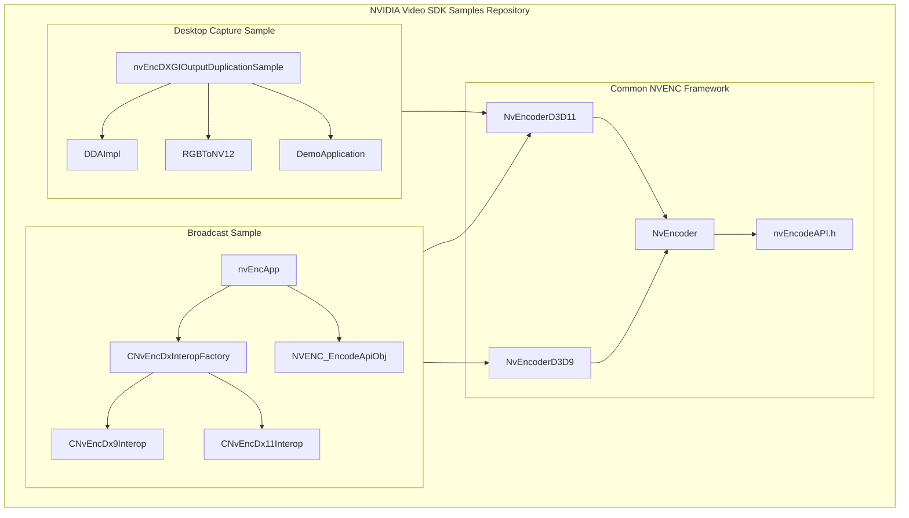
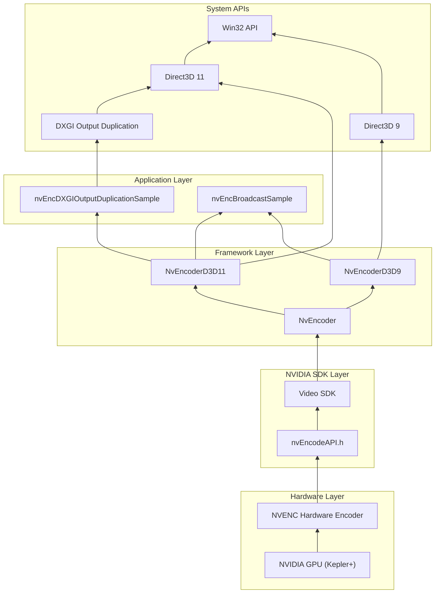

<!-- source: DeepWiki mcp.deepwiki.com · repo NVIDIA/video-sdk-samples · page 1 Overview · fetched 2026-10-26 -->

# Overview

Relevant source files

The following files were used as context for generating this wiki page:

- [README.md](README.md)

## Purpose and Scope

The NVIDIA Video SDK Samples repository provides sample applications demonstrating GPU-accelerated video encoding and decoding capabilities using NVIDIA's Video SDK APIs. This collection serves as practical reference implementations for developers integrating hardware-accelerated video processing into their applications.

The repository contains two primary sample applications: a desktop screen capture encoder and a broadcast encoding sample, along with supporting NVENC framework components. For detailed implementation guides of specific samples, see [Desktop Capture Sample](#2) and [Broadcast Sample](#3). For information about the underlying encoding framework, see [NVENC Framework](#4).

Sources: [README.md:1-4]()

## Repository Architecture

The repository is organized around two main sample applications that demonstrate different aspects of GPU-accelerated video encoding, supported by a common NVENC framework infrastructure.

### High-Level System Organization

Sources: [README.md:1-4]()

## Technology Stack

The samples leverage NVIDIA's hardware encoding capabilities through a layered architecture spanning from low-level GPU APIs to high-level application interfaces.

### Technology Dependencies and API Layers

Sources: [README.md:1-4]()

## Sample Applications

### Desktop Capture Sample (`nvEncDXGIOutputDuplicationSample`)

The desktop capture sample demonstrates real-time screen recording using Windows DXGI Output Duplication API combined with NVIDIA NVENC hardware encoding. The application captures desktop frames, performs color space conversion, and encodes them to H.264 format.

| Component | Class/Function | Purpose |
|-----------|---------------|---------|
| Application Controller | `DemoApplication` | Orchestrates capture and encoding pipeline |
| Screen Capture | `DDAImpl` | Wraps DXGI Desktop Duplication API |
| Color Conversion | `RGBToNV12` | Hardware-accelerated RGB to NV12 conversion |
| Video Encoding | `NvEncoderD3D11` | NVENC-based H.264 encoding |

### Broadcast Sample (`nvEncBroadcastSample`)

The broadcast sample provides a more comprehensive NVENC API demonstration with support for both DirectX 9 and DirectX 11 contexts. It includes advanced encoder configuration options and broadcast-specific features.

| Component | Class/Function | Purpose |
|-----------|---------------|---------|
| Application Core | `nvEncApp` | Main application and encoder lifecycle management |
| DirectX Factory | `CNvEncDxInteropFactory` | Creates DirectX 9/11 contexts |
| DirectX 9 Integration | `CNvEncDx9Interop` | DirectX 9 encoder interface |
| DirectX 11 Integration | `CNvEncDx11Interop` | DirectX 11 encoder interface |
| Encoding API | `NVENC_EncodeApiObj` | High-level encoding interface |

Sources: [README.md:1-4]()

## Common NVENC Framework

The repository includes a shared NVENC framework that provides base classes and utilities used by both sample applications. This framework abstracts the low-level NVENC API into more manageable C++ classes.

### Core Framework Components

| Component | Purpose | Key Classes |
|-----------|---------|-------------|
| Base Encoder | Abstract interface for NVENC operations | `NvEncoder` |
| DirectX 11 Implementation | D3D11-specific encoder implementation | `NvEncoderD3D11` |
| DirectX 9 Implementation | D3D9-specific encoder implementation | `NvEncoderD3D9` |
| Hardware API | Low-level NVENC function declarations | Functions in `nvEncodeAPI.h` |

The framework provides platform abstraction, memory management utilities, and error handling mechanisms that simplify integration of NVENC capabilities into applications.

Sources: [README.md:1-4]()

---

