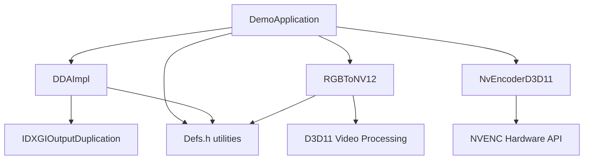
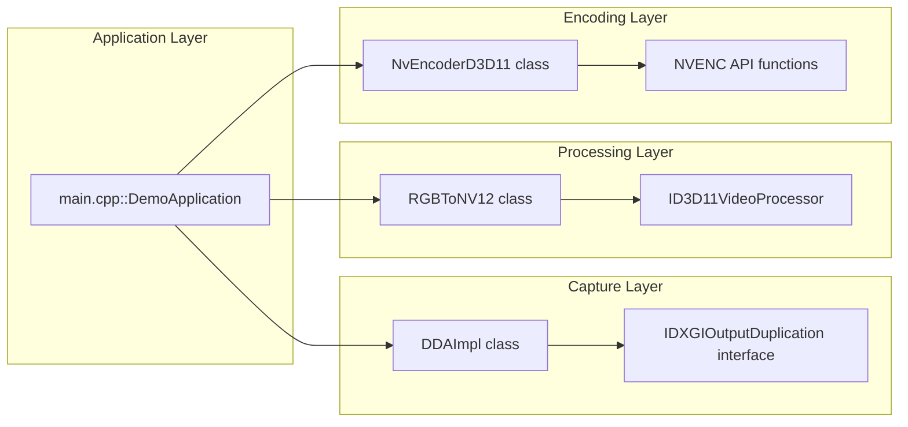

<!-- source: DeepWiki mcp.deepwiki.com · repo NVIDIA/video-sdk-samples · page 2 Desktop Capture Sample · fetched 2026-10-26 -->

# Desktop Capture Sample

Relevant source files

The following files were used as context for generating this wiki page:

- [nvEncDXGIOutputDuplicationSample/README.md](nvEncDXGIOutputDuplicationSample/README.md)

## Purpose and Scope

The Desktop Capture Sample (`nvEncDXGIOutputDuplicationSample`) demonstrates real-time desktop screen capture and hardware video encoding using NVIDIA's NVENC technology. This sample shows how to integrate Windows Desktop Duplication API with NVIDIA's hardware encoder to create efficient screen recording or live streaming applications.

The sample covers the complete pipeline from desktop capture to compressed H.264 output, including color space conversion and GPU-accelerated encoding. For information about the broader NVENC framework and common encoder components, see [NVENC Framework](#4). For details about the broadcast-oriented encoding API, see [Broadcast Sample](#3).

## System Overview

The Desktop Capture Sample implements a streamlined architecture that captures desktop content and encodes it to H.264 video format using hardware acceleration throughout the entire pipeline.

### High-Level Architecture

Sources: [nvEncDXGIOutputDuplicationSample/README.md:1-3]()

## Core Components

The sample consists of four primary components that work together to implement the capture-encode pipeline:

### Component Mapping to Code Entities

Sources: [nvEncDXGIOutputDuplicationSample/README.md:1-3]()

| Component | Purpose | Key Responsibilities |
|-----------|---------|---------------------|
| `DemoApplication` | Main orchestrator | Application lifecycle, frame capture loop, resource coordination |
| `DDAImpl` | Desktop capture wrapper | DXGI Output Duplication management, frame acquisition |
| `RGBToNV12` | Color space converter | Hardware-accelerated RGB to NV12 conversion |
| `NvEncoderD3D11` | Hardware encoder | NVENC-based H.264 encoding with D3D11 interop |

## Data Flow Pipeline

The sample implements a linear pipeline that processes desktop frames from capture to encoded output:

### Frame Processing Pipeline

```mermaid
flowchart LR
    Desktop["Windows Desktop"] --> DXGICapture["IDXGIOutputDuplication::AcquireNextFrame"]
    DXGICapture --> RGBTexture["ID3D11Texture2D (DXGI_FORMAT_B8G8R8A8)"]
    RGBTexture --> ColorConvert["RGBToNV12::ConvertRGBToNV12"]
    ColorConvert --> NV12Texture["ID3D11Texture2D (DXGI_FORMAT_NV12)"]
    NV12Texture --> EncodeFrame["NvEncoderD3D11::EncodeFrame"]
    EncodeFrame --> H264Stream["H.264 Bitstream"]
    H264Stream --> OutputFile["output.h264"]
```

Sources: [nvEncDXGIOutputDuplicationSample/README.md:2]()

The pipeline leverages GPU memory throughout, avoiding CPU copies:

1. **Capture Stage**: `IDXGIOutputDuplication` captures desktop content directly to GPU texture memory
2. **Conversion Stage**: `RGBToNV12` performs format conversion using D3D11 Video Processing API
3. **Encoding Stage**: `NvEncoderD3D11` encodes directly from GPU texture using NVENC hardware
4. **Output Stage**: Compressed bitstream is written to disk as H.264 file

## Technical Implementation

### D3D11 Context Management

The sample uses a shared D3D11 device context across all components to enable efficient GPU memory sharing. The `DemoApplication` creates and manages the primary D3D11 device, which is passed to each processing component during initialization.

### Frame Synchronization

Desktop duplication operates asynchronously, requiring proper synchronization between capture and encoding threads. The sample implements frame timing to match desktop refresh rates and avoid dropped or duplicate frames.

### Error Handling

Common error scenarios include:
- Desktop duplication timeouts during periods of no screen updates
- NVENC encoder initialization failures on unsupported hardware
- D3D11 device lost conditions requiring context recreation

Sources: [nvEncDXGIOutputDuplicationSample/README.md:1-3]()

## Related Documentation

This page provides the high-level overview of the Desktop Capture Sample. For detailed implementation information, see:

- [Application Architecture](#2.1) - Deep dive into `DemoApplication` class and main execution flow
- [Desktop Duplication Implementation](#2.2) - Technical details of `DDAImpl` and DXGI integration  
- [Color Space Conversion](#2.3) - `RGBToNV12` implementation and D3D11 Video Processing usage
- [Build Configuration](#2.4) - Project setup and compilation requirements

---

