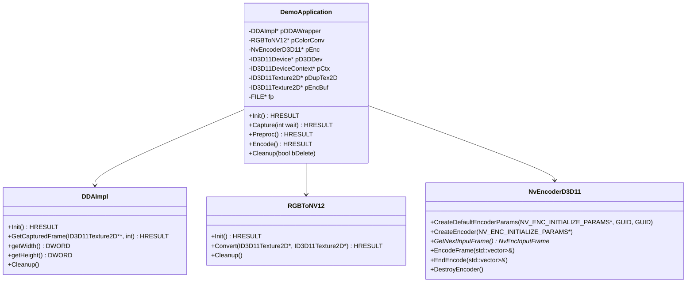
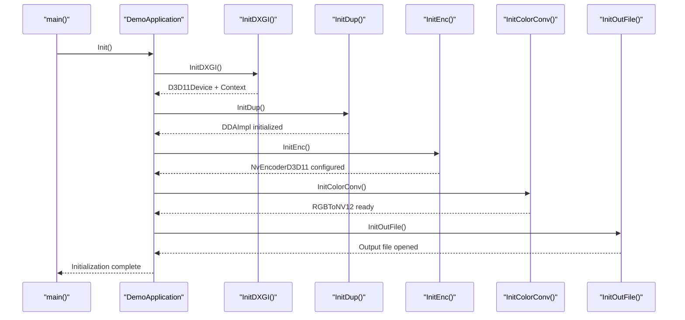
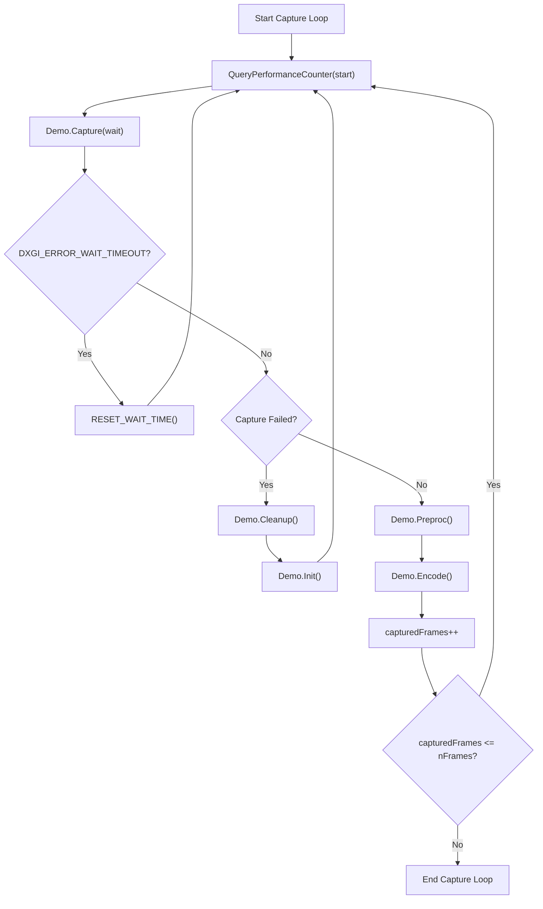
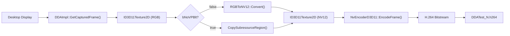
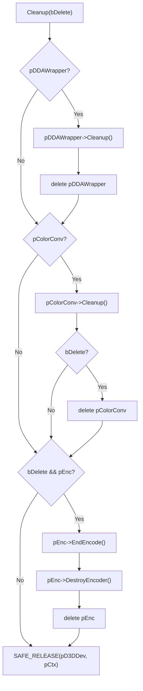

<!-- source: DeepWiki mcp.deepwiki.com · repo NVIDIA/video-sdk-samples · page 2.1 Application Architecture · fetched 2026-10-26 -->

# Application Architecture

Relevant source files

The following files were used as context for generating this wiki page:

- [nvEncDXGIOutputDuplicationSample/Defs.h](nvEncDXGIOutputDuplicationSample/Defs.h)
- [nvEncDXGIOutputDuplicationSample/main.cpp](nvEncDXGIOutputDuplicationSample/main.cpp)

This document details the architectural design of the Desktop Capture Sample application, specifically the `DemoApplication` class and its orchestration of the desktop capture and encoding pipeline. The architecture demonstrates how to integrate Windows DXGI Output Duplication API with NVIDIA's NVENC hardware encoder through DirectX 11 interoperability.

For information about the underlying desktop duplication implementation, see [Desktop Duplication Implementation](#2.2). For details about color space conversion, see [Color Space Conversion](#2.3).

## Core Architecture Overview

The Desktop Capture Sample is built around a single orchestration class `DemoApplication` that coordinates four primary subsystems: desktop capture via DXGI, color space conversion, hardware video encoding, and DirectX 11 resource management. The application follows a producer-consumer pipeline pattern where each stage processes frames in sequence.

**Application Architecture Diagram**

Sources: [nvEncDXGIOutputDuplicationSample/main.cpp:34-329]()

## Component Responsibilities

The `DemoApplication` class manages five core components, each with specific responsibilities in the video capture and encoding pipeline:

| Component | Type | Purpose | Key Methods |
|-----------|------|---------|-------------|
| `pDDAWrapper` | `DDAImpl*` | Desktop screen capture using DXGI Output Duplication | `GetCapturedFrame()`, `getWidth()`, `getHeight()` |
| `pColorConv` | `RGBToNV12*` | Color space conversion from RGB to NV12 format | `Convert()` |
| `pEnc` | `NvEncoderD3D11*` | Hardware video encoding using NVENC | `EncodeFrame()`, `GetNextInputFrame()` |
| `pD3DDev` | `ID3D11Device*` | DirectX 11 device for GPU operations | Device creation and resource management |
| `pCtx` | `ID3D11DeviceContext*` | DirectX 11 immediate context | GPU command submission |

Sources: [nvEncDXGIOutputDuplicationSample/main.cpp:44-62]()

## Initialization Sequence

The application follows a strict initialization order to ensure proper dependency resolution between DirectX 11, DXGI, and NVENC components:

**Initialization Sequence Diagram**

### DirectX 11 Initialization

The `InitDXGI()` method creates a DirectX 11 device and context with hardware acceleration preference. It iterates through available driver types (`D3D_DRIVER_TYPE_HARDWARE`, `D3D_DRIVER_TYPE_WARP`, `D3D_DRIVER_TYPE_REFERENCE`) and feature levels starting from DirectX 11.0 down to 9.1 for maximum compatibility.

Sources: [nvEncDXGIOutputDuplicationSample/main.cpp:80-115]()

### NVENC Encoder Configuration

The encoder initialization in `InitEnc()` configures encoding parameters based on whether video preprocessing is enabled (`bNoVPBlt` flag). The encoder supports two modes:

- **Direct encoding**: RGB input format, dimensions match captured desktop
- **Preprocessed encoding**: NV12 input format, fixed 1920x1080 output resolution

Key encoding parameters include GOP length of 5 frames and H.264 codec with low-latency high-performance preset.

Sources: [nvEncDXGIOutputDuplicationSample/main.cpp:131-164]()

## Main Capture Loop

The application's primary execution occurs in the `Grab60FPS()` function, which implements a timing-controlled capture loop targeting approximately 60 frames per second:

**Main Capture Loop Flow**

The loop implements adaptive timing control using Windows performance counters to maintain consistent frame rates. The base wait time of 17ms targets 60 FPS, with dynamic adjustment based on actual processing time.

Sources: [nvEncDXGIOutputDuplicationSample/main.cpp:332-414]()

## Data Flow Pipeline

The frame processing pipeline transforms desktop pixels through multiple stages before final H.264 output:

**Frame Processing Pipeline**

The pipeline supports two processing modes controlled by the `bNoVPBlt` constant:
- **Direct mode**: Bypasses color conversion for ARGB input directly to encoder
- **Conversion mode**: Converts RGB to NV12 using hardware-accelerated video processing

Sources: [nvEncDXGIOutputDuplicationSample/main.cpp:226-273]()

## Resource Management

The application implements deterministic resource management through the `Cleanup()` method with support for partial cleanup during error recovery:

**Resource Cleanup Flow**

The cleanup process ensures proper shutdown of the NVENC encoder by flushing remaining frames before destroying encoder resources. The `SAFE_RELEASE` macro provides null-safe COM object release.

Sources: [nvEncDXGIOutputDuplicationSample/main.cpp:275-329](), [nvEncDXGIOutputDuplicationSample/Defs.h:33-35]()

## Error Handling

The application implements comprehensive error handling with automatic recovery capabilities. The `returnIfError` macro provides consistent error propagation with detailed logging including function name, line number, and file path.

Key error handling features:
- **Timeout handling**: `DXGI_ERROR_WAIT_TIMEOUT` indicates no screen updates, triggers retry with timing adjustment
- **Capture failure recovery**: Failed captures trigger complete reinitialization of DDA subsystem
- **Resource safety**: All DirectX and NVENC resources use RAII patterns and safe release mechanisms

Sources: [nvEncDXGIOutputDuplicationSample/main.cpp:37-42](), [nvEncDXGIOutputDuplicationSample/Defs.h:37-43]()

---

