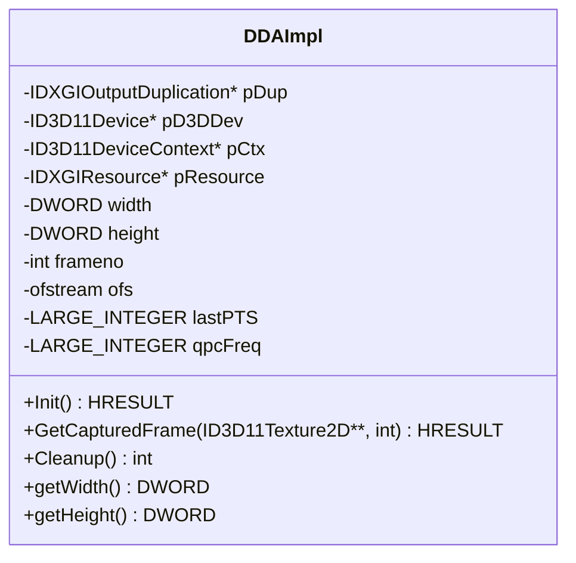
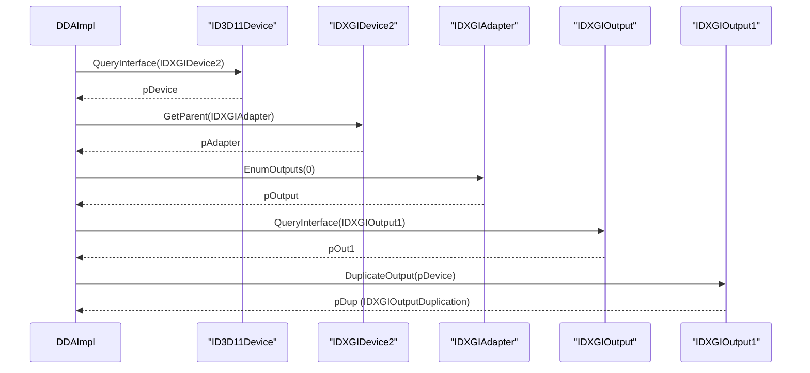
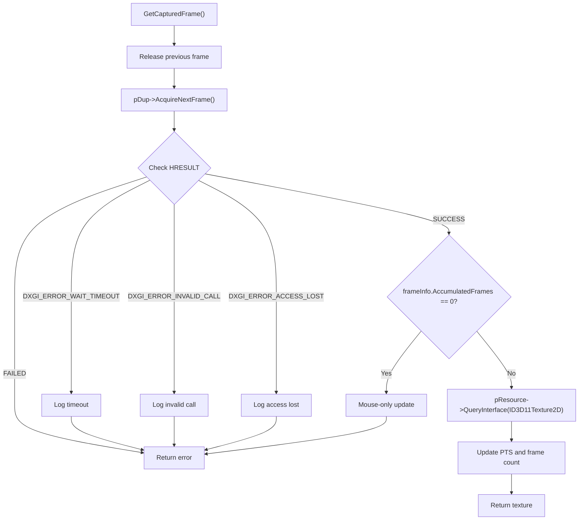
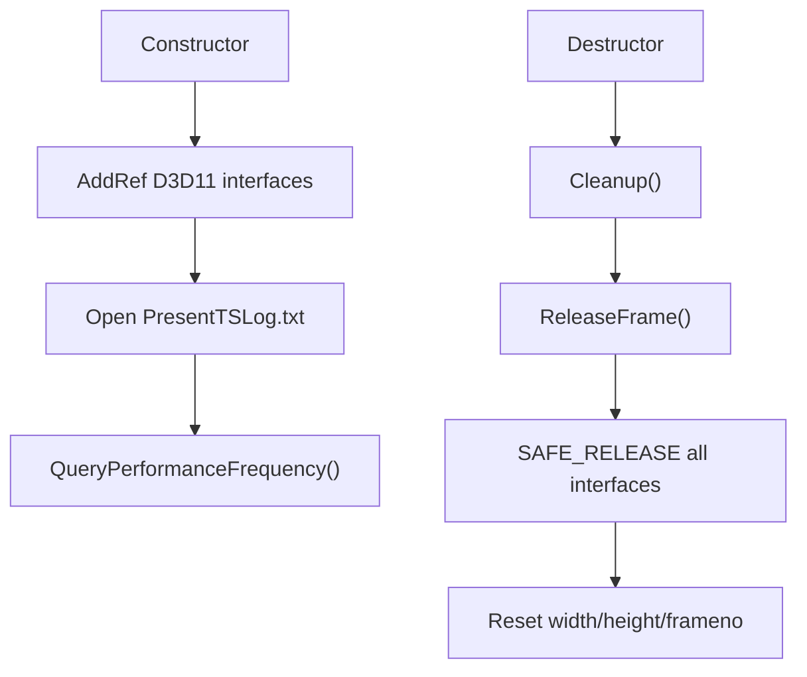

<!-- source: DeepWiki mcp.deepwiki.com · repo NVIDIA/video-sdk-samples · page 2.2 Desktop Duplication Implementation · fetched 2026-10-26 -->

# Desktop Duplication Implementation

Relevant source files

The following files were used as context for generating this wiki page:

- [nvEncDXGIOutputDuplicationSample/DDAImpl.cpp](nvEncDXGIOutputDuplicationSample/DDAImpl.cpp)
- [nvEncDXGIOutputDuplicationSample/DDAImpl.h](nvEncDXGIOutputDuplicationSample/DDAImpl.h)

## Purpose and Scope

This document covers the `DDAImpl` class, which provides a wrapper around the Windows DXGI Desktop Duplication API for capturing desktop screen content. The implementation handles the lifecycle management of DXGI Output Duplication objects and provides a simplified interface for acquiring captured desktop frames as Direct3D 11 textures.

For information about the overall application architecture that uses this desktop capture system, see [Application Architecture](#2.1). For details about color space conversion applied to captured frames, see [Color Space Conversion](#2.3).

## Class Overview

The `DDAImpl` class serves as a thin wrapper around the `IDXGIOutputDuplication` interface, managing the complete lifecycle of desktop capture operations from initialization through frame acquisition to cleanup.

**Sources:** [nvEncDXGIOutputDuplicationSample/DDAImpl.h:37-93]()

## Initialization Process

The `Init()` method establishes the DXGI Output Duplication session through a series of interface queries and object creation steps:

### Key Initialization Steps

| Step | Operation | Purpose |
|------|-----------|---------|
| 1 | Query `IDXGIDevice2` from `ID3D11Device` | Bridge from D3D11 to DXGI interfaces |
| 2 | Get parent `IDXGIAdapter` | Access display adapter capabilities |
| 3 | Enumerate outputs (index 0) | Select primary display output |
| 4 | Query `IDXGIOutput1` interface | Access duplication functionality |
| 5 | Create `IDXGIOutputDuplication` | Establish desktop capture session |

The method captures display dimensions from `DXGI_OUTDUPL_DESC` and stores them in the `width` and `height` member variables.

**Sources:** [nvEncDXGIOutputDuplicationSample/DDAImpl.cpp:34-86]()

## Frame Acquisition

The `GetCapturedFrame()` method implements the core capture loop, acquiring new desktop updates and converting them to `ID3D11Texture2D` objects:

### Frame Information Processing

The method processes `DXGI_OUTDUPL_FRAME_INFO` to track presentation timing and frame accumulation:

- **AccumulatedFrames**: Number of desktop updates since last acquisition
- **LastPresentTime**: High-precision timestamp for frame presentation
- **LastMouseUpdateTime**: Timestamp for mouse-only updates

Frame timing calculations use `QueryPerformanceFrequency()` for microsecond precision timing measurements.

**Sources:** [nvEncDXGIOutputDuplicationSample/DDAImpl.cpp:88-150]()

## Error Handling

The implementation includes comprehensive error handling for common DXGI Output Duplication scenarios:

| Error Code | Condition | Handling |
|------------|-----------|----------|
| `DXGI_ERROR_WAIT_TIMEOUT` | No new frames within timeout period | Log and return timeout |
| `DXGI_ERROR_INVALID_CALL` | Previous frame not properly released | Log invalid state |
| `DXGI_ERROR_ACCESS_LOST` | Desktop session changed (RDP, mode switch) | Log access loss |

Mouse-only updates (when `AccumulatedFrames == 0`) are treated as non-visual updates and result in timeout returns.

**Sources:** [nvEncDXGIOutputDuplicationSample/DDAImpl.cpp:110-129]()

## Resource Management

The `DDAImpl` class follows RAII principles with proper resource lifecycle management:

### Constructor Responsibilities
- Reference counting for `ID3D11Device` and `ID3D11DeviceContext`
- Performance counter frequency initialization
- Timestamp logging file creation

### Cleanup Responsibilities  
- Frame release via `IDXGIOutputDuplication::ReleaseFrame()`
- Interface cleanup using `SAFE_RELEASE` macro
- State variable reset

**Sources:** [nvEncDXGIOutputDuplicationSample/DDAImpl.h:82-92](), [nvEncDXGIOutputDuplicationSample/DDAImpl.cpp:153-168]()

## Integration Points

The `DDAImpl` class integrates with the broader desktop capture system through well-defined interfaces:

- **Input**: Requires initialized `ID3D11Device` and `ID3D11DeviceContext` from the D3D11 rendering system
- **Output**: Provides `ID3D11Texture2D` objects containing captured desktop content in RGB format
- **Timing**: Generates high-precision presentation timestamps for frame synchronization

The captured textures flow directly into the color space conversion pipeline before NVENC encoding.

**Sources:** [nvEncDXGIOutputDuplicationSample/DDAImpl.h:43-63]()

---

