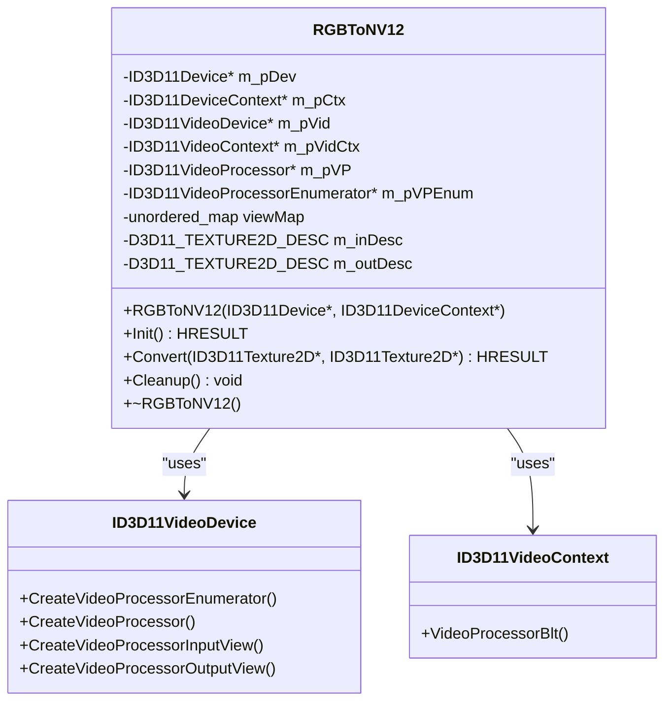
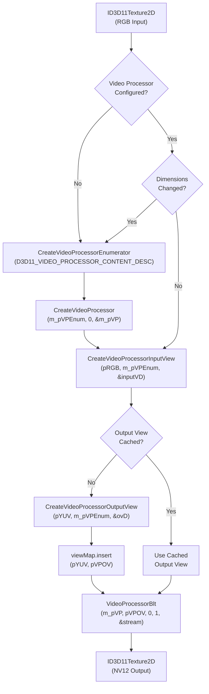
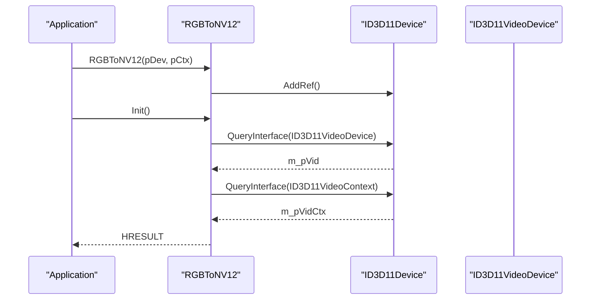

<!-- source: DeepWiki mcp.deepwiki.com · repo NVIDIA/video-sdk-samples · page 2.3 Color Space Conversion · fetched 2026-10-26 -->

# Color Space Conversion

<details>
<summary>Relevant source files</summary>

The following files were used as context for generating this wiki page:

- [nvEncDXGIOutputDuplicationSample/Preproc.cpp](nvEncDXGIOutputDuplicationSample/Preproc.cpp)
- [nvEncDXGIOutputDuplicationSample/Preproc.h](nvEncDXGIOutputDuplicationSample/Preproc.h)

</details>


## Purpose and Scope

This document covers the color space conversion system in the Desktop Capture Sample, specifically the `RGBToNV12` class that performs hardware-accelerated conversion from RGB to NV12 color format using DirectX 11 Video Processing API. This conversion is essential for preparing captured desktop frames for NVENC hardware encoding, which requires input in NV12 (YUV 4:2:0 planar) format.

For information about the broader desktop capture pipeline, see [Application Architecture](#2.1). For details about the NVENC encoding that follows this conversion, see [NVENC Framework](#4).

## Technical Overview

The color space conversion system bridges the gap between DXGI Desktop Duplication output (RGB format) and NVENC encoder input requirements (NV12 format). The conversion leverages DirectX 11 Video Processing API (`ID3D11VideoProcessor`) to perform hardware-accelerated format conversion with minimal CPU overhead.

The system handles dynamic resolution changes and implements performance optimizations through view caching and intelligent resource management.

**Sources:** [nvEncDXGIOutputDuplicationSample/Preproc.h:35-85](), [nvEncDXGIOutputDuplicationSample/Preproc.cpp:32-168]()

## RGBToNV12 Class Architecture



The `RGBToNV12` class encapsulates DirectX 11 Video Processing functionality with the following key components:

| Component | Type | Purpose |
|-----------|------|---------|
| `m_pDev` | `ID3D11Device*` | Primary D3D11 device for resource creation |
| `m_pCtx` | `ID3D11DeviceContext*` | D3D11 context for command submission |
| `m_pVid` | `ID3D11VideoDevice*` | Video-specific D3D11 device interface |
| `m_pVidCtx` | `ID3D11VideoContext*` | Video-specific context for processing |
| `m_pVP` | `ID3D11VideoProcessor*` | Configured video processor instance |
| `viewMap` | `std::unordered_map` | Cache for output view optimization |

**Sources:** [nvEncDXGIOutputDuplicationSample/Preproc.h:40-61]()

## Color Space Conversion Process



The conversion process in the `Convert()` method follows these steps:

1. **Configuration Check**: Verifies if video processor needs reconfiguration based on texture dimensions
2. **Video Processor Setup**: Creates processor enumerator and processor instance if needed
3. **View Creation**: Creates input view from RGB texture and obtains/creates output view for NV12 texture
4. **Processing**: Executes hardware-accelerated conversion using `VideoProcessorBlt`

**Sources:** [nvEncDXGIOutputDuplicationSample/Preproc.cpp:76-168]()

## Performance Optimizations

### Dynamic Reconfiguration

The system optimizes for changing input/output dimensions by detecting when video processor reconfiguration is required:

```cpp
// Dimension change detection
if (m_inDesc.Width != inDesc.Width ||
    m_inDesc.Height != inDesc.Height ||
    m_outDesc.Width != outDesc.Width ||
    m_outDesc.Height != outDesc.Height)
{
    // Recreate video processor
}
```

**Sources:** [nvEncDXGIOutputDuplicationSample/Preproc.cpp:90-97]()

### Output View Caching

The `viewMap` optimization prevents repeated creation of `ID3D11VideoProcessorOutputView` objects:

| Optimization | Implementation | Benefit |
|--------------|----------------|---------|
| View Caching | `std::unordered_map<ID3D11Texture2D*, ID3D11VideoProcessorOutputView*>` | Reduces API overhead |
| Cache Lookup | `viewMap.find(pYUV)` before creation | Avoids redundant allocations |
| Cleanup Management | Views released in `Cleanup()` | Prevents resource leaks |

**Sources:** [nvEncDXGIOutputDuplicationSample/Preproc.h:55-57](), [nvEncDXGIOutputDuplicationSample/Preproc.cpp:135-153]()

## DirectX Video Processing Integration

### Initialization Sequence



The initialization process establishes video processing capabilities by obtaining video-specific interfaces from the standard D3D11 device.

**Sources:** [nvEncDXGIOutputDuplicationSample/Preproc.cpp:42-57]()

### Video Processor Configuration

The video processor configuration uses `D3D11_VIDEO_PROCESSOR_CONTENT_DESC` to specify processing parameters:

```cpp
D3D11_VIDEO_PROCESSOR_CONTENT_DESC contentDesc = {
    D3D11_VIDEO_FRAME_FORMAT_PROGRESSIVE,  // Progressive frames
    { 1, 1 },                              // Input frame rate
    inDesc.Width, inDesc.Height,           // Input dimensions
    { 1, 1 },                              // Output frame rate  
    outDesc.Width, outDesc.Height,         // Output dimensions
    D3D11_VIDEO_USAGE_PLAYBACK_NORMAL      // Usage scenario
};
```

**Sources:** [nvEncDXGIOutputDuplicationSample/Preproc.cpp:105-111]()

---

