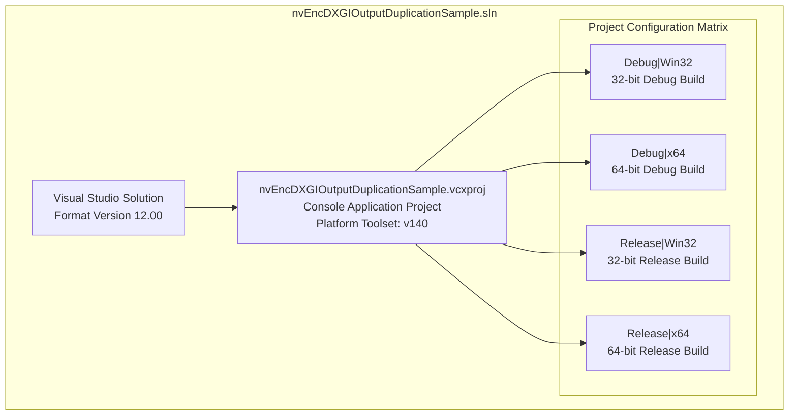
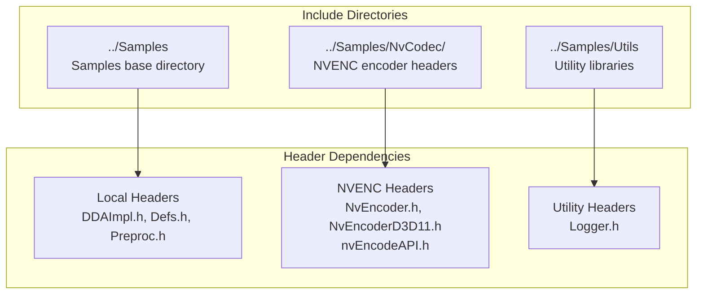
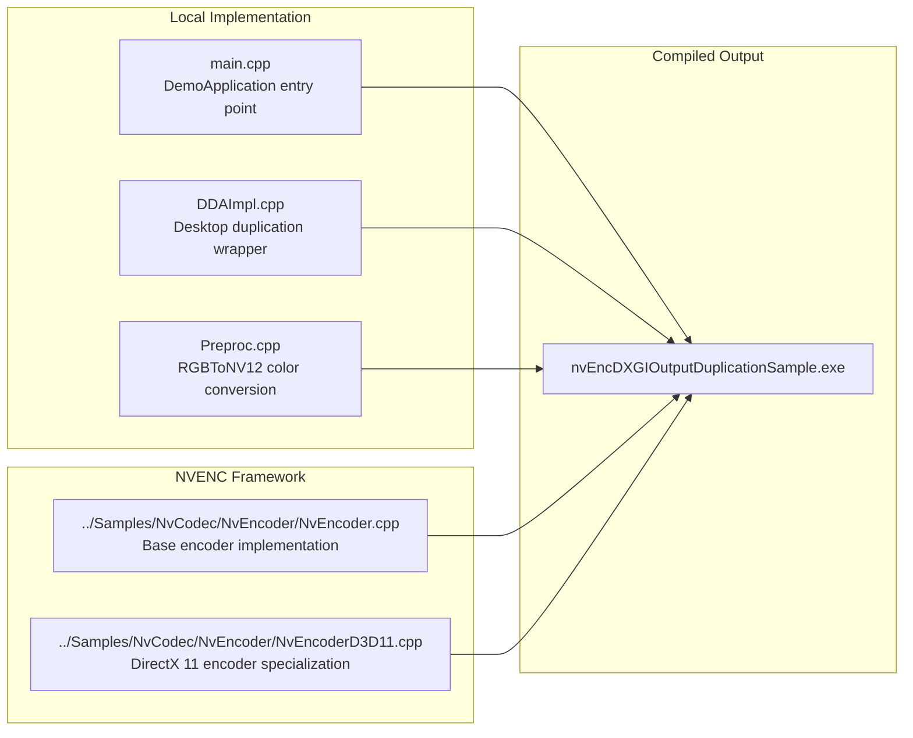

<!-- source: DeepWiki mcp.deepwiki.com · repo NVIDIA/video-sdk-samples · page 2.4 Build Configuration · fetched 2026-10-26 -->

# Build Configuration

<details>
<summary>Relevant source files</summary>

The following files were used as context for generating this wiki page:

- [nvEncDXGIOutputDuplicationSample/nvEncDXGIOutputDuplicationSample.sln](nvEncDXGIOutputDuplicationSample/nvEncDXGIOutputDuplicationSample.sln)
- [nvEncDXGIOutputDuplicationSample/nvEncDXGIOutputDuplicationSample.vcxproj](nvEncDXGIOutputDuplicationSample/nvEncDXGIOutputDuplicationSample.vcxproj)
- [nvEncDXGIOutputDuplicationSample/nvEncDXGIOutputDuplicationSample.vcxproj.filters](nvEncDXGIOutputDuplicationSample/nvEncDXGIOutputDuplicationSample.vcxproj.filters)

</details>


This document covers the build system configuration for the Desktop Capture Sample (`nvEncDXGIOutputDuplicationSample`), including Visual Studio project structure, compiler settings, dependencies, and platform support. The sample is built using Microsoft Visual Studio with a traditional MSBuild project structure.

For information about the application architecture and runtime behavior, see [Application Architecture](#2.1). For details about the NVENC framework dependencies, see [NVENC Framework](#4).

## Project Structure

The Desktop Capture Sample uses a standard Visual Studio solution containing a single C++ console application project. The build system supports multiple platforms and configurations through MSBuild project files.

### Build Configuration Matrix

The solution supports four build configurations across two platforms:

| Configuration | Platform | Purpose |
|---------------|----------|---------|
| Debug | Win32 | 32-bit debug build with full debugging symbols |
| Debug | x64 | 64-bit debug build with full debugging symbols |
| Release | Win32 | 32-bit optimized release build |
| Release | x64 | 64-bit optimized release build |

**Build Configuration Overview**


Sources: [nvEncDXGIOutputDuplicationSample/nvEncDXGIOutputDuplicationSample.sln:1-28](), [nvEncDXGIOutputDuplicationSample/nvEncDXGIOutputDuplicationSample.vcxproj:3-19]()

## Compiler Configuration

The project uses Visual Studio 2015 toolset (`v140`) with specific compiler and linker settings optimized for DirectX and NVENC integration.

### Platform Toolset and Runtime

| Setting | Value | Description |
|---------|-------|-------------|
| `PlatformToolset` | `v140` | Visual Studio 2015 compiler toolset |
| `CharacterSet` | `MultiByte` | ANSI character encoding |
| `ConfigurationType` | `Application` | Standalone executable |
| `RuntimeLibrary` (Debug) | `MultiThreadedDebug` | Static runtime linking for debug builds |

### Preprocessor Definitions

The build system defines platform-specific macros for conditional compilation:

**Debug Builds:**
- `WIN32`
- `_DEBUG` 
- `_CONSOLE`
- `_LIB`

**Release Builds:**
- `WIN32`
- `NDEBUG`
- `_CONSOLE` 
- `_LIB`

Sources: [nvEncDXGIOutputDuplicationSample/nvEncDXGIOutputDuplicationSample.vcxproj:28-53](), [nvEncDXGIOutputDuplicationSample/nvEncDXGIOutputDuplicationSample.vcxproj:84-163]()

## Dependencies and Include Paths

The project depends on DirectX libraries for graphics operations and includes shared NVENC framework code from the samples directory.

### System Library Dependencies

**DirectX and Windows Libraries:**
```
d3d11.lib          // Direct3D 11 graphics API
dxgi.lib           // DirectX Graphics Infrastructure
kernel32.lib       // Windows kernel functions
user32.lib         // Windows user interface
gdi32.lib          // Graphics Device Interface
ole32.lib          // OLE automation
oleaut32.lib       // OLE automation utilities
uuid.lib           // GUID utilities
```

### Include Directory Structure

**Include Path Resolution**


Sources: [nvEncDXGIOutputDuplicationSample/nvEncDXGIOutputDuplicationSample.vcxproj:93-94](), [nvEncDXGIOutputDuplicationSample/nvEncDXGIOutputDuplicationSample.vcxproj:98-99](), [nvEncDXGIOutputDuplicationSample/nvEncDXGIOutputDuplicationSample.vcxproj:112-113]()

## Source File Organization

The project compiles both local implementation files and shared NVENC framework components.

### Source File Compilation Structure

**Project Source Organization**


### Header File Organization

The project includes both application-specific headers and shared framework headers organized by functional groups:

| Filter Group | Headers | Purpose |
|--------------|---------|---------|
| Header Files | `Defs.h`, `DDAImpl.h`, `Preproc.h` | Local application headers |
| Header Files\NVEnc | `NvEncoder.h`, `NvEncoderD3D11.h`, `nvEncodeAPI.h`, `Logger.h` | NVENC framework headers |

Sources: [nvEncDXGIOutputDuplicationSample/nvEncDXGIOutputDuplicationSample.vcxproj:164-179](), [nvEncDXGIOutputDuplicationSample/nvEncDXGIOutputDuplicationSample.vcxproj.filters:16-62]()

## Build Optimization Settings

The build system applies different optimization strategies for debug and release configurations.

### Debug Configuration

**Debug Build Settings:**
- `Optimization`: Disabled
- `GenerateDebugInformation`: true
- `LinkIncremental`: true
- `RuntimeLibrary`: MultiThreadedDebug
- `WarningLevel`: Level3
- `SDLCheck`: true

### Release Configuration

**Release Build Settings:**
- `Optimization`: MaxSpeed
- `FunctionLevelLinking`: true
- `IntrinsicFunctions`: true
- `EnableCOMDATFolding`: true
- `OptimizeReferences`: true
- `WholeProgramOptimization`: true
- `CodeAnalysisRuleSet`: AllRules.ruleset

### Library Directory Configuration

Release builds include additional library search paths for optional testing dependencies:

```
$(SolutionDir)/gmock/release_Win32
```

Sources: [nvEncDXGIOutputDuplicationSample/nvEncDXGIOutputDuplicationSample.vcxproj:84-102](), [nvEncDXGIOutputDuplicationSample/nvEncDXGIOutputDuplicationSample.vcxproj:122-163]()

---

