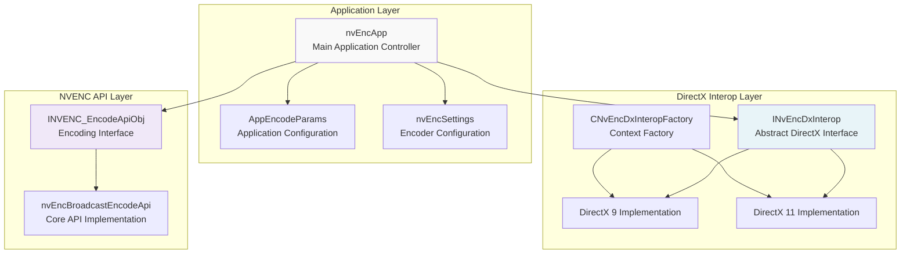
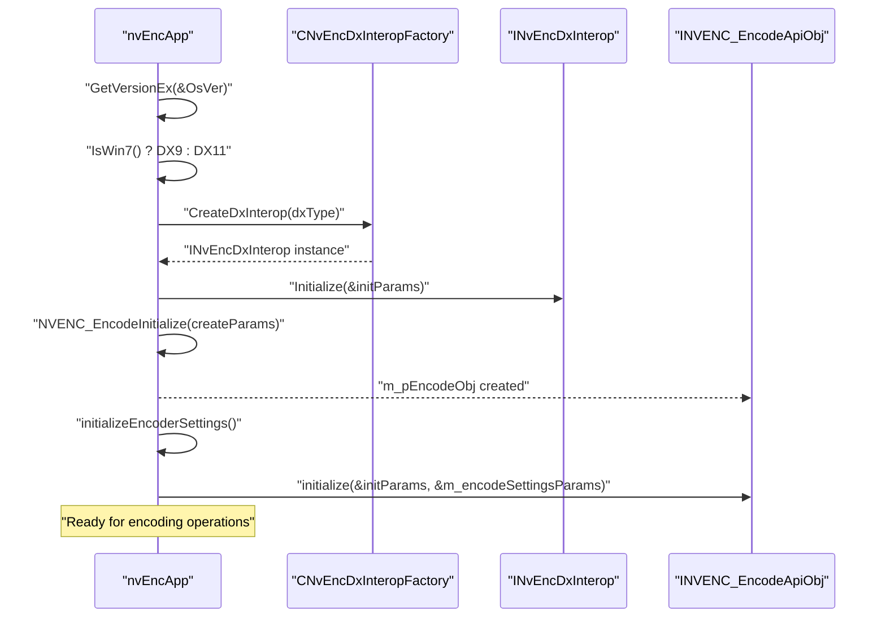
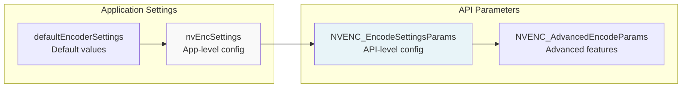
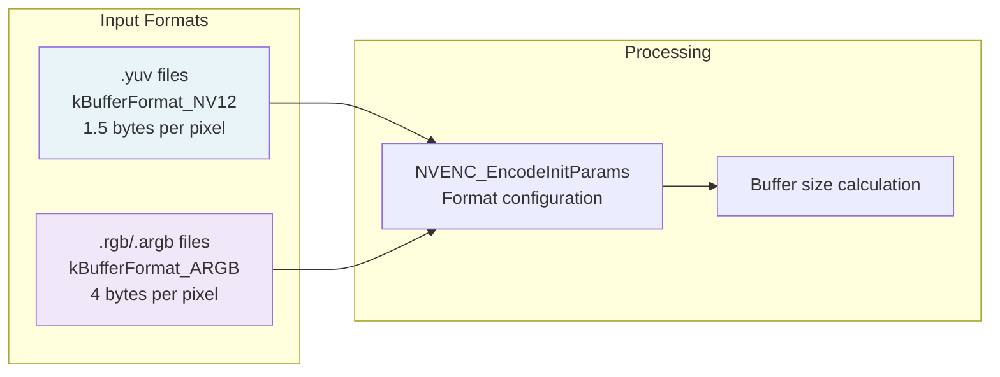

<!-- source: DeepWiki mcp.deepwiki.com · repo NVIDIA/video-sdk-samples · page 3 Broadcast Sample · fetched 2026-10-26 -->

# Broadcast Sample

Relevant source files

The following files were used as context for generating this wiki page:

- [nvEncBroadcastSample/common/inc/nvEncApp.h](nvEncBroadcastSample/common/inc/nvEncApp.h)
- [nvEncBroadcastSample/common/inc/nvEncAppUtils.h](nvEncBroadcastSample/common/inc/nvEncAppUtils.h)

## Purpose and Scope

The Broadcast Sample (`nvEncBroadcastSample`) demonstrates a comprehensive NVENC-based video encoding solution designed for broadcast and professional video applications. This sample provides a more feature-rich implementation compared to the Desktop Capture Sample, offering advanced encoding capabilities, DirectX 9/11 interoperability, and configurable encoder settings suitable for live streaming and broadcast workflows.

For desktop screen capture functionality, see [Desktop Capture Sample](#2). For detailed information about the underlying NVENC hardware API, see [NVENC Hardware API](#4.1).

## Architecture Overview

The Broadcast Sample implements a layered architecture that separates graphics API concerns from encoding logic, enabling flexible integration with different DirectX versions and encoding configurations.

### High-Level Component Architecture

**Sources:** [nvEncBroadcastSample/common/inc/nvEncApp.h:98-426](), [nvEncBroadcastSample/common/inc/nvEncAppUtils.h:55-74]()

### Application Initialization Flow

**Sources:** [nvEncBroadcastSample/common/inc/nvEncApp.h:135-154](), [nvEncBroadcastSample/common/inc/nvEncApp.h:296-354]()

## Core Components

### nvEncApp Class

The `nvEncApp` class serves as the main application controller, managing the entire encoding pipeline from initialization to cleanup. It handles platform detection, graphics context creation, and encoder configuration.

| Component | Type | Purpose |
|-----------|------|---------|
| `m_pGraphicsContext` | `INvEncDxInterop*` | DirectX context management |
| `m_pEncodeObj` | `INVENC_EncodeApiObj*` | NVENC API interface |
| `m_encodeSettingsParams` | `NVENC_EncodeSettingsParams` | Encoder configuration |
| `OsVer` | `OSVERSIONINFO` | Platform version detection |

**Sources:** [nvEncBroadcastSample/common/inc/nvEncApp.h:98-106]()

### Encoder Configuration Structure

The `nvEncSettings` structure provides application-level encoder configuration that maps to the lower-level NVENC API parameters:

**Sources:** [nvEncBroadcastSample/common/inc/nvEncApp.h:64-96]()

### DirectX Interoperability Factory

The factory pattern implementation enables runtime selection between DirectX 9 and DirectX 11 based on platform capabilities:

| Method | Purpose | Platform Logic |
|--------|---------|----------------|
| `IsWin7()` | Platform detection | Windows 7 → DX9, Windows 8+ → DX11 |
| `CreateDxInterop()` | Context creation | Factory method for DX context |
| `Initialize()` | Context setup | Graphics resource initialization |

**Sources:** [nvEncBroadcastSample/common/inc/nvEncApp.h:109-117](), [nvEncBroadcastSample/common/inc/nvEncApp.h:135-154](), [nvEncBroadcastSample/common/inc/nvEncAppUtils.h:71-74]()

## Default Configuration

The sample provides sensible defaults for broadcast applications:

| Parameter | Default Value | Range/Options |
|-----------|---------------|---------------|
| Resolution | 1920x1080 | Configurable |
| Frame Rate | 30 fps (30000/1000) | Configurable numerator/denominator |
| Bitrate | 6000 Kbps | Up to 40000 Kbps |
| Profile | High | Baseline, Main, High |
| Preset | Medium | Fast, Medium, Slow, Fastest |
| Rate Control | CBR | CBR, VBR, CONSTQUAL |
| B-Frames | 2 | 0-3 |

**Sources:** [nvEncBroadcastSample/common/inc/nvEncApp.h:43-96]()

## Input Format Support

The application supports multiple input formats with automatic detection based on file extensions:

**Sources:** [nvEncBroadcastSample/common/inc/nvEncApp.h:253-271]()

## Key Differences from Desktop Capture Sample

The Broadcast Sample provides several advantages over the simpler Desktop Capture Sample:

- **Multi-API Support**: DirectX 9 and DirectX 11 compatibility through abstraction layer
- **Advanced Configuration**: Comprehensive encoder settings with presets and advanced parameters
- **File Input Support**: Reads from video files rather than live screen capture
- **Broadcast Features**: Optimized for streaming with configurable bitrates and quality settings
- **Platform Adaptation**: Automatic platform detection and appropriate API selection

For DirectX interoperability details, see [DirectX Interoperability](#3.1). For encoding API specifics, see [Broadcast Encoding API](#3.2).

---

