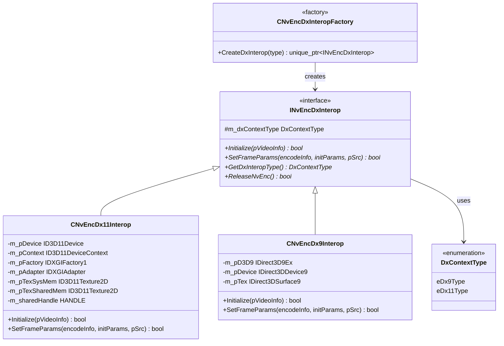
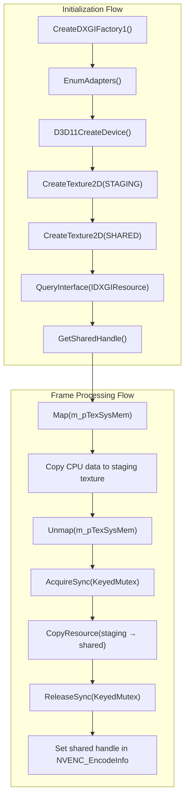
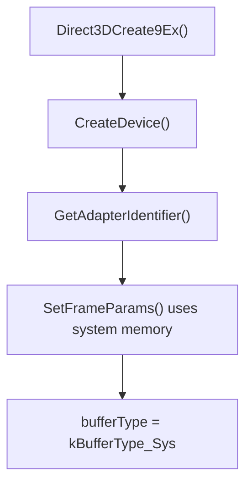
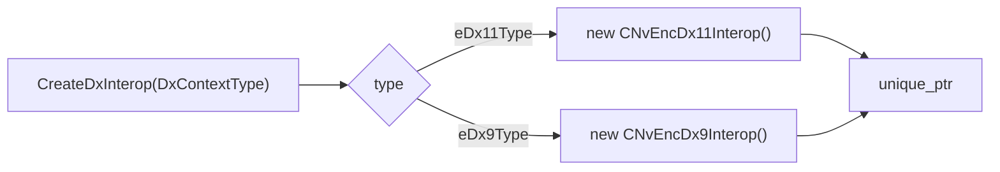
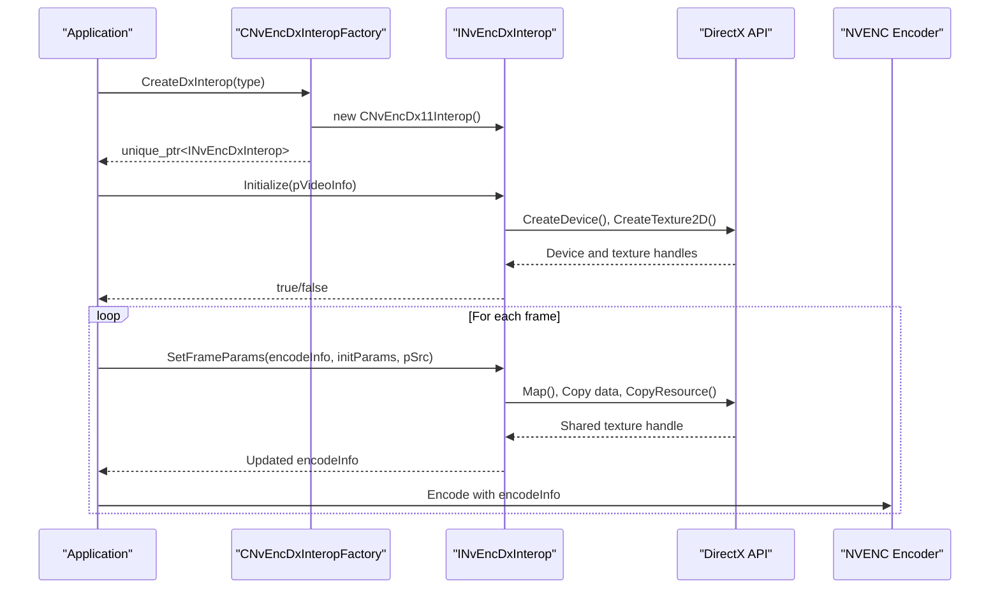

<!-- source: DeepWiki mcp.deepwiki.com · repo NVIDIA/video-sdk-samples · page 3.1 DirectX Interoperability · fetched 2026-10-26 -->

# DirectX Interoperability

Relevant source files

The following files were used as context for generating this wiki page:

- [nvEncBroadcastSample/common/inc/nvEncDx11App.h](nvEncBroadcastSample/common/inc/nvEncDx11App.h)
- [nvEncBroadcastSample/common/inc/nvEncDx9App.h](nvEncBroadcastSample/common/inc/nvEncDx9App.h)
- [nvEncBroadcastSample/common/src/nvEncDx11App.cpp](nvEncBroadcastSample/common/src/nvEncDx11App.cpp)
- [nvEncBroadcastSample/common/src/nvEncDx9App.cpp](nvEncBroadcastSample/common/src/nvEncDx9App.cpp)
- [nvEncBroadcastSample/common/src/nvEncDxInteropFactory.cpp](nvEncBroadcastSample/common/src/nvEncDxInteropFactory.cpp)

This document covers the DirectX interoperability layer in the broadcast sample that provides a unified interface for both DirectX 9 and DirectX 11 contexts, enabling flexible graphics API integration with NVENC encoding. For information about the broader broadcast encoding API, see [Broadcast Encoding API](#3.2). For details about the NVENC framework itself, see [NVENC Framework](#4).

## Purpose and Scope

The DirectX interoperability layer abstracts the differences between DirectX 9 and DirectX 11 APIs, allowing the broadcast sample to work with either graphics context. This layer handles device initialization, texture management, memory synchronization, and frame data preparation for NVENC encoding. The system supports both system memory and GPU memory (shared texture) workflows.

## Architecture Overview

The interoperability layer follows a factory pattern with a common interface and platform-specific implementations:

**Sources:** [nvEncBroadcastSample/common/inc/nvEncDx11App.h:30-49](), [nvEncBroadcastSample/common/inc/nvEncDx9App.h:30-46](), [nvEncBroadcastSample/common/src/nvEncDxInteropFactory.cpp:30-71]()

## Interface Design

The `INvEncDxInterop` interface provides the contract for DirectX interoperability:

| Method | Purpose | Return Type |
|--------|---------|-------------|
| `Initialize()` | Sets up DirectX context and resources | `bool` |
| `SetFrameParams()` | Prepares frame data for encoding | `bool` |
| `GetDxInteropType()` | Returns the DirectX context type | `DxContextType` |
| `ReleaseNvEnc()` | Cleanup resources | `bool` |

The interface supports two buffer types through the `NVENC_EncodeInfo` structure:
- `kBufferType_Sys` - System memory buffers
- `kBufferType_Vid` - GPU memory buffers (shared textures)

**Sources:** [nvEncBroadcastSample/common/inc/nvEncDx11App.h:35-39](), [nvEncBroadcastSample/common/inc/nvEncDx9App.h:35-39]()

## DirectX 11 Implementation

The `CNvEncDx11Interop` class provides comprehensive DirectX 11 integration with support for both system memory and shared texture workflows:

### Key Components

- **Device Management**: Creates D3D11 device using DXGI factory and adapter enumeration
- **Dual Texture System**: 
  - `m_pTexSysMem`: Staging texture with CPU write access (`D3D11_USAGE_STAGING`)
  - `m_pTexSharedMem`: Shared texture with keyed mutex (`D3D11_RESOURCE_MISC_SHARED_KEYEDMUTEX`)
- **Synchronization**: Uses `IDXGIKeyedMutex` for thread-safe access to shared resources
- **Format Support**: Handles both `DXGI_FORMAT_B8G8R8A8_UNORM` (ARGB) and `DXGI_FORMAT_NV12` formats

**Sources:** [nvEncBroadcastSample/common/src/nvEncDx11App.cpp:56-165](), [nvEncBroadcastSample/common/src/nvEncDx11App.cpp:170-299]()

## DirectX 9 Implementation

The `CNvEncDx9Interop` class provides a simpler DirectX 9 integration that primarily uses system memory:

### Characteristics

- **Simplified Architecture**: No shared texture support, relies on system memory transfers
- **Direct Memory Access**: Directly references source buffer pointer in `NVENC_EncodeInfo.SysBuffer.pixelBuffer`
- **Format Support**: Supports ARGB format through `D3DFMT_A8R8G8B8`
- **Presentation Parameters**: Configures windowed mode with immediate presentation interval

**Sources:** [nvEncBroadcastSample/common/src/nvEncDx9App.cpp:51-85](), [nvEncBroadcastSample/common/src/nvEncDx9App.cpp:90-102]()

## Factory Pattern Implementation

The `CNvEncDxInteropFactory` provides centralized creation of interop instances:

The factory method handles:
- Type-safe creation based on `DxContextType` enumeration
- Memory management through `std::unique_ptr`
- Error handling for failed allocations

**Sources:** [nvEncBroadcastSample/common/src/nvEncDxInteropFactory.cpp:35-71]()

## Data Flow Pipeline

The interoperability layer sits between the application and NVENC, handling format conversion and memory management:

**Sources:** [nvEncBroadcastSample/common/src/nvEncDx11App.cpp:170-299](), [nvEncBroadcastSample/common/src/nvEncDx9App.cpp:90-102](), [nvEncBroadcastSample/common/src/nvEncDxInteropFactory.cpp:35-71]()

---

