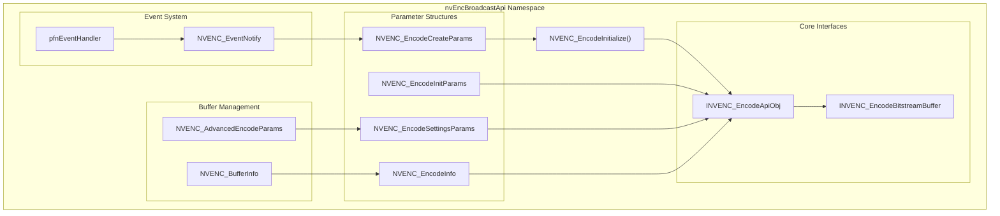
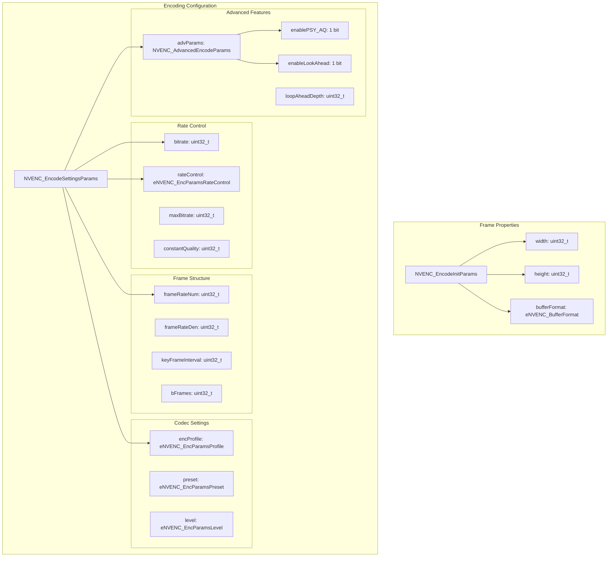
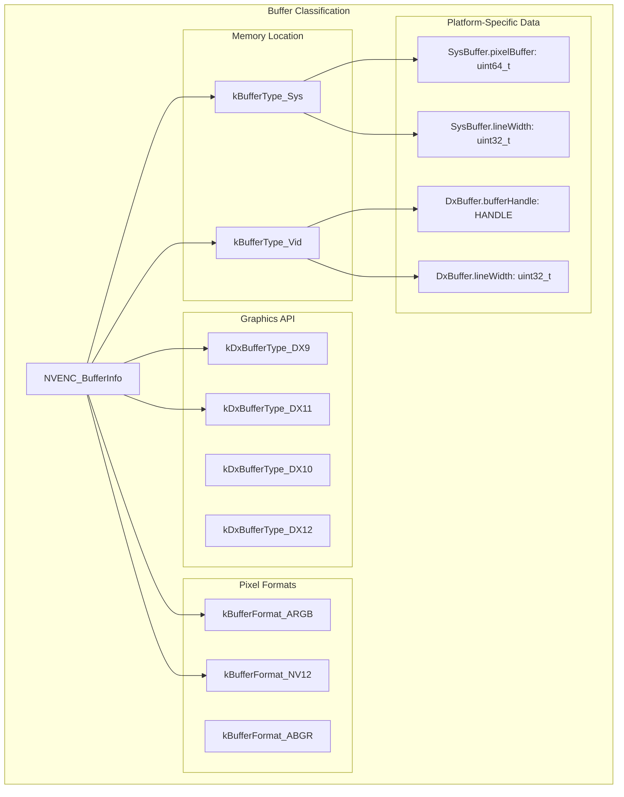
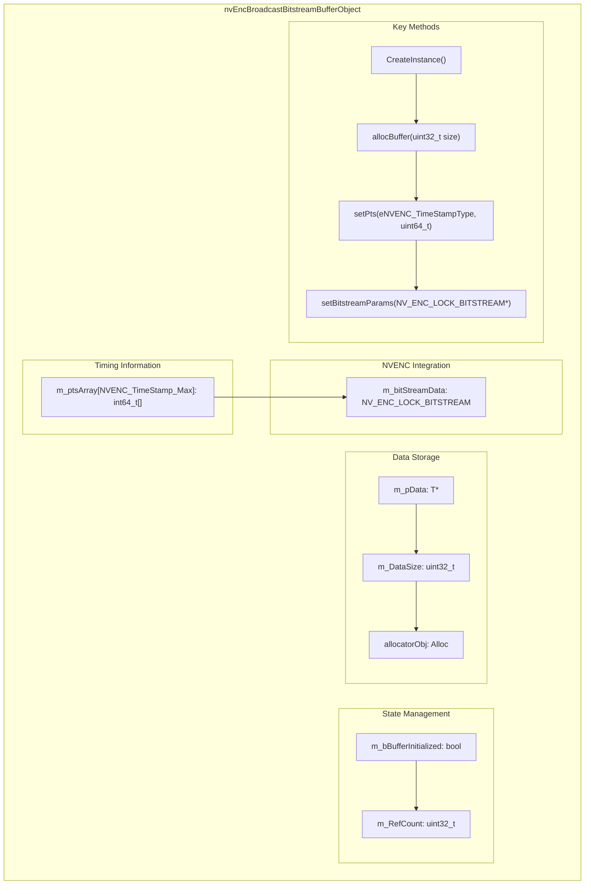
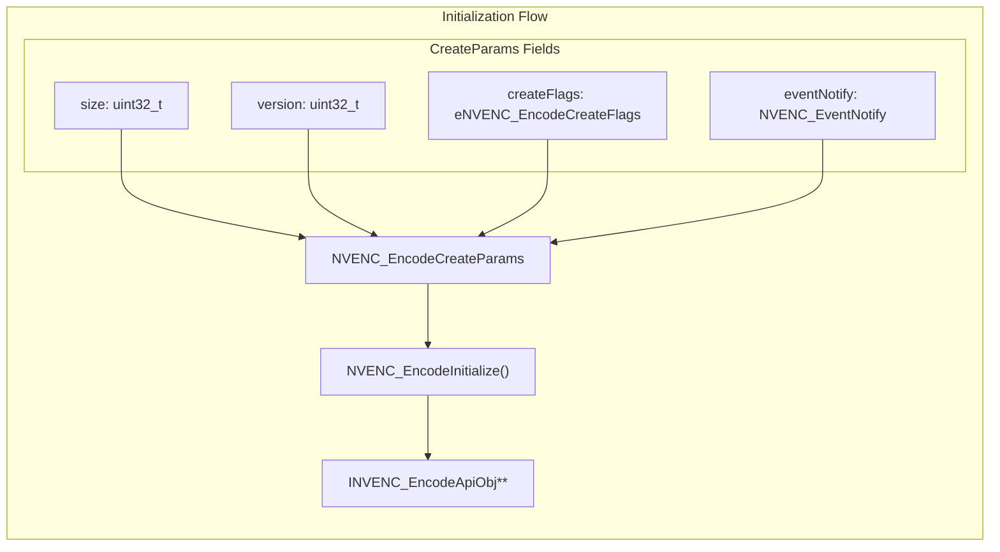

<!-- source: DeepWiki mcp.deepwiki.com · repo NVIDIA/video-sdk-samples · page 3.2 Broadcast Encoding API · fetched 2026-10-26 -->

# Broadcast Encoding API

Relevant source files

The following files were used as context for generating this wiki page:

- [nvEncBroadcastSample/nvEnc/api/nvEncBroadcastEncodeApi.h](nvEncBroadcastSample/nvEnc/api/nvEncBroadcastEncodeApi.h)
- [nvEncBroadcastSample/nvEnc/nvEncCore/NvEncBroadcastBitstreamBuffer.h](nvEncBroadcastSample/nvEnc/nvEncCore/NvEncBroadcastBitstreamBuffer.h)
- [nvEncBroadcastSample/nvEnc/nvEncCore/NvEncBroadcastBitstreamBufferInst.h](nvEncBroadcastSample/nvEnc/nvEncCore/NvEncBroadcastBitstreamBufferInst.h)

## Purpose and Scope

The Broadcast Encoding API provides a high-level, object-oriented interface for GPU-accelerated video encoding using NVIDIA's NVENC hardware encoder. This API abstracts the complexity of the low-level NVENC hardware API and provides simplified parameter structures, automatic resource management, and integrated bitstream handling specifically designed for broadcast applications.

This documentation covers the API interfaces, parameter structures, and bitstream management components. For information about DirectX interoperability layers that work with this API, see [DirectX Interoperability](#3.1). For details about the underlying NVENC hardware API, see [NVENC Hardware API](#4.1).

## API Architecture

The Broadcast Encoding API is organized around two primary abstract interfaces that define the encoding workflow: `INVENC_EncodeApiObj` for encoder management and `INVENC_EncodeBitstreamBuffer` for output data handling.

Sources: [nvEncBroadcastSample/nvEnc/api/nvEncBroadcastEncodeApi.h:331-403]()

## Core Interfaces

### INVENC_EncodeApiObj Interface

The `INVENC_EncodeApiObj` class serves as the primary encoder interface, managing the complete encoding lifecycle from initialization through finalization.

| Method | Purpose | Parameters |
|--------|---------|------------|
| `initialize()` | Initialize encoder with frame and encoding parameters | `NVENC_EncodeInitParams*`, `NVENC_EncodeSettingsParams*` |
| `createBitstreamBuffer()` | Create a buffer for encoded output | `INVENC_EncodeBitstreamBuffer**` |
| `encode()` | Encode a single frame | `NVENC_EncodeInfo*`, `INVENC_EncodeBitstreamBuffer*` |
| `getSequenceParams()` | Retrieve sequence parameter set | `INVENC_EncodeBitstreamBuffer*` |
| `finalize()` | Complete encoding and flush remaining frames | `INVENC_EncodeBitstreamBuffer*` |
| `isInitalized()` | Check initialization status | None |
| `releaseObject()` | Release encoder resources | None |

Sources: [nvEncBroadcastSample/nvEnc/api/nvEncBroadcastEncodeApi.h:336-365]()

### INVENC_EncodeBitstreamBuffer Interface

The `INVENC_EncodeBitstreamBuffer` class provides access to encoded bitstream data with integrated timestamp and metadata management.

| Method | Purpose | Return Type |
|--------|---------|-------------|
| `isInitalized()` | Check buffer initialization status | `bool` |
| `release()` | Release buffer resources | `eNVENC_RetCode` |
| `recycle()` | Prepare buffer for reuse | `eNVENC_RetCode` |
| `isKeyFrame()` | Check if current packet is a keyframe | `bool` |
| `getPts()` | Get presentation or decoding timestamp | `uint64_t` |
| `getBitStreamBuffer()` | Access raw bitstream data | `uint8_t*` |

Sources: [nvEncBroadcastSample/nvEnc/api/nvEncBroadcastEncodeApi.h:301-328]()

## Encoding Parameter Structures

### Initialization Parameters

The API uses a structured approach to encoding configuration, separating frame properties from encoding settings.

Sources: [nvEncBroadcastSample/nvEnc/api/nvEncBroadcastEncodeApi.h:176-285]()

### Rate Control Modes

The API supports three primary rate control strategies:

| Mode | Enum Value | Description |
|------|------------|-------------|
| Variable Bitrate | `NVENC_EncParams_RC_VBR` | Allows bitrate to vary while maintaining target average |
| Constant Bitrate | `NVENC_EncParams_RC_CBR` | Maintains steady bitrate output |
| Constant Quality | `NVENC_EncParams_RC_CONSTQUAL` | Prioritizes visual quality over bitrate consistency |

Sources: [nvEncBroadcastSample/nvEnc/api/nvEncBroadcastEncodeApi.h:186-192]()

### Profile and Level Support

The API provides comprehensive support for H.264 and HEVC encoding standards:

| Profile Type | Available Options |
|--------------|-------------------|
| H.264 Profiles | Baseline, Main, High, Auto |
| H.264 Levels | 1.0 through 5.2 |
| HEVC Levels | 1.0 through 6.2 |
| Encoding Presets | Fast, Fastest, Medium/Default, Slow |

Sources: [nvEncBroadcastSample/nvEnc/api/nvEncBroadcastEncodeApi.h:197-253]()

## Buffer Management System

### Buffer Type Hierarchy

The API supports multiple buffer types and graphics API integration through a unified buffer information structure.

Sources: [nvEncBroadcastSample/nvEnc/api/nvEncBroadcastEncodeApi.h:140-161]()

### Encode Information Structure

Each encoding operation uses `NVENC_EncodeInfo` to package frame data with timing information:

| Field | Type | Purpose |
|-------|------|---------|
| `bufferInfo` | `NVENC_BufferInfo` | Frame buffer details and format |
| `pts` | `int64_t` | Presentation timestamp |
| `reserved` | `uint32_t[4]` | Reserved for future use |

Sources: [nvEncBroadcastSample/nvEnc/api/nvEncBroadcastEncodeApi.h:166-171]()

## Bitstream Buffer Implementation

### Template-Based Buffer Object

The `nvEncBroadcastBitstreamBufferObject` class provides a template-based implementation of the `INVENC_EncodeBitstreamBuffer` interface with configurable memory allocation strategies.

Sources: [nvEncBroadcastSample/nvEnc/nvEncCore/NvEncBroadcastBitstreamBuffer.h:30-101]()

### Buffer Lifecycle Management

The bitstream buffer supports reference counting and recycling for efficient memory management:

| Operation | Method | Description |
|-----------|--------|-------------|
| Creation | `CreateInstance()` | Static factory method for buffer instantiation |
| Initialization | `initialize()` | Prepare buffer for use |
| Data Access | `getBitStreamBuffer()` | Retrieve pointer to encoded data |
| Timestamp Query | `getPts()` | Get frame timing information |
| Recycling | `recycle()` | Reset buffer for reuse |
| Cleanup | `release()` | Deallocate resources |

Sources: [nvEncBroadcastSample/nvEnc/nvEncCore/NvEncBroadcastBitstreamBuffer.h:89-101](), [nvEncBroadcastSample/nvEnc/nvEncCore/NvEncBroadcastBitstreamBufferInst.h:25-39]()

## API Initialization and Error Handling

### Error Code System

The API uses a comprehensive error code enumeration for detailed error reporting:

| Category | Error Codes | Description |
|----------|-------------|-------------|
| Success | `API_SUCCESS` | Operation completed successfully |
| Parameter Errors | `API_ERR_INVALID_PARAMETERS`, `API_ERR_INVALID_VER` | Invalid input parameters or version mismatch |
| State Errors | `API_ERR_UNINITIALIZED`, `API_ERR_ALREADY_CREATED` | Incorrect API usage sequence |
| Resource Errors | `API_ERR_OUT_OF_MEMORY`, `API_ERR_INSUFFICIENT_BUFFER` | Memory or buffer allocation failures |
| Feature Errors | `API_ERR_UNSUPPORTED`, `API_ERR_NO_IMPLEMENTATION` | Unsupported features or missing implementation |
| Operational | `API_ERR_XCODE_FAIL`, `API_PENDING` | Encoding failures or asynchronous operations |

Sources: [nvEncBroadcastSample/nvEnc/api/nvEncBroadcastEncodeApi.h:42-59]()

### Initialization Function

The primary entry point `NVENC_EncodeInitialize` creates encoder instances with specified configuration:

Sources: [nvEncBroadcastSample/nvEnc/api/nvEncBroadcastEncodeApi.h:382-395]()

---

